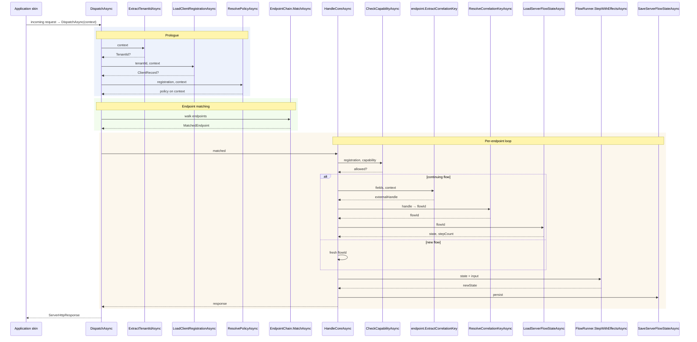
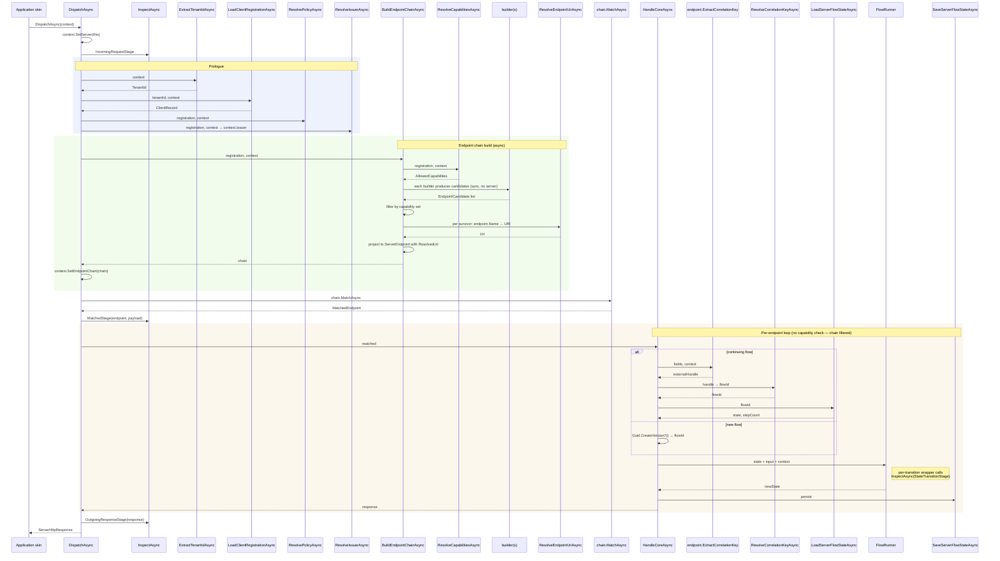

# Verifiable.OAuth — AuthorizationServer Design Notes

This is a living document. Decisions, scale assumptions, and open questions accumulate here as they surface in design discussion. Polish later. The goal is to keep architectural reasoning in one place so future work composes against a stable picture rather than re-deriving the picture each time.

For decisions that have settled into the codebase as committed architectural choices, see the `/documents/ADRs/` folder. This document is upstream of those — a working surface for thinking, not a record of finalised decisions.

---

## 1. Scale assumptions

The AS is designed for **agents-ready** throughput: millions of concurrent agents, including agents that may themselves run the AS. The deployment shape ranges from a single in-process AS for an embedded credential flow to a horizontally-scaled multi-region cluster handling autonomous-agent traffic.

The key consequence: **per-call certainty**, not statistical rarity. Every per-request operation must be deterministic-by-construction. "Rare" doesn't exist at scale. Two examples that illustrate the principle:

- A 64-bit random field with birthday collision at ~4 billion sounds safe in isolation. At millions of issuances per second it collides within an hour. Random fields used in any per-request artefact (nonces, jti values, opaque token bodies) need ≥128 bits when they're protecting freshness against an active attacker, or at least 96 bits when collision resistance is the only concern.
- A `kid` lookup taking 200 nanoseconds is fine alone. Multiplied across every request from millions of agents it's a bottleneck. Key resolvers must support in-process caching on the hot path; the library documents this expectation but cannot enforce it because the backend is the application's choice.

**Corollary on storage:** the per-request volume profile of some operations (DPoP JTI replay, RFC 9421 signature replay, attestation replay) is orders of magnitude higher than the per-flow volume of user-initiated handles (request_uri, code, device_code). Both go through the same storage abstraction; the application's backend choice (Redis cluster, Orleans grain, in-memory cache, signature-only stateless) absorbs the difference.

---

## 2. Pipeline overview

A request flows through three layers in order: **request prologue** (tenant, registration, policy), **endpoint chain** (matching), **per-endpoint loop** (state load → step → save). Every transition has a named typed delegate; the application wires the delegates, the library composes them.

The two diagrams below show the pre-9h current state and the post-9h future state. The 9h refactor's net effect: every per-call decision flows through a named typed delegate on `AuthorizationServerIntegration`; every per-call resolved value lives on `ExchangeContext`; every consumer reads from one source of truth. Inspection hooks at four well-defined points enable audit, telemetry, and security-event emission without library code changes.

#### Pre-9h current state

#### Post-9h future state

### 2.1 Prologue stage

| Delegate | Returns | Purpose |
|---|---|---|
| `ExtractTenantIdAsync` | `TenantId?` | Application reads tenant from whichever request signal identifies it (URL segment, subdomain, header, claim). Null → `400 invalid_request`. |
| `LoadClientRegistrationAsync` | `ClientRecord?` | Application loads the registration for the tenant. Null → `404`. Result stamped on `context.Registration`. |
| `ResolvePolicyAsync` | (writes to context) | Resolves per-request `PolicyProfile` and related policy state onto the context. Downstream code consults via typed `ExchangeContext` extensions. |

All three are required in every serving composition. Applications wire construction seams and request serving changes through the drained, candidate-validated operation in [Live configuration](#41-live-configuration).

### 2.2 Endpoint chain stage

`EndpointChain.MatchAsync` walks every registered endpoint's `MatchesRequest` until one returns a non-null `MatchPayload`. Endpoints are registered via `EndpointBuilders` (`AuthCodeEndpoints.Builder`, `Oid4VpEndpoints.Builder`, `MetadataEndpoints.Builder`, `RegistrationEndpoints.Builder`). Application chooses which builders to include.

`EndpointBuilders` is also the app-facing extension seam for *new* endpoints — including ones the library does not ship. `EndpointBuilderDelegate` and `EndpointCandidate` are public, and the library's own flows are nothing more than builders in this same set, so adding an endpoint is uniform regardless of author:

- **A new standard RFC endpoint** (e.g. RFC 7009 revocation, Global Token Revocation, RP-Initiated Logout) is shipped in the library as one builder-produced `EndpointCandidate` plus, where it needs an application decision, one named slot on `AuthorizationServerIntegration` (e.g. `RevokeTokenDelegate`). The chunk is small and shaped like every other endpoint; the library owns the wire and conformance-tests it.
- **A proprietary or experimental endpoint** an application needs can be authored entirely application-side: register a custom builder returning a custom `EndpointCandidate` with its own `MatchesRequest` / `BuildInputAsync` / `BuildResponse`. The candidate reaches application state through the `ExchangeContext` it is handed, not through a new integration slot (the sealed `AuthorizationServerIntegration` bundle is library-defined). No fork is required.

This is the same boundary that governs signals: the library owns the standard wire and the decision *seam*; the application owns the decision and any proprietary translation. A brand-new RFC that drops mid-cycle is therefore an additive chunk — a builder plus, optionally, a delegate slot — not a pipeline rewrite.

### 2.3 Per-endpoint loop stage

The capability filter (the registration allows this endpoint's capability and, when the composition declares its capabilities, the declaration names it) selects the candidate set
in `EndpointChain.BuildForRequestAsync`, at chain-build time, before matching, before
`Integration.MaterializeRegistrationAsync` runs, and before `HandleCoreAsync` is ever entered — a
capability-filtered candidate never reaches the loop below. `Integration.MaterializeRegistrationAsync`,
when wired, then updates `context`'s registration from the wire `client_id`, so every step below
sees the materialized record.

The materialized record is the one the request is judged by. For a record of the loaded
registration's type, policy and issuer are resolved again for it, with every entry the loaded
registration's policy resolution wrote first returned to the value the request arrived with, or removed
when the request arrived without it, so the materialized record's resolution starts from the request's
arriving state and a policy axis its profile does not set reads the arriving value or its strict
default. The set the request is served under (`server.resolvedCapabilities`) is the dispatcher's entry,
written by its chain build after the loaded registration's policy resolution, and no policy entry: the
policy restore of a materialized judgement leaves it in place, whatever the policy resolution did under
that name. The judgement of a materialized record needs that set: a context that holds under that name
no entry the library wrote for that context, once the materialized record's policy and issuer are
resolved, is answered as a record of another type is, `500` `server_error` with the fault on the
dispatch activity, and is never held to an empty bound. For a record of the loaded registration's type
that is another reference, its capabilities are resolved through `ResolveCapabilitiesAsync` whenever the
context holds that set, whether the chain is kept or built again, and held to the bound: the set resolved
for the loaded registration that both records allow. The set the chain build stores on the context is the
library's immutable copy of the resolution: it is made by walking the bound, or without one the
registration's own allowed capabilities, and asking the answer for each capability, never from the
answer's own subset test or enumeration. A capability resolution can only narrow what the registration
allows. The readers listed below act on that set, so an answer that held a capability beyond the
registration's would widen what they do, which reading the record could not; the walk leaves such a
capability out of the set. What the library holds of that set: its own pipeline cannot widen it, since
it is the library's immutable copy and a capability resolution and a materialization can only narrow
it; no public member replaces it; the chain build stores it in the context entry named
`server.resolvedCapabilities` inside an entry of the library's own that records the context it was
written for, so a value under that name that is not the library's own entry for the context read, an
entry carried from another request's context included, reads as no set, and a reader of no set allows
no capability; and the public `EndpointChain.BuildForRequestAsync` refuses a context that already
carries a set, while the dispatcher builds through the internal `BuildBoundedForRequestAsync`. Code that
holds a request's context is the application: it can replace the context's registration and endpoint
chain through their public setters, and it answers for what it stores in the context. The bound and the
check that keeps the chain read that copy and ask the materialized record's answer for each capability,
so an answer the application changes after handing it back, or whose own subset test reaches beyond the
bound, adds nothing. The chain is built again for the materialized record
(`EndpointChain.BuildBoundedForRequestAsync`) when it does not allow every capability the loaded
registration allows, when its policy resolution leaves a policy entry at another
value than the loaded registration's resolution left it, or when its resolved capabilities held to the
bound are fewer than those resolved for the loaded registration; the resolved set and the chain are then
stashed again and the request is matched again, and a rebuild that follows the resolution of a record
keeping every capability is handed that answer, so the resolution is asked once for the loaded and once
for the materialized record. Otherwise the chain built for the loaded registration and its resolved set
are kept, and a kept chain is the loaded registration's in every input: its capability resolution, its
endpoint addresses and whatever else its builders read of the registration. A resolution that answers
more than the bound is held by it; a resolution that throws for the materialized record leaves the
dispatch as one that throws for the loaded registration does, with no answer of the library's.
A materialization may narrow the capabilities: a capability it removes is answered exactly as one the
registration never held (a request no candidate matches answers the dispatcher's `404`; a grant the
client lost answers the token endpoint's `unauthorized_client`). A policy change alone builds the chain
again because the endpoint builders read the per-request policy as they build their candidates: the
authorization endpoint's candidate takes the pushed-authorization requirement into its claim of a
request that names no reference and into the error it answers an unresolved reference with. Whenever
the chain is built again, the match-decision inspection runs again for the decision that is executed,
before it is executed, so a request's last announced decision is the one executed (`MatchedStage`), and
a request no endpoint matches carries no trace of the first match on the context or the dispatch
activity. A materialization never widens the capabilities or the chain: the set resolved for the
materialized record is held to the bound, and the chain built again is held to the endpoints of the
chain built for the loaded registration, each identified by its name, HTTP method and flow kind
together, an endpoint that chain lacks being dropped and recorded as capability-filtered. Each
capability a materialization adds is absent from the resolved set and is recorded as
`ServerEventNames.MaterializedCapabilityDropped`, and a candidate a builder's gate admits for it, a gate
that reads two capabilities while its candidate carries one, is dropped unless the loaded chain holds an
endpoint of that same name, HTTP method and flow kind. A name alone does not identify an endpoint: an
application's builder may yield candidates that share a name across HTTP method or flow kind, one of
them behind such a gate, and a name bound would admit the gated one where the loaded chain holds only
the other. The capability is held by the capability bound and is not part of the identity, since the
token endpoint's grant-type refusal takes its capability from the resolved set and stays under a kept
one when a materialization removes the one it carried or adds one ahead of it.

The readers that act on a capability read the bounded set, the resolved set the chain build writes on
the context (`ResolvedCapabilities`) before it calls any builder, not the record: the token endpoint's
module (the grants it registers, which its grant-type refusal declines, and the capability the refusal
carries), the two request-object gates (a pushed request carrying a request object and an authorization
request carrying one by value, each reading a second capability beside the one its candidate carries),
the end-session back-channel logout fan-out, the discovery document's `backchannel_logout_supported`,
`backchannel_logout_session_supported` and `client_id_metadata_document_supported`, the federation
entity configuration's `client_registration_types_supported`, and the shared signals challenge's
`resource_metadata`. Each of these reads, on a context that carries no resolved set, allows nothing. So
a capability a materialization adds, and a capability the capability resolution withholds with no
materialization at all, is answered
by each of them as one the registration never held: a grant the materialization adds and the server
serves answers `unauthorized_client`, and a capability added ahead of every kept one in the order the
refusal takes its capability from leaves the refusal under a kept one, so a missing `grant_type`, a
grant the server does not serve and the added grant answer `invalid_request`, `unsupported_grant_type`
and `unauthorized_client`. The builder gates that admit a candidate on the capability that candidate
itself carries read the record's own capabilities, and that changes no answer: the chain's capability
filter drops a candidate whose capability is outside the resolved set, so such a gate can only admit a
candidate the filter then holds, and `EndpointChain.CapabilityFilteredCandidateNames` names it among the
dropped. An application's builder or endpoint that reads the record's own capabilities for anything
beyond the candidate it gates reads the materialized record's and is held by the endpoint bound only.
One reader stays on the loaded record, a limit of the library: the client ID metadata materialization
(`ClientIdMetadataMaterialization`) decides whether to fetch the client's document from the loaded
record's `OAuthClientIdMetadataDocument` capability. The resolved set is on the context when it runs,
but it does not read it, so a capability resolution that withholds that capability does not stop the
fetch, while the discovery document served under that resolution does not advertise
`client_id_metadata_document_supported`. The registration management endpoints read and write the
registration as stored, not the materialized record (Section 8, the registration management entry).

A record of another type than the loaded one is a fault of the application's wiring whatever its
capabilities: no endpoint runs over it, and it is answered `500` `server_error` with the description the
library answers a fault of the server's own wiring with (`WellKnownOAuthErrorDescriptions.ServerNotReady`)
and the fault on the dispatch activity. That answer and a failure the materialization answers are sent
without the announced endpoint running, the context carrying the capability of the endpoint the request
matched.
- Proven over the listener by `IdJagGrantTests.AMaterializationThatNarrowsAwayTheTokenExchangeIsUnauthorizedClient`,
  `AMaterializationThatNarrowsAwayTheIdJagCapabilityMintsNothing`,
  `AMaterializationThatAddsACapabilityServesNothingItAddsAndRecordsItAsync`,
  `ACapabilityTheMaterializationChangesIsAnsweredAsOneNeverHeldAsync` (removed or added: no token-serving
  capability left, another kept, a grant the server does not serve, one removed and a served grant
  added, and a capability added ahead of every kept one with a missing `grant_type`, an unserved grant
  and the added grant, each compared byte for byte with a registration that never held it, with the
  match decisions announced),
  `AGrantTheCapabilityResolutionWithholdsIsAnsweredAsOneNeverHeldAsync`,
  `TheRefusalsCapabilityTheResolutionWithholdsIsAnsweredAsOneNeverHeldAsync` (the first token-serving
  capability withheld, a request without `grant_type` answered `invalid_request` as never held),
  `AGrantTheMaterializationRemovesIsRefusedAndTheRefusalIsAnnouncedAsync`,
  `ACandidateOfALoadedEndpointsNameUnderAnotherMethodOrFlowKindIsNotRunAsync` (a composed builder's
  second candidate of a loaded endpoint's name by another HTTP method, or of another flow kind, behind a
  gate that reads a second capability),
  `AnEndpointOnlyAnAddedCapabilityAdmitsIsNotRunAsync`,
  `ARequestObjectTheCapabilityResolutionWithholdsIsAnsweredAsOneNeverHeldAsync` (by value and pushed),
  `APolicyAxisTheMaterializedProfileDoesNotSetReadsItsStrictDefaultAsync`,
  `AnEntryTheLoadedProfileOverwroteReadsTheValueTheRequestArrivedWithAsync`,
  `AProfileTheMaterializationChangesAnswersAsTheProfileHeldFromTheStartAsync`,
  `AMaterializedRecordOfAnotherFamilyIsAServerErrorAsync` (the description read from the wire),
  `AMaterializedRecordOfAnotherFamilyKeepingEveryCapabilityIsAServerErrorAsync`,
  `TheMaterializedRecordsPolicyAndIssuerServeTheRequestAsync` and
  `AMaterializationThatChangesNoCapabilityBuildsOneChainAsync` (one chain build, two resolutions), by
  `ResolveCapabilitiesAsyncTests.AMaterializedResolutionBeyondTheLoadedResolutionAddsNoEndpointAsync`,
  `TheRequestCarriesTheBoundedResolutionOfAMaterializedRegistrationAsync`,
  `AMaterializationKeepingEveryCapabilityIsResolvedUnderTheBoundAsync` (exactly two resolutions),
  `AResolutionThatNarrowsTheSetItHandedBackIsHeldToItsSecondAnswerAsync` (one mutable set handed back by
  both resolutions and narrowed between them: discovery answered as never held),
  `AnAnswerClaimingToBeWithinTheBoundIsHeldToTheBoundAsync` (an answer whose subset test claims every set:
  the stored set holds nothing outside the bound) and
  `AResolutionThatThrowsForTheMaterializedRegistrationFaultsAsForTheLoadedOneAsync` (answered byte for byte
  as a resolution that throws for the loaded registration, the fault recorded once),
  `AResolutionBeyondWhatTheRegistrationAllowsAddsNothingAsync` (a resolution that answers the token
  exchange capability the registration does not allow, with no materialization: the token endpoint
  answered byte for byte as under a resolution of what the registration allows, `404`, and the stored
  set holding the registration's capabilities alone),
  `ASetAnApplicationWritesUnderTheResolvedCapabilitiesEntryServesNothingAsync` (a materialization that
  stores its own set under `server.resolvedCapabilities`, holding back-channel logout, and answers the
  registration it was given, the capability withheld by the resolution or not allowed by the registration:
  the discovery document answered byte for byte as at a registration that never held it, and no set read),
  `AResolvedCapabilitiesEntryCarriedFromAnotherRequestServesNothingAsync` (the library's entry of a request
  under back-channel logout, read by its outgoing inspection and stored by the materialization of a
  request whose registration does not allow it: answered byte for byte as under a set of the
  application's own, and no set read),
  `APublicChainBuildOnTheRequestsContextWidensNothingAsync` (a materialization that calls the public chain
  build on the request's context with its registration widened by back-channel logout: `500`, the one
  fault an `InvalidOperationException`, and no part of the answer carrying the capability),
  `ASecondPublicChainBuildOnOneContextIsRefusedAsync` (the public chain build again on one context
  refused, on a fresh context built),
  `APolicyResolutionBuildingAChainInEachCallIsRefusedInItsSecondCallAsync` (a capability resolution that
  narrows the loaded registration, a policy resolution that calls the public chain build on the
  request's context in each of its calls and a materialization of every capability: the second build
  refused, `500`, the one fault the refusal, and no part of the answer carrying the narrowed capability),
  `AValueThePolicyResolutionStoresUnderTheServedSetsNameLeavesTheServedSetAsync` (a policy resolution that
  stores a set of its own under `server.resolvedCapabilities` in its first call: answered byte for byte as
  without that write, the served set in place),
  `AnEntryThePolicyResolutionWritesForTheLoadedRegistrationIsRemovedForTheMaterializedOneAsync` (an entry
  of the policy resolution's own name written in its first call is absent as its second call runs and as
  the answer leaves, and the document is answered byte for byte as without the write),
  `APolicyResolutionRemovingTheServedSetInItsSecondCallIsAServerFaultAsync` and
  `APolicyResolutionReplacingTheServedSetInItsSecondCallIsAServerFaultAsync` (a materialization of the
  loaded capabilities, a capability resolution that withholds discovery from it and a policy resolution
  whose second call removes the entry or stores a set of its own under its name: `500`, the one fault an
  `InvalidOperationException` on the request's trace) and
  `APolicyResolutionLeavingTheServedSetHoldsTheMaterializedRegistrationToItAsync` (the same with the entry
  left alone: the chain built again, `404`, the JWKS capability alone served), and, each in the two forms
  (a materialization that adds the capability; a capability resolution that withholds it) compared with a
  registration that never held it, by
  `EndSessionLogoutTests.ABackChannelLogoutOutsideTheServedCapabilitiesIsNotDeliveredAsync`,
  `DiscoveryEndpointTests.ADiscoveryMemberOutsideTheServedCapabilitiesIsNotAdvertisedAsync`,
  `FederationEntityConfigurationEndpointTests.ARegistrationTypeOutsideTheServedCapabilitiesIsNotListedAsync`
  (the signed statement's complete decoded claims, the key identifier and coordinates each registration
  generates replaced) and
  `SsfStreamManagementEndpointTests.TheChallengeNamesNoResourceMetadataOutsideTheServedCapabilitiesAsync`
  (the whole answer).

`HandleCoreAsync` runs an 8-step state-machine loop:

1. The endpoint's own pre-correlation step (`endpoint.BeforeCorrelationAsync`), when set — the
   endpoint's own check needing only the request, the materialized registration, and the server,
   run before either a flow is created or any stored record is correlated or loaded. A stateless
   or new-flow endpoint runs it here, first; a continuing-flow endpoint runs it after its own
   handle-presence refusal (below) has found a handle present. Every check it makes is
   request-only, so it is identical for a caller naming a handle that does not correlate to
   anything and one naming a live handle whose own checks fail the same way — but the identical
   answer rests on what each check reads, not on a shared constant every step answers "by
   construction": the code-redemption and refresh-token steps answer identification, the
   `code_verifier`'s (or nothing's) absence, and a resolver fault or decline through
   `endpoint.HandleNotFoundError` / `endpoint.HandleNotFoundErrorDescription` (falling back to
   the grant's own constant when the endpoint sets neither); a malformed `code_verifier`
   answers its own distinct `invalid_grant` "PKCE verification failed." (the grammar, not the
   endpoint's identity, decides that body); declared client authentication answers its own
   `invalid_client` untranslated; and the request-only half of DPoP validation answers its own
   nonce challenge or `invalid_dpop_proof`. The `request_uri` completion's step answers two
   literal bodies of its own ("Missing client_id."; the registration-identification comparison),
   never an endpoint constant. This step is the one place in the loop that runs for a handle that
   does not exist BY DESIGN, and it may therefore consume single-use authentication material — a
   client assertion's or a DPoP proof's `jti`, a nonce — before any stored record is ever reached;
   see the consumption sentence on `BeforeCorrelationDelegate`'s own remarks and §5's
   cryptography-before-storage ordering this step exists to serve.
2. Stateless short-circuit (no state to load/save).
3. Get current state — either generate fresh `flowId` for new flows, or extract external handle → resolve correlation key → load state.
4. Stamp verified-at on context.
5. `endpoint.BuildInputAsync` produces typed input or early-exit response.
6. `FlowRunner.StepWithEffectsAsync` advances the PDA.
7. `endpoint.BuildResponse` produces the response.
8. Persist via `SaveServerFlowStateAsync`.

Step 8 is where the application's `SaveServerFlowStateAsync` lambda pattern-matches on state type to update secondary indexes for the next step's correlation lookup. This is how `request_uri`, `code`, `device_code`, and `(issuer, jti)` all get their lookup paths — same delegate, application-side discrimination.

### 2.4 Replay determinism

The PDA's state-step transitions are deterministic given identical inputs.
The `Save/LoadServerFlowStateAsync` shape captures state snapshots, not the
input log; replay against the persisted state stream reconstructs "what
the state was at each step", but re-running an action (e.g. a DPoP-proof
JTI lookup) against external state that has since changed could produce a
different action-result and therefore a different next state.

For deployments that need strict deterministic replay — forensic
reconstruction, long-trace property-based testing — the per-step
`(before-state, input, action-results, after-state)` tuple is the right
artefact to capture. The `InspectAsync(StateTransitionStage)` hook
introduced in phase 9h is the natural emission point; the deployment's
inspector lambda records each tuple into whatever event store the
forensic trail uses. The library's storage abstraction does not bake
this in — replay determinism is a deployment concern, not a library
invariant.

---

## 3. Layered delegate model

Every integration point falls into one of three layers. Each layer composes the layer below it.

### Bottom layer: storage delegates

The universal storage contract. Backend-agnostic by design.

| Delegate | Shape |
|---|---|
| `LoadServerFlowStateDelegate` | `(tenantId, correlationKey, context, ct) → (OAuthFlowState?, stepCount)` |
| `SaveServerFlowStateDelegate` | `(tenantId, correlationKey, state, stepCount, context, ct) → void` |
| `ResolveCorrelationKeyDelegate` | `(tenantId, flowKind, externalHandle, context, ct) → flowId?` |
| `LoadClientRegistrationDelegate` | `(tenantId, context, ct) → ClientRecord?` |

The application's implementation chooses the backend: Redis, Orleans, in-memory, signature-only stateless, distributed K/V, hybrid layered cache + persistent store. The library's contract is intentionally agnostic — different SLO regimes (single-instance demo vs millions of agents) use radically different backends behind the same delegate signatures.

### Middle layer: cryptographic primitive delegates

Tagged primitives routed through `CryptographicKeyFactory` registry and dispatched via `CryptographicKeyEvents`. Backends (`Verifiable.Microsoft`, `Verifiable.BouncyCastle`, `Verifiable.Libsodium`, future `Verifiable.Tpm`) provide concrete implementations.

| Delegate | Purpose |
|---|---|
| `ComputeDigestDelegate` | Hash of arbitrary `ReadOnlySequence<byte>` input. |
| `ComputeHmacDelegate` | Keyed hash; symmetric MAC. |
| `VerifyHmacDelegate` | Recompute-and-compare MAC verification. |
| `SigningDelegate` | Asymmetric signature production. |
| `VerificationDelegate` | Asymmetric signature verification. |

Key resolution sits alongside the primitives and uses a unified slot model across signing and HMAC. Rotation policy lives in a `KeySet` (slots: `Incoming`, `Current`, `Retiring`, `Historical`) — `Incoming` is pre-published but not yet used for issuance; `Current` is active; `Retiring` is not used for issuance but still accepted for verification; `Historical` is archived (not verifiable, not published). The signing-side equivalent is the existing `SigningKeySet` per `ClientRecord.SigningKeys[usage]`; the HMAC-side `KeySet` (non-generic, lives at integration level) and its in-process default `InProcessKeySet` both store `KeyId` per slot. Material loading is decoupled from rotation.

Selection and byte-loading are separate delegates:

| Role | Signing | HMAC |
|---|---|---|
| Slot store | `SigningKeySet` (per `KeyUsageContext`) | `KeySet` (non-generic, stores `KeyId` per slot) |
| Selector | `SelectSigningKeyDelegate` → `KeyId` | `SelectHmacKeyDelegate` → `KeyId?` |
| Byte-loader (private) | `ServerSigningKeyResolverDelegate(KeyId, TenantId, …) → PrivateKeyMemory?` | `ResolveServerHmacKeyDelegate(KeyId, TenantId, …) → SymmetricKey?` |
| Byte-loader (public) | `ServerVerificationKeyResolverDelegate(KeyId, KeyUsageContext, TenantId, …) → PublicKeyMemory?` | (not applicable — symmetric) |
| Material type | `PrivateKeyMemory` / `PublicKeyMemory` | `SymmetricKey` |
| Publishable in JWKS | Always (`Incoming + Current + Retiring`) | Opt-in per keyset; renders as `kty=oct` per RFC 7518 §6.4 |

The signing side stores `KeyId` per slot and loads material lazily via the byte-loader — HSM/KMS-friendly by construction. The HMAC in-process default holds a `Dictionary<KeyId, SymmetricKey>` side store alongside the slot tracker (`InProcessKeySet`); an HSM-backed HMAC deployment would wire a different byte-loader and reuse the same slot model.

All byte-loaders take `(KeyId, TenantId, ExchangeContext, CancellationToken)`; the public-key loader also takes the `KeyUsageContext` the key is expected under, right after the `KeyId` (the slot of the token or artefact verified or published: `AccessTokenIssuance` for access tokens at UserInfo and at a resource server, `IdTokenIssuance` for an `id_token_hint` and at a relying party, `JarSigning` for a request object, `FederationEntitySignature` for the entity configuration's `jwks`, and the set a discovery algorithm list derives from), and answers `null` for a key it does not hold for that usage. Where the library holds the registration's key sets, its own slot admission runs first, so the usage narrows what a resolver verifies and never widens it. `TenantId` is threaded for application convenience — it lets the resolver shard by tenant first before looking up by kid within the tenant. Applications that don't need per-tenant isolation ignore the parameter. Selection happens upstream; byte-loaders perform no rotation logic, no selection logic, no slot-membership gating. Verifiability-by-slot is checked separately, before the byte-loader runs: the HMAC side checks `KeySet.IsKidValidForVerification(KeyId)`; the public-key side runs `IssuedKeyAdmission` over the registration's key set for the usage (`ClientRecord.SigningKeys[usage]`) where the library holds the sets and meets a presented `kid` (UserInfo, the OpenID for Verifiable Credential Issuance endpoints, end-session), and reads the key id from the registration's slot elsewhere (a request object, the entity configuration, discovery). At a resource server and at a relying party the library holds no key sets, the header key identifier goes straight to the application's resolver under the usage, and the resolver's answering nothing for a key it does not hold under that usage is the only key gate there.

`ServerDecryptionKeyResolverDelegate` continues to return `PrivateKeyMemory?` for OID4VP encrypted-payload decryption; it's a per-key lookup without the rotation surface (no current decryption kid selection beyond the registration-time-bound `ClientRecord.EncryptionKeyId`).

### Top layer: application integration delegates

Application-shaped integration points that compose the layers below.

| Delegate | Composes |
|---|---|
| `ExtractTenantIdAsync` | (no lower-layer composition; pure request inspection) |
| `ResolvePolicyAsync` | Reads from registration, writes to context |
| `ParseClientMetadataServerDelegate` | Application's JSON layer; inbound RFC 7591/7592 body parsing |
| `ValidateRegistrationAccessTokenDelegate` | Comparison against application's stored credential form |
| `IssueDpopNonceDelegate` (planned, DPoP) | Composes `ComputeHmacAsync` + `ResolveServerHmacKey` + random + time |
| `ValidateDpopNonceDelegate` (planned, DPoP) | Composes `ComputeHmacAsync` + `ResolveServerHmacKey` |
| `ValidateDpopProofDelegate` | Composes `VerificationDelegate` + `ComputeDigestAsync` + replay-check via `Load/SaveServerFlowState` |
| `ResolveSubjectTrustChainDelegate` | Composes the federation entity-statement fetch and `VerificationDelegate` chain validation the application's own resolver performs, answering a `FederationResolveOutcome` |
| `ResolveIssuerKeyDelegate` | Composes `JwtVcIssuerMetadataDocuments` (JWT VC Issuer Metadata) or `SdJwtX5cTrustResolver` (Inline X.509 Certificates), or the application's own trust framework entirely |

Top-layer delegates are where the library provides defaults that wire the lower layers together for the common case, and where applications override when their requirements differ from the defaults.

---

## 4. Storage abstraction philosophy

The library's storage contract is intentionally agnostic. `Load/SaveServerFlowStateDelegate` takes whatever parameters the protocol requires (`tenantId`, `correlationKey`, state, context) and the application decides how to fulfil them.

This means:

- **A single-instance development deployment** wires the delegate to an in-memory `ConcurrentDictionary`. Lookup is microseconds.
- **A horizontally-scaled cluster** wires it to Redis (with consistent-hashed sharding for the JTI volume), Orleans grains, DragonflyDB, ScyllaDB, or whatever the deployment's operational team chose.
- **A signature-stateless deployment** wires it to a custom impl that doesn't persist anything for some state types — for example, `ParRequestReceivedState` could be HMAC-encoded into the returned `request_uri` value rather than stored. The application's `LoadServerFlowStateDelegate` decodes the HMAC'd handle back into the state. The host may choose this storage representation while satisfying the same flow-state operations.

The **secondary index pattern** lives entirely inside the application's `SaveServerFlowStateDelegate` lambda. Application pattern-matches on the inbound state type and writes whatever index entries the next protocol step needs to find via `ResolveCorrelationKeyAsync`. The library never sees the index structure. Load, save, claim, delete and correlation lookup form one storage domain and are published together in one alteration candidate. A replacement requires host migration or forwarding for retained flows.

**The claim primitive.** `Load`/`SaveServerFlowStateDelegate` are read-then-write, not a concurrency control: two concurrent requests that load the same `(correlationKey, stepCount)` both pass verification and both save, the second silently clobbering the first — invisible in every single-writer test and real under load. `ClaimServerFlowStateDelegate` sits beside `Load`/`Save`/`DeleteServerFlowStateDelegate` as the fourth required storage primitive, called after verification and before an irreversible effect (minting a token, consuming a pushed-authorization `request_uri`): it returns `true` for exactly one caller per `(correlationKey, expectedStepCount)` and `false` for every other. An in-memory backend can use `ConcurrentDictionary<(string, int), byte>.TryAdd` for one winner, but must coordinate that claim with the loaded version, tenant domain, saves, deletion and retention. An isolated claim dictionary does not establish those relationships. A distributed backend implements it as a conditional write against the same version/step column `Load` reads and `Save` writes (a compare-and-swap, or `UPDATE ... WHERE step_count = @expectedStepCount`).

**Implication for high-volume per-request operations** (DPoP JTI replay being the first concrete case): the same delegate handles them. Volume is the application's concern. The library's contract supports any reasonable backend; it's the deployment's job to wire one that meets its SLO.

**Validation timing.** Admission requires explicit `Validate()` or a successful requested alteration, as described in [Live configuration](#41-live-configuration). Construction edits invalidate validation. A serving alteration drains requests, validates an independent candidate and publishes the complete wiring only on success. Load, save, claim, delete and correlation operations must share one storage/version domain per request; the host migrates or forwards retained flow records when that domain changes.

**Revocation seams and storage.** `RevokeTokenDelegate` handles client-driven RFC 7009 requests using the wire token. The optional `RevokeIssuedTokenDelegate` handles library-driven code replay and refresh reuse using persisted `jti` and token type. RFC 6749 §4.1.2 says "SHOULD revoke (when possible)"; without this optional seam audited access tokens remain valid until expiry, while the required delete seam invalidates the claimed live refresh record. Rotation retires its presented record in place and retains its index for the successor refresh lifetime. Hosts expire these records and index entries by `ExpiresAt`. Reuse loads the predecessor audit and walks retained successor records with a visited set, claims `(tenantId, flowId, loadedStepCount)` before deletion, and reloads once after a lost claim. A second lost claim stops without deleting unclaimed state. The walk has no hop cap; a corrupted cycle stops at its repeated flow id, keeping completed revocations. Code replay uses the same successor walk rooted at `RefreshFlowId`. Valid reuse persists `RevokedAt` through `ServerRefreshTokenReuseDetected`; its once-only effect is sequential.

### 4.1 Live configuration

`EndpointServer.RequestAlterationAsync(Action<AlterationCandidate>, CancellationToken)` queues an alteration and returns its completion task. Direct host calls, registration observers and signal handlers use this operation. Requests already admitted complete before the alteration callback runs. New arrivals wait while the server drains requests and processes queued candidates in alteration enqueue order. An observer queues the alteration and returns; publication follows request completion. Awaiting the alteration inside its emitting dispatch would wait for that dispatch's own lease, so observers retain the task for an external consumer.

Each callback receives independent editable wiring containers: the primary integration, protocol-family registry, nested cryptography and codecs, action-handler and authorization-detail registries, together with immutable declaration and configuration snapshots. `AlterationCandidate.Integration` exposes the primary copy; `Family<T>()` resolves its family copy. `Configuration`, `ActionExecutor` and `AddIntegration<T>()` let coupled changes form one candidate. Every candidate assignment of a wiring component copies the supplied containers and refuses components attached to another server. This includes components nested in verification records and fresh integrations containing externally owned children. Ownership checks and copying hold the component locks together; refusal is a named `InvalidOperationException`. Candidate `AddIntegration<T>()` replaces both primary and family references when registered under the primary's concrete type; a different key registers a secondary family subject to validation. Delegate targets and application resources are shared shallow references; their synchronization remains application-owned. The authorization integration's registration-event subject stays shared so subscriptions survive publication. Secondary family containers and their nested registries participate in copying and freezing as well. Custom integrations extend `WiringComponent.CloneCore` and `Children` for their own mutable containers and override `ValidateFamily` for secondary-family dependencies.

A candidate is validated before one reference assignment publishes the complete composition. Validation checks required host seams, including `DeleteFlowStateAsync` and `ResolveEndpointUriAsync`, the primary/family identity, declaration coherence and wired feature dependencies whatever the composition declares. The authorization family returned by `OAuth()` must be the primary integration, so dispatch and protocol handlers use the same validated host seams. Secondary families validate their own requirements without duplicating the primary host's storage seams. Structural checks cannot prove arbitrary delegate behavior, backend availability or the correctness of application data. Unless the declaration names signed request objects, a signed OID4VP request_uri request needing an unregistered signing action receives a neutral server error without an internal type name. Structural validation requires ClaimFlowStateAsync before publication. Construction-time validation enumerates the actions a request will need only for declared capabilities: a declaration naming signed request objects requires the registered `SignJarAction` handler, and a construction or candidate without it is refused with `CompositionDependencyException`. The unsigned redirect_uri request path does not require SignJarAction. An unexpected JAR response state receives a neutral server error without an internal type name. A JWKS request needing an unwired document builder receives a neutral server error without an internal member name. `ServerConfiguration.DeclaredCapabilities` names the capabilities a composition serves. Every `AuthorizationServerIntegration` supplies the `Cryptography`, `Codecs`, `MemoryPool`, `Timings`, `TokenProducers`, `ClientAuthenticationMethodsSupported` and `ClientAssertionSigningAlgorithmsSupported` containers. Without a declaration, every `AuthorizationServerIntegration` also supplies subject resolution, the grant-family loader, both key resolvers and every codec delegate. With a declaration, validation requires only the dependencies of the declared capabilities: the discovery endpoint needs nothing beyond the host seams, the JWKS endpoint needs `Cryptography.BuildJwksDocumentAsync`, and every other capability needs subject resolution, the grant-family loader, both key resolvers and every codec delegate; signed request objects need the registered `SignJarAction` handler besides. A missing dependency of a declared capability is refused with `CompositionDependencyException`, whose failures name each declared capability and the dependency it lacks. The failures are ordered by capability identifier and then by dependency path, ordinally, so the report is the same on every run. Dispatch builds the endpoint chain only from candidates whose capability the declaration names, so no request reaches a handler whose dependencies validation did not check. An empty declaration is refused unless `IsMaintenanceMode` is explicitly true, and then every request receives the ordinary unmatched-endpoint response. Presence does not establish delegate behavior: a resolver returning null satisfies its presence check.

An empty builder set is refused unless `ServerConfiguration.IsMaintenanceMode` is explicitly true. Maintenance requests receive the ordinary unmatched-endpoint response. `AdmissionWaitTimeout` bounds the total hold an arrival spends waiting for a window to close, defaults to five seconds, and must be positive and at most one minute. Expiry returns HTTP 503 with `ServerErrors.TemporarilyUnavailable` and `Retry-After: 1`, through `ServerHttpResponse` and the existing transport error path; the code is RFC 6749 §4.1.2.1's authorization-endpoint vocabulary reused as a transport-level refusal, not a §5.2 token-endpoint error response. DrainTimeout bounds the drain and abandonment reopens admission on unchanged wiring. AdmissionWaitTimeout and DrainTimeout reject nonpositive values and values above one minute in their init accessors with ArgumentOutOfRangeException. Both defaults are five seconds. An arrival is held only while the window closes within AdmissionWaitTimeout; a drain that runs to its bound refuses arrivals whose admission hold expires. Each queued request joins a specific window, whose membership is sealed by the drain wait's terminal outcome. Requests queued after the drain's terminal outcome belong to a fresh window and cannot inherit an abandoned window's fault. Each abandoned request is cancelled when its own token is cancelled; other requests receive the window's actual timeout or opening-request cancellation fault. The task outcome retains the actual cause without sampling a timer after continuation. Caller cancellation before a window opens cancels its request without touching admission. Once a window is open, cancellation is checked before its callback and after the callback returns. Cancellation after a callback edits its candidate discards and freezes that candidate before publication. RequestAlterationAsync throws synchronously for a null callback, a disposed serving owner or an invalid timeout policy, including calls from event observers. An exception escaping the worker faults every queued requester and reopens admission on the accepted wiring. The refusal body reuses RFC 6749 section 4.1.2.1 authorization-endpoint vocabulary as a transport-level refusal, not an RFC 6749 section 5.2 token-endpoint error response. The uniform OAuth-shaped body applies to every capability, including metadata and JWKS; HTTP 503 and Retry-After carry the refusal semantics.

An incoherent candidate is discarded and only its requester faults. The named `InvalidOperationException` identifies missing or incoherent wiring. Accepted live container references remain unchanged; subsequent requests use the accepted composition, and a later coherent alteration can succeed. A callback that throws discards its half-edited candidate, faults its requester with that exception and advances the queue. A null endpoint-builder member is rejected by ArgumentNullException before publication. Every accepted or discarded candidate and the original serving objects are frozen. Serving setters and registry registration require an alteration candidate. Setters on `ServerIntegration`, `AuthorizationServerIntegration`, nested groups, family registries and action executors throw a named fault; direct `ApplyConfiguration`, `AddIntegration` and action-bridge edits also throw. Construction setters remain available before first admission or successful requested publication. A construction edit invalidates validation, including edits to nested containers. A construction edit to a shared component invalidates every attached server. Component graphs are collected before their locks are acquired in ascending stable acquisition-key order, independent of composition order. A construction component shared between servers becomes frozen for every owner when any owner serves or publishes. Each owner can alter its own copied composition through its requested alteration afterwards. Disposing a server detaches its component ownership, including retained replaced or discarded views, without disposing application resources.

Admission requires explicit validation or a successful alteration. First admission freezes component setters and then rechecks validation before publishing or admitting a request. A lost construction race refuses admission with the named validation fault, and the host repairs the frozen wiring through a requested alteration. `Validate()` is available for fail-fast hosts; dispatch validates nothing itself. Validate refuses a call while an alteration window owns admission. Validation and construction mutation reject a disposed owner before attaching any component. `IsValidated` describes the current composition since its last edit and is false while alterations own admission. A rejected alteration resumes the accepted wiring's validation state. The ordinary dispatcher and global registration handler both acquire a ServerRequestLease through AcquireRequestAsync before reading any application seam. Every admitted request retains one complete wiring composition. `context.Server` identifies the serving owner; `context.RequestServer` is the fixed view used by builders, handlers, claim contributors and action callbacks. The lease lasts through outgoing inspection or global registration response construction. Disposing the exposed request view disposes its serving owner; disposing the lease only releases its request count. Direct helper callers outside a serving entry point can supply their own context server.

The drain quiesces requests, not flows; the host migrates or forwards retained state. Load, claim, delete, save and correlation operations in a request use one captured backend. Persisted flow records remain in the backend that received them and can span several requests. A storage alteration therefore includes the application's migration or forwarding step before publication. Once the alteration completes, the host can retire replaced wiring resources after accounting for any retained flows that still need them. The library does not dispose application-owned pools, providers, keys or stores. The host completes resource cleanup before reporting unconsumed request faults. A status-bearing presentation with no status resolver is refused and its captured fault names the missing resolver.

Policy is resolved once per request from its admitted wiring. Ordinary dispatch loads registration data unless the skin supplies a request snapshot, resolves capabilities once and retains the results on the request context. Applications publish immutable records and capability sets through synchronized stores, use fresh contexts and protect mutable delegate closures. `TimingPolicy` supplies deployment defaults; built-in profiles also define their own request lifetimes, and token producers apply registration overrides where specified. Captured timing records remain stable within a request. Token validators resolve their token shape through their own request paths.

Registration, capability and key data change under traffic through application operations, separately from wiring publication. Registration creation, conditional replacement and deletion commit through the required registration store before optional observers run. `AuthorizationServerIntegration.ClientRegistrationStore` supplies `IClientRegistrationStore.CreateAsync`, `TryUpdateAsync` and `DeleteAsync`; its operations and the registration loader share one synchronized storage domain for the record, routing indexes and protected management credential. Registration parsing or management-token validation requires ClientRegistrationStore in the validated composition. A required persistence exception propagates before notification and the operation emits no registration event. The client response and required create store receive the plaintext management credential; the application stores a hash or protected representation. Optional observer exceptions and exceptions from their inspection reports are isolated per subscription, preserving the committed response and delivery to later subscribers. `RegistrationObserverFailureStage` reports the immutable event and exception through `InspectAsync`, using an uncancelled diagnostic call after commitment. Applications protect diagnostic exception details; diagnostics are best effort and have no durable delivery guarantee.

Registration events carry immutable selected client data, event identifiers, tenant and client identifiers, occurrence times and per-registration revisions; they carry neither the request context nor the management credential. Event identifiers are allocated atomically within the instance-scoped stream, without application I/O after commitment. `ClientRegistrationProjection` selects client name and URI, immutable redirect URI, scope and capability sets, and copied default signing-key identifiers by usage. `ClientRegistrationEvent.Projection` replaces request-context delivery, `ClientRegistered` contains no credential or live record, and `ClientUpdated.Previous` carries the prior immutable projection while `Projection` carries the committed replacement. `ClientRecord.Revision` begins at one; the conditional store accepts only the loaded revision and a replacement exactly one greater. Concurrent updates that read one registration revision have exactly one successful conditional commit; a stale update returns HTTP 400 with invalid_client_metadata and emits nothing. This is the library's concurrency policy using the existing RFC 7592 §2.2 registration error path, not an additional wire revision field. Sequential requests may each succeed after loading successive revisions. The fixture's store commits both routing indexes under the same lock as its loader and management-token validation.

Each subscription owns a unique token; repeated concurrent disposal removes only that token, including when an observer subscribes more than once. Observer equality cannot substitute for subscription identity. Emission captures the subscription array, invokes each entry, and awaits any failure report before continuing. Concurrent emitters can invoke the same observer concurrently, with no global delivery order or replay; consumers use tenant, client and revision to discard stale cache updates. Disposal cannot cancel an already captured delivery. Capability grant and revoke signals require an application effect on synchronized registration and granted-capability state before endpoint reachability changes. Their projection identifies the source registration revision; the application advances its stored revision when applying a change. The fixture applies the signal to the registration revision and granted set atomically, and its resolver reads that granted set on each request. Grants add endpoint eligibility to the registration; revocation removes the active grant while retaining that eligibility, so the resolver enforces the refusal. Metadata-only replacement preserves revoked grants. Signals are best effort; an application needing durable capability effects must provide its own reliable effect mechanism.

A subscription made inside a candidate callback attaches to its shared stream immediately and survives that candidate's acceptance or rejection. A source component can be adopted by only one composition; a second adoption is refused with a named ownership fault. A candidate may adopt a component attached to its own composition by copying it; a component attached to another composition is refused. A fresh adopted authorization integration carries its event subject with its copy, so subscriptions made before adoption receive this server's registration events after publication. An adopted fresh stream supplies the observers for that replacement family; callers supply its required registration store as part of adoption. The async registration notification helpers require their caller to commit storage first; the registration endpoints and fixture operations do so explicitly. Notification helpers accept the caller context for API consistency and do not forward or retain it in optional diagnostics or events.

Observer failure reports receive a detached context containing no request, headers, body, live registration or management bearer. The stage contains only selected event data and the supplied exception. Outgoing inspection runs after the handler completes on every dispatch; its exceptions are recorded on the request Activity and the response returns as built. Incoming and matched inspection exceptions propagate before commitment.

Deletion makes one conditional pass at the revision it loaded and emits a tombstone one revision beyond the atomically removed record, so delayed updates cannot repopulate a deleted cache entry. `DeleteAsync(record, expectedRevision, context, cancellationToken)` atomically returns the removed record or null without mutation. A lost race is answered HTTP 400 `invalid_client_metadata` with the description "The registration changed during this deletion." and no event, and the handler loads nothing again; a deletion the client sends again is authenticated against the record it finds, and an absent or replaced identity receives HTTP 401. Consumers retain tombstone revisions after removing cached data. A delayed deletion cannot remove a different client's reused tenant index or grant state. For a persisted registration, an absent grant set or a different current client identity grants no capabilities to an overlapping request. A request-derived registration is resolved through the endpoint chain and materialized per request without being committed to ClientRegistrationStore. Capability effects apply only to their source identity and revision, so a delayed signal cannot overwrite a newer grant decision.

A management PUT requires the issued client_id; a missing or different identifier returns invalid_client_metadata without mutation or notification. The client update handler includes its issued client identifier in the complete replacement document. Management requests for absent clients or with invalid registration access tokens return HTTP 401. Registration responses carry an absolute configuration URI, the management bearer, the client identifier and every accepted metadata field. Read and update share the complete client-information response defined by RFC 7592 section 3. The validated presented bearer is echoed without requiring the store to recover its protected credential. The registered metadata retains copied immutable collections, and omitted replacement metadata is unset. The shared client/server metadata writer covers every supported field. `ClientRegistrationEvent.ClientId` and `TenantId` are computed get-only properties supplied through the required `Projection`; they have no independent init accessors or required-member obligations.

`LiveServerAlterationTests` holds the listener proofs for in-flight completion, held arrivals, bounded refusal, a bounded drain's abandonment and cancellation, the next request's seam and policy changes, configuration consistency under concurrent arrivals, named candidate rejection, a candidate's own copy of an adopted integration, serving setter guards, storage migration, global registration admission, observer and signal requests, ordered concurrent alterations, and capability-scoped validation and dispatch. Configuration observations exercise the combined drain and captured-view protections; either protection independently prevents a transition within one admitted request. A worker checkpoint registers the drain continuation before the held request is released. Race assertions concern invariants rather than which request wins. Notification-only cases retain their scope; endpoint observations use the listener.

### 4.2 Remote documents: the attempt is the library's, the cache is the application's

The storage rule above applies to every document the server fetches from elsewhere — a Client ID Metadata Document, the JWK Set a `jwks_uri` names, an authorization server's metadata. Decision record: [remote-documents-attempt-and-application-cache](ADRs/remote-documents-attempt-and-application-cache.md).

| | Library | Application |
|---|---|---|
| Reaching the wire | `OutboundFetch.FetchAsync` — the one chokepoint for every server-side fetch; SSRF policy from `ExchangeContext.OutboundFetchPolicy`, redirects, the size hint. The client-side flows (authorization code, refresh, revocation, the ID-JAG mint and redeem, the OID4VCI wallet's metadata, nonce, credential, deferred and notification calls, the OID4VP wallet's response and request-object posts) evaluate the same policy before invoking the application's transport delegate — from the call's context when it carries one, else from the client's deployment configuration (`OAuthClientInfrastructure.OutboundFetchPolicy`, `Oid4VciWalletConfiguration.OutboundFetchPolicy`, `Oid4VpWalletConfiguration.OutboundFetchPolicy`, default `SecureDefault`) — because the endpoints they dial are named by discovered metadata, which `OutboundRequest`'s remarks call as much an SSRF vector as a fetched URL. The OID4VCI wallet's OPTIONAL §4.1.3 by-reference Credential Offer GET (`Oid4VciWalletConfiguration.FetchCredentialOffer`) does not follow that evaluate-then-invoke shape: it dials through this same `OutboundFetch.FetchAsync` chokepoint rather than a single-hop transport delegate, so it carries the chokepoint's own redirect re-validation and per-hop policy evaluation, bounded by `MaximumCredentialOfferBytes` | `OutboundTransportDelegate` and the client-side transport delegates — the single-hop primitives; no `HttpClient` in the library; a browser host sends every request built for these seams with credentials omitted, since the Fetch Standard's default is `same-origin` and an issuer-named endpoint may share the application's origin |
| The attempt | `ClientIdMetadataDocuments.ResolveAsync`, `JwksUriResolver.ResolveAsync`, `AuthorizationServerMetadataDocuments.ResolveAsync` — fetch, validate, compute RFC 9111 §5.2 freshness from the headers, report result + `HttpCacheFreshness`; stateless. `JwtVcIssuerMetadataDocuments.ResolveAsync` / `SelectKeyAsync` do the same for a SD-JWT VC issuer's JWT VC Issuer Metadata document, answering a `JwtVcIssuerMetadataResolution` | the well-known suffix an issuer is resolved through (`WellKnownPaths.OAuthAuthorizationServer`, `OpenIdConfiguration`, or `WellKnownPaths.JwtVcIssuer`), which RFC 8414 §3 says the application MUST choose |
| The store | — | the implementation of `ResolveClientMetadataDelegate` / `ResolveJwksUriDelegate` / `ResolveAuthorizationServerMetadataDelegate` / `ResolveIssuerKeyDelegate`: a dictionary, a distributed cache, a grain, a database row |
| Lifetime bounds | `HttpCacheFreshness.Clamp`, a pure helper | which bounds, if any |
| After a failure | reports a non-storable freshness and a typed outcome | retry hold, backoff, drop; never stale on error without permission (RFC 9111 §4.2.4) |
| Key-set rotation | `ClientIdMetadataDocuments.RefreshJwksAsync` — replaces a document's key set from its `jwks_uri`; `ClientIdMetadataResolution.HasJwksUriKeySet` says when it applies | calls the helper on a document hit, so the key set follows its own lifetime, not the document's |
| Wiring | `ClientIdMetadataDocumentResolverOptions.ResolveJwksUri`; `PrivateKeyJwtClientAuthentication.BuildValidator(…, ResolveJwksUriDelegate?)` | one delegate instance into both; nothing wired means a `jwks_uri` is never dereferenced and the client fails closed for want of a key |
| Every other fetched document | the `did:web`, `did:webvh`, `did:webplus` resolvers and the `did:webvh` dereferencer report freshness on `DidResolutionMetadata` / `DidDereferencingMetadata` (the process metadata, since the result and document types are shared with methods that never touch the wire); the WebFinger JRD, the Status List Token, the federation entity statement and DIDComm attachment data report it on their own results; the DIDComm message POST is exempt, having no document to keep | stores each for its reported lifetime, or not at all |

The key-set delegate is asked on every resolution, including by a caller serving a cached document. An implementation that does not bound its own retries after a failure puts one outbound request on a host the client itself names for every authorization request that reaches it; that bound is the application's, like everything else in the right-hand column. The reference implementation the test suite runs as its application is `ClientMetadataResolutionCache` under `test/Verifiable.Tests/TestInfrastructure`.

### 4.3 The tenant key and the tenant handle

`TenantId` is the application's internal routing key: the value `ExtractTenantIdAsync` produces from the request, that the registration store, the flow-state store, the correlation keys and every key-set byte-loader are scoped by, and that the library passes raw into the application's own delegates (`ResolveOidcClaimsDelegate`, the key resolvers, `AuthorizeSsfRequestDelegate`). It never leaves the process through the library: it renders nothing of its value through `ToString()` or the debugger display, and no span tag, wire body, token claim or metadata document carries it.

`TenantHandle` is what the library shows. The application sets it on `ClientRecord` beside the key — a public slug, a pseudonymous identifier, whatever it is content to see on every exported span and in every delivered event — and the library never derives one. The dispatch span's `server.tenant.handle` tag carries the handle when the registration has one and nothing tenant-shaped when it does not; the registration projection carries both the key, which observers need to correlate an event with their own store, and the handle, which is what its debugger display and any diagnostic built from it render.

---

## 5. Operational ordering on validation

Per-request validation follows a strict cheap-first ordering:

1. **Structural parse** — is the input syntactically well-formed? Cheap, no backend calls.
2. **Format and policy checks** — required fields present, claim shapes correct, expiry windows in tolerance.
3. **Cryptographic verification** — signature, HMAC. Compute-bound, no backend calls.
4. **Storage-backed checks** — replay defense (JTI lookup), binding lookup (access-token thumbprint), revocation lookup.

RFC 9449 §4.3 itself permits any order for its twelve DPoP proof checks ("These checks may be performed in any order"), so this ordering is this library's own policy, not an RFC mandate — chosen because it is the right ordering for every per-request validation in the library. Three reasons:

- **DoS resistance.** An attacker hammering the AS with malformed proofs wastes only structural-parse cycles, not storage backend round-trips. Storage cost stays proportional to legitimate traffic, not attack volume.
- **Cost gradient.** The cheapest checks fail the largest fraction of bad inputs. Doing them first minimises total work.
- **Uniformity.** Applying the same cheap-first ordering to every per-request validation — DPoP proofs, client assertions, anything else the library or an application adds — keeps protocol behaviour predictable without needing a spec to require it case by case.

**Exception case worth noting:** an application may legitimately want to interpose an even cheaper check before cryptographic verification — for example, a Bloom filter of known-bad-jti values for a rapid-revocation feed. The library's design doesn't preclude this; the application's `ValidateDpopProofDelegate` (or equivalent) can compose whatever it wants. The library's defaults follow the standard ordering; the application's overrides can choose differently if the threat model demands.

**A DPoP proof's own nonce claim is checked AFTER its signature.** `DpopProofValidator.ValidateAsync`'s structural-parse-then-signature-then-claims ordering has its own nonce branch, but every token-endpoint caller builds its `DpopProofValidationRequest` with `NonceRequired = false` and no `ExpectedNonce`, so that branch never gates anything at the token endpoint — the validator returns success once signature and claim shape check out, carrying whatever `Nonce` claim (or none) the proof presented. The token endpoint's own single server nonce policy — every grant challenges a nonce-less proof alike, `use_dpop_nonce` — is decided AFTERWARD, by `Verifiable.OAuth.AuthCode.Server.DpopTokenEndpointValidation` (`ValidatePresentedProofAsync` for the two step endpoints — code redemption, refresh; `ValidateAsync` for the four grants without one) reading `proofResult.Claims.Nonce` on the validator's returned result. Because the validator's signature check runs before this outer nonce decision, a nonce-less or wrong-nonce proof still costs the server one full signature verification before it is ever challenged — never a free rejection ahead of it.

---

## 6. Per-call delegate guidance

Documented expectations for delegate implementations. None of these are enforced by the library (the application owns the backend); they're guidance the library's documentation should set.

- **Resolvers MUST cache in-process on the hot path.** `LoadClientRegistrationAsync`, `ResolveCorrelationKeyAsync`, `ResolveServerSigningKey`, `ResolveServerHmacKey` are called on every request. KMS / HSM / database round-trips on every call collapse throughput. The application's implementation must maintain an in-process cache (TTL-bounded, invalidated on rotation events) and only hit the cold backend on cache miss.
- **Backends MUST be async-capable.** The library's primitive delegates are all `ValueTask<T>`; software backends return synchronously-completed `ValueTask<T>` with state-machine elision (zero overhead), hardware backends genuinely await. Don't wrap a blocking backend in `Task.Run`; it defeats the purpose.
- **Failures MUST be deterministic.** The library doesn't retry on delegate failures — that's the application's HTTP handler chain's job. A delegate that throws gets its exception surfaced to the application; a delegate that returns null gets its semantic null-handling per the contract. No silent retries, no eventual-consistency tolerance inside the library.
- **`ExchangeContext` is the universal sidecar.** Every delegate takes it; applications can read prior decisions (`context.TenantId`, `context.Registration`, `context.Policy`) and write to it for downstream consumption. State that flows through the pipeline should travel via `ExchangeContext` extensions, not via the delegate parameters.

---

## 7. Open questions

Items genuinely undecided at the time of writing. Resolve in discussion; promote to settled section when decided.

### 7.1 Default DPoP nonce wire format

Stateless HMAC nonces using `ComputeHmacAsync`. The library will ship a default implementation; what fields does the default include?

- `kid` (key identifier for rotation) — required.
- `issuedAt` (Unix uint64 ms or sec) — required.
- `audienceHash` (first 16 bytes of SHA-256 of audience URI) — defense against cross-server replay.
- `random` (≥128 bits of CSPRNG) — collision resistance under high issuance volume.
- `hmacTag` (HMAC-SHA-256 over the preceding fields) — authentication.

Format encoding: binary packed for compactness (~80 bytes binary, ~110 bytes base64url) versus JWT-shaped (using the future JWS HS256 surface) for inspectability. Default proposal: binary packed. Rationale: nonces are opaque to clients (just echoed); compactness in HTTP header dominates; JWS HS256 isn't built yet (it's a listed-open consumer of the HMAC primitives). Override path: application replaces the default `IssueDpopNonceDelegate` / `ValidateDpopNonceDelegate` with their own implementation.

### 7.2 Server HMAC key lifecycle defaults — *settled, see §8*

The library ships `InProcessKeySet` (non-generic, slot-aware, `IDisposable`) as the in-process default for HMAC keys, with the same `Incoming`/`Current`/`Retiring`/`Historical` slot semantics used by the signing side. The byte-loader (`ResolveServerHmacKeyDelegate`) takes `(KeyId, TenantId, …)` and returns `SymmetricKey?`. Selection lives in `SelectHmacKeyDelegate`. Validation paths gate on slot membership (`KeySet.IsKidValidForVerification`) before invoking the byte-loader, so `Incoming` and `Historical` kids never validate inbound artefacts.

### 7.3 Forthcoming compositions

The library's nonce/proof/binding primitives will compose with two emerging protocols, expected to land as proper specs within the year:

- **DPoP-aware HTTP signing (RFC 9421 / draft-ietf-httpbis-message-signatures based)** — message signatures over the HTTP request itself, possibly binding the DPoP proof's key into the signature context.
- **HW-attested OAuth client authentication** via `draft-ietf-oauth-attestation-based-client-auth` — `urn:ietf:params:oauth:client-assertion-type:jwt-client-attestation` with EUDI Wallet WTE (Wallet Trust Evidence) / Apple App Attest / Google Play Integrity / TPM-backed attestation evidence flowing through.

The library's design must compose with both without changing the existing delegate signatures. The top-layer delegate model (application implements `IssueDpopNonceDelegate` / `ValidateDpopNonceDelegate` and can bake whatever extra fields it needs into the HMAC input) supports HTTP-signing composition naturally. Attestation-based client authentication composes through `ValidateClientAssertionDelegate` (currently shaped for `private_key_jwt` and will need extension for the attestation variant) — design TBD when the draft stabilises.

Reference links (to be verified against current versions before any phase that depends on them):

- `draft-ietf-oauth-attestation-based-client-auth`: <https://datatracker.ietf.org/doc/draft-ietf-oauth-attestation-based-client-auth/>
- EUDI ARF: <https://github.com/eu-digital-identity-wallet/architecture-and-reference-framework>
- HAIP: <https://openid.net/specs/openid4vc-high-assurance-interoperability-profile-1_0.html>
- OID4VCI §11.2 wallet attestation: <https://openid.net/specs/openid-4-verifiable-credential-issuance-1_0.html>
- RFC 9421 (HTTP Message Signatures): <https://www.rfc-editor.org/rfc/rfc9421>
- Android Keystore attestation: <https://source.android.com/docs/security/features/keystore/attestation>
- Apple App Attest: <https://developer.apple.com/documentation/devicecheck/>
- TPM-based attestation: TCG Credential Profile EK 2.0; `TPM2_Quote` for platform state; `TPM2_Certify` for key attestation.

### 7.4 JTI replay storage at agent-ready volume

The `(issuer, jti)` replay store is the single shared defense (`JtiReplayGuard` over `FlowKind.JtiReplay`) consulted by every `jti`-presenting path — the JAR request object (RFC 9101), the DPoP proof at the token endpoint (RFC 9449), the OID4VCI credential endpoint and SIOP nonce checks, and the JWT Bearer / ID-JAG assertion redemption (RFC 7523 §3 rule 7). All hit `Load/SaveServerFlowStateAsync` through the same correlation path the diagrams above show; the composite `(issuer, jti)` key isolates issuers. DPoP is the highest-volume consumer: at millions of requests per second the per-key write rate is order-of-magnitude above per-flow handles. The library's contract supports this — the delegate signature carries no inherent throughput limit — but real deployments will need carefully-chosen backends (Redis cluster with sharded keyspace, DragonflyDB, or similar) plus careful TTL management. Under `JtiReplayPolicy.Required` and `JtiReplayPolicy.OptionalIfStorePresent`, before any store call, the guard answers `JtiReplayOutcome.Unacceptable` for a `jti` longer than `JtiReplayGuard.MaxJtiLength` (RFC 9449 Section 11.1) and for a `jti` or an issuer that holds a character of the Unicode general category Cc or an unpaired surrogate (through `TextHygiene.Inspect`), because the composed correlation string and the saved record reach the application's store and a store may not hold such a character, so a refusal stands where a store fault would reach the caller as a server error; under `JtiReplayPolicy.Disabled` the guard answers before either check and reaches no store. The character rule is this library's policy, not a rule of the specification. The control-character half is proven over the wire, with no store call, at each site a presenter's text reaches: the DPoP proof at both sites of the token endpoint (`Oid4VciPreAuthorizedCodeGrantTests.ADpopProofWhoseJtiCarriesAControlCharacterIsRefusedBeforeAnyStoreCall` and `DpopBoundRefreshTests.ADpopProofAtRefreshWhoseJtiCarriesAControlCharacterIsRefusedBeforeAnyStoreCallAsync`), the DPoP proof at the credential endpoint (`Oid4VciDpopCredentialEndpointTests.ADpopProofWhoseJtiCarriesAControlCharacterIsRefusedBeforeAnyStoreCallAsync`), the request object (`JarParTests.APushedRequestObjectWhoseJtiCarriesAControlCharacterIsRefusedBeforeAnyStoreCallAsync`) and, for the issuer, the assertion grant (`IdJagGrantTests.AnIdJagIssuerCarryingAControlCharacterIsRefusedBeforeAnyStoreCallAsync`). The unpaired-surrogate half is proven on the guard itself (`JtiReplayGuardStoreProofTests.AJtiOrIssuerCarryingALoneSurrogateIsUnacceptableBeforeAnyStoreCall`), since every wire path of the library reads the `jti` and the issuer through a JSON claims reader that refuses a lone surrogate first.

The library should document this clearly in the `Load/SaveServerFlowStateAsync` XML doc comments — what kinds of state types exist, their volume profiles, and the implications for backend selection. Currently the docs describe the contract but don't quantify the volume gap; that's a documentation improvement worth doing alongside any phase that adds per-request state types.

### 7.5 Self-hosted AS — agent-as-AS deployment shape

The scale assumption notes that agents may run the AS themselves. This implies a deployment shape where the library's AS code is part of an agent's runtime, handling its own outbound credential flows and possibly inbound calls from other agents. The implications for resource consumption, key isolation, and trust boundaries aren't fully worked through yet. Worth a dedicated section when the shape becomes concrete enough to design against.

---

## 8. Settled architectural decisions (promote when ready)

- **Registration persistence and notification.** The registration plane changes data under traffic. RFC 7591 create and RFC 7592 update/delete commit through `IClientRegistrationStore` before emitting immutable projections. Required storage exceptions propagate. Each optional observer exception is inspected independently, and observer or diagnostic exceptions cannot abort a committed operation or stop later deliveries. Unique subscription tokens make duplicate subscriptions and concurrent disposal independent. Record revisions and conditional replacement provide one winner for requests sharing a loaded revision, with HTTP 400 `invalid_client_metadata` for stale updates. Capability grant/revoke signals require an application state effect; the fixture updates its registration and resolver's granted set, and listener tests prove before/grant/revoke reachability. `LiveServerAlterationTests` also proves projection retention without credentials, persistence failure, commit ordering, observer isolation, subscription identity and coherent concurrent updates.

- **Post-handler inspection and registration management.** Outgoing inspection failures are recorded on the request Activity and preserve the built response; incoming and matched failures propagate. Observer diagnostics receive detached contexts. Conditional deletion returns the final removed record and publishes its next revision as a tombstone. Management authentication uses HTTP 401 for absent clients and invalid bearers, requires the issued identifier in PUT, and emits complete RFC 7592 section 3 responses with absolute configuration URIs. See [Live configuration](#41-live-configuration).
  - **The client configuration endpoint's refusals and their challenges.** The endpoint is an OAuth 2.0 protected resource ([RFC 7592 Section 2](https://www.rfc-editor.org/rfc/rfc7592#section-2)), and the 401 answers of its read, update and delete operations carry one `Bearer` challenge, attached by `CredentialEndpointDpopValidation.Challenged`, the body the Global Token Revocation endpoint's refusals are challenged through, reached through `CredentialEndpointDpopValidation.ChallengedAsync`, which resolves the issuer once for the refusal; its `realm` is the issuer the request is served under. [RFC 9110 Section 15.5.2](https://www.rfc-editor.org/rfc/rfc9110#section-15.5.2): "The server generating a 401 response MUST send a WWW-Authenticate header field (Section 11.6.1) containing at least one challenge applicable to the target resource."
    - A request whose `Authorization` field holds no Bearer token, as `BearerTokenValidation.TryExtractBearer` reads it (no field, an empty or white-space value, a credential of another scheme), lacks the authentication information the endpoint reads and is answered 401 with an empty body and the challenge `Bearer realm="<issuer>"`, which carries no error code. [RFC 7592 Section 2](https://www.rfc-editor.org/rfc/rfc7592#section-2): "The client MUST use its registration access token in all calls to this endpoint as an OAuth 2.0 Bearer Token [RFC6750]." [RFC 6750 Section 3.1](https://www.rfc-editor.org/rfc/rfc6750#section-3.1): "If the request lacks any authentication information (e.g., the client was unaware that authentication is necessary or attempted using an unsupported authentication method), the resource server SHOULD NOT include an error code or other error information."
    - A registration access token the application's `ValidateRegistrationAccessTokenAsync` refuses is answered 401, the body's error `invalid_token` with the description "Registration access token is invalid.", and the challenge `Bearer realm="<issuer>", error="invalid_token"`, at read, update and delete alike. A deletion whose client another party deletes or replaces while it runs is answered as a lost race (400 `invalid_client_metadata`, "The registration changed during this deletion."), and a deletion sent after it is answered by the state it finds. [RFC 7592 Section 2.1](https://www.rfc-editor.org/rfc/rfc7592#section-2.1), and in the same words [Section 2.2](https://www.rfc-editor.org/rfc/rfc7592#section-2.2) and [Section 2.3](https://www.rfc-editor.org/rfc/rfc7592#section-2.3): "If the registration access token used to make this request is not valid, the server MUST respond with an error as described in the OAuth Bearer Token Usage specification [RFC6750]." [RFC 6750 Section 3](https://www.rfc-editor.org/rfc/rfc6750#section-3): "If the protected resource request included an access token and failed authentication, the resource server SHOULD include the "error" attribute to provide the client with the reason why the access request was declined."
    - The 400 for an `Authorization` field sent on two lines carries the challenge `Bearer realm="<issuer>", error="invalid_request"`; the other 400 and 500 answers carry no challenge, and neither does an accepted request's answer.
    - A registration that is not a `ClientRecord` when the endpoint runs (the dispatcher sets the registration before a candidate runs, and an application's materializer may replace it with a record of another family) is answered 500 `server_error` with `WellKnownOAuthErrorDescriptions.ServerNotReady` and no challenge, before the token is read, since the fault is the server's wiring and not the caller's. [RFC 9110 Section 15.6.1](https://www.rfc-editor.org/rfc/rfc9110#section-15.6.1): "The 500 (Internal Server Error) status code indicates that the server encountered an unexpected condition that prevented it from fulfilling the request."
    - The challenged answers need the issuer resolvable, as the credential endpoint's refusals do: a client the endpoint registers carries no issuer of its own, so the application's issuer resolver or the request's context names it; where neither does, the default resolver throws, and the host's HTTP application answers the refusal 500 `server_error` without a challenge.
  - **The management operations act on the registration as stored.** The read and the update are built from the registration as stored, loaded again through `LoadRegistrationAsync`, not from the record an application's materialization answered for the request, so nothing a materialization changes is answered as registered or written to the store. The update sets the RFC 7591 metadata members it sets and no other member of the stored record, its conditional replacement is against the stored revision, and the update notification receives the stored record as the earlier one. The read, the update and the deletion each make one pass, in one order: the `Authorization` field is read, and a request without a Bearer token is challenged with no store call; the registration as stored is loaded; the registration access token is checked through `ValidateRegistrationAccessTokenAsync` for that stored record's tenant and client identifier; and the operation acts on that record: the read answers the metadata of the revision it loaded, the update replaces it conditioned on that revision, and the deletion deletes it conditioned on that revision. A change another party commits between the load and the conditional write fails the write: the update's conditional replacement, answered 400 `invalid_client_metadata` with the description "The registration changed during this update.", and the deletion's conditional deletion, answered 400 `invalid_client_metadata` with the description "The registration changed during this deletion." and no event; neither loads the registration or checks the token again, and a deletion the client sends again is authenticated against the record it finds. A replacement or revocation of a registration access token is such a change only when the application commits it as the registration's next revision, which is the application's to guarantee (`IClientRegistrationStore`). What a materialization can change of these steps is the registration they start from: the tenant the load is asked for and the client identifier the stored record must name are those of the context's registration, which the materialization answered. The field, the stored record, the token check and the record the operation acts on are the request's, the store's and the application's seam's, so a materialization that names another client of the same tenant is answered as a stored record naming another client, one that names another tenant has that tenant's record loaded and the presented token checked for it, and no materialization makes an operation act on a record other than the one whose tenant and client identifier the token was checked for. A stored record that is gone, or names another client, is answered 401 `invalid_token` with the challenge, as a refused token is. [RFC 7592 Section 2.1](https://www.rfc-editor.org/rfc/rfc7592#section-2.1): "If the client does not exist on this server, the server MUST respond with HTTP 401 Unauthorized and the registration access token used to make this request SHOULD be immediately revoked." [RFC 7592 Section 2.2](https://www.rfc-editor.org/rfc/rfc7592#section-2.2): "If the client does not exist on this server, the server MUST respond with HTTP 401 Unauthorized, and the registration access token used to make this request SHOULD be immediately revoked." [RFC 7592 Section 2.2](https://www.rfc-editor.org/rfc/rfc7592#section-2.2): "Valid values of client metadata fields in this request MUST replace, not augment, the values previously associated with this client." [RFC 7592 Section 3](https://www.rfc-editor.org/rfc/rfc7592#section-3): "Additionally, the authorization server MUST return all registered metadata about this client, including any fields provisioned by the authorization server itself."
    - Proven over the listener by `DynamicRegistrationEndToEndTests.AnUpdateUnderAMaterializationReplacesTheMetadataOfTheRegistrationAsStoredAsync` (a materialization that adds the token exchange capability, on a server wired to serve the token exchange grant, and one that gives `logo_uri`, a member the update does not set, a value: the PUT answered as without a materialization, the stored record keeping its capabilities and its `logo_uri`, and a later token exchange request with no materialization wired answered byte for byte as at a registration that never held the capability, `404`, where an update that wrote the added capability has that request served by the grant), `AnUpdateUnderAMaterializationAnnouncesTheRegistrationAsStoredAsTheEarlierOneAsync` (the one update notification's earlier registration the stored record, not the materialized one), `AReadUnderAMaterializationAnswersTheRegistrationAsStoredAsync` (the read answered byte for byte as without a materialization), `AnUpdateWhoseTokenIsReplacedAfterItsCheckWritesNothingAsync` (the token replaced and a revision committed after the seam answers valid: 400 "The registration changed during this update.", the other party's revision kept), `AReadWhoseTokenIsReplacedAfterItsCheckAnswersTheRevisionItCheckedAsync` (the read answering the revision it loaded), `ADeletionWhoseTokenIsReplacedBeforeItsDeletionCommitsLosesItsRaceAsync` (the token replaced and a revision committed after the check and before the deletion commits: 400 "The registration changed during this deletion.", the seam asked once, the other party's revision kept, and the deletion sent again with the token valid for the stored record answered 204), `ARequestWhoseTokenIsReplacedBeforeItsCheckIsAnInvalidTokenAsync` (read, update and delete, each answered as a refused token), `AManagementRequestWhoseClientIsNotStoredWhenItIsLoadedIsAnInvalidTokenAsync` (the read and the update of a client gone or of a stored record naming another client, each answered byte for byte as a refused token) and `ADeletionWhoseClientIsGoneWhileItRunsLosesItsRaceAsync` (the client removed after the check and before the deletion commits: 400 "The registration changed during this deletion.", the seam asked once, and the deletion sent again answered 401 `invalid_token` as a client that does not exist); and by `LiveServerAlterationTests.ConditionalDeletionKeepsCacheDeletedAcrossCommitAndDeliveryOrdersOverWire` (an update committed first: the deletion answered 400 "The registration changed during this deletion." with nothing committed and no event, the deletion sent again answered 204, and the tombstone one revision beyond the removed record retained in either delivery order).
  - **Deviations.** Each is named with its reason.
    - A management request whose client does not exist when it arrives meets no registration and is answered by `AuthorizationServerIntegration.ResolveMissingRegistrationAsync`, 401 `invalid_token` with no `WWW-Authenticate` field, where [RFC 9110 Section 15.5.2](https://www.rfc-editor.org/rfc/rfc9110#section-15.5.2) says: "The server generating a 401 response MUST send a WWW-Authenticate header field (Section 11.6.1) containing at least one challenge applicable to the target resource." The reason: no registration names the issuer there, and without an application issuer resolver or an issuer on the request's context none resolves for the realm.
      - Its consequences: a known client's refused token is challenged and an absent client's is not, so the answer tells a caller whether a `client_id` exists on the server; and the absent client's answer carries `invalid_token` also when the request carries no credential, where [RFC 6750 Section 3.1](https://www.rfc-editor.org/rfc/rfc6750#section-3.1) says: "If the request lacks any authentication information (e.g., the client was unaware that authentication is necessary or attempted using an unsupported authentication method), the resource server SHOULD NOT include an error code or other error information."
  - Proven over the listener by `DynamicRegistrationEndToEndTests.AClientConfigurationRequestWithoutATokenIsChallenged` (no `Authorization` field: 401, an empty body, the literal challenge without `error`), `AClientConfigurationRequestWhoseAuthorizationFieldCarriesNoBearerTokenIsChallenged` (an empty value, a value of white space and a `Basic` credential: the same answer), `AClientConfigurationRequestPresentingItsTokenUnderTheDPoPSchemeIsChallengedWithoutAnErrorCode` (the client's valid registration access token under the `DPoP` scheme: the same answer, no client metadata), `AClientConfigurationRequestWhoseTokenIsRefusedIsAnInvalidToken` (401, `invalid_token`, the literal challenge with `error`), `ADeletionWhoseClientIsGoneWhileItRunsLosesItsRaceAsync` (the client removed between the request's authentication and its deletion: the lost race's 400 without a challenge, and the deletion sent again 401 `invalid_token` with no `WWW-Authenticate` field), `AClientConfigurationRequestServedUnderARegistrationTheEndpointCannotUseIsAServerError` (a materializer that answers a registration of another family, with and without a token: 500 `server_error`, no challenge, no fault reaching the host), `AClientConfigurationRefusalServedWhereNoIssuerResolvesIsAServerFault` (a refused token where no issuer resolves: the default resolver's throw, answered 500 `server_error` by the host, no challenge) and `AClientConfigurationReadWithItsTokenCarriesNoChallenge` (200, no `WWW-Authenticate` field); and by `LiveServerAlterationTests.MissingClientOrInvalidManagementBearerReturnsUnauthorizedOverWire` (a refused token of a known client at read, update and delete: 401, `invalid_token`, the literal challenge with `error`; an absent client's token: 401, `invalid_token`, no `WWW-Authenticate` field) and `DelayedDeletionPreservesReusedTenantOverWire` (the stale deletion: the lost race's 400 without a challenge and no event, the reused tenant's registration kept), each served with an application issuer resolver.

Decisions in this section are foundational enough that they need no re-discussion. Move items here from §7 when they're settled across the codebase and tests, or split into ADRs in `/documents/ADRs/` when they deserve their own decision record.

- **Live configuration.** Serving wiring changes through requested, ordered alterations. Admission captures one validated composition; the server drains requests, validates candidate copies, and publishes them atomically. Registration and policy data retain their application-owned consistency boundaries. See [Live configuration](#41-live-configuration).

- **The authorize evaluation sees the parsed authorization details.** `AuthorizationRequestEvaluation.RequestedAuthorizationDetailObjects` carries the same request's `RequestedAuthorizationDetails` string, parsed through the wired `ParseAuthorizationDetailListDelegate` into the neutral `AuthorizationDetail` model — the same parse the token endpoint's `ResolveCredentialAuthorizationDelegate` seam consumes — so an application correlating `issuer_state` to the requested `credential_configuration_id` reads the parsed value instead of re-parsing the string itself; a request carrying no `authorization_details` observes `null` for both. Proven by `RequestedAuthorizationDetailsReachTheDecisionSeamParsed` and `RequestWithoutAuthorizationDetailsObservesNullParsedList`.

- **Paired seams are refused at `Validate()`.** `AuthorizationServerIntegration.ValidateFeatureDependencies` refuses `ResolveCredentialAuthorizationAsync` wired without `ParseAuthorizationDetailsAsync`, and refuses the parser wired for the built-in `openid_credential` type alone without the resolver — the two shapes [RFC 9396 §5](https://www.rfc-editor.org/rfc/rfc9396) can never validly reach, since a half-wired pair would otherwise answer `invalid_authorization_details` at the wire with no composition-time signal until a Wallet's first request. Coupled seams wire in one alteration (`AlterationCandidate` — see `RequestAlterationAsync`'s own documentation). Proven by `ResolveCredentialAuthorizationWiredWithoutParserIsRefused`, `ParserAloneForTheBuiltInTypeOnlyIsRefused`, and `BothAuthorizationDetailsSeamsWiredValidates`.

- **Unified key-rotation primitive.** Both signing and HMAC use the same slot model (`Incoming` / `Current` / `Retiring` / `Historical`) — signing via the existing `SigningKeySet` per `ClientRecord.SigningKeys[usage]`, HMAC via the non-generic `KeySet` (with `InProcessKeySet` as the in-process default). Selection (`SelectSigningKeyDelegate` / `SelectHmacKeyDelegate`) is separated from byte-loading (`ServerSigningKeyResolverDelegate` / `ServerVerificationKeyResolverDelegate` / `ResolveServerHmacKeyDelegate`). All byte-loaders take typed `(KeyId, TenantId, ExchangeContext, CancellationToken)`, the public-key loader with the expected `KeyUsageContext` after the `KeyId`. See §3 for the full layered model.
- **Token revocation (RFC 7009), server side.** The revocation endpoint is stateless (the same `StartsNewFlow` + `FlowKind.Stateless` shape as `client_credentials`, not the stateful correlation-key path). The library owns the wire — client authentication via `ValidateClientCredentialsDelegate`, the §2.2 empty-200 that never reveals token validity, and a fail-closed candidate gate (the endpoint materializes only when both `RevokeTokenDelegate` and `ValidateClientCredentialsDelegate` are wired). The application owns the token store behind `RevokeTokenDelegate`: it scopes revocation to the authenticated client's tokens and cascades refresh → access (§2.1). That store is the same state the per-call decision seams (`EvaluateAccessDelegate`, `LoadClientRegistrationDelegate`) read, so a client-driven RFC 7009 revocation, an admin action, and an inbound SSF/CAEP `session-revoked` signal all converge on one piece of state — continuous access evaluation is then an emergent property of the existing per-call seams, not a separate mechanism. First slice of the global-logout arc. Convergence requires the application to commit these triggers to the same coherent state read by request resolvers.
- **Global Token Revocation (draft-parecki-oauth-global-token-revocation), server side.** A stateless JSON-body command endpoint (`global_token_revocation_endpoint`) that revokes all of a subject's tokens by RFC 9493 Subject Identifier. The `sub_id` reuses `Verifiable.Core.SecurityEvents.SubjectIdentifier` (the same type the Shared Signals subsystem uses); the body crosses the serialization firewall through `ParseGlobalTokenRevocationRequestDelegate` (default JSON ships in `Verifiable.Json`, see below); the command drops out to `RevokeSubjectTokensDelegate`, whose returned outcome maps to the §3 status codes (204/403/404/422), with 400 (malformed/invalid `sub_id`) and 401 (auth) handled by the endpoint. Fail-closed gate: capability + parse seam + revoke seam + client auth all required. **There is deliberately no library "orchestrator" object** — the revoke-subject seam *is* the global-logout fan-out: the application revokes the subject's grants against its store and, when it runs a Shared Signals Transmitter, MAY emit a CAEP `session-revoked` event. This is the "command" end of the signal/command spectrum (CAEP being the best-effort "signal" end). Shipped as its own `GlobalTokenRevocationEndpoints.Builder` in `Verifiable.OAuth.Logout`, demonstrating the §2.2 new-endpoint extension shape. The default JSON `sub_id` parser ships in `Verifiable.Json` (`GlobalTokenRevocationJsonParsing` + `UseDefaultGlobalTokenRevocationJsonParsing`, reusing `SsfJsonReadHelpers.ReadSubject`); the endpoint is folded into the all-capabilities discovery-coherence test, and the happy-path flow test exercises the production parser end-to-end.
  - **The refusals and their challenges.** Two answers carry one `Bearer` challenge: a refusal of the client authentication seam (401) and the revoke-subject seam's `GlobalTokenRevocationOutcome.Forbidden` (403). The challenge is composed by `BearerTokenChallenge.BuildChallenge`, whose `realm` is the issuer the request is served under (the application's `ResolveIssuerAsync` when wired, the default resolver otherwise) written in its URI form as [RFC 3987 Section 3.1](https://www.rfc-editor.org/rfc/rfc3987#section-3.1) maps an IRI, the host in its IDNA ASCII form and every other character outside ASCII percent-encoded, so the quoted-string of [RFC 9110 Section 5.6.4](https://www.rfc-editor.org/rfc/rfc9110#section-5.6.4) carries it. [RFC 9110 Section 15.5.2](https://www.rfc-editor.org/rfc/rfc9110#section-15.5.2): "The server generating a 401 response MUST send a WWW-Authenticate header field (Section 11.6.1) containing at least one challenge applicable to the target resource." [RFC 6750 Section 3](https://www.rfc-editor.org/rfc/rfc6750#section-3): "If the protected resource request does not include authentication credentials or does not contain an access token that enables access to the protected resource, the resource server MUST include the HTTP "WWW-Authenticate" response header field; it MAY include it in response to other conditions as well." and "All challenges defined by this specification MUST use the auth-scheme value "Bearer"." The 400, 404 and 422 answers to a caller the seam authenticated carry no challenge, and neither does the 500 server fault: they are the other conditions of that first sentence, for which the endpoint does not take its MAY. The challenged answers need the issuer resolvable, as the credential endpoint's refusals do: with no application resolver, no issuer on the registration and none on the request's context the default resolver throws, and an issuer whose host IDNA cannot map makes the realm's derivation throw; the issuer is the application's own configuration, the one its tokens are issued under.
    - A request whose `Authorization` field holds an access token, as `BearerTokenValidation.TryExtractAccessToken` reads it (a token after the `Bearer` or the `DPoP` scheme), and which the seam refuses is answered 401, the body's error `invalid_token` with the description `WellKnownOAuthErrorDescriptions.ClientAuthenticationFailed`, and the challenge `Bearer realm="<issuer>", error="invalid_token"`. [RFC 6750 Section 3](https://www.rfc-editor.org/rfc/rfc6750#section-3): "If the protected resource request included an access token and failed authentication, the resource server SHOULD include the "error" attribute to provide the client with the reason why the access request was declined." [RFC 6750 Section 3.1](https://www.rfc-editor.org/rfc/rfc6750#section-3.1), `invalid_token`: "The access token provided is expired, revoked, malformed, or invalid for other reasons. The resource SHOULD respond with the HTTP 401 (Unauthorized) status code."
    - A request whose client credentials are malformed (a client authentication field sent twice, the `Authorization` field on two field lines or outside its grammar, two mechanisms) is answered 400 `invalid_request` with the challenge `Bearer realm="<issuer>", error="invalid_request"` and never reaches the seam, which receives the one `ClientCredentialReading` the library read. A `Basic` credential the seam refuses is answered in its own scheme, as the token endpoint's client authentication failure is: 401 `invalid_client` with `Basic realm="<issuer>"` when an issuer resolves for the request, and otherwise 400 `invalid_client` without a challenge.
    - Every other request the seam refuses (no `Authorization` field, an empty or white-space value, a credential of another scheme than `Basic`) lacks the authentication information the endpoint reads and is answered 401 with an empty body and the challenge `Bearer realm="<issuer>"`, which carries no error code. [RFC 6750 Section 3.1](https://www.rfc-editor.org/rfc/rfc6750#section-3.1): "If the request lacks any authentication information (e.g., the client was unaware that authentication is necessary or attempted using an unsupported authentication method), the resource server SHOULD NOT include an error code or other error information." A form credential (a client assertion or secret in the request's parameters) is handed to the seam, which may accept it; one the seam refuses is answered as a request without an `Authorization` field is, since the draft defines no form credential for this endpoint ([draft-parecki-oauth-global-token-revocation-06 Section 3.2](https://datatracker.ietf.org/doc/html/draft-parecki-oauth-global-token-revocation-06#section-3.2): "This specification RECOMMENDS using a private key JWT as described in Section 3.5. Other authentication methods such as OAuth 2.0 Bearer Token [RFC6750] MAY be used where appropriate.") and `Bearer` is the challenge this refusal's branch selects for a request that is not a `Basic` attempt: the endpoint reads `Basic` in the `Authorization` field as a client authentication, answered in its own scheme above, and extracts a `Bearer` or a `DPoP` token there (`BearerTokenValidation.TryExtractAccessToken`).
    - A caller the revoke-subject seam answers `GlobalTokenRevocationOutcome.Forbidden` for is answered 403, the body's error `insufficient_scope`, and the challenge `Bearer realm="<issuer>", error="insufficient_scope"`. [RFC 6750 Section 3.1](https://www.rfc-editor.org/rfc/rfc6750#section-3.1), `insufficient_scope`: "The request requires higher privileges than provided by the access token. The resource server SHOULD respond with the HTTP 403 (Forbidden) status code and MAY include the "scope" attribute with the scope necessary to access the protected resource." The endpoint names no scope: the decision is the application's and carries none. [draft-parecki-oauth-global-token-revocation-06 Section 3.4.2](https://datatracker.ietf.org/doc/html/draft-parecki-oauth-global-token-revocation-06#section-3.4.2), 403 Forbidden: "Insufficient authorization, e.g. missing scopes."
    - A registration that is not a `ClientRecord` is answered 500 `server_error` with `WellKnownOAuthErrorDescriptions.ServerNotReady` and no challenge, since the fault is the server's wiring and not the caller's. An application's materializer that replaces the registration with a record of another type than the loaded one is answered so by the dispatcher before the endpoint runs (the materialized registration's entry above); the endpoint's own check answers the same for a registration that is not a `ClientRecord` when it runs. [RFC 9110 Section 15.6.1](https://www.rfc-editor.org/rfc/rfc9110#section-15.6.1): "The 500 (Internal Server Error) status code indicates that the server encountered an unexpected condition that prevented it from fulfilling the request."
    - A request the seam accepts is answered as the revoke-subject seam's outcome maps, and its answer carries no challenge.
  - **The application's turn.** The client authentication seam owns the method and is consulted for every request, one without an `Authorization` field included; the endpoint reads the one reading it took before the seam, to choose among the 401 shapes (`GlobalTokenRevocationEndpoints.RefuseUnauthenticatedAsync`). For a client whose registration names a Client ID Metadata Document, a reading that presents a credential is judged against the client's document: the materialization fetches it (the document of the request's `client_id`, else of the registration's own identifier) and the seam receives the record it materialized, and a failed fetch or a `client_id` naming another client is answered by that same body, so a caller cannot tell it from a refused authentication; a malformed reading, the empty line included, and a reading without a credential reach the endpoint as for any client (the client authentication entry below, its second class). A realm the application composes for its own challenges is derived the same way, as the remarks of `BearerTokenChallenge.BuildChallenge` state.
  - **Deviations.** Each is named with its reason.
    - An access token carried outside the `Authorization` field (for example as the URI query parameter of [RFC 6750 Section 2.3](https://www.rfc-editor.org/rfc/rfc6750#section-2.3)) and refused by the seam is answered without an error code, where [RFC 6750 Section 3](https://www.rfc-editor.org/rfc/rfc6750#section-3) says: "If the protected resource request included an access token and failed authentication, the resource server SHOULD include the "error" attribute to provide the client with the reason why the access request was declined." The reason: the endpoint reads the `Authorization` field only.
  - The challenge is attached by `CredentialEndpointDpopValidation.Challenged`, the one body the client configuration endpoint's and the Shared Signals Transmitter's refusals are challenged through as well; the endpoint reaches it through `CredentialEndpointDpopValidation.ChallengedAsync`, which resolves the issuer once for the refusal.
  - Proven by `GlobalTokenRevocationServerTests` over the loopback listener: `ARevocationWhoseCredentialTheSeamRefusesIsAnInvalidToken` (401, `invalid_token`, the literal challenge), `ARevocationWithoutACredentialIsChallengedWithoutAnErrorCode` (401, an empty body, the literal challenge without `error`), `ARevocationWhoseAuthorizationFieldCarriesNoAccessTokenIsChallengedWithoutAnErrorCode` (an empty value and a value of white space: 401, an empty body, the literal challenge without `error`), `ARevocationWithARefusedBasicCredentialIsChallengedInTheBasicScheme` (401, `invalid_client`, the literal challenge `Basic realm="https://gtr.issuer.test/"`), `ARevocationWithTwoAuthorizationLinesIsAnInvalidRequest` and `ARevocationWhoseAuthorizationValueIsOutsideTheGrammarIsAnInvalidRequest` (a malformed credential: 400 `invalid_request`, the literal body, the literal challenge `Bearer realm="https://gtr.issuer.test/", error="invalid_request"`, the authentication seam not called, nothing revoked), `ACallerWithoutTheRightToRevokeTheSubjectIsInsufficientScope` (403, `insufficient_scope`, the literal challenge), `TheChallengeOfAnInternationalizedIssuerCarriesItsAsciiForm` (an issuer whose host holds U+00FC, the realm `https://xn--bcher-kva.example/`), `ARevocationServedUnderARegistrationTheEndpointCannotUseIsAServerError` (a materializer that answers a registration of another family: 500 `server_error`, no challenge), `ARefusalServedWhereNoIssuerResolvesIsAServerFault` (a refused request where no issuer resolves: the resolver's throw, answered by the host's HTTP application as 500 `server_error`, no challenge) and `ARevocationTheSeamAcceptsCarriesNoChallenge` (204, no `WWW-Authenticate` field); and in process by `GlobalTokenRevocationRejectsUnauthenticatedClient` (401, an empty body, the challenge without `error`, the body never parsed).
- **Per-session `sid` + RP-Initiated Logout, server side.** The ID Token carries a `sid` established at authorize (the app stamps `ExchangeContext.SetSessionId`, mirroring `SetAuthTime`/`SetSubjectId`; threaded authorize→`ServerCodeIssuedState`→`IssuanceContext`→`SidClaimContributor`) — per-authentication-session, not per-subject. The `end_session_endpoint` (`EndSessionEndpoints` in `Verifiable.OAuth.Logout`) verifies the `id_token_hint` as an AS-issued JWS via **`Jws.VerifyAndDecodeAsync`** (the payload comes from the VERIFIED result; signature + `iss` only, **`exp` deliberately not enforced** per RP-Initiated §3 — so it does not reuse `JwsAccessTokenValidator`), extracts `sub`/`sid`, validates `post_logout_redirect_uri` against the new `ClientRecord.AllowedPostLogoutRedirectUris`, drops out to `TerminateSessionDelegate`, and redirects 302 with `state` echoed (else 200). Fail-closed gate: capability + `TerminateSessionAsync` + `VerificationKeyResolver`. Federated/cross-server logout *propagation* is deferred to the Back-Channel (Slice 5) and CAEP-emit (Slice 7) slices. **Non-legacy logout params:** §3 `logout_hint` is supported as a *sessionless* path through a sibling seam `TerminateSessionByHintDelegate` (`Integration.TerminateSessionByHintAsync`) — when `id_token_hint` is absent but `logout_hint` is present and that seam is wired, the library passes the opaque hint verbatim (it does not interpret it; the app resolves it to a session) and runs the same redirect-URI validation + 302/200; with the seam unwired, `id_token_hint` remains required (fail-closed). A sibling seam, not an overload of `TerminateSessionDelegate`, because the verified-`sub`/`sid` path and the opaque-hint path are distinct non-nullable contracts. §3 `ui_locales` has no library action (the library renders no UI), so the only supported surface is the **`ui_locales_supported`** discovery advertisement, app-contributed via `ContributeDiscoveryFieldsAsync`; `end_session_endpoint` itself is library-emitted. `frontchannel_logout_supported`/`_session_supported` are correctly omitted (Front-Channel is legacy/skipped); `backchannel_logout_supported`/`_session_supported` arrive with Slice 5.
- **Back-Channel Logout, server side.** The Logout Token is a dedicated OAuth-layer primitive pair (`BackChannelLogout.BuildLogoutTokenAsync` / `VerifyLogoutTokenAsync` in `Verifiable.OAuth.Logout`), NOT a generic RFC 8417 SET: its `sub`/`sid` are top-level JWT claims (not an RFC 9493 `sub_id`) and its explicit `typ` is `logout+jwt` (`WellKnownMediaTypes.Jwt.LogoutJwt`), so it composes the JCose signing/verification path directly rather than reusing `SecurityEventTokenIssuance`/`Verification` (whose `typ` is `secevent+jwt`) — same crypto, different envelope. The verifier enforces the §2.6 rules (signature first, then `iss`/`aud`/`iat`, a `sub` and/or `sid`, the back-channel logout member in `events`, and **no `nonce`**) and returns a typed `BackChannelLogoutVerificationResult`. **There is no library orchestrator and no new OP endpoint** (the OP is the sender; the RP owns the `backchannel_logout_uri`): the fan-out IS the `DeliverBackChannelLogoutDelegate` seam (`Integration.DeliverBackChannelLogoutAsync`) the end-session endpoint drops out to *after* `TerminateSessionDelegate`, passing the verified `sub`/`sid`; the app enumerates its own session→RP store, builds a Logout Token per RP with the primitive, and delivers it. Behaviour and advertisement share one gate — capability `OidcBackChannelLogout` allowed **and** the deliver seam wired — so `backchannel_logout_supported`/`backchannel_logout_session_supported` are advertised iff the OP will actually fan out (the OP carries the per-session `sid`, hence session-supported too). `ClientRecord.BackchannelLogoutUri`/`BackchannelLogoutSessionRequired` mirror the registration. Cross-server *propagation* is proven by the firewalled multi-RP HTTP e2e `FederatedBackChannelLogoutHttpTests.FederatedLogoutPropagatesLogoutTokenToEveryRegisteredRpOverHttp` (Slice 5d): one OP `sid` is shared across two registered RPs (SSO), the OP signs a Logout Token per RP and POSTs it to each `ClientRecord.BackchannelLogoutUri` over a real Kestrel socket, and each RP reconstructs from the wire bytes plus the OP's published public key alone, verifies §2.6, and drops the session keyed by `sid`. The deliberate scope choice — a multi-RP firewalled HTTP propagation e2e rather than the full Federation trust-ring — is sound because Back-Channel Logout is OP→RP (OIDC), not a federation-trust-chain feature; the ring would add multi-host realism, not a dependency. The OP-side session setup and `end_session` trigger run in-process (already covered by `EndSessionLogoutTests.EndSessionFansOutBackChannelLogoutAfterTerminate`); the security-critical OP→RP `logout_token` delivery is what crosses the wire.
- **CAEP `session-revoked` emit, application-composed (Slice 7).** A revoked/terminated session MAY be signalled to Receivers as a best-effort CAEP `session-revoked` SET (CAEP 1.0 §3.1) — the "signal" end of the signal/command spectrum, distinct from the directed Back-Channel Logout fan-out. **There is deliberately no library issuance helper and no emit orchestrator:** the SET is composed from the primitives the application already holds — the typed `CaepSessionRevokedEvent.ToSecurityEvent()` carried by `SecurityEventTokenIssuance.IssueAsync`, with the revoked subject as the SET `sub_id` — inside the application's own seam (`RevokeSubjectTokensDelegate` for Global Token Revocation, or `TerminateSessionDelegate` for RP-Initiated Logout). A dedicated `CaepSessionRevokedSetIssuance` wrapper was considered and **rejected as thin sugar** over that one-line composition (which `CaepInteropEventTests` already exercises inline) — adding public surface without earning it. Every underlying piece was already covered on its own (the typed event + projection, SET issuance/reception, interop-profile conformance, the HTTP SET round-trip in `SsfHttpFlowTests`, and the documented app-driven hook in the GTR §8 decision); Slice 7 is the *flow-level* proof that ties them to the real revocation endpoint. `GlobalLogoutCaepEmitHttpTests.GlobalTokenRevocationEmitsConformantSessionRevokedSetToReceiverOverHttp`: a real `global_token_revocation_endpoint` request (returning §3 204) drops to the revoke-subject seam, which emits a CAEP-Interop-conformant (non-empty `reason_admin`) session-revoked SET about the revoked iss_sub subject and pushes it firewalled over Kestrel to a Receiver, which reconstructs from the wire bytes plus the OP's published public key alone and confirms the event type and `sub_id` through the full reception pipeline.
- **Shared Signals Transmitter, the Stream Management API's refusals and their challenges.** A request the application's `AuthorizeSsfRequestAsync` answers `SsfRequestDenialReason.AuthenticationRequired` for is answered 401 with one `Bearer` challenge whose `realm` is the issuer the request is served under. The general basis is the 401 row of the error tables of [Shared Signals Framework 1.0 Section 8.1.1.1](https://openid.net/specs/openid-sharedsignals-framework-1_0.html#section-8.1.1.1) and of the other Stream Management operations, "if authorization failed or it is missing"; [Section 8.1.2.1](https://openid.net/specs/openid-sharedsignals-framework-1_0.html#section-8.1.2.1) states it for reading a stream's status: "If a Receiver makes an unauthorized request, then the Transmitter MUST respond with a 401 error status." [RFC 9110 Section 15.5.2](https://www.rfc-editor.org/rfc/rfc9110#section-15.5.2): "The server generating a 401 response MUST send a WWW-Authenticate header field (Section 11.6.1) containing at least one challenge applicable to the target resource."
  - The transmitter's one challenge is `Bearer`, so it reads a Bearer token only. A request whose `Authorization` field holds a Bearer token, as `BearerTokenValidation.TryExtractBearer` reads it, is answered with the body's error `invalid_token`, the description "Authorization failed or is missing." (the wording of the 401 row of those error tables), and the challenge `Bearer realm="<issuer>", error="invalid_token"`. [RFC 6750 Section 3](https://www.rfc-editor.org/rfc/rfc6750#section-3): "If the protected resource request included an access token and failed authentication, the resource server SHOULD include the "error" attribute to provide the client with the reason why the access request was declined."
  - Every other such request (no `Authorization` field, an empty or white-space value, a credential of another scheme, a token presented under the `DPoP` scheme included) is answered with an empty body and the challenge `Bearer realm="<issuer>"`, which carries no error code. [RFC 6750 Section 3.1](https://www.rfc-editor.org/rfc/rfc6750#section-3.1): "If the request lacks any authentication information (e.g., the client was unaware that authentication is necessary or attempted using an unsupported authentication method), the resource server SHOULD NOT include an error code or other error information."
  - A request the seam answers `SsfRequestDenialReason.InsufficientScope` for is answered 403 with the body's error `insufficient_scope` and the challenge `Bearer realm="<issuer>", error="insufficient_scope"`, as the Global Token Revocation endpoint's `Forbidden` is. [RFC 6750 Section 3](https://www.rfc-editor.org/rfc/rfc6750#section-3): "If the protected resource request does not include authentication credentials or does not contain an access token that enables access to the protected resource, the resource server MUST include the HTTP "WWW-Authenticate" response header field; it MAY include it in response to other conditions as well." [RFC 6750 Section 3.1](https://www.rfc-editor.org/rfc/rfc6750#section-3.1), `insufficient_scope`: "The request requires higher privileges than provided by the access token. The resource server SHOULD respond with the HTTP 403 (Forbidden) status code and MAY include the "scope" attribute with the scope necessary to access the protected resource." The transmitter names no scope: the decision is the application's and carries none.
  - When the registration allows `OAuthProtectedResourceMetadata`, either challenge carries the `resource_metadata` URL of [RFC 9728 Section 5.1](https://www.rfc-editor.org/rfc/rfc9728#section-5.1) after the realm and the error. The realm and that URL come from one resolution of the issuer per refusal, through `CredentialEndpointDpopValidation.ResolveIssuerAsync`, inside the refusal's guard, and the challenge is attached by `CredentialEndpointDpopValidation.Challenged`, the one body; the configuration document's `issuer` is read through the same resolution body.
  - No other answer of the transmitter carries a challenge.
  - **Deviations.** Each is named with its reason.
    - When no issuer resolves, the 401 and the 403 are answered without a `WWW-Authenticate` field, where [RFC 9110 Section 15.5.2](https://www.rfc-editor.org/rfc/rfc9110#section-15.5.2) says: "The server generating a 401 response MUST send a WWW-Authenticate header field (Section 11.6.1) containing at least one challenge applicable to the target resource." The reason: the realm is the issuer, and the transmitter keeps its answer for an issuer that does not resolve.
  - Proven by `SsfStreamManagementEndpointTests` over the listener: `AStreamManagementRequestWithoutACredentialIsChallengedWithoutAnErrorCode` (no `Authorization` field: 401, an empty body, the literal challenge without `error`), `AStreamManagementRequestWhoseAuthorizationFieldCarriesNoAccessTokenIsChallengedWithoutAnErrorCode` (an empty value, a value of white space and a `Basic` credential: the same answer), `AStreamManagementRequestPresentingATokenUnderTheDPoPSchemeIsChallengedWithoutAnErrorCode` (`DPoP forged-token`: the same answer), `AStreamManagementRequestWhoseAccessTokenIsRefusedIsAnInvalidToken` (401, `invalid_token`, the literal challenge with `error`), `ScopeEnforcementOverHttpWire` (a read-scoped token at Create Stream: 403, `insufficient_scope`, the literal challenge with `error`), `TheChallengeOfATransmitterServingItsResourceMetadataKeepsTheMetadataUrl` (the literal challenge with `error` and `resource_metadata`), `ARefusalOfTheTransmitterResolvesItsIssuerOnce` (the application's issuer resolver consulted once for the refusal, beside the dispatch's one resolution per request), `AStreamManagementRequestWithoutACredentialServedWhereNoIssuerResolvesIsUnchallenged`, `AStreamManagementRequestWhoseAccessTokenIsRefusedServedWhereNoIssuerResolvesIsUnchallenged` and `AStreamManagementRequestWhoseScopeIsInsufficientServedWhereNoIssuerResolvesIsUnchallenged` (a registration without an issuer and no issuer resolver: 401, or 403 `insufficient_scope`, without a `WWW-Authenticate` field, the deviation) and `AStreamManagementRequestTheSeamPermitsCarriesNoChallenge` (201, no `WWW-Authenticate` field).
- **RFC 8252 §7.3 loopback redirect exception, server side.** `RedirectUriMatching.IsRegisteredLoopback` is the narrow native-app companion to the exact-match matcher (`IsRegisteredExact`, which every call site tries first): a canonical-form gate first — `string.Equals(uri.OriginalString, uri.AbsoluteUri, Ordinal)` on both the requested URI and every registered candidate — refuses by construction the entire class of alternate-form bypasses (leading whitespace, non-canonical or default-re-stated ports, uppercase host casing, IPv4 shorthand/octal/decimal/hex encodings, longhand IPv6, and the bracketed-IPv6-plus-suffix trick where `Uri` folds a suffix into the path); only a candidate that survives it is compared on `Uri.Host` (against `127.0.0.1`, `[::1]`, and — only under the deployment opt-in `PolicyExchangeContextExtensions.IsLocalhostNameAcceptedForLoopbackRedirects`, default `false` per RFC 8252 §8.3's NOT RECOMMENDED — `localhost`), `Uri.IsLoopback`, `Uri.AbsolutePath`, and `Uri.Query`; the port is the one free variable RFC 8252 §7.3 grants, ignored on both the request and a ported registration alike. `AuthCodeEndpoints.IsAcceptableRedirectUri` gates the fallback to a public client (no declared `token_endpoint_auth_method`) presenting PKCE `S256` — the sole accepted PKCE method — at all three authorization-time sites (PAR, direct Authorize, JAR). The authorize redirect's `Location` is built from `Uri.OriginalString`, never `Uri.ToString()`, so the AS hands the client back exactly the string the token endpoint's RFC 6749 §4.1.3 check later demands: present → ordinal-equal to the code's persisted redirect URI or `invalid_grant`; absent → accepted, since this library's unconditional PKCE requirement means the OAuth 2.1 draft-16 §4.1.2.1 "MUST reject requests without a code_challenge from public clients" branch never applies here (§10.2 supplies only the "MUST allow"/"MUST enforce" redirect_uri-in-token-request rule, not the code_challenge MUST) — removing the unconditional redirect_uri check trades away a defence-in-depth layer RFC 9700 never credited to it: §4.4.2.1's actual AS-mix-up control is the RFC 9207 `iss` authorization-response parameter (or an ID Token `iss`), not PKCE and not an access token's `iss` claim. Proven by `RedirectUriMatchingTests`: Part C's canonical-form vector table (including the bracketed-IPv6 bypass vectors, the ":80"/uppercase-host canonical refusals, a ported-registration's own port being ignored, and a registered-candidate fragment being refused) drives the matcher directly; Part D drives the wired fallback in-process end to end; Part E drives every clause — any port (including a genuinely bound `[::1]`), the https/localhost/non-loopback refusals, the localhost opt-in, the direct-Authorize and JAR gates, and the RFC 6749 §4.1.3 / OAuth 2.1 §10.2 token-endpoint rule — over TestHostShell's real Kestrel-bound HTTPS loopback socket. RFC 6749 §3.1.2's "MUST be an absolute URI" / "MUST NOT include a fragment component" is enforced identically on both tiers: `IsRegisteredExact` and `IsRegisteredLoopback`'s canonical-form gate each refuse a relative or fragment-bearing candidate on either side (the requested value or a registered entry) as a permanent non-match, checking `IsAbsoluteUri` before any other `Uri` member is read so a relative candidate never throws.
- **RFC 9470 step-up authentication, server side (Slice 6).** Step-up enforcement converges on one authorize-decision seam: `Integration.EvaluateAuthorizationRequestAsync` (`EvaluateAuthorizationRequestDelegate`) is handed an `AuthorizationRequestEvaluation` (the requested `acr_values`/`max_age` and the session's `EstablishedAcr`/`auth_time`) and returns an `AuthorizationRequestDecision` — `Permit`, or `Deny(reason)` carrying an `AuthorizationDenialReason`. The library maps the reason to the OAuth error and error-redirect (`MapDenialReasonToError` in `AuthCodeEndpoints`: `UnmetAuthenticationRequirements` → `unmet_authentication_requirements` per OIDCUAR, `AccessDenied` → `access_denied`; a null/unmapped reason defaults to `access_denied`). The division of labour is **semantic decisions to the application, temporal to the library**: the app compares `acr` against its own authentication context (the library cannot know what an acr value *means*), while the library enforces `max_age` (OIDC Core §3.1.2.1) itself by whole-second comparison with **no clock skew** — `auth_time` and now share the AS clock, and any skew tolerance would defeat `max_age=0`. Every authorize path — direct, PAR, JAR — runs the same seam, so step-up cannot be bypassed by choice of request channel. The issued JWT access token carries `acr` + `auth_time` (RFC 9068 §2.2.1) when the host stamped them, and both survive refresh; `acr_values_supported` is advertised in discovery. Two front-channel hardenings rode the same slice: `state` is echoed on authorize **error** redirects (RFC 6749 §4.1.2.1), and PAR/JAR keep the pushed / `request_uri`-referenced value authoritative over a tampered front-channel duplicate (RFC 9126 + RFC 9101 §6.3), emitting an OTel span event when a tampering attempt is detected and ignored. Proven by `StepUpAccessTokenClaimsTests`, `UnmetAuthenticationRequirementsTests`, `AuthorizeStateEchoTests`, and `ParRequestIntegrityTests`.

- **The authentication instant is the host's, stated only as stamped.** [OpenID Connect Core 1.0 Section 2](https://openid.net/specs/openid-connect-core-1_0.html#IDToken) defines `auth_time` as "Time when the End-User authentication occurred." and states "When a max_age request is made or when auth_time is requested as an Essential Claim, then this Claim is REQUIRED; otherwise, its inclusion is OPTIONAL." The instant is a fact of the host's own authentication, so the library states none it was not given: every code-issuing authorize path (pushed, direct, and a signed request by value) carries the instant the host stamped (`ExchangeContext.SetAuthTime`) into `ServerAuthorizeCompleted.AuthTime` or `ServerDirectAuthorizeCompleted.AuthTime` and from there into `ServerCodeIssuedState.AuthTime` (each a `DateTimeOffset?`), `null` when the host stamped none, and the refresh chain carries what the code state holds (`ServerRefreshTokenIssuedState.AuthTime`). An unknown instant is carried as unknown and never becomes the instant the authorize leg runs. What follows from an unknown instant, as `AcrAmrClaimContributor` writes the claim: the access tokens of the code redemption and of every refresh, and every refreshed ID Token, carry no `auth_time`; the ID Token of the code redemption carries one only when the application's resolver (`ResolveOidcClaimsDelegate`) returns `AuthenticationContext.AuthTime`, which the contributor reads before the code's instant. A `max_age` request is refused with `unmet_authentication_requirements` before a code is issued (`EvaluateAuthenticationRequirementsAsync`), so the claim the clause makes REQUIRED for such a request is never left out of a token. For the Essential Claim case: the library does not read the `claims` request parameter and does not advertise `claims_parameter_supported`, so no Essential Claim request for `auth_time` reaches it; a host that needs `auth_time` on every ID Token stamps the instant (`ExchangeContext.SetAuthTime`). The library reads neither `require_auth_time` nor `default_max_age` of a client's registration metadata, so a host that registers such clients stamps the instant. Deviations: none. Proven by `AuthCodeParPkceRealWireFlowTests.ASessionStampedWithoutAnAuthenticationInstantIssuesNoAuthTime`, one case per start (over the real wire, the subject stamped and no instant: neither ID Token nor either access token of the redemption and the refresh carries `auth_time`; the pushed request and the pushed signed request reach the pushed authorize path, the direct request the direct one, and the signed request by value its own), `UnmetAuthenticationRequirementsTests.IdTokenOfAPermittedMaxAgeRequestCarriesTheStampedAuthTime` (a pin of [OpenID Connect Core 1.0 Section 3.1.2.1](https://openid.net/specs/openid-connect-core-1_0.html#AuthRequest), "When max_age is used, the ID Token returned MUST include an auth_time Claim Value.": a permitted `max_age` request with a stamped instant yields an ID Token whose `auth_time` is the stamp), `AcrAmrClaimContributorTests.EmitsAllThreeClaimsWhenAuthContextIsFullyPopulated` (the resolver's `AuthenticationContext.AuthTime` is written before the code's instant), `Oidc10IdTokenNonceAudienceScenarioTests.MatchingNonceValidatesAndSurfacesAuthenticationContext` (no stamped instant: the validated ID Token states no `auth_time`), and `Oidc10IdTokenProducerTests.PayloadCarriesExpectedClaimsForBaselineInput` (the whole baseline payload of an authentication without a stamped instant, which has no `auth_time` member); pinned by `Oidc10IdTokenNonceAudienceScenarioTests.AStampedAuthenticationInstantIsTheIdTokenAuthTime`, `RefreshedIdTokenAuthContextTests.RefreshedIdTokenPinsAuthTimeAndAcrToOriginalAuthentication` and `StepUpAccessTokenClaimsTests` (the stamped instant reaches the claim while the clock has moved past it), and by `UnmetAuthenticationRequirementsTests.MaxAgeWithoutEstablishedAuthTimeFailsClosed` (a `max_age` request without a stamped instant is refused and no code is issued).

- **Every ID Token the authorization server issues carries its own `jti`.** [RFC 7519 Section 4.1.7](https://www.rfc-editor.org/rfc/rfc7519#section-4.1.7): "The "jti" (JWT ID) claim provides a unique identifier for the JWT." `Oidc10IdTokenProducer` writes a `jti` on every ID Token it builds, at the code redemption and at every refresh, drawn from the server's `GenerateIdentifierAsync` under `WellKnownIdentifierPurposes.OAuthJti`, the seam and purpose `Rfc9068AccessTokenProducer` draws the access token's `jti` from. A blank identifier is refused as the access token's is: a seam answer that is null, empty or white space only ends the token endpoint's walk with the `ArgumentException` that `JwtPayload.ForAccessToken` throws for the access token's, and no token of the walk is returned. The claim contributors the application wires (`AuthorizationServerIntegration.ClaimIssuer`) are merged into the payload after the producer has built it and can write any claim, `jti` included, since later contributions replace earlier values (`ContributionProfiles.StandardClaimIssuer`). Proven by `AuthCodeParPkceRealWireFlowTests.EveryIdTokenCarriesADistinctJti` (over the real wire, two code redemptions for one subject and one client and a refresh of the first, all at one instant: three non-empty `jti` values that differ), `Oidc10IdTokenProducerTests.IdTokenJtiIsTheIdentifierSeamsOwnDrawUnderTheJwtIdPurpose` (the ID Token's `jti` is the seam's answer to the producer's own draw, distinct from the access token's), and `Oidc10IdTokenProducerTests.ABlankJwtIdentifierForTheIdTokenIsRefusedAsForTheAccessToken` (over the real wire, the seam answers the access token's draw normally and the ID Token's with an empty and with a white space value: the code redemption is answered 500 with an empty body and no token, as for the same answer to the access token's draw).

- **The granted scope narrows at the authorize decision seam.** `AuthorizationRequestDecision.Permit(string? grantedScope)` optionally narrows the request's scope per [RFC 6749 §3.3](https://www.rfc-editor.org/rfc/rfc6749#section-3.3): "The authorization server MAY fully or partially ignore the scope requested by the client." `AuthCodeEndpoints.EvaluateGrantedScope` validates the narrowed value is a non-empty subset of the requested tokens and canonicalizes it to the requested tokens' own order, deduplicated; a value outside the request or an empty grant is the application's own defect, answered `server_error` with `OAuthEventNames.SeamGrantedScopeExceedsRequest` recorded on the dispatch span rather than issued as a silent widening or an empty grant — an application that wants to grant nothing denies instead with `AuthorizationDenialReason.InvalidScope`. The redeemed token response's `scope` reflects the canonical value whenever it is set. Proven by `BarePermitGrantsTheRequestedScopeUnchanged`, `SeamPermitsWithNarrowerScopeRedeemsToATokenCarryingTheNarrowedScope`, `SeamPermittingAScopeOutsideTheRequestIsAServerErrorNotASilentWidening`, `SeamPermittingAnEmptyScopeIsAServerError`, `SeamGrantedScopeIsCanonicalizedToTheRequestOrderWithoutDuplicates`, and `DenyWithInvalidScopeReasonMapsToInvalidScopeErrorWithStateEchoed`.

- **Token-endpoint error taxonomy, server side.** `EndpointCandidate`/`ServerEndpoint` carry an optional `HandleNotFoundError`/`HandleNotFoundErrorDescription` pair an endpoint uses to name its own refusal when its correlation handle resolves to no live flow — unknown, expired, or already consumed — read by `EndpointServer.HandleCoreAsync` at every "handle not found" site; `null` falls back to the host-generic `invalid_request` vocabulary, correct for an endpoint whose handle carries no protocol-specific error semantics. The Authorization Code token endpoint sets the pair to `invalid_grant` (RFC 6749 §5.2: "the provided authorization grant ... is invalid, expired, revoked"). A token request missing `code` is still MATCHED by the endpoint — rather than falling through to the host's bodiless 404 no endpoint recognizing it would otherwise produce — so the correlation-key-resolution failure inside `HandleCoreAsync` answers with the OAuth-shaped `invalid_request` body §5.2 requires ("The request is missing a required parameter"). Proven by `AuthCodeParPkceRealWireFlowTests` (an unknown code, an expired code via the injected `FakeTimeProvider`, and a missing `code` parameter). A refusal reachable only after a caller has already proven possession of the grant's own secrets — the matching `code_verifier` digest at code redemption (RFC 7636 §4.6), or the bound client's identity at refresh (RFC 6749 §6) — keeps its own body instead of this constant, because it tells such a caller nothing about existence it did not already know: the `ResolveEffectiveResource` granted-set subset refusal (`invalid_target`, RFC 8707 §2.2), the `ResolveGrantedAuthorizationDetailsAsync` narrowing-beyond-grant refusal (`invalid_authorization_details`, RFC 9396 §6), and the application's own `ResolveCredentialAuthorizationAsync` denial all answer this way.
- **Client authentication: one reading per request, refused before any seam, challenged with its realm.** Every path that authenticates or identifies a client is one of three kinds. The authorization endpoint family identifies the client by `client_id` and authenticates none. The client-authenticating paths (the pushed authorization request and the pushed request carrying a request object, code redemption and its grant binding, refresh, client credentials, token exchange, the jwt-bearer grant, the pre-authorized code grant and its `invalid_client` denial, revocation, introspection, Global Token Revocation, and the Client ID Metadata Document materialization) read the request's credentials once, through `ClientCredentialReading.Read`, from the `Authorization` field and the `client_id`, `client_secret`, `client_assertion` and `client_assertion_type` form fields, before any seam runs, and read `client_id` through that reading (`ClientCredentialReading.ClientId`). The federation endpoints' gate authenticates a federation requester, not the tenant's OAuth client, through the application's seam, after the reading is taken and a malformed one refused. The document the materialization fetches is named per class: the reading's `client_id` at classes 2 to 4, the registration's own identifier as the fallback of classes 2 and 4, and at class 5 the `client_id` by the field's own rule. The reading is taken once and carried on the request's context to every later site (`AuthCodeEndpoints.CarriedClientCredentials`), so the endpoint reads the reading the materialization took. The materialization classifies the matched request once (`ClientIdMetadataMaterialization`, its private `Classify`), by the matched capability first, and one table says what each class does. (1) A protected resource (UserInfo; the OID4VCI Credential, Deferred Credential and Notification endpoints; the client configuration endpoint; the Shared Signals transmitter; and the resource side's endpoints that serve without a client: the OID4VCI Nonce, Credential Offer and Credential Issuer Metadata endpoints, the Protected Resource Metadata endpoint and the AuthZEN endpoints) is never judged: nothing is read, fetched or refused, whatever fields the request carries (a `client_id`, a `grant_type`, a malformed `Authorization` field), and the endpoint answers it as at a tenant without a metadata document. (2) Global Token Revocation authenticates the client ([draft-parecki-oauth-global-token-revocation-06 Section 3.2](https://datatracker.ietf.org/doc/html/draft-parecki-oauth-global-token-revocation-06#section-3.2): "The request MUST also be authenticated."): a reading that presents a credential is judged against the document of its `client_id`, else of the registration's own identifier; a malformed reading, the empty line included, and a reading without a credential pass through and the endpoint answers them as it does; a `client_id` naming another client and a failed fetch are answered by the endpoint's own refusal of an unauthenticated request (`GlobalTokenRevocationEndpoints.RefuseUnauthenticatedAsync`, the body the endpoint answers a refused authentication with), so a caller cannot tell them from a refused authentication. (3) A pushed request, its request object form included, authenticates the client as the token endpoint does ([RFC 9126 Section 2](https://www.rfc-editor.org/rfc/rfc9126#section-2): "The rules for client authentication as defined in [RFC6749] for token endpoint requests, including the applicable authentication methods, apply for the PAR endpoint as well."): a malformed reading is refused before any fetch; the document fetched is the one its `client_id` names, and a request without one passes through to the endpoint, which answers "Missing client_id."; a `client_id` naming another client and a failed fetch are answered through `AuthCodeEndpoints.ClientAuthenticationFailureResponseAsync`, the body the endpoint's own refusal uses, one answer for both. (4) The token endpoint family (the capabilities that tag token-family endpoints alone: client credentials, token exchange, jwt-bearer, pre-authorized code, revocation, introspection, and the device authorization endpoint (`OAuthDeviceAuthorization`), which no builder of the library serves and an application's builder may, whose requests authenticate as the token endpoint's do ([RFC 8628 Section 3.1](https://www.rfc-editor.org/rfc/rfc8628#section-3.1): "The client authentication requirements of Section 3.2.1 of [RFC6749] apply to requests on this endpoint, which means that confidential clients (those that have established client credentials) authenticate in the same manner as when making requests to the token endpoint, and public clients provide the "client_id" parameter to identify themselves."), every candidate under that capability being judged as that endpoint, while the endpoint of the user interaction ([RFC 8628 Section 3.3](https://www.rfc-editor.org/rfc/rfc8628#section-3.3): "Authorization servers supporting this specification MUST implement a user-interaction sequence that starts with the user navigating to "verification_uri" and continues with them supplying the "user_code" at some stage during the interaction."), which a user agent reaches, carries a capability of the application's own; and any other capability outside the first three classes when the request carries a `grant_type` with a value, since the authorization-code capability tags the authorization endpoint and the token endpoint both): a malformed reading is refused before any fetch; the document fetched is the one its `client_id` names, else the registration's own, with a credential or with none, so every token-family request of such a tenant is judged against the client's document; a `client_id` naming another client and a failed fetch are answered through `ClientAuthenticationFailureResponseAsync`. (5) Every other request (the authorization endpoint family, end-session, discovery, the federation endpoints and the rest), whose endpoints of the library authenticate no client of the tenant: the reading's malformation is not judged there, the document fetched is the one its `client_id` names by the field's own rule alone (`ClientCredentialReading.ReadClientIdentifier`, the body `ClientCredentialReading.Read` reads every field with: one non-empty value; an empty occurrence is the omitted parameter; two non-empty values name no client), a request without one passes through, and a `client_id` naming another client and a failed fetch are answered 400 `invalid_request` with `RequestNotProcessed`. The federation endpoints' gate authenticates a federation requester through the application's seam (`AuthenticateFederationClientDelegate`), which is handed the registration as the dispatcher holds it: the stored one unless the request's `client_id` names the client and the document materialized it, or the request carries a `grant_type` with a value, which makes it a token request of the fourth class (the document fetched on the registration's own identifier, and a failed fetch refused as a client authentication failure). An application's own endpoint under a capability of its own is judged as a token request when its request carries a `grant_type` with a value, and otherwise by `client_id` alone, so one that authenticates the client on a request carrying neither is served on the stored registration. The order matters: a protected resource request that carries a `grant_type` is a protected resource request. The invariant, bounded to the endpoints the library builds: whenever such an endpoint identifies or authenticates the client of a tenant whose registration names a metadata document, the record it judges is the document's; a request the materialization does not judge is answered by its endpoint as at a tenant without a metadata document. The federation gate's requester and an application's endpoint under a capability of its own lie outside that bound and are judged as the fifth class says. The public `ClientIdMetadataMaterialization.IsTokenEndpointRequest` answers true exactly for the fourth class. The federation endpoints keep their own seam (`AuthenticateFederationClientDelegate`), which receives the request's fields and not the reading; the reading is taken and a malformed one refused before it runs. The `Authorization` field is read through `AuthorizationFieldReading.Read` (in `Verifiable.Server`), the one reader of the field the bearer resources and the client configuration endpoint share: the field is absent, repeated, or one field line with its scheme, its credentials, whether its value matches the grammar and whether its credentials are a token68 (`HasToken68Credentials`), the scheme compared ASCII case-insensitively. The reading's text names the scheme of a well-formed line only, and of any other line a fixed word, since the text before the first SP of a line outside the grammar may hold the credential itself.
  - **The grammar and the repeat.** [RFC 9110 Section 11.6.2](https://www.rfc-editor.org/rfc/rfc9110#section-11.6.2): "Authorization = credentials", one credential and no list, so a second field line is what [RFC 9110 Section 5.3](https://www.rfc-editor.org/rfc/rfc9110#section-5.3) forbids: "This means that, aside from the well-known exception noted below, a sender MUST NOT generate multiple field lines with the same name in a message (whether in the headers or trailers) or append a field line when a field line of the same name already exists in the message, unless that field's definition allows multiple field line values to be recombined as a comma-separated list (i.e., at least one alternative of the field's definition allows a comma-separated list, such as an ABNF rule of #(values) defined in Section 5.6.1)." One line is judged by [RFC 9110 Section 11.4](https://www.rfc-editor.org/rfc/rfc9110#section-11.4), "credentials = auth-scheme [ 1*SP ( token68 / #auth-param ) ]", with "auth-scheme    = token" and the scheme compared as [Section 11.1](https://www.rfc-editor.org/rfc/rfc9110#section-11.1) says: "It uses a case-insensitive token to identify the authentication scheme:", followed by that rule. A present field line that is empty or holds white space only has no scheme token and is outside the grammar like any other such value: one grammar reading with no exception, since the rule of [RFC 6749 Section 3.2](https://www.rfc-editor.org/rfc/rfc6749#section-3.2) for a value sent empty governs request parameters, not header fields. A scheme longer than 20 characters is read as outside the grammar, a policy of the library: the scheme of a refused attempt is written back in its challenge, so the reading bounds it, and the longest name in the [IANA HTTP Authentication Scheme Registry](https://www.iana.org/assignments/http-authschemes/http-authschemes.xhtml) is `SCRAM-SHA-256`, 13 characters. A list of auth-param may start with an empty element and OWS before its comma, as the recipient rule of [RFC 9110 Section 5.6.1.2](https://www.rfc-editor.org/rfc/rfc9110#section-5.6.1.2) accepts ("#element => [ element ] *( OWS "," OWS [ element ] )"); the SP after the scheme stays required.
  - **The refusals.** A malformed reading is answered 400 `invalid_request` with one of three fixed descriptions of `WellKnownOAuthErrorDescriptions`, and no seam runs: a client authentication form field carrying two non-empty values (`RepeatedClientAuthenticationParameter`; [RFC 6749 Section 3.2](https://www.rfc-editor.org/rfc/rfc6749#section-3.2): "Request and response parameters MUST NOT be included more than once."), the `Authorization` field on two field lines or outside the grammar (`MalformedAuthorizationField`), or more than one mechanism among a `Basic` field, a field of another scheme, a form secret and a form assertion (`MoreThanOneClientAuthenticationMethod`; [RFC 6749 Section 2.3](https://www.rfc-editor.org/rfc/rfc6749#section-2.3): "The client MUST NOT use more than one authentication method in each request."). [RFC 6749 Section 5.2](https://www.rfc-editor.org/rfc/rfc6749#section-5.2), `invalid_request`: "The request is missing a required parameter, includes an unsupported parameter value (other than grant type), repeats a parameter, includes multiple credentials, utilizes more than one mechanism for authenticating the client, or is otherwise malformed." An empty value is the omitted parameter, so an empty occurrence beside a valued one is not a repeat: "Parameters sent without a value MUST be treated as if they were omitted from the request." (Section 3.2). That holds for `client_id` as for the credentials: `client_id=` beside `client_id=<x>` names the client `<x>` at every site, and two non-empty values are a repeated parameter. The pre-authorized code grant refuses a malformed reading before its code-validation seam runs, so a malformed request never consumes the code.
  - **What the seam receives.** `ValidateClientCredentialsDelegate` takes the `ClientCredentialReading` in place of the request and its form fields: the seam judges the one credential the library read (`HasBasicAuthorization` with the field's credentials, `ClientSecret`, `ClientAssertion` with `ClientAssertionType`, or `HasOtherAuthorization`), never a credential the library refused or one value of a field sent twice. `PrivateKeyJwtClientAuthentication` reads the assertion and its type from the reading. A non-credential field a deployment's policy reads (a vendor parameter, the requested scope) is on the request the context carries; a seam that judges credentials reads them from the reading only, never from the request, whose raw fields hold every value of a field sent twice and an empty occurrence beside a valued one.
  - **The challenges.** A failed authentication is answered `invalid_client` by one body, `AuthCodeEndpoints.ClientAuthenticationRefusal`. A request that attempted the `Authorization` field is answered 401 with the challenge of its scheme, [RFC 6749 Section 5.2](https://www.rfc-editor.org/rfc/rfc6749#section-5.2): "If the client attempted to authenticate via the "Authorization" request header field, the authorization server MUST respond with an HTTP 401 (Unauthorized) status code and include the "WWW-Authenticate" response header field matching the authentication scheme used by the client." The challenge names its realm, [RFC 7617 Section 2](https://www.rfc-editor.org/rfc/rfc7617#section-2): "The authentication parameter 'realm' is REQUIRED ([RFC7235], Section 2.2).", the realm the header-safe form of the issuer the request is served under (`CredentialEndpointDpopValidation.HeaderSafeIssuer`, the body every challenge of the library writes its realm through): `Basic realm="<issuer>"`. A failed attempt of another scheme is answered 401 with the challenge of that scheme and, when `ClientAuthenticationMethodsSupported` advertises `client_secret_basic`, the `Basic` challenge after it in the same field, `<scheme> realm="<issuer>", Basic realm="<issuer>"` ([RFC 9110 Section 11.6.1](https://www.rfc-editor.org/rfc/rfc9110#section-11.6.1), "WWW-Authenticate = #challenge"), so the answer matches the client's scheme and names one the server applies. Any other failed request is answered 401 with the `Basic` challenge when `client_secret_basic` is advertised ("The authorization server MAY return an HTTP 401 (Unauthorized) status code to indicate which HTTP authentication schemes are supported."), and otherwise 400, the section's default status ("The authorization server responds with an HTTP 400 (Bad Request) status code (unless specified otherwise) and includes the following parameters with the response:"), so no 401 leaves without a challenge: [RFC 9110 Section 15.5.2](https://www.rfc-editor.org/rfc/rfc9110#section-15.5.2), "The server generating a 401 response MUST send a WWW-Authenticate header field (Section 11.6.1) containing at least one challenge applicable to the target resource." The materialization's refusal (`ClientIdMetadataMaterialization.Refuse`), the pre-authorized code grant's `invalid_client` denial and the federation endpoints' client authentication gate answer through the same bodies. The materialization's own refusals of a pushed request and a token request (a client identifier mismatch, a failed fetch) answer through `AuthCodeEndpoints.ClientAuthenticationFailureResponseAsync`, so their realm is the issuer the token endpoint resolves, through the application's resolver when one is wired and the library's default resolution (`DefaultIssuerResolver`, shape-checked by `IssuerIdentifier.Parse`) otherwise; an issuer that does not resolve, a resolver that answers none included, leaves no realm and a 400 with no challenge, whatever issuer the context carries. The public `ClientIdMetadataMaterialization.Refuse`, which an application rule composes synchronously, shapes a pushed request and a token request as the client authentication failure and every other request as 400 `RequestNotProcessed`; its realm, with the application's resolver wired, is the context's issuer as the dispatcher left it, a value an earlier step placed on the context before a resolution the resolver declined included, and, with no resolver wired, the value of the library's default resolution. So with a resolver that declines and a preset issuer, `Refuse` names the preset realm where the library's own refusal names none (making `Refuse` read nothing after a declined resolution needs the dispatcher to mark the declination). A request served under a registration of another family than `ClientRecord`, which only an application's materializer can place, is answered 500 `server_error` with `ServerNotReady` and no challenge (`AuthCodeEndpoints.UnresolvedRegistrationResponse`), as Global Token Revocation answers it: the fault is the server's wiring.
  - **The bearer resources.** UserInfo and the OID4VCI resources read the field through `CredentialEndpointDpopValidation.ReadPresentationAsync` and the client configuration endpoint through `BearerTokenValidation.ReadAuthorizationField` with `RefuseRepeatedAuthorizationAsync`; a field on two lines is answered 400 `invalid_request` ([RFC 6750 Section 3.1](https://www.rfc-editor.org/rfc/rfc6750#section-3.1): "The request is missing a required parameter, includes an unsupported parameter or parameter value, repeats the same parameter, uses more than one method for including an access token, or is otherwise malformed.  The resource server SHOULD respond with the HTTP 400 (Bad Request) status code."). UserInfo and the Credential, Deferred Credential and Notification endpoints, which accept the `DPoP` scheme, answer the challenge of the scheme every line names: `DPoP realm="<issuer>", error="invalid_request", scope="openid", algs="…"` (no `scope` at the OID4VCI resources) for lines all naming `DPoP`, `Bearer realm="<issuer>", error="invalid_request"` for lines all naming `Bearer`, and both for lines of two schemes or a line without a scheme token, [RFC 9449 Section 7.2](https://www.rfc-editor.org/rfc/rfc9449#section-7.2)'s Figures 18 and 19 ("If the mechanism used to attempt authentication could be established unambiguously, then the corresponding challenge SHOULD be used to deliver error information (Figure 18)." and "Otherwise, both Bearer and DPoP challenges MAY be used to deliver error information (Figure 19)."); the client configuration endpoint, which reads a Bearer token only, carries `Bearer realm="<issuer>", error="invalid_request"` (the entry for `c59d4e1d` below). A scheme written `bearer` is the `Bearer` scheme. The token is taken only from a well-formed line whose credentials are a token68, the form "credentials = "Bearer" 1*SP b64token" ([RFC 6750 Section 2.1](https://www.rfc-editor.org/rfc/rfc6750#section-2.1)) and "credentials = "DPoP" 1*SP token68" ([RFC 9449 Section 7.1](https://www.rfc-editor.org/rfc/rfc9449#section-7.1)) define; a line whose credentials are no token68, a list of auth-param among them, carries no token and is answered at UserInfo and the OID4VCI resources 400 `invalid_request` with the challenge of the scheme it names alone (the entry for `23539b6c` below), and at the client configuration endpoint, which reads a `Bearer` token only, as a request without one, 401 with the challenge and no error code. At these resources and at Global Token Revocation a present line that is empty or white space only is a request that lacks the authentication information the endpoint reads, answered 401 without an error code ([RFC 6750 Section 3.1](https://www.rfc-editor.org/rfc/rfc6750#section-3.1): "If the request lacks any authentication information (e.g., the client was unaware that authentication is necessary or attempted using an unsupported authentication method), the resource server SHOULD NOT include an error code or other error information."); at every client-authenticating site of the token endpoint family it is the malformed field, 400 `invalid_request` with `MalformedAuthorizationField`. Global Token Revocation hands the reading of such a line on to its client authentication seam, marked `IsAuthorizationMalformed` and naming no mechanism. A Client ID Metadata Document client is answered the same way at these resources, since the materialization never judges a protected resource request, and at Global Token Revocation, since a reading without a credential passes through to the endpoint. Proven by `GlobalTokenRevocationServerTests.ARevocationWhoseAuthorizationFieldCarriesNoAccessTokenIsChallengedWithoutAnErrorCode` (an empty and a white-space line, a refusing seam: 401, an empty body, `Bearer realm="https://gtr.issuer.test/"`; without the endpoint's exception for such a line the answer is 400 `invalid_request`, `MalformedAuthorizationField` and `Bearer realm="https://gtr.issuer.test/", error="invalid_request"`), the pin `GlobalTokenRevocationServerTests.AnAuthorizationLineWithoutACredentialReachesTheSeamAsAReadingWithoutCredentials` (an accepting seam receives `HasCredentials` false, `IsAuthorizationMalformed` true and `ClientId` null), `DynamicRegistrationEndToEndTests.AClientConfigurationRequestWhoseAuthorizationFieldCarriesNoBearerTokenIsChallenged` (the client configuration endpoint: 401 with the challenge), `GlobalTokenRevocationServerTests.AnEmptyAuthorizationLineOfAMetadataDocumentClientIsChallengedWithoutAnErrorCode`, `ClientIdMetadataDocumentAdversarialFlowTests.AnEmptyAuthorizationLineAtUserInfoIsChallengedWithoutAnErrorCodeAsync` and `ClientIdMetadataDocumentAdversarialFlowTests.TwoAuthorizationLinesAtUserInfoAreAnsweredWithTheBearerChallengeAloneAsync` (a Client ID Metadata Document client: 401 with the challenge and no error code, and 400 with the `Bearer` challenge alone), and `ClientCredentialsGrantTests.AnEmptyAuthorizationLineBesideAValidSecretIsAnInvalidRequest` (the token endpoint: 400 `invalid_request`). Where the integration requires DPoP-bound access tokens (`IsDpopBoundAccessTokenRequiredAtResources`), UserInfo and the Credential, Deferred Credential and Notification endpoints answer a request without credentials, a malformed line and any `Bearer` presentation with the `DPoP` challenge alone and no `error`, and a repeated field with the `DPoP` challenge alone carrying `invalid_request`, before any token is read (the entry for `7ae07edc` below).
  - **Deviations.** Each is named with its reason.
    - [RFC 7662 Section 2.3](https://www.rfc-editor.org/rfc/rfc7662#section-2.3) says "If the protected resource uses OAuth 2.0 client credentials to authenticate to the introspection endpoint and its credentials are invalid, the authorization server responds with an HTTP 401 (Unauthorized) as described in Section 5.2 of OAuth 2.0 [RFC6749]." At a server that advertises no `client_secret_basic`, a failed form authentication at introspection is answered 400. The reason: such a server has no challenge to send, and a 401 without one breaks RFC 9110 Section 15.5.2. Proven by `TokenIntrospectionServerTests.IntrospectionEndpointRejectsUnauthenticatedCallerWithoutTouchingTheStore` (no credential: 400 `invalid_client`, no `WWW-Authenticate`) and the pin `TokenIntrospectionServerTests.AWrongFormSecretAtAServerWithoutBasicIsABadRequestWithoutAChallenge` (a wrong `client_secret` over the wire: 400 `invalid_client`, the literal body, no `WWW-Authenticate`).
    - A request whose issuer does not resolve has no realm, and its failed authentication is answered 400 with no challenge, also when it attempted the `Authorization` field, where [RFC 6749 Section 5.2](https://www.rfc-editor.org/rfc/rfc6749#section-5.2) says: "If the client attempted to authenticate via the "Authorization" request header field, the authorization server MUST respond with an HTTP 401 (Unauthorized) status code and include the "WWW-Authenticate" response header field matching the authentication scheme used by the client." The issuer does not resolve when no application resolver is wired and neither the registration nor the context names an issuer of the issuer shape, and when the application's resolver answers none, also while the context holds an issuer an earlier step placed there, which the token endpoint's resolution does not use. The reason: a challenge without a realm breaks RFC 7617 Section 2, and a 401 without a challenge breaks RFC 9110 Section 15.5.2. Proven by the pin `ClientCredentialsGrantTests.AFailedBasicAttemptWhereNoIssuerResolvesIsABadRequestWithoutAChallenge` (no issuer resolver, no issuer on the registration or the context, a wrong secret in `Authorization: Basic`: 400 `invalid_client`, no `WWW-Authenticate`), `ClientIdMetadataDocumentAdversarialFlowTests.AFailedDocumentFetchUnderAnIssuerOutsideTheIssuerShapeIsABadRequestWithoutAChallengeAsync` (the materialization's refusal of a failed fetch with `Authorization: Basic`, no resolver, a registration issuer of the `http` scheme: 400 `invalid_client`, no `WWW-Authenticate`) and `ClientIdMetadataDocumentAdversarialFlowTests.AFailedDocumentFetchWhereTheIssuerResolverAnswersNoneIsABadRequestWithoutAChallengeAsync` (the same where the resolver answers none and the context carries a preset issuer: 400 `invalid_client`, no `WWW-Authenticate`).
    - [OpenID Federation 1.0 Section 8.9](https://openid.net/specs/openid-federation-1_0.html#section-8.9) defines `invalid_client` as "The Client cannot be authorized or is not a valid participant of the federation." and continues "The HTTP response status code SHOULD be 401 (Unauthorized)." A failed client authentication at a federation endpoint that did not use the `Authorization` field, at a server that advertises no `client_secret_basic`, is answered 400. The reason: such a server has no challenge applicable to the endpoint, and a 401 without one breaks RFC 9110 Section 15.5.2. Proven by `FederationFetchEndpointTests.FetchEndpointRejectsWhenClientAuthenticationFails`.
  - Proven by, over the loopback listener: `AuthCodeClientAuthenticationTests.ARepeatedClientAssertionIsAnInvalidRequest` (400 `invalid_request`, the literal body), `AuthCodeClientAuthenticationTests.TwoAuthorizationLinesAreAnInvalidRequest` (two `Authorization: Basic` field lines sent by `RawHttpsRequest`: 400 `invalid_request`), `AuthCodeClientAuthenticationTests.ASecretBesideAnAssertionIsAnInvalidRequest` (400 `invalid_request`), `ClientSecretAttachHelperTests.RequestCarryingBothBasicHeaderAndPostFieldsIsAnInvalidRequest` (a valid `Basic` credential beside a form secret: 400 `invalid_request`), `AuthCodeClientAuthenticationTests.AFailedBasicAttemptIsChallengedWithItsRealm` (401 `invalid_client` and the literal `Basic realm="https://basic-realm.issuer.test/"`), `AuthCodeClientAuthenticationTests.AFailedFormAuthenticationWithoutBasicAdvertisedIsABadRequest` (400 `invalid_client`, no challenge), the pin `AuthCodeClientAuthenticationTests.AnEmptyClientSecretIsTheOmittedParameter` (`client_secret=` answered as the request without it), `AuthCodeClientAuthenticationTests.ARepeatedClientSecretNeverReachesTheSeam` (the seam called zero times), `AuthCodeClientAuthenticationTests.AValidBasicCredentialReachesTheSeamAsTheBasicMechanismAlone` (the reading the seam receives), `UserInfoEndpointTests.UserInfoRefusesTwoBearerAuthorizationLinesWithTheBearerChallengeAloneAsync`, `Oid4VciDpopCredentialEndpointTests.CredentialEndpointRefusesTwoBearerAuthorizationLinesWithTheBearerChallengeAloneAsync` and `Oid4VciDeferredAndNotificationTests.ProtectedEndpointRefusesTwoBearerAuthorizationLinesWithTheBearerChallengeAloneAsync` (one row each for the Deferred Credential and the Notification endpoint; two `Bearer` lines sent by `RawHttpsRequest`: 400 `invalid_request` and the literal field with the `Bearer` challenge alone), `DynamicRegistrationEndToEndTests.AClientConfigurationReadWithTwoAuthorizationLinesIsAnInvalidRequest` (400 `invalid_request` and the literal `Bearer realm="https://registration.issuer.test/", error="invalid_request"`), `UserInfoEndpointTests.UserInfoReadsALowerCaseBearerSchemeAsTheBearerSchemeAsync`, the `Bearer a=b` data row of `UserInfoEndpointTests.UserInfoChallengesARequestWithoutUsableCredentialsAsync` (an auth-param list carries no token: 401, the challenge without an error code), the `(True,401,True)` data row of `ClientIdMetadataDocumentAdversarialFlowTests.AFailedDocumentFetchAtTheTokenEndpointCarriesTheChallengeOfTheSchemeAttemptedAsync` (the materialization's refusal of a `Basic` attempt: 401 and `Basic realm="<issuer>"`), `ClientIdMetadataDocumentCrossWireFlowTests.AnEmptyClientIdBesideTheClientUrlAtRefreshRequiresTheDeclaredAuthenticationAsync` and `ClientIdMetadataDocumentCrossWireFlowTests.AnEmptyClientIdBesideTheClientUrlAtCodeRedemptionRequiresTheDeclaredAuthenticationAsync` (`client_id=` beside the client's URL and no assertion: the document is fetched and 400 `invalid_client`), `ClientIdMetadataDocumentCrossWireFlowTests.TheClientUrlTwiceAtTheTokenEndpointIsAnInvalidRequestAsync` (400 `invalid_request`, `RepeatedClientAuthenticationParameter`; the materialization refuses it and the document resolver is not called), `ClientIdMetadataDocumentCrossWireFlowTests.AnAssertionWithoutClientIdIsJudgedAgainstTheClientsDocumentAsync` (a valid assertion and no `client_id`: the document resolver is called and the code is redeemed), `ClientIdMetadataDocumentAdversarialFlowTests.AFailedDocumentFetchWhereTheIssuerResolverAnswersNoneIsABadRequestWithoutAChallengeAsync` and `ClientIdMetadataDocumentAdversarialFlowTests.AFailedDocumentFetchUnderAnIssuerOutsideTheIssuerShapeIsABadRequestWithoutAChallengeAsync` (a failed fetch with `Authorization: Basic` where no issuer resolves: 400 `invalid_client`, no `WWW-Authenticate`), `AuthCodeClientAuthenticationTests.AnEmptyClientIdBesideTheClientIdIsTheOneIdentifierAtThePushedRequest` (201) and `AuthCodeClientAuthenticationTests.ARepeatedClientIdIsAnInvalidRequestAtThePushedRequest` (400 `invalid_request`, the literal body), the pins `JarParTests.AnEmptyOuterClientIdBesideTheClientIdIsTheOneIdentifierAsync` (201) and `JarParTests.ARepeatedOuterClientIdIsAnInvalidRequestAsync` (400 `invalid_request`, the literal body) at the pushed request carrying a request object, the pin `AuthCodeParPkceRealWireFlowTests.AnEmptyClientIdBesideThePublicClientsIdentifierRedeemsTheCodeBoundToThatClient` (200, the access token's `client_id` the client's), the pin `Oid4VciPreAuthorizedCodeGrantTests.AnEmptyClientIdBesideAClientIdIsTheOneIdentifierTheCodeValidationSeamReceives` (the code-validation seam receives the one value), `Oid4VciPreAuthorizedCodeGrantTests.ARepeatedClientAssertionIsRefusedBeforeTheCodeIsConsulted` (400 `invalid_request`, the code-validation seam not called) and the pin `Oid4VciPreAuthorizedCodeGrantTests.AClientAuthenticationDenialOfABasicAttemptIsChallengedInTheBasicScheme` (401 `invalid_client`, `Basic realm="<issuer>"`), `ClientCredentialsGrantTests.AnEmptyAuthorizationLineBesideAValidSecretIsAnInvalidRequest` (an empty `Authorization` line beside a valid secret: 400 `invalid_request`), `ClientCredentialsGrantTests.AFailedAttemptOfAnotherSchemeCarriesItsChallengeAndTheBasicChallenge` (`Authorization: Bearer x` with `client_secret_basic` advertised: 401 and the literal `Bearer realm="<issuer>", Basic realm="<issuer>"`), the pin `ClientCredentialsGrantTests.AFailedAttemptOfAnotherSchemeWithoutBasicAdvertisedCarriesItsChallengeAlone` (`Bearer realm="<issuer>"` alone), `ClientCredentialsGrantTests.ASchemeLongerThanTwentyCharactersIsAnInvalidRequest` (400 `invalid_request`), `ClientCredentialsGrantTests.ATokenRequestServedUnderARegistrationTheEndpointCannotUseIsAServerError` (500 `server_error`, no challenge), `FederationFetchEndpointTests.FetchEndpointChallengesAFailedBasicAttemptWithItsRealm`, `GlobalTokenRevocationServerTests.ARevocationWithARefusedBasicCredentialIsChallengedInTheBasicScheme`, `GlobalTokenRevocationServerTests.ARevocationWithTwoAuthorizationLinesIsAnInvalidRequest` and `GlobalTokenRevocationServerTests.ARevocationWhoseAuthorizationValueIsOutsideTheGrammarIsAnInvalidRequest` (400 `invalid_request`, the literal `Bearer realm="https://gtr.issuer.test/", error="invalid_request"`, the seam not called, nothing revoked); the materialization's classes by `ClientIdMetadataDocumentCrossWireFlowTests.AJwtBearerGrantWithoutClientIdAndWithoutClientAuthenticationIsRefusedAsync` (a jwt-bearer grant with neither `client_id` nor a credential at a tenant whose document declares `private_key_jwt`: the document fetched, 400 `invalid_client`, no token), the seven data rows of `ClientIdMetadataDocumentCrossWireFlowTests.ATokenFamilyRequestWithoutClientIdAndWithoutClientAuthenticationIsJudgedAgainstTheClientsDocumentAsync` (client credentials, token exchange, code redemption, refresh, pre-authorized code, revocation, introspection: the document fetched for each), `ClientIdMetadataDocumentCrossWireFlowTests.TheClientAuthenticationSeamReceivesTheReadingTheMaterializationTookAsync` (the seam receives the instance the materialization carried), the six data rows of `ClientIdMetadataDocumentAdversarialFlowTests.AProtectedResourceRequestOfAMetadataDocumentTenantIsAnsweredAsWithoutADocumentAsync` (UserInfo, the Deferred Credential endpoint and the client configuration endpoint, with a `client_id` naming another client and with a `grant_type` beside an empty `Authorization` line: 401 with the resource's challenge, equal to the answer at the tenant without a document, nothing fetched), `ClientIdMetadataDocumentAdversarialFlowTests.AProtectedResourceRequestUnderAnApplicationClientNameRuleKeepsTheResourcesChallengeAsync` (an application rule composed after the materialization that refuses a materialized registration without a `client_name`: a UserInfo request without an access token arrives with the stored registration and is answered 401 with the resource's own challenge and an empty body), the two data rows of `ClientIdMetadataDocumentAdversarialFlowTests.APushedRequestNamingAnotherClientOrWhoseDocumentFailsIsAClientAuthenticationFailureAsync` (401 with `Basic realm="<issuer>"` for a `Basic` attempt, 400 without one; a mismatch and a failed fetch answered alike), the three data rows of `ClientIdMetadataDocumentAdversarialFlowTests.APushedRequestWithoutOneUsableClientIdFetchesNoDocumentAsync` (a pushed request without `client_id`, with `Authorization: Basic`, without it, and with a `grant_type` beside `Authorization: Basic`: nothing fetched, 400 "Missing client_id."), `ClientIdMetadataDocumentAdversarialFlowTests.APushedAuthorizationRequestRepeatingClientSecretIsAnInvalidRequestAsync` (`client_secret` twice: refused before any fetch, 400 `invalid_request`), the two data rows of `ClientIdMetadataDocumentAdversarialFlowTests.ATokenRequestNamingAnotherClientIsAClientAuthenticationFailureAsync` (a code redemption naming another client: nothing fetched, 401 with `Basic realm="<issuer>"` for a `Basic` attempt, 400 `invalid_client` without one), at the authorization endpoint `ClientIdMetadataDocumentAdversarialFlowTests.AnAuthorizationRequestNamingAnotherClientIsAnsweredWithoutARedirectAsync` (a `client_id` naming another client: 400 `invalid_request` with `RequestNotProcessed`, no redirect), `ClientIdMetadataDocumentAdversarialFlowTests.AnAuthorizationRequestWithoutClientIdIsAnsweredByTheAuthorizationEndpointAsync` (`Authorization: Basic` and no `client_id`: nothing fetched, 400 "Missing client_id.") and `ClientIdMetadataDocumentAdversarialFlowTests.AnAuthorizationRequestCarryingAGrantTypeIsAuthenticatedAsTheTokenEndpointAuthenticatesAsync` (a `grant_type` with a value: judged as a token request, 400 `invalid_client`), at an application's device authorization endpoint composed through the server's configuration the two data rows of `ClientIdMetadataDocumentAdversarialFlowTests.ADeviceAuthorizationRequestWithoutClientIdIsJudgedAgainstTheClientsDocumentAsync` (`Authorization: Basic`, and neither a credential nor `client_id`: the document fetched once and, in both rows, the handler receives the materialized registration; the row with the `Basic` credential also proves the client authentication seam receives it, the row without a credential does not reach the seam) and the two of `ClientIdMetadataDocumentAdversarialFlowTests.ADeviceAuthorizationRequestWhoseClientIsNotAuthenticatedIsRefusedAsTheTokenEndpointRefusesItAsync` (a document that answers 404, and a `client_id` naming another client: 401 `invalid_client` with `Basic realm="<issuer>"`, the handler not reached), `ClientIdMetadataDocumentAdversarialFlowTests.ARepeatedClientSecretBesideOneClientIdAtTheAuthorizationEndpointIsJudgedByThatClientIdAsync` (the document fetched by the one `client_id`), the pin `ClientIdMetadataDocumentAdversarialFlowTests.TwoDifferentClientIdValuesAtTheAuthorizationEndpointNameNoClientAsync` (no fetch, 400 "Missing client_id."), `ClientIdMetadataDocumentAdversarialFlowTests.AnEmptyGrantTypeAtTheTokenEndpointIsReadAsOmittedAsync` (`grant_type=` is no token request), and, at Global Token Revocation, `GlobalTokenRevocationServerTests.ARevocationPresentingACredentialOfAMetadataDocumentClientIsJudgedAgainstItsDocument` (a `Basic` credential, a client assertion and the draft's signed JWT as a `Bearer` token without `client_id`, and a `Basic` credential beside the client's own `client_id`: the seam judges the materialized record), `GlobalTokenRevocationServerTests.ARevocationOfAMetadataDocumentClientWhoseDocumentFailsIsRefusedAsUnauthenticated` (for the signed JWT as a `Bearer` token, 401 `invalid_token` in the body and in the `Bearer` challenge) and `GlobalTokenRevocationServerTests.ARevocationOfAMetadataDocumentClientNamingAnotherClientIsRefusedAsUnauthenticated` (the endpoint's own 401, neither seam reached), `GlobalTokenRevocationServerTests.AnEmptyAuthorizationLineBesideAGrantTypeOfAMetadataDocumentClientIsChallengedWithoutAnErrorCode` (401 `Bearer realm`) and the pin `GlobalTokenRevocationServerTests.ARevocationWithoutACredentialOfAMetadataDocumentClientFetchesNoDocument`; the readings themselves by `AuthorizationFieldReadingTests` and `ClientCredentialReadingTests`.
- **Authorization-code lifecycle: hash at rest, claims, replay and reuse.** Authorization redirects carry the raw code; `ServerCodeIssuedState` persists its SHA-256 base64url `CodeHash`. Token correlation hashes the presented code, so the stored hash is not accepted as the wire code. `BeforeCodeRedemptionCorrelationAsync`, the endpoint's pre-correlation step, runs identification, issuer resolution, the `code_verifier`'s presence and grammar, declared client authentication, the request-only `client_id` rule, the request-only `resource` and `authorization_details` decisions, and DPoP — all before the presented code is ever looked up. `VerifyCodeGrantPresentation` then runs the checks that need the loaded code state — the PKCE digest, the grant-binding comparison, and the `redirect_uri` comparison — before claiming the loaded flow step and minting. PAR authorization claims its request URI in the same way. A valid code replay re-verifies through `VerifyCodeGrantPresentation`, revokes the original issuance audit, then walks the refresh family rooted at `ServerTokenIssuedState.RefreshFlowId` through retired links to the live token. It records `RevokedAt` through the pure `ServerAuthorizationCodeReplayDetected` transition only after that work; sequential repeats skip revocation. Invalid code presentations revoke nothing (OAuth 2.1 draft-16 §7.5.3: "The authorization server SHOULD NOT revoke any issued tokens when receiving a replayed authorization code that contains invalid parameters"). The Pre-Authorized Code grant's own stepless `authorization_details` resolution no longer runs the OID4VCI `locations` decision (and with it issuer resolution and Credential Issuer metadata contribution) when the grant carries `authorization_details` but the token request does not — that decision was already unread on this path; no wire answer changes.

- **Refresh rotation and reuse.** `BeforeRefreshCorrelationAsync`, the endpoint's pre-correlation step, carries identification, issuer resolution, declared client authentication, and the request-only `client_id` rule — OAuth 2.1 draft-16 §4.3.1's stored-grant binding rule ("if client authentication is included in the request, ensure that the refresh token was issued to the authenticated client, OR if a client_id is included in the request, ensure the refresh token was issued to the matching client") read fail-closed on neither identity (`invalid_request`). `VerifyRefreshClient` then keeps only the record-dependent half, once the record is loaded: the bound-client comparison. Validated credentials identify the registration; without credentials the form must identify the client. Confidential clients must authenticate. Both the live and reuse paths call `DpopTokenEndpointValidation.BindValidatedProofAsync`, reading the outcome the step's own `ValidatePresentedProofAsync` call already carried, and require a matching proof for a bound token. Rotation claims the loaded step before minting, side-saves a fresh refresh state, and retires the presented record with `SuccessorRefreshFlowId`. Its `ExpiresAt` is the maximum of issued-token expiry and successor refresh expiry. `PredecessorFlowId` on each live refresh state names the flow that audited its paired access token: the code flow initially, the presented refresh flow at rotation. The retirement transition preserves that backlink.

- **Every token-issuing grant applies the registration profile's DPoP mandate.** The authorization-code and refresh grants no longer call `DpopTokenEndpointValidation.ValidateAsync` at all: each instead runs the request-only half of DPoP in its own pre-correlation step (`ValidatePresentedProofAsync`, with `proofRequiredByRegistration = ClientPolicyProfiles.RequiresDpop(registration.Profile)` — the refresh grant's request-only half derives from the REGISTRATION's profile here, exactly like every other grant, so a DPoP-mandating profile presenting any refresh record without a proof is challenged), and the record's own `cnf.jkt` binding is applied afterwards, in the handler, by `BindValidatedProofAsync`. `ValidateAsync` itself runs with `dpopRequired = ClientPolicyProfiles.RequiresDpop(registration.Profile)` at its four remaining callers — the stepless grants without a pre-correlation step: Pre-Authorized Code, `client_credentials`, token exchange, and JWT Bearer. `RequiresDpop` returns `true` under `PolicyProfile.Fapi20` — [FAPI 2.0 Security Profile §5.3.2.1](https://openid.net/specs/fapi-security-profile-2_0-final.html#section-5.3.2.1): the authorization server "shall only issue sender-constrained access tokens" — and under `PolicyProfile.Haip10`, whose [§4](https://openid.net/specs/openid4vc-high-assurance-interoperability-profile-1_0-final.html#section-4) requires DPoP support of Wallets and Credential Issuers and which the library treats as the same mandate. Under either, a request presenting no proof is answered with a `use_dpop_nonce` challenge carrying a `DPoP-Nonce` header, and a proof without the server's nonce is challenged once. Every grant runs the validation before its first step that can consume a single-use artifact — the authorization code's and the refresh token's claim, the pre-authorized code seam, the JWT Bearer assertion seam and the assertion's `jti` record, the token exchange's subject-token, actor-token and authorization seams — because the retry [RFC 9449 §8](https://www.rfc-editor.org/rfc/rfc9449#section-8) prescribes presents the same request: a challenge or a rejected proof must not burn the artifact (`RedeemCompletesAfterOneNonceRetryOverRealWireUnderMandatingRegistration`, `RedeemWithInvalidDpopProofDoesNotConsumeTheAssertion`, `RegistrationRequiringDpopChallengeDoesNotConsultTheSubjectSeamBeforeTheRetry`; the replay defense after a complete redemption stays pinned by `RedeemRejectsReplayedJti`). A presented proof binds the token (`IssuanceContext.Confirmation`, `cnf.jkt`, `token_type=DPoP` per [RFC 9449 §5](https://www.rfc-editor.org/rfc/rfc9449#section-5)). On the token exchange and JWT Bearer grants, `IdJagDpopDecision.Evaluate` runs its proof-of-possession matrix where its inputs exist, after the seams, reading the outcome of the validation that ran before them and combining the presented proof's key thumbprint with the grant's own bound thumbprint and the Resource Server's sender-constraint requirement. Proven by `TokenExchangeGrantTests.RegistrationRequiringDpopWithoutAProofIsRefused`, `JwtBearerGrantTests.RegistrationRequiringDpopWithoutAProofIsRefused`, `ClientCredentialsGrantTests.RegistrationRequiringDpopWithoutAProofIsRefused`, `Oid4VciPreAuthorizedCodeGrantTests.RegistrationRequiringDpopWithoutAProofIsRejectedWithoutConsultingTheSeam`, `DpopEndToEndTests.TokenIssuanceAndResourceCallValidateUnderDpopProtocol`, and the refresh grant's own `DpopBoundRefreshTests.DpopSenderConstrainedRefreshTokenRefreshesThroughRealClientAsync` / `NonDpopClientStillRefreshesThroughRealClientAsync` / `DpopMandatingProfileChallengesAnUnboundRefreshRecordObtainedBeforeTheProfileMandatedItAsync` (a registration-profile alteration to a DPoP-mandating profile, after a Bearer refresh record already exists, is challenged on the record's own profile, not its stored binding).

- **DPoP delegate wiring is all-or-nothing, checked wherever a DPoP decision can be reached.** `DpopTokenEndpointValidation`'s three entry points — `ValidateAsync`, `ValidatePresentedProofAsync`, and `BindValidatedProofAsync`'s bound-record/no-proof branch — each check the SAME five delegates (`ValidateDpopProofAsync`, `IssueDpopNonceAsync`, `ValidateDpopNonceAsync`, `ResolveServerHmacKeyAsync`, `GetHmacKeySetAsync`) before issuing a nonce challenge or accepting a proof, answering `server_error` when any one is missing rather than issuing a nonce the server could never validate a retried proof against, or silently skipping a check a partial wiring left out. Proven by `DpopBoundRefreshTests.BoundRefreshWithoutAProofAndPartiallyWiredDpopFailsClosedAsync`.

- **The Pre-Authorized Code grant validates DPoP before the code seam.** `AuthCodeEndpoints.BuildPreAuthorizedCodeToken` runs `DpopTokenEndpointValidation.ValidateAsync` before `AuthorizationServerIntegration.ValidatePreAuthorizedCodeAsync`, because the pre-authorized code is single-use and the seam may consume it: a `use_dpop_nonce` challenge or a rejected proof must not consume it, so the Wallet retries the same code once it satisfies the challenge. A presented proof's confirmation rides the DPoP outcome's `Confirmation` into `IssuanceContext.Confirmation`, and the response `token_type` follows it. Proven by `NonceChallengeRunsBeforeTheSeamAndTheRetryWithTheSameCodeSucceeds`, `PresentedProofBindsTheAccessTokenAndAnswersDpopTokenType`, `LongLivedAccessTokenIsIssuedWithAProofAndRefusedWithoutOne`, `ProofWithWrongHtuIsRejectedWithoutConsultingTheSeam`, `ProofWithWrongHtmIsRejectedWithoutConsultingTheSeam`, and `ReplayedJtiIsRejectedWithoutConsultingTheSeamASecondTime`. This grant has no [RFC 8707 §2](https://www.rfc-editor.org/rfc/rfc8707#section-2) `resource` parameter, so its access token's audience is the answer of `AuthorizationServerIntegration.ResolveAccessTokenAudienceAsync` when the application wires one, else the union of the `ScopeToAudience` entries of the scopes it grants (the grant keeps its credential scopes and drops only the identity scopes, having no End-User), and the producer's default, the issuer, only when neither the resolver nor the granted scopes' mappings name an audience. The Credential, Deferred Credential and Notification endpoints accept a token whose audience holds the issuer, so an application that audiences the token elsewhere, through its resolver or its scope map, names the issuer among the audiences of a token that is to reach those endpoints.

- **A Credential Request is held to the Credential Issuer catalogue and to what its Access Token granted.** The Credential Endpoint materializes only when `AuthorizationServerIntegration.ContributeCredentialIssuerMetadataAsync` is wired beside the request parser and the issuance seam, as the Credential Issuer Metadata endpoint does, so no request is served against an unknown catalogue ([OID4VCI 1.0 Section 12.2.4](https://openid.net/specs/openid-4-verifiable-credential-issuance-1_0.html#section-12.2.4): "credential_configurations_supported: REQUIRED. Object that describes specifics of the Credential that the Credential Issuer supports issuance of."). The catalogue is read once per request and that one answer is handed to every rule that reads it (the encryption requirements, the scope binding, the key attestation and the batch ceiling), so a catalogue the application alters while a request is served judges the request once. The Deferred Credential Endpoint requires the same seam beside `ResolveDeferredCredentialAsync`, and at both endpoints a request asking for an encrypted response from a catalogue advertising no `credential_response_encryption` is refused `invalid_encryption_parameters` with a fixed description ([OID4VCI 1.0 Section 8.2](https://openid.net/specs/openid-4-verifiable-credential-issuance-1_0.html#section-8.2): "The Credential Issuer indicates support for encrypted responses by including the credential_response_encryption parameter in the Credential Issuer Metadata." [Section 8.3.1.2](https://openid.net/specs/openid-4-verifiable-credential-issuance-1_0.html#section-8.3.1.2): "invalid_encryption_parameters: This error occurs when the encryption parameters in the Credential Request are either invalid or missing."). Both endpoints judge a request only against a catalogue the Credential Issuer Metadata endpoint publishes: right after the one read, the catalogue passes `CredentialIssuerMetadataValidation.Validate`, the one body that decides what that endpoint publishes, and a catalogue it refuses (a configuration without `format`, a proof type without `proof_signing_alg_values_supported`, a `batch_size` below 2, an encryption object lacking a REQUIRED member or carrying `encryption_required` as anything but a boolean, a malformed `display` entry) is answered exactly as that endpoint answers it, 500 `server_error` with the same body, before any rule reads it and with neither the issuance nor the deferred seam reached: the request is the server's own fault ([OID4VCI 1.0 Section 12.2.4](https://openid.net/specs/openid-4-verifiable-credential-issuance-1_0.html#section-12.2.4), on `credential_response_encryption`: "encryption_required: REQUIRED. Boolean value specifying whether the Credential Issuer requires the additional encryption on top of TLS for the Credential Response." [RFC 9110 Section 15.6.1](https://www.rfc-editor.org/rfc/rfc9110#section-15.6.1): "The 500 (Internal Server Error) status code indicates that the server encountered an unexpected condition that prevented it from fulfilling the request."). A `credential_response_encryption` object the catalogue carries therefore holds a non-empty `alg_values_supported` and a non-empty `enc_values_supported`, the two lists the object makes REQUIRED, and the requested `alg` and `enc` are always checked against both lists ([OID4VCI 1.0 Section 12.2.4](https://openid.net/specs/openid-4-verifiable-credential-issuance-1_0.html#section-12.2.4): "alg_values_supported: REQUIRED. A non-empty array containing a list of the JWE [RFC7516] encryption algorithms (alg values) [RFC7518] supported by the Credential Endpoint to encode the Credential Response in a JWT [RFC7519]." And: "enc_values_supported: REQUIRED. A non-empty array containing a list of the JWE [RFC7516] encryption algorithms (enc values) [RFC7518] supported by the Credential Endpoint to encode the Credential Response in a JWT [RFC7519]."). A catalogue whose object sets `encryption_required` and carries no lists issues no Credential: every request under it is answered 500, whether it asks for an encrypted response or not.
  - **The grant rules.** After the exclusivity check, `Oid4VciEndpoints.AuthorizeCredentialRequest` reads the `openid_credential` objects the token endpoint embedded in the token's `authorization_details` claim. With such objects, a request by `credential_configuration_id` is refused `invalid_credential_request`, and a `credential_identifier` no object lists is refused `unknown_credential_identifier`; without them, a request by `credential_identifier` is refused `invalid_credential_request`. An identifier the grant lists under more than one configuration names no one Credential Dataset; the grant is the application's inconsistency, so the request is answered 500 `server_error` with a fixed description and the issuance seam is not consulted; an identifier is ambiguous only across distinct configurations, so one listed in two objects naming the same configuration is served ([OID4VCI 1.0 Section 6.2](https://openid.net/specs/openid-4-verifiable-credential-issuance-1_0.html#section-6.2): "credential_identifiers: REQUIRED. A non-empty array of strings, each uniquely identifying a Credential Dataset that can be issued using the Access Token returned in this response."). [OID4VCI 1.0 Section 8.2](https://openid.net/specs/openid-4-verifiable-credential-issuance-1_0.html#section-8.2): "credential_identifier: REQUIRED when an Authorization Details of type openid_credential was returned from the Token Response. It MUST NOT be used otherwise." And: "credential_configuration_id: REQUIRED if a credential_identifiers parameter was not returned from the Token Response as part of the authorization_details parameter. It MUST NOT be used otherwise."
  - **The catalogue rules.** The configuration the grant authorized (the request's own, or the configuration of the object listing the requested identifier) is looked up in the catalogue; one it does not list is refused `unknown_credential_configuration` ([OID4VCI 1.0 Section 8.3.1.2](https://openid.net/specs/openid-4-verifiable-credential-issuance-1_0.html#section-8.3.1.2): "unknown_credential_configuration: Requested Credential Configuration is unknown."). A request by `credential_configuration_id` whose configuration declares a `scope` presents a token granted that scope, and a token with no `scope` claim grants none ([OID4VCI 1.0 Section 8.2](https://openid.net/specs/openid-4-verifiable-credential-issuance-1_0.html#section-8.2): "The corresponding object in the credential_configurations_supported map MUST contain one of the value(s) used in the scope parameter in the Authorization Request."); the scope binding holds a request by configuration only, a request by a granted identifier being authorized by the object that lists it; the key-attestation requirement judges the authorized configuration whichever member named it. Each refusal carries a fixed description that names no value from the request.
  - **The narrowed clause.** The clause of a configuration that declares no `scope` holds for a token that carries granted details, which names its configurations; a configuration that declares no `scope` is served to every token that carries no granted details, a token that carries a `scope` included, although [OID4VCI 1.0 Section 12.2.4](https://openid.net/specs/openid-4-verifiable-credential-issuance-1_0.html#section-12.2.4) says: "If scope is absent, the only way to request the Credential is using authorization_details [RFC9396] - in this case, the OAuth Authorization Server metadata for one of the Authorization Servers found from the Credential Issuer's Metadata must contain an authorization_details_types_supported that contains openid_credential." This is a limitation with its reason for each token: a Pre-Authorized Code token carries neither scope nor details, and its evidence, the Credential Offer, is seen by the application's seams alone, so the Credential Endpoint cannot tell such a token from one the clause refuses, and binding it to its offer's configurations is `IssueCredentialAsync`'s; a token that carries a `scope` and no granted details is served because the endpoint holds a request by configuration to the configuration's own declared `scope` (`Oid4VciEndpoints.ValidateScopeConfigurationBinding`) and has no rule for a configuration that declares none.
  - **The authorization-code path.** The authorization-code client's token result carries the granted `openid_credential` authorizations the library's Token Response parser read (`AuthCodeFlowEndpointResult.GrantedCredentialAuthorizations`), and the wallet chooses its target through `CredentialRequestTarget.FromGrantedAuthorizations`, as the Pre-Authorized Code entry points do; the entry "The granted authorizations reach the wallet typed, through one reader, on both paths." states the rule.
  - **The wallet's target.** `CredentialRequestTarget` names what a Credential Request asks for, `ForConfiguration` or `ForIdentifier`, exactly one, so a request naming both members or neither cannot be expressed ([OID4VCI 1.0 Section 8.2](https://openid.net/specs/openid-4-verifiable-credential-issuance-1_0.html#section-8.2): "When this parameter is used, the credential_configuration_id MUST NOT be present."). `Oid4VciWalletClient.IssueWithAccessTokenDetailedAsync` takes it, and the request body writes exactly the member it names, escaped, as it writes the `credential_response_encryption` object's members. The Pre-Authorized Code entry points read their Token Response's `authorization_details` with the span reader, every member found by the text its name spells with its escapes decoded and read at its value's own offset (`JwkJsonReader.IndexOfValue`), and request by the first `credential_identifiers` value granted for the requested configuration, by the configuration when the response returned no `openid_credential` object, and send no request, answering `MalformedResponse`, when the response granted identifiers for other configurations only or any entry of the array is malformed (not an object, or an `openid_credential` object without its configuration, with a configuration that is empty or white space, without identifiers, or listing an identifier that is empty or white space); the whole array is validated before a grant is answered ([OID4VCI 1.0 Section 6.2](https://openid.net/specs/openid-4-verifiable-credential-issuance-1_0.html#section-6.2): "The Wallet MUST use these identifiers together with an Access Token in subsequent Credential Requests."). An `authorization_details` member that is an empty array is malformed, and so is an entry whose `type` is absent or not a JSON string, wherever it stands; an entry whose `type` is a string other than `openid_credential` is skipped ([OID4VCI 1.0 Section 6.2](https://openid.net/specs/openid-4-verifiable-credential-issuance-1_0.html#section-6.2): "It is a non-empty array of objects, as defined in Section 7 of [RFC9396]." [RFC 9396 Section 2](https://www.rfc-editor.org/rfc/rfc9396#section-2): "type: An identifier for the authorization details type as a string. The value of the type field determines the allowable contents of the object that contains it. The value is unique for the described API in the context of the AS. This field is REQUIRED."). The Pre-Authorized Code entry points read the member through `GrantedCredentialAuthorizationReader` and choose through `CredentialRequestTarget.FromGrantedAuthorizations`; after an authorization-code exchange the wallet chooses through the same factory over the token result.
  - Proven over the listener by `Oid4VciConfigurationConstraintsTests.ARequestByConfigurationUnderGrantedIdentifiersIsAnInvalidCredentialRequest`, `ARequestByAnotherConfigurationUnderGrantedIdentifiersIsAnInvalidCredentialRequest`, `AnIdentifierTheTokenWasNotGrantedIsUnknown`, `ARequestByIdentifierUnderATokenWithoutDetailsIsAnInvalidCredentialRequest`, `ATokenCarryingNoScopeIsRefusedAScopedConfiguration`, `AConfigurationTheCatalogueDoesNotListIsUnknown`, `AnIdentifierForAConfigurationRequiringKeyAttestationIsRefusedAPlainProof`, `AnIdentifierGrantedForAConfigurationTheCatalogueDoesNotListIsUnknown`, `AnIdentifierGrantedUnderTwoConfigurationsIsAServerError`, `AnIdentifierGrantedTwiceUnderOneConfigurationIsServed`, `ARequestByIdentifierIsNotHeldToTheConfigurationScope`, `ACredentialEndpointWithoutTheCatalogueIsNotServed`, `ACredentialRequestIsJudgedAgainstOneCatalogue`, `ACredentialRequestUnderACatalogueTheMetadataEndpointRefusesIsAServerError`, `ScopeMatchingConfigurationIssues`, `ScopeNotMatchingConfigurationIsRefused` and `AnUnknownScopeValueIsIgnoredAsync` (a token granted the configuration's scope value is served; a token granted another scope value is refused; a scope value naming no configuration is ignored, at the pushed request and at the Credential Endpoint; the entry for `40f45edc` below); by `Oid4VciDeferredAndNotificationTests.ADeferredCredentialEndpointWithoutTheCatalogueIsNotServed`; by `Oid4VciEncryptionConformanceTests.ACredentialRequestAskingForResponseEncryptionTheCatalogueDoesNotAdvertiseIsRefused`, `ADeferredRequestAskingForResponseEncryptionTheCatalogueDoesNotAdvertiseIsRefused`, `ACredentialRequestAgainstAResponseEncryptionObjectWithoutBothListsIsRefused`, `ADeferredRequestAgainstAnEmptyResponseEncryptionObjectIsRefused`, `ARequiredResponseEncryptionWithoutItsListsIssuesNoCredential`, `ACredentialRequestUnderAnEncryptionObjectTheMetadataEndpointRefusesIsAServerError` and `ADeferredRequestUnderAStringEncryptionRequiredFlagIsAServerError`; by `Oid4VciAuthorizationCodeIssuanceTests.ParPkceAuthorizationCodeJourneyEndsInAnIssuedCredential`; and by `Oid4VciWalletClientTests.APreAuthorizedJourneyRequestsByTheGrantedIdentifier`, `APreAuthorizedTokenGrantingAnotherConfigurationIsNotSpentOnIt`, `AGrantedIdentifierThatNamesNoDatasetIsAMalformedTokenResponse`, `AConfigurationIdentifierIsWrittenAloneAndEscaped` and `AResponseEncryptionJwkMemberIsWrittenEscaped`. In process by `Oid4VciWalletClientTests.AMalformedEntryAfterAValidGrantIsAMalformedTokenResponse`, `AnEmptyAuthorizationDetailsArrayIsAMalformedTokenResponse`, `AnEntryWithoutAStringTypeIsAMalformedTokenResponse`, `AnEntryWithABlankConfigurationIdentifierIsAMalformedTokenResponse`, `AnAuthorizationDetailsNameSpelledWithAnEscapeIsReadAsTheMember`, `AnEntryTypeSpelledWithAnEscapeIsReadAsItsType` and `AnEntryOfAnotherTypeBesideAValidGrantIsSkipped` (the library's Authorization Server emits no such member or entry, so the Token Response is delivered through the wallet's transport delegate); and by `CredentialRequestTargetTests`, the target's shape.

- **The granted authorizations reach the wallet typed, through one reader, on both paths.** `GrantedCredentialAuthorizationReader` (internal, `Verifiable.OAuth.Oid4Vci`) reads a Token Response's `authorization_details` on UTF-8 bytes into `GrantedCredentialAuthorization` values, the record the Authorization Server writes the member from, so one type serves both ends of the wire member; the Pre-Authorized Code wallet and `OAuthResponseParsers.ParseTokenResponse` both call it. It finds every member, `authorization_details` itself included, by the text its name spells with its escapes decoded and reads the member at its value's own offset (`JwkJsonReader.IndexOfValue`), since an escaped spelling makes the raw name longer than the text it spells ([RFC 8259 Section 7](https://www.rfc-editor.org/rfc/rfc8259#section-7): "Any character may be escaped."; [RFC 8259 Section 8.3](https://www.rfc-editor.org/rfc/rfc8259#section-8.3): "Implementations that transform the textual representation into sequences of Unicode code units and then perform the comparison numerically, code unit by code unit, are interoperable in the sense that implementations will agree in all cases on equality or inequality of two strings."). `TokenResponse.GrantedCredentialAuthorizations` carries the list in the order the response lists it, and `AuthCodeFlowHandlers.HandleTokenAsync` and `RefreshAsync` surface it on their `Ok` result as `AuthCodeFlowEndpointResult.GrantedCredentialAuthorizations`; `TokenReceivedState` does not carry it, and an application keeps what it needs from the result. `CredentialRequestTarget.FromGrantedAuthorizations` chooses the target: the first identifier of the first entry naming the configuration ([RFC 9396 Section 2](https://www.rfc-editor.org/rfc/rfc9396#section-2): "An authorization_details array MAY contain multiple entries of the same type."), the configuration when the list is empty, and no target when the list names other configurations only ([OID4VCI 1.0 Section 8.2](https://openid.net/specs/openid-4-verifiable-credential-issuance-1_0.html#section-8.2): "credential_identifier: REQUIRED when an Authorization Details of type openid_credential was returned from the Token Response. It MUST NOT be used otherwise." And: "credential_configuration_id: REQUIRED if a credential_identifiers parameter was not returned from the Token Response as part of the authorization_details parameter. It MUST NOT be used otherwise."). For every grant it parses (the authorization code, the refresh, the client credentials and the ID-JAG), `ParseTokenResponse` reads a body that is not an RFC 9457 problem as one JSON document before it reads any member: a body longer than `JwkJsonReader.MaximumDocumentLength`, counted in chars and then in UTF-8 bytes, is refused before any buffer is rented ([RFC 8259 Section 9](https://www.rfc-editor.org/rfc/rfc8259#section-9): "An implementation may set limits on the size of texts that it accepts."); the body is then converted to UTF-8 once, into a buffer rented from `ArrayPool<byte>.Shared` and cleared on its return, and held to `JwkJsonReader.IsWellFormedJsonDocument`, so a body that is not well-formed JSON ([RFC 8259 Section 2](https://www.rfc-editor.org/rfc/rfc8259#section-2)), a member name repeated in any object included, a string holding an unpaired surrogate or a noncharacter, escaped or not, included ([RFC 7493 Section 2.1](https://www.rfc-editor.org/rfc/rfc7493#section-2.1): "Object member names, and string values in arrays and object members, MUST NOT include code points that identify Surrogates or Noncharacters as defined by [UNICODE]."), and a string holding an escaped U+0000 included (this library's own rule, since a store of text cannot hold U+0000 and the JSON grammar admits the escape; [RFC 8259 Section 9](https://www.rfc-editor.org/rfc/rfc8259#section-9): "An implementation may set limits on the length and character contents of strings."), is refused before any member is read ([RFC 8259 Section 4](https://www.rfc-editor.org/rfc/rfc8259#section-4): "When the names within an object are not unique, the behavior of software that receives such an object is unpredictable."). Both refusals are an `OAuthMalformedResponse`, which the authorization-code client answers `server_error` with no token surfaced and no state saved; an error response is held to the same gate, so an error body that is not well-formed JSON or is over the limit is answered `server_error`, not the error code it names. Every member, `error`, `error_description`, `error_uri`, `access_token`, `token_type`, `expires_in`, `refresh_token`, `scope`, `id_token` and `authorization_details`, is then read from that copy at the top level of the response object only, so a member of the same name inside a nested object, an `authorization_details` entry among them, is never read in its place ([RFC 6749 Section 5.1](https://www.rfc-editor.org/rfc/rfc6749#section-5.1): "The parameters are serialized into a JavaScript Object Notation (JSON) structure by adding each parameter at the highest structure level."). A string value is read with its JSON escapes decoded, and the members `error`, `error_description`, `error_uri`, `access_token`, `token_type`, `refresh_token`, `scope` and `id_token` are then held to their grammars: an `access_token` holding a char outside `%x20-7E`, a present `refresh_token` that is empty or holds such a char, a `token_type` that is neither a type-name nor an RFC 3986 URI-reference, a present `scope` outside Appendix A.4, or a present `id_token` that is empty or holds a char outside the JWS Compact Serialization's base64url chars and periods, is refused as `OAuthInvalidFieldValue` naming the member with a fixed reason and an empty received value, so no token holding a control char is surfaced or composed into a header and none is echoed ([RFC 6749 Appendix A.12](https://www.rfc-editor.org/rfc/rfc6749#appendix-A.12): "access-token = 1*VSCHAR"; [Appendix A.13](https://www.rfc-editor.org/rfc/rfc6749#appendix-A.13): "token-type = type-name / URI-reference", "type-name  = 1*name-char" and "name-char  = "-" / "." / "_" / DIGIT / ALPHA"; [RFC 3986 Section 4.1](https://www.rfc-editor.org/rfc/rfc3986#section-4.1): "URI-reference = URI / relative-ref"; the URI-reference is read by `IsUriReference`, a private span recognizer of that grammar in `OAuthResponseParsers`, which holds (a) every char unreserved, a gen-delim, a sub-delim or a `%` followed by two hex digits, (b) at most one `#`, (c) a URI whose first segment's colon closes a scheme of `ALPHA *( ALPHA / DIGIT / "+" / "-" / "." )`, or a relative reference whose first segment holds no colon ([RFC 3986 Section 4.2](https://www.rfc-editor.org/rfc/rfc3986#section-4.2): "A path segment that contains a colon character (e.g., "this:that") cannot be used as the first segment of a relative-path reference, as it would be mistaken for a scheme name."), (d) `[` and `]` only inside an authority, between `//` and the authority's end at the next `/`, `?`, `#` or the value's end, and (e) a non-empty value, the authority's inner structure not read further: brackets need not form an IP-literal and the port need not be digits; [RFC 7515 Section 7.1](https://www.rfc-editor.org/rfc/rfc7515#section-7.1): "The JWS Compact Serialization represents digitally signed or MACed content as a compact, URL-safe string."; [Appendix A.17](https://www.rfc-editor.org/rfc/rfc6749#appendix-A.17): "refresh-token = 1*VSCHAR"; [Appendix A.4](https://www.rfc-editor.org/rfc/rfc6749#appendix-A.4): "scope       = scope-token *( SP scope-token )" and "scope-token = 1*NQCHAR"; [Appendix A](https://www.rfc-editor.org/rfc/rfc6749#appendix-A): "VSCHAR     = %x20-7E" and "NQCHAR     = %x21 / %x23-5B / %x5D-7E"); an empty `access_token` or `token_type` is an `OAuthMalformedResponse`. An `expires_in` of zero or below is refused, and one that is not an integer within `int` reads as absent. `id_token` is held to that alphabet only and is otherwise surfaced unvalidated by the parser: it is the input of the ID Token validator, `Oidc10IdTokenValidator.ValidateAsync`, which refuses a value that is not a compact JWS as `JwsAccessTokenValidationFailureReason.Malformed`. The parser holds `access_token` to Appendix A.12 alone, since it serves clients that carry the token in places other than an `Authorization` header. The Pre-Authorized Code wallet holds its own `access_token` to one or more chars in `%x20-7E` (an empty one refused) and to `token68`, the syntax of the `Authorization` header's credential it presents the token as under the Bearer or the DPoP scheme ([RFC 9110 Section 11.2](https://www.rfc-editor.org/rfc/rfc9110#section-11.2): "token68        = 1*( ALPHA / DIGIT / "-" / "." / "_" / "~" / "+" / "/" ) *"=""; [RFC 9449 Section 7.1](https://www.rfc-editor.org/rfc/rfc9449#section-7.1): "The syntax of the Authorization header field for the DPoP scheme uses the token68 syntax defined in Section 11.2 of [RFC9110] for credentials and is repeated below for ease of reference."), so a token of white space or one holding a space or a quotation mark is refused at the read, before any later request. It holds a present `token_type` to the same type-name or URI-reference (an absent one refused as `MalformedResponse`, [RFC 6749 Section 5.1](https://www.rfc-editor.org/rfc/rfc6749#section-5.1): "token_type REQUIRED."; a present empty one refused), and uses the token only under `Bearer` or `DPoP` ([RFC 6749 Section 7.1](https://www.rfc-editor.org/rfc/rfc6749#section-7.1): "The client MUST NOT use an access token if it does not understand the token type."; the entry for `9214b8eb` below). Both reads go through the same internal predicates `OAuthResponseParsers.IsVisibleCharacterText` and `OAuthResponseParsers.IsTokenType`, answering `MalformedResponse` with a fixed rule text that echoes no value. Its own error read, for every endpoint it calls, holds the error members to the parser's set through `OAuthResponseParsers.IsErrorCharacterText`: an `error` that is empty or outside the set is `MalformedResponse` with a fixed rule text, and an `error_description` outside it is read as absent (the wallet reads no `error_uri`). At the credential endpoint, and at the deferred credential endpoint, whose error response OpenID4VCI 1.0 Section 9.3 constructs as Section 8.3.1 defines it, Section 8.3.1.2 holds `error_description` to that set and asks of `error` only that it be a single ASCII code; at the nonce endpoint (Section 7 defines no error response) and the notification endpoint (Section 11.3 defines the `error` member only for its 400 JSON body, which SHOULD be one of its codes) the set is this library's reading, as is the set for the `error` of every endpoint but the token endpoint ([OpenID4VCI 1.0 Section 8.3.1.2](https://openid.net/specs/openid-4-verifiable-credential-issuance-1_0.html#section-8.3.1.2): "error: REQUIRED. The error parameter SHOULD be a single ASCII [USASCII] error code from the following:" And: "The values for the error_description parameter MUST NOT include characters outside the set %x20-21 / %x23-5B / %x5D-7E."; [Section 9.3](https://openid.net/specs/openid-4-verifiable-credential-issuance-1_0.html#section-9.3): "When the Deferred Credential Request is invalid, the Credential Issuer constructs the error response as defined in Section 8.3.1."; [Section 11.3](https://openid.net/specs/openid-4-verifiable-credential-issuance-1_0.html#section-11.3): "error: REQUIRED. The value of the error parameter SHOULD be one of the following ASCII [USASCII] error codes:"). An `error` that is empty ([Appendix A.7](https://www.rfc-editor.org/rfc/rfc6749#appendix-A.7): "error             = 1*NQSCHAR") or holds a char outside `%x20-21 / %x23-5B / %x5D-7E` makes the response an `OAuthMalformedResponse`, and an `error_description` holding one, an `error_uri` holding a char outside `%x21 / %x23-5B / %x5D-7E`, or an `error_uri` that is not a URI-reference that is an `https` or `http` URI with a host and no userinfo, is read as absent while the error stands with its code. `IsWebPageUri` holds the rule by itself and surfaces an `error_uri` only when `IsUriReference` holds, its scheme is `https` or `http`, compared without case, a query and a fragment allowed, and (a) its hier-part starts with `//`, (b) its authority, to the next `/`, `?`, `#` or the end, is not empty, (c) the authority holds no `@`, and (d) the authority is a non-empty host with an optional port: a host that starts with `[` runs to the first `]`, holds an IPv6 address between the brackets, and its `]` is the authority's last char or is followed by `:` and digits only, and any other host is not empty and holds no bracket and no `:`, so the authority holds at most one `:`, which is followed by digits only; a `javascript:`, `file:` or `data:` URI, a relative reference, a value holding a char or a delimiter no URI-reference holds, an `https:` or `http:` value without `//` or with an empty authority, an authority behind a userinfo, and a host or port outside that shape are read as absent ([RFC 9110 Section 4.2.2](https://www.rfc-editor.org/rfc/rfc9110#section-4.2.2): "https-URI = "https" "://" authority path-abempty [ "?" query ]" and "A sender MUST NOT generate an "https" URI with an empty host identifier.  A recipient that processes such a URI reference MUST reject it as invalid."; [Section 4.2.1](https://www.rfc-editor.org/rfc/rfc9110#section-4.2.1) the same for `http-URI`; [RFC 3986 Section 3.2](https://www.rfc-editor.org/rfc/rfc3986#section-3.2): "authority   = [ userinfo "@" ] host [ ":" port ]"; [Section 3.2.2](https://www.rfc-editor.org/rfc/rfc3986#section-3.2.2): "reg-name    = *( unreserved / pct-encoded / sub-delims )"; [Section 3.2.3](https://www.rfc-editor.org/rfc/rfc3986#section-3.2.3): "port        = *DIGIT"; [RFC 6749 Section 5.2](https://www.rfc-editor.org/rfc/rfc6749#section-5.2): "error_uri OPTIONAL. A URI identifying a human-readable web page with information about the error, used to provide the client developer with additional information about the error." And: "Values for the "error" parameter MUST NOT include characters outside the set %x20-21 / %x23-5B / %x5D-7E." And: "Values for the "error_description" parameter MUST NOT include characters outside the set %x20-21 / %x23-5B / %x5D-7E." And: "Values for the "error_uri" parameter MUST conform to the URI-reference syntax and thus MUST NOT include characters outside the set %x21 / %x23-5B / %x5D-7E."; [Appendix A.9](https://www.rfc-editor.org/rfc/rfc6749#appendix-A.9): "error-uri         = URI-reference"; [RFC 3986 Section 3](https://www.rfc-editor.org/rfc/rfc3986#section-3): "URI         = scheme ":" hier-part [ "?" query ] [ "#" fragment ]"; [RFC 9110 Section 4.2.4](https://www.rfc-editor.org/rfc/rfc9110#section-4.2.4): "Before making use of an "http" or "https" URI reference received from an untrusted source, a recipient SHOULD parse for userinfo and treat its presence as an error; it is likely being used to obscure the authority for the sake of phishing attacks."); the PAR parser's error path is unchanged. A refusal past the problem+json branch carries the body as its `OAuthMalformedResponse.Body` only when the body is an HTML or XML document: with a leading byte order mark and white space stripped, its first char is `<`; every other refused body, a JSON text, a form-encoded body, plain text, a JSON scalar or anything else, carries an empty `Body`, and the `authorization_details` refusal an empty `OAuthInvalidFieldValue.ReceivedValue`; each summary and reason name the refusal ([RFC 6749 Section 10.3](https://www.rfc-editor.org/rfc/rfc6749#section-10.3): "Access token credentials (as well as any confidential access token attributes) MUST be kept confidential in transit and storage, and only shared among the authorization server, the resource servers the access token is valid for, and the client to whom the access token is issued."; [Section 10.4](https://www.rfc-editor.org/rfc/rfc6749#section-10.4): "Refresh tokens MUST be kept confidential in transit and storage, and shared only among the authorization server and the client to whom the refresh tokens were issued."; [RFC 8259 Section 8.1](https://www.rfc-editor.org/rfc/rfc8259#section-8.1): "Implementations MUST NOT add a byte order mark (U+FEFF) to the beginning of a networked-transmitted JSON text."). An HTML or XML document, such as a gateway's error page, keeps its `Body` for diagnostics, whatever it holds. A malformed member is answered as `OAuthInvalidFieldValue` naming `authorization_details`, which the authorization-code client answers `invalid_response`, with no token surfaced and no state saved; an `openid_credential` entry whose `credential_configuration_id` is empty or white space is malformed, as an empty identifier is, and an identifier listed twice in one entry is read as listed ([OID4VCI 1.0 Section 6.2](https://openid.net/specs/openid-4-verifiable-credential-issuance-1_0.html#section-6.2): "It is a non-empty array of objects, as defined in Section 7 of [RFC9396]." And: "credential_identifiers: REQUIRED. A non-empty array of strings, each uniquely identifying a Credential Dataset that can be issued using the Access Token returned in this response."). An entry whose `type` is a string other than `openid_credential` is skipped, and the data fields of an `openid_credential` entry other than its configuration and identifiers are ignored ([OID4VCI 1.0 Section 6.2](https://openid.net/specs/openid-4-verifiable-credential-issuance-1_0.html#section-6.2): "The Wallet MUST ignore any unrecognized data fields in the authorization_details present in the Token Response."). An application that wires its own `ParseTokenResponseDelegate` and leaves the member empty makes the wallet request by the configuration. Proven over the listener by `Oid4VciAuthorizationCodeIssuanceTests.ParPkceAuthorizationCodeJourneyEndsInAnIssuedCredential`, `ATokenResponseGrantingTwoIdentifiersIsSpentOnTheFirst`, `ATokenResponseWithoutGrantedDetailsIsSpentOnTheConfiguration` and `ARefreshedTokenResultCarriesTheGrantedAuthorizations`, and, with the Token Response rewritten after it crossed the wire and before the client reads it (the library's Authorization Server emits no such answer), by `AnAuthorizationDetailsNameSpelledWithAnEscapeIsReadAsTheMemberOnTheAuthorizationCodePath`, `AMalformedAuthorizationDetailsMemberFailsTheTokenExchange`, `AGrantedEntryNamingNoConfigurationFailsTheTokenExchange`, `ATokenResponseRepeatingItsAccessTokenFailsTheTokenExchange`, `ANestedAccessTokenIsNotSurfacedAsTheToken`, `AnAccessTokenOutsideItsGrammarFailsTheTokenExchange`, `AScopeOutsideItsGrammarFailsTheTokenExchange`, `APresentEmptyRefreshTokenFailsTheTokenExchange`, `AnEmptyErrorCodeFailsTheTokenExchange` and `AnIdTokenOutsideTheCompactSerializationFailsTheTokenExchange`, by `Oid4VciWalletClientTests.APreAuthorizedTokenAnswerHoldingALineBreakIsNotSpent`, `APreAuthorizedTokenErrorOutsideItsCharacterSetIsMalformed`, `APreAuthorizedAccessTokenOutsideToken68IsMalformed` and `APreAuthorizedTokenTypeOutsideItsGrammarIsMalformed` (the Pre-Authorized Code Token Response rewritten the same way), by `APreAuthorizedUriReferenceTokenTypeIsReadButNotUsed` (the URI-reference emitted by the listener through the test host's answer rewrite and read by the wallet's own transport), and by `IdJagGrantTests.ARefusedMintAnswerReachesTheApplicationWithoutItsBody`, `AFormEncodedMintAnswerReachesTheApplicationWithoutItsBody`, `AMintErrorUriNamingNoWebPageReachesTheApplicationAsAbsent`, `AMintErrorUriWithUserinfoReachesTheApplicationAsAbsent`, `AMintErrorUriOutsideTheUriReferenceSyntaxReachesTheApplicationAsAbsent` and `AMintErrorWithAnEmptyCodeReachesTheApplicationAsMalformed` (the ID-JAG mint answer rewritten the same way, the parse error reaching the application); in process by `OAuthResponseParsersTests.ParseTokenResponseReadsTheGrantedIdentifiersInOrder`, `ParseTokenResponseReadsAnAuthorizationDetailsNameSpelledWithAnEscape`, `ParseTokenResponseReadsEveryGrantedEntryInOrder`, `ParseTokenResponseLeadsALaterConfigurationToItsEntrysFirstIdentifier`, `ParseTokenResponseWithoutAuthorizationDetailsGrantsNoIdentifiers`, `ParseTokenResponseSkipsAnEntryOfAnotherType`, `ParseTokenResponseIgnoresUnrecognizedFieldsOfAGrantedEntry`, `ParseTokenResponseRefusesAuthorizationDetailsThatAreNotANonEmptyArrayOfObjects`, `ParseTokenResponseRefusesAnEntryWithoutAStringType`, `ParseTokenResponseRefusesAGrantedEntryWithoutItsRequiredMembers`, `ParseTokenResponseRefusesABlankConfigurationIdentifier`, `ParseTokenResponseRefusesABodyThatRepeatsAMember`, `ParseTokenResponseRefusesABodyThatRepeatsExpiresIn`, `ParseTokenResponseRefusesABodyOverTheDocumentLimit`, `ParseTokenResponseReadsTheTopLevelAccessTokenOverANestedOne`, `ParseTokenResponseReadsANestedErrorAsDataOfItsEntry`, `ParseTokenResponseRefusalOfANotWellFormedBodyCarriesNoCredential`, `ParseTokenResponseRefusalOfAMissingTokenTypeCarriesNoCredential`, `ParseTokenResponseRefusalOfAnEmptyAccessTokenCarriesNoCredential`, `ParseTokenResponseRefusesAnAccessTokenOutsideItsGrammar`, `ParseTokenResponseRefusesARefreshTokenOutsideItsGrammar`, `ParseTokenResponseRefusesATokenTypeOutsideItsGrammar`, `ParseTokenResponseRefusalOfARefreshTokenOnlyBodyCarriesNoCredential`, `ParseTokenResponseRefusalOfAnIdTokenOnlyBodyCarriesNoCredential`, `ParseTokenResponseRefusalOfATruncatedBodyHoldingARefreshTokenCarriesNoCredential`, `ParseTokenResponseRefusalOfAnEscapedAccessTokenNameCarriesNoCredential`, `ParseTokenResponseReadsAnAccessTokenNameSpelledWithAnEscape`, `ParseTokenResponseRefusesATokenStringOutsideIJsonAsNotWellFormed`, `ParseTokenResponseRefusesATokenStringHoldingAnEscapedControlCharacterAsNotWellFormed`, `ParseTokenResponseRefusalOfAuthorizationDetailsCarriesNoCredential`, `ParseTokenResponseRefusalOfAnHtmlBodyKeepsItsBody`, `ParseTokenResponseRefusesAnErrorCodeOutsideItsCharacterSet`, `ParseTokenResponseReadsAnErrorDescriptionOutsideItsCharacterSetAsAbsent`, `ParseTokenResponseReadsAnErrorUriOutsideItsCharacterSetAsAbsent`, `ParseTokenResponseRefusesAnErrorBodyThatRepeatsAMember`, `ParseTokenResponseRefusalOfABodyThatIsNotHtmlOrXmlCarriesNoBody`, `ParseTokenResponseRefusalOfAByteOrderMarkedJsonObjectCarriesNoBody`, `ParseTokenResponseAcceptsAUriReferenceTokenType`, `ParseTokenResponseRefusesAPresentEmptyRefreshToken`, `ParseTokenResponseRefusesAScopeOutsideItsGrammar`, `ParseTokenResponseRefusesAnErrorCodeHoldingAQuotationMark`, `ParseTokenResponseReadsAnErrorDescriptionHoldingAReverseSolidusAsAbsent`, `ParseTokenResponseReadsAnErrorUriHoldingASpaceAsAbsent`, `ParseTokenResponseRefusesAnEmptyErrorCode`, `ParseTokenResponseReadsAnErrorUriThatNamesNoWebPageAsAbsent`, `ParseTokenResponseReadsAnErrorUriOutsideTheUriReferenceSyntaxAsAbsent`, `ParseTokenResponseReadsAnErrorUriWithUserinfoAsAbsent`, `ParseTokenResponseReadsAnErrorUriWithoutAnAuthorityAsAbsent`, `ParseTokenResponseReadsAnErrorUriWithAnEmptyHostAsAbsent`, `ParseTokenResponseReadsAnErrorUriWhoseAuthorityIsNoHostAndPortAsAbsent`, `ParseTokenResponseSurfacesAnErrorUriWithAHostAndPortAsWritten`, `ParseTokenResponseSurfacesAnErrorUriWithAnAtSignAfterItsAuthorityAsWritten`, `ParseTokenResponseSurfacesAWebPageErrorUriAsWritten`, `ParseTokenResponseRefusesAnIdTokenOutsideTheCompactSerialization`, `ParseTokenResponseSurfacesACompactSerializationIdTokenAsWritten`, `ParseTokenResponseRefusesATokenTypeOutsideTheUriReferenceGrammar`, `ParseTokenResponseRefusesAScopeOutsideAppendixA4`, `ParseTokenResponseSurfacesAScopeOfTwoScopeTokens` and `ParseTokenResponseRefusalOfAByteOrderMarkedHtmlBodyKeepsItsBody`; by `Oid4VciWalletClientTests.AnAccessTokenOutsideItsGrammarIsAMalformedTokenResponse`, `ATokenTypeOutsideItsGrammarIsAMalformedTokenResponse`, `AUriReferenceTokenTypeIsReadButNotUsed`, `ATokenTypeHoldingASpaceIsAMalformedTokenResponse`, `AnEmptyTokenTypeIsAMalformedTokenResponse`, `AnEmptyAccessTokenIsAMalformedTokenResponse`, `ARefusedAccessTokenIsNotEchoedInTheFailure`, `ATokenTypeOutsideTheUriReferenceGrammarIsAMalformedTokenResponse`, `AnAccessTokenOutsideToken68IsAMalformedTokenResponse`, `AToken68AccessTokenIsSpent`, `ATokenErrorCodeOutsideItsCharacterSetIsAMalformedResponse` and `ATokenErrorDescriptionOutsideItsCharacterSetIsAbsent`; and by `CredentialRequestTargetTests.AGrantForTheConfigurationTargetsItsFirstIdentifier`, `TwoGrantsForTheConfigurationTargetTheFirstEntrysFirstIdentifier`, `NoGrantTargetsTheConfiguration` and `AGrantForOtherConfigurationsOnlyHasNoTarget`. The Pre-Authorized Code rows of `Oid4VciWalletClientTests` named in the entry before hold the wallet's answers through the shared reader and the factory.

- **Key-attestation assurance constraints.** `KeyAttestationVerifier.CheckAssuranceConstraints` checks the attested `key_storage` and `user_authentication` arrays against the issuer's accepted-value sets as OID4VCI 1.0 Appendix D.1/D.2 define them: a MEMBERSHIP SET, satisfied when at least one attested value is a member of the accepted set by ordinal string equality, never an ordering between values; an absent or empty constraint constrains nothing, and an attested array that does not read as a JSON array of strings answers `KeyAttestationVerificationFailureReason.AssuranceConstraintValuesMalformed` rather than a silent unsatisfied result. Proven by `KeyAttestationVerifierTests.SatisfiedConstraintsValidate`, `KeyStorageConstraintUnsatisfiedWhenNoAttestedValueIsAccepted`, `UserAuthenticationConstraintUnsatisfiedWhenNoAttestedValueIsAccepted`, `MalformedAttestedArrayAnswersAssuranceConstraintValuesMalformed`, `AbsentConstraintIsSatisfiedByAnyAttestation`, and `EcosystemDefinedUrlValueMatchesByOrdinalEquality`.

- **Trace facts.** A request that matches no endpoint is categorized by a fixed precedence (`NoMatchCategories`): `NoRegistrationForTenant` when the tenant has no registration; otherwise `MatcherDeclined` when any candidate reached its matcher, else `CapabilityFiltered`, else `EndpointNameUnresolved` when `EndpointChain.UnresolvedUriCandidateNames` lists an endpoint name the application's URI resolver did not map, else `NoCandidateForPathAndMethod`. The unresolved names ride the `NoMatch` event under `ServerEventNames.NoMatchEndpointNameUnresolvedTagName`, and an unmapped name never stops a mapped endpoint from dispatching. `OAuthTagNames` tags the dispatch span from `IssueTokensAsync` — the one function every token-issuing grant calls — with `GrantType`, `ClientId`, `GrantedScope`, and the issued access token's `AccessTokenJti`; the code grant additionally tags `PkceMethod` from its own redeemed `codeState`, since PKCE is specific to that one grant. `ServerHttpResponse.ErrorCode` and `ServerTagNames.ErrorCode` carry the same wire error code onto the response and the span. No tag carries a token, a code, or a subject. Proven by `OAuthDiagnosticsTests.MappedEndpointStillDispatchesWhileAnotherNameIsUnresolved`, `CodeGrantTokenActivityCarriesTheOAuthWireFacts`, `ClientCredentialsTokenActivityCarriesItsOwnGrantType`, `RefusedTokenRequestActivityAndResponseCarryTheSameErrorCode`, and `NoActivityTagCarriesTheAccessTokenAuthorizationCodeOrSubject`.

- **Family revocation and persistence.** Valid reuse first reads its predecessor's audit, then revokes its own audit and walks `SuccessorRefreshFlowId` through retained records. Each audited token reaches the optional `RevokeIssuedTokenAsync`; the live refresh record is claimed with its loaded step before the required `DeleteFlowStateAsync` deletes it. A lost claim reloads that same flow once and follows the retired successor. A second failed live claim stops without deleting unclaimed state. Missing or unexpected records stop traversal. There is no arbitrary hop cap: retention by `ExpiresAt` supplies the natural bound, and a visited set stops corruption-induced cycles while keeping completed revocations. After the walk, `ServerRefreshTokenReuseDetected` sets `RevokedAt` through a pure record-copy transition and the runner saves it. Sequential presentations skip the walk; concurrent reuses may repeat idempotent audit calls. Code replay uses the same successor walk. Every reuse refusal, including issuer-resolution failure, has the constant `invalid_grant` body; only response bytes are constant, not work or timing. A legitimate client's concurrent refresh can lose its grant when one request loads the retired record after another rotates it: OAuth 2.1 §4.3.1 states "The authorization server cannot determine which party submitted the invalid refresh token, but it will revoke the active refresh token as well as the access authorization grant associated with it."

- **PKCE policy.** Plain is refused everywhere, including `PolicyProfile.Rfc6749WithPkce`. [OAuth 2.1 draft-16 §4.1.1](https://datatracker.ietf.org/doc/html/draft-ietf-oauth-v2-1-16#section-4.1.1) prohibits the plain transformation; [§7.5.2](https://datatracker.ietf.org/doc/html/draft-ietf-oauth-v2-1-16#section-7.5.2) states "The plain code challenge method, defined in [RFC7636], is explicitly forbidden in OAuth 2.1." [RFC 9700 §2.1.1](https://www.rfc-editor.org/rfc/rfc9700#section-2.1.1) calls for a method that does not expose the verifier; S256 is the only such method. PAR, direct authorize, and both JAR entry points refuse unsupported methods with `invalid_request` per [RFC 7636 §4.4.1](https://www.rfc-editor.org/rfc/rfc7636#section-4.4.1). The RFC 6749 profile retains its other relaxations. [RFC 8414 §2](https://www.rfc-editor.org/rfc/rfc8414#section-2) discovery advertises `["S256"]` under every profile. `WellKnownCodeChallengeMethods.Plain` and `IsPlain` identify the refused wire name and values in remote client metadata; they do not enable server acceptance. The persisted `ServerCodeIssuedState.CodeChallengeMethod` travels from authorization to token verification: only S256 hashes and compares, and every other persisted value fails `invalid_grant`. [RFC 7636 §4.1](https://www.rfc-editor.org/rfc/rfc7636#section-4.1) verifier grammar is checked before [§4.6](https://www.rfc-editor.org/rfc/rfc7636#section-4.6) digest verification. Absent methods request plain under [RFC 7636 §4.3](https://www.rfc-editor.org/rfc/rfc7636#section-4.3) and receive the same refusal. Both JAR paths check the method immediately after signature verification, before projection and loopback redirect matching; parameter failures use the direct JSON response specified by [RFC 9101 §6.3](https://www.rfc-editor.org/rfc/rfc9101#section-6.3). Direct authorization validates the client and redirect URI first, then redirects `invalid_request` with the exact request state under [RFC 6749 §4.1.2.1](https://www.rfc-editor.org/rfc/rfc6749#section-4.1.2.1). Invalid destinations receive a direct refusal. PAR retains its JSON 400 under [RFC 9126 §2.3](https://www.rfc-editor.org/rfc/rfc9126#section-2.3).
  - `AbsentPkceMethodRefusedAtParUnderRfc6749WithPkce` and `AbsentPkceMethodRefusedAtDirectAuthorizeUnderRfc6749WithPkce` prove the absent-method refusal.
  - `JarAuthorizeByValueTests` and `JarParTests` each prove plain and absent methods with an exact registered redirect and with a native loopback redirect on an ephemeral port.
  - `LoopbackFallbackRefusesPlainPkceIndependently` directly proves the fallback's independent S256 condition; `PlainPkceWithInvalidRedirectUriDoesNotRedirect` proves destination validation precedes the redirect error.
  - `AuthCodeParPkceRealWireFlowTests.PlainPkceRefusedAtParUnderS256OnlyDefault`, `PlainPkceRefusedAtParUnderRfc6749WithPkce`, and `PlainPkceRefusedAtDirectAuthorizeUnderRfc6749WithPkce` prove the authorization refusals over the listener.
  - `JarAuthorizeByValueTests.RejectsJarWithCodeChallengeMethodPlain` and `JarParTests.RejectsJarWithCodeChallengeMethodPlain` prove signed-request refusals under the RFC 6749 profile over the listener.
  - `DiscoveryEndpointTests.DiscoveryEmitsCodeChallengeMethodsAsS256OnlyUnderFapi20` and `DiscoveryEmitsCodeChallengeMethodsAsS256OnlyUnderRfc6749WithPkce` prove the listener advertisement.
  - `AuthCodeParPkceRealWireFlowTests.TooShortCodeVerifierAtTokenExchangeIsInvalidGrant` and `CodeVerifierWithDisallowedCharacterAtTokenExchangeIsInvalidGrant` use matching S256 digests to isolate the grammar rules.
  - `PersistedPlainPkceMethodAtTokenExchangeIsInvalidGrant` and `PersistedUnknownPkceMethodAtTokenExchangeIsInvalidGrant` corrupt the host's stored method and prove refusal; `S256IssuedCodeVerifiedAgainstPersistedMethodNotRequest` proves the persisted S256 transformation, and `FullJourneyReachesTokenRefreshAndRevocation` proves successful S256 issuance.

- **CAEP `credential-change` emit + credential status lists (the credential-side signal).** The signal/command spectrum extends from the *session* to the *credential*: where `session-revoked` (Slice 7) signals a revoked session, a CAEP `credential-change` SET (CAEP 1.0 §3.3, `change_type: revoke`, `credential_type: verifiable-credential`) signals a revoked credential — the same best-effort "signal" end, the same `SecurityEventTokenIssuance` / reception subsystem, the same **no library orchestrator** rule. The status runtime itself lives *outside* the AS, in `Verifiable.Core/StatusLists`: one shared bit core (`StatusList` — packed N-bit entries over a pooled buffer, parameterized by a **required** `BitOrder`: least-significant-first for the IETF Token Status List, most-significant-first for the W3C Bitstring Status List) carrying two presentations — `StatusListToken` (IETF: ZLIB + base64url token) and `BitstringStatusListCodec` / `BitstringStatusListEntry` / `BitstringStatusListValidation` (W3C: GZIP + Multibase + the `BitstringStatusListCredential`, issued/verified over the existing JWS or Data Integrity surface). Revocation is the `UpdateCredentialStatusesDelegate` seam — the credential-side counterpart of `RevokeSubjectTokensDelegate`: the application flips the bit(s) and republishes each affected list once (the pull channel a verifier polls) and emits the `credential-change` SET to its Shared Signals receivers (the push channel). The seam is **batch-shaped** because a single credential may carry several entries across one or more lists (W3C §A.3/§A.4), grouped so a batch re-encodes each affected list exactly once with no half-applied intermediate. Proven by `BitstringStatusListRevocationDualChannelHttpTests` (one trigger → republished list + pushed SET, each verified firewalled) and `BitstringStatusListBatchRevocationTests`. Wire shapes verified against the verbatim specifications: Token Status List `draft-ietf-oauth-status-list-20` §4.1, CAEP 1.0 §3.3, RFC 8417 (SET), RFC 9493 (`sub_id`), and RFC 8935 (push delivery).

- **The federation resolve endpoint names its error.** `AuthorizationServerIntegration.ResolveSubjectTrustChainAsync` (`ResolveSubjectTrustChainDelegate`) answers a `FederationResolveOutcome` — `FederationResolveOutcome.Resolved(contribution)` or `FederationResolveOutcome.Failed(error)` naming a `FederationResolveError`, or `null` — which `FederationEndpoints.BuildFederationResolveErrorResponse` maps to the [Federation §8.9](https://openid.net/specs/openid-federation-1_0.html#section-8.9) error vocabulary the specification assigns each reason (`invalid_trust_anchor` 404, `invalid_trust_chain` 400, `invalid_metadata` 400, `not_found` 404, and `invalid_subject` 404 for `null` or an unnamed error). `FederationEffectiveMetadataResolver.ReadDeclaredEntityTypes` enumerates every Entity Type the resolved subject declares, in ordinal order, for the request's optional `entity_type` filter. Proven by `FederationResolveEndpointTests` (`ResolveEndpointServesSignedResolveResponse`, `ResolveEndpointReturns404WhenSubjectUnresolvable`, `ResolveEndpointReturns400WithInvalidTrustChainWhenResolverNamesIt`, `ResolveEndpointReturns400WithInvalidMetadataWhenResolverNamesIt`, `ResolveEndpointReturns404WithInvalidTrustAnchorWhenResolverNamesIt`, `ResolveEndpointReturns404WithNotFoundWhenResolverNamesIt`) and `FederationEffectiveMetadataResolverTests.ReadDeclaredEntityTypesReturnsEveryDeclaredTypeInOrdinalOrder` / `ReadDeclaredEntityTypesReturnsEmptyWhenSubjectDeclaresNone`.

- **Remote documents: the library performs the attempt, the application owns the cache.** Caching is an application-layer concern. `ClientIdMetadataDocuments.ResolveAsync` and `JwksUriResolver.ResolveAsync` are stateless: the policed fetch through `OutboundFetch.FetchAsync`, the document's validation, and the RFC 9111 §5.2 freshness the headers imply, reported on the result as `HttpCacheFreshness`. The application's implementations of `ResolveClientMetadataDelegate` and `ResolveJwksUriDelegate` are the cache — the store, the lifetime bounds, what follows a failure, and RFC 9111 §4.2.4's rule against serving stale without permission are theirs — and one key-set delegate instance is wired into both `ClientIdMetadataDocumentResolverOptions.ResolveJwksUri` and `PrivateKeyJwtClientAuthentication.BuildValidator`, so a document and a registration share one cache. A cached document whose `HasJwksUriKeySet` is set is refreshed on a hit through `ClientIdMetadataDocuments.RefreshJwksAsync`, so a rotated key set follows its own lifetime and not the document's. The library ships no in-process dictionary, no lifetime options and no retry floor; `ClientMetadataResolutionCache` in `test/Verifiable.Tests/TestInfrastructure` is the reference an application starts from. See [§4.2](#42-remote-documents-the-attempt-is-the-librarys-the-cache-is-the-applications) and `documents/ADRs/remote-documents-attempt-and-application-cache.md`.

- **The SD-JWT VC issuer key is resolved through one delegate.** `ResolveIssuerKeyDelegate` (`issuerId`, `keyId`, `x5c`, `ExchangeContext`) is the application's single seam for both of [SD-JWT VC draft-19 §2.5](https://datatracker.ietf.org/doc/html/draft-ietf-oauth-sd-jwt-vc-19#section-2.5)'s key-discovery mechanisms — JWT VC Issuer Metadata (`JwtVcIssuerMetadataDocuments.ResolveAsync` / `SelectKeyAsync`, `JwtVcIssuerMetadataResolution` and its outcome enum, `JwtVcIssuerMetadataDocumentResolverOptions`, `WellKnownPaths.JwtVcIssuer`) or Inline X.509 Certificates (`SdJwtX5cTrustResolver.ResolveAsync`, evaluated per call against a caller-supplied instant, never a captured `TimeProvider`) — or an application's own trust framework entirely; `SdJwtVpTokenVerification.VerifyAsync` requires the calling context so the delegate can police its own outbound request. The CBOR mdoc sibling, `MdocCborIacaTrustResolver.Create`, takes a `TimeProvider` instead because its returned delegate is built once and reused across many resolutions. Proven by `SdJwtVpTokenVerificationIssuerKeySeamTests` (`VerifyAsyncPassesTheHeaderKidToTheDelegateAndNullX5cWhenAbsent`, `VerifyAsyncPassesTheHeaderX5cToTheDelegate`, `VerifyAsyncVerifiesCredentialSignatureThroughX5cTrustResolverWithConfiguredAnchor`, `VerifyAsyncReportsCredentialSignatureUnverifiedWithNoMatchingAnchor`, `VerifyAsyncPassesTheCallersContextToTheDelegate`) and `JwtVcIssuerMetadataDocumentsResolvingTests` (`SelectKeyAsyncSelectsByKeyIdFromInlineJwks`, `SelectKeyAsyncSelectsThroughJwksUriResolver`, `SelectKeyAsyncRefusesADuplicateKeyId`, `SelectKeyAsyncSelectsTheSoleKeyWhenNoKeyIdIsPresented`, `SelectKeyAsyncRefusesWhenNoKeyIdIsPresentedAndTwoKeysExist`); the real-wire round trip is `Oid4VpFlowIntegrationTests.IssuerKeyResolvesFromJwtVcIssuerMetadataOverRealWireThenViaJwksUri`.

- **Every client-side dial is evaluated against the outbound policy first.** The endpoints the client flows dial — PAR, token, refresh, revocation, the ID-JAG mint and redeem, the OID4VCI wallet's metadata, nonce, credential, deferred and notification calls, the OID4VP wallet's response and request-object posts — are named by discovered metadata or by an offer, and `OutboundRequest`'s remarks say a POST to such an endpoint is as much an SSRF vector as a fetched URL. Each flow evaluates `OutboundFetchPolicy` before invoking the application's transport, from the call's `ExchangeContext` when it carries one and otherwise from the client's deployment configuration (`OAuthClientInfrastructure.OutboundFetchPolicy`, `Oid4VciWalletConfiguration.OutboundFetchPolicy`, `Oid4VpWalletConfiguration.OutboundFetchPolicy`, default `SecureDefault`), and a denied target answers with the flow's own typed failure without the transport ever being called. The three OID4VCI transport delegates carry the `ExchangeContext` for the same reason `SendFormPostDelegate` does. The browser cookie concern is the application's transport factory's to close (`credentials: omit` on every request built for these seams); the seam docs say so. The OID4VCI wallet's OPTIONAL §4.1.3 by-reference Credential Offer GET (`Oid4VciWalletConfiguration.FetchCredentialOffer`) is the one client dial that does not follow this evaluate-then-invoke shape: it runs through the library's own `OutboundFetch.FetchAsync` chokepoint — the same one server-side document resolution uses — rather than a single-hop transport delegate, so it carries that chokepoint's own redirect re-validation and per-hop policy evaluation, bounded by `MaximumCredentialOfferBytes`. See [§4.2](#42-remote-documents-the-attempt-is-the-librarys-the-cache-is-the-applications).

- **The client starts an authorization request directly, and asks for a token as itself.** `AuthCodeClient.StartAsync` composes the [RFC 6749 §4.1.1](https://www.rfc-editor.org/rfc/rfc6749#section-4.1.1) authorization redirect with PKCE `S256` ([RFC 7636 §4.3](https://www.rfc-editor.org/rfc/rfc7636#section-4.3)) and persists the same flow state the pushed road (`StartParAsync`) persists, so the callback and token legs serve both roads. It is refused before any state, PKCE material or redirect is built when the authorization server's metadata sets `require_pushed_authorization_requests` ([RFC 9126 §5](https://www.rfc-editor.org/rfc/rfc9126#section-5)), and a caller field named after a flow-owned parameter (`client_id`, `response_type`, `redirect_uri`, `scope`, `state`, `code_challenge`, `code_challenge_method`, `resource`, `dpop_jkt`, `request`, `request_uri`) never overrides the flow's value, at the two request-object starts as at the plain ones (the entry for `9214b8eb` below). `ClientCredentialsClient.RequestTokenAsync`, behind the `ClientCredentials` extension property on `OAuthClient`, composes the [RFC 6749 §4.4.2](https://www.rfc-editor.org/rfc/rfc6749#section-4.4.2) request, authenticates by `ClientRegistration.AuthenticationMethod`, and sends through the DPoP-retrying token request the authorization-code and refresh legs use (`TokenEndpointClientOperations`), so a wired infrastructure presents the proof and answers the one `use_dpop_nonce` challenge. The ID-JAG mint and redeem roads (`IdJagFlowHandlers.MintAsync`, `RedeemAsync`) send through the same request while keeping their own `OAuthOutboundFetchPolicyDenied` answer. Client authentication is attached per attempt, so a `private_key_jwt` retry presents a fresh assertion (a new `jti` and `iat`) and an authorization server that enforces client-assertion replay (`CheckClientAssertionJtiReplayDelegate`) serves it (`RequestCompletesAfterOneNonceRetryWithFreshClientAssertionUnderReplayCheckedRegistration`, `RedeemCompletesAfterOneNonceRetryWithFreshClientAssertionUnderReplayCheckedRegistration`, `MintCompletesAfterOneNonceRetryOverRealWireUnderMandatingRegistration`). Proven by `AuthCodeParPkceRealWireFlowTests.PlainStartReachesTokenOverRealWire`, `StartAsyncRefusedBeforeAnyDialWhenMetadataRequiresPar`, `AdditionalFieldsCannotOverrideStateOrCodeChallengeAtPlainStart`, and `ClientCredentialsGrantTests.ClientComposedRequestIssuesTokenUnderClientSecretBasicOverRealWire`, `ClientComposedRequestIssuesTokenUnderPrivateKeyJwtOverRealWire`, `WrongSecretAnswersTypedInvalidClientFailureNeverAnException`, `TokenEndpointDeniedByOutboundPolicyIsNeverDialed`, and `ClientRequestCompletesAfterOneNonceRetryOverRealWire`.

- **The OID4VCI wallet's transports carry headers, and its requests carry DPoP.** `Oid4VciFormPostDelegate` and `Oid4VciJsonPostDelegate` take an `OutgoingHeaders` parameter and answer an `HttpResponseData`, so the client — not the transport — composes the `DPoP` proof header; `Oid4VciWalletConfiguration.ConstructDpopProofAsync`, `DpopKey`, and `GenerateIdentifierAsync` are wired together or not at all (`Oid4VciWalletClient`'s constructor refuses a partial set), and when wired the §6 Pre-Authorized Code Token Request carries a proof and every subsequent §7/§8/§9/§11 request does too once the Token Response returns `token_type=DPoP`. `LookupDpopNonce` / `StoreDpopNonce` keep the nonce each endpoint supplies under that endpoint, its scheme, authority and path, the text a proof sent there names as `htu`, from every answer that carries one `DPoP-Nonce` field within the `1*NQCHAR` syntax, a 200, a refusal and a nonce challenge alike ([RFC 9449 §8.2](https://www.rfc-editor.org/rfc/rfc9449#section-8.2), [§9](https://www.rfc-editor.org/rfc/rfc9449#section-9)), so a nonce is used only at the endpoint that supplied it and a co-located authorization server and resource keep their own; `DpopNonceRetry.SendWithNonceRetryAsync` sends once and retries exactly one further time with a fresh proof on a `use_dpop_nonce` challenge ([RFC 9449 §8](https://www.rfc-editor.org/rfc/rfc9449#section-8), §9), never a second time, the bound being the library's own rule. `CredentialIssuanceResult.ExpiresAt` is the Token Request instant plus `expires_in`, or `null` when the response carried none. Proven by `ConstructWithDpopProofConstructorButNoDpopKeyThrows`, `ConstructWithDpopKeyButNoProofConstructorThrows`, `ConstructWithDpopKeyAndProofConstructorButNoGeneratorThrows`, `TokenRequestCarriesDpopHeaderWhenKeyConfiguredAndNoneWhenAbsent`, `TokenRequestRetriesOnceOnUseDpopNonceChallengeAndUsesTheSecondAnswer`, `TokenRequestFailsOnSecondUseDpopNonceChallengeRatherThanRetryingAgain`, `CredentialRequestRetriesOnceOnUseDpopNonceChallengeAndUsesTheSecondAnswer`, `CredentialRequestFailsOnSecondUseDpopNonceChallengeRatherThanRetryingAgain`, `ExpiresAtEqualsRequestedAtPlusExpiresInWhenPresentAndIsNullWhenAbsent`, and, for the nonce kept per endpoint from every answer, `ClientCredentialsGrantTests.ClientUsesANonceSuppliedOnASuccessfulTokenResponseAsync`, `ClientUsesANonceSuppliedOnATokenErrorResponseAsync`, `ClientStoresNoNonceFromAnAnswerOutsideTheOneFieldNonceSyntaxAsync`, `ClientKeepsTheNonceOfEachTokenEndpointOnOneOriginApartAsync`, `Oid4VciWalletClientTests.WalletUsesANonceSuppliedOnASuccessfulCredentialResponseAsync` and `WalletKeepsTheTokenEndpointNonceApartFromTheResourceNoncesOnOneOriginAsync`.

- **The OID4VCI wallet answers remote failures as values.** `Oid4VciRequestFailure` (`Kind`, `Endpoint`, nullable `StatusCode`, `ErrorCode`, `ErrorDescription`) and `Oid4VciRequestFailureKind` (`ErrorResponse`, `MalformedResponse`, `OutboundPolicyDenied`) carry every `Oid4VciWalletClient` request's failure on input the Wallet does not control; every such request answers `Result<T, Oid4VciRequestFailure>` and `SendCredentialNotificationAsync` answers a nullable `Oid4VciRequestFailure?` — `null` on the §11.2 2xx acknowledgment. What the remote party sent never throws (`CredentialOfferSerializer.TryParse` is the non-throwing parse `FromJson` shares); composition errors, caller errors, and an application delegate's own exception stay exceptions. Proven by `TokenRequestRefusedAnswersErrorResponseWithStatusAndCode`, `TokenResponseRepeatingAccessTokenAnswersMalformedResponse`, `NonceRequestRefusedAnswersErrorResponseWithStatusAndCode`, `NonceResponseWithoutCNonceAnswersMalformedResponse`, `CredentialRequestRefusedAnswersErrorResponseWithStatusAndCode`, `CredentialResponseWithEmptyCredentialsArrayAnswersMalformedResponse`, and `NotificationRefusedAnswersErrorResponseWithStatusAndCode`.

- **Capability catalogs enumerate themselves.** `WellKnownCapabilityIdentifiers.All`, `WellKnownFederationCapabilityIdentifiers.All`, `WellKnownVcalmCapabilities.All`, and `WellKnownWebFingerCapabilityIdentifiers.All` are hand-kept lists, one per catalog file, that name every `CapabilityIdentifier` property the same file declares — an operator-typed capability URN is then checked against a complete set rather than one that drifts. `SourceHygieneTests.CapabilityIdentifierCatalogsEnumerateEveryDeclaredIdentifier` scans all four files and fails naming the file and line of any property a catalog's list omits, or any list entry no property declares.

- **The tenant key never leaves the process; the tenant handle is what the library shows.** `TenantId` scopes storage, correlation and the application's own delegates, renders nothing of its value, and reaches no span, body, claim or document. `TenantHandle`, set by the application on `ClientRecord`, is the only tenant-shaped value the library emits: the dispatch span's `server.tenant.handle` tag, fail closed when no handle is set, and the display half of the registration projection, whose key half stays for observer correlation. The library derives no handle. See [§4.3](#43-the-tenant-key-and-the-tenant-handle).

- **The client assertion names the issuer as its audience, its type is a per-registration choice, and the server's audience rule is a policy.** [rfc7523bis-11 §4](https://datatracker.ietf.org/doc/html/draft-ietf-oauth-rfc7523bis-11#section-4) item b replaces RFC 7523 §3 item 3 for client authentication: "the aud (audience) claim value MUST use the issuer identifier [RFC8414] of the authorization server as its sole value. The authorization server MUST have an issuer identifier to be used with this specification. The aud claim value MUST indicate only the issuer identifier of the intended authorization server as the audience of the JWT; this includes that the token endpoint URL of the authorization server MUST NOT be used as an audience value. The authorization server MUST reject any JWT that does not contain its issuer identifier as its sole audience value." "In the absence of an application profile specifying otherwise, applications MUST compare the audience values using the Simple String Comparison method defined in Section 6.2.1 of RFC 3986 [RFC3986]." [§5](https://datatracker.ietf.org/doc/html/draft-ietf-oauth-rfc7523bis-11#section-5) replaces the last paragraph of [RFC 9126 §2](https://www.rfc-editor.org/rfc/rfc9126#section-2) for a pushed authorization request: "the issuer identifier URL of the authorization server according to [RFC8414] MUST be used as the sole value of the audience. The authorization server MUST reject any such JWT that does not contain its own issuer identifier as the sole audience value." Both sections add: "Client authentication JWTs SHOULD be explicitly typed by using the typ header parameter value client-authentication+jwt or another more specific explicit type value defined by a specification profiling this specification", and "it is NOT RECOMMENDED for servers to reject JWTs that do not have explicit types." [RFC 9126 §2.1](https://www.rfc-editor.org/rfc/rfc9126#section-2.1) has the authorization server "Authenticate the client in the same way as at the token endpoint (Section 2.3 of [RFC6749])." Of the client authentication parameters a pushed request carries, the same section says "they are relied upon only for client authentication and are not germane to the authorization request itself", so the pushed request the server stores holds neither the `client_assertion` nor the `client_assertion_type` value. [OpenID Connect Core §9](https://openid.net/specs/openid-connect-core-1_0.html#ClientAuthentication) says of the `jti`: "These tokens MUST only be used once, unless conditions for reuse were negotiated between the parties; any such negotiation is beyond the scope of this specification." and of the claim set: "Any Claims used that are not understood MUST be ignored." On the client, `ClientRegistration.ClientAssertionAudience` names the `aud` value at every endpoint the registration authenticates at: `ClientAssertionAudience.IssuerIdentifier` by default, `ClientAssertionAudience.TokenEndpoint` on offer. `ClientRegistration.IsClientAssertionExplicitlyTyped` (default `true`) selects the `typ` header parameter, `JWT` or `client-authentication+jwt`, through the `type` parameter of `ClientAssertionSigning.SignAsync`, and `ClientTokenEndpointAuthentication.AttachClientAssertionAsync` applies both choices to the assertion it attaches, so the code exchange, the refresh, the client credentials grant and a raw push present one shape. On the server, `PrivateKeyJwtClientAuthentication.BuildValidator` takes a `ClientAssertionAudiencePolicy`: the default `AuthorizationServerIdentities` accepts the issuer identifier and the request's token and pushed-authorization endpoint URLs, and `IssuerIdentifierOnly` is the opt-in that accepts the issuer identifier as the sole `aud` value, compared ordinally; combining `additionalAcceptedAudiences` with `IssuerIdentifierOnly` throws an `ArgumentException` when the validator is built. The validator reads no `typ`, so both `JWT` and `client-authentication+jwt` authenticate, reads the named claims only and ignores any other, and fails closed when the issuer identifier cannot be resolved. The application's turn: the registration's audience choice; the server's policy choice; the issuer identifier and the endpoint URLs the server accepts as the audience, which the application pins to configuration because a value derived from an unvalidated `Host` or forwarded header lets an assertion made for another authorization server match; `checkJtiReplayAsync` as the single-use mechanism, since a validator built without it leaves the single-use MUST to the application's own mechanism; and a `client_secret_jwt` validator, which the library does not ship, so the application applies the audience rule there itself. The library's own pushed-request sender attaches no client authentication; a confidential client's pushed request is authenticated by the application's push built on `ClientTokenEndpointAuthentication.AttachClientAssertionAsync`. Three deviations are named: the default audience policy, and two per-registration opt-ins. `ClientAssertionAudience.TokenEndpoint` is a deviation from §4 item b's MUST NOT, offered only for an authorization server that refuses its issuer identifier as the audience. The default `ClientAssertionAudiencePolicy.AuthorizationServerIdentities` is a deviation from §4 item b and §5's MUST reject a JWT without the issuer identifier as its sole audience value, taken because the text is an Internet-Draft and because of the asymmetry its §6 describes: "the resulting compatibility is not entirely symmetric", so a server enforcing the narrower rule refuses a client that follows RFC 7523 §3 item 3 or OpenID Connect Core §9. The default of `IsClientAssertionExplicitlyTyped` follows the §4 and §5 SHOULD, typing the assertion `client-authentication+jwt`; setting it to `false` writes the generic `JWT`, a deviation from that SHOULD, offered only for an authorization server that rejects `typ` values it does not know. Proven by `AuthCodeClientAuthenticationTests.CodeExchangeAssertionFollowsTheRegistrationsAudienceAndTypeAsync`, `AuthCodeClientAuthenticationTests.IssuerOnlyPolicyAcceptsOnlyTheIssuerAsSoleAudienceAsync`, `AuthCodeClientAuthenticationTests.PushedRequestAcceptsEachOfTheThreeRfc9126AudiencesWithoutExplicitWiring`, `ClientCredentialsGrantTests.ClientCredentialsAssertionNamesTheIssuerByDefaultAsync`, `ClientCredentialsGrantTests.IssuerOnlyPolicyHoldsAtTheTokenEndpointAsync`, `ClientAssertionSigningTests.TypeHeaderIsTheValueTheCallerNames`, `PrivateKeyJwtClientAuthenticationTests.IssuerOnlyPolicyWithAdditionalAudiencesIsRefusedAtBuild`, `PrivateKeyJwtClientAuthenticationTests.AssertionIsRefusedWhenIssuerResolutionFails`, `PrivateKeyJwtClientAuthenticationTests.IssuerOnlyPolicyCountsAnAudienceSequenceHeldAsAnIterator`, `ClientAssertionSigningTests.UnsetAssertionAudienceIsRefusedAsAnArgumentAndAddsNothingToTheForm`, `AuthCodeClientAuthenticationTests.ClaimSetsTheSpecificationsAllowAreAcceptedAtThePushedRequestAsync`, `AuthCodeClientAuthenticationTests.ClaimRuleViolationsAreRefusedAtThePushedRequestAsync`, `AuthCodeClientAuthenticationTests.FutureNotBeforeIsRefusedAtThePushedRequestAsync`, `AuthCodeClientAuthenticationTests.PushedRequestStoresNoClientAuthenticationParametersAsync`, and `RefreshConfidentialClientAuthenticationTests.RefreshAssertionNamesTheIssuerByDefaultAsync`.

- **Resource indicators: the grammar, the fold and the comparison key.** [RFC 8707 §2](https://www.rfc-editor.org/rfc/rfc8707#section-2) says a `resource` value "MUST be an absolute URI, as specified by Section 4.3 of [RFC3986]. The URI MUST NOT include a fragment component.", provides the error code `invalid_target` for both request kinds ("The following error code is provided for an authorization server to indicate problems with the requested resource(s) in response to an authorization request or access token request.") and defines it ("The requested resource is invalid, missing, unknown, or malformed."). [§2.1](https://www.rfc-editor.org/rfc/rfc8707#section-2.1) is the authorization request's section and directs: "If the authorization server fails to parse the provided value(s) or does not consider the resource(s) acceptable, it should reject the request with an error response using the error code "invalid_target" as the value of the "error" parameter and can provide additional information regarding the reasons for the error using the "error_description"." This library applies the same reading at the token endpoint as its own reading. `ResourceIndicator.Parse` reads a value's original spelling against [RFC 3986 Appendix A](https://www.rfc-editor.org/rfc/rfc3986#appendix-A)'s `absolute-URI` and names the first part that fails as a `ResourceIndicatorFault`: every code point is US-ASCII ([RFC 3986 §2](https://www.rfc-editor.org/rfc/rfc3986#section-2): "The ABNF notation defines its terminal values to be non-negative integers (codepoints) based on the US-ASCII coded character set"), every `%` begins a two-digit triplet, a `#` is refused, and a value without a scheme is refused ([RFC 3986 §3.1](https://www.rfc-editor.org/rfc/rfc3986#section-3.1): "Scheme names consist of a sequence of characters beginning with a letter and followed by any combination of letters, digits, plus ("+"), period ("."), or hyphen ("-")."), so `:foo` and `://api.example.com/`, whose scheme is empty, are refused. For an `http` or `https` value `Parse` adds [RFC 9110 §4.2.1](https://www.rfc-editor.org/rfc/rfc9110#section-4.2.1) and [§4.2.2](https://www.rfc-editor.org/rfc/rfc9110#section-4.2.2)'s "A recipient that processes such a URI reference MUST reject it as invalid." for an empty host (`HttpHost`) and the `"://" authority` production for a value without one (`HttpAuthority`), and [RFC 9110 §4.2.4](https://www.rfc-editor.org/rfc/rfc9110#section-4.2.4)'s "a recipient SHOULD parse for userinfo and treat its presence as an error; it is likely being used to obscure the authority for the sake of phishing attacks." for a `userinfo` (`HttpUserInfo`), so `https://api.example.com@other.example/` is refused instead of reading as one host while naming another. For every other scheme the generic syntax's `userinfo` is accepted, stored and minted into `aud` as sent, the deprecated `user:password` form included; the deviation is named below. [RFC 6749 §3.1](https://www.rfc-editor.org/rfc/rfc6749#section-3.1) is followed as written: "Parameters sent without a value MUST be treated as if they were omitted from the request." `ReadResourceOccurrences` drops an empty occurrence at every form ingress, the token exchange's included, so a request whose occurrences are all empty names no resource, while a whitespace-only occurrence is a value with no indicator in it and is malformed; a blank string inside a request object's `resource` claim is not a parameter sent without a value and is refused as malformed by the claim reader.
  - **The fold and the comparison key.** [RFC 8707 §2](https://www.rfc-editor.org/rfc/rfc8707#section-2): "The authorization server may use the exact "resource" value as the audience or it may map from that value to a more general URI or abstract identifier for the given resource." The library maps by folding: the `ResourceIndicator.ComparisonKey` that `ResourceIndicator.Parse` derives for a value it accepts lowers the ASCII letters of the value's scheme and, when it has an authority, of its host outside percent triplets, following [RFC 3986 §6.2.2.1](https://www.rfc-editor.org/rfc/rfc3986#section-6.2.2.1) ("the scheme and host are case-insensitive and therefore should be normalized to lowercase") and the [MCP authorization](https://modelcontextprotocol.io/specification/2026-07-28/basic/authorization#canonical-server-uri) sentence "implementations SHOULD accept uppercase scheme and host components for robustness and interoperability." The fold is culture-independent ASCII lowering; userinfo, port, path and query keep their spelling ("The other generic syntax components are assumed to be case-sensitive unless specifically defined otherwise by the scheme"). A value `Parse` refuses has no comparison key: `ReadResource` keeps such an occurrence unchanged, and `ResolveEffectiveResource` never matches a granted entry `Parse` refuses. `ResourceIndicator.ComparisonKey` is the fold of an accepted value, and two accepted indicators are equal exactly when their comparison keys are identical, which is [RFC 3986 §6.2.1](https://www.rfc-editor.org/rfc/rfc3986#section-6.2.1)'s simple string comparison: "If two URIs, when considered as character strings, are identical, then it is safe to conclude that they are equivalent." `ResolveEffectiveResource` matches a token request's `resource` values against the granted set by `ComparisonKey` ([RFC 8707 §2.2](https://www.rfc-editor.org/rfc/rfc8707#section-2.2): "the authorization server will issue an access token based on that subset of requested resources, whereas any refresh token that is returned is bound to the full original grant."): a requested value matches the granted entry of its identical spelling first and otherwise the first granted entry with its comparison key, and the issued `aud` carries each matched granted entry once, in the requested order and in the granted spelling. The granted set and the requested set are each deduplicated by exact spelling. Because the path is compared as sent, a multi-tenant resource that names its tenant in a path component keeps it ([RFC 8707 §3](https://www.rfc-editor.org/rfc/rfc8707#section-3): "it is important to use a specific resource URI including any portion of the URI that identifies the tenant, such as a path component.").
  - **The gates.** A `resource` value enters from the wire at four sites and each folds at its own site: `ReadResource` for the form field (the pushed request, the direct authorize request, and the token endpoint of the authorization-code, refresh and `client_credentials` grants), `AuthCodeRequestObjectExtensions.ReadResourceClaim` for the request object's claim (a JSON string or an array of strings, [RFC 8707 §2.1](https://www.rfc-editor.org/rfc/rfc8707#section-2.1): "a single "resource" parameter value is represented as a JSON string while multiple values are represented as an array of strings"), the token exchange grant at its own site, which reads `ReadResourceOccurrences`, and the `resource` claim of a signed ID-JAG at the redeem, which `IdJagAssertionValidation`'s claim core reads. That claim is absent, a JSON string, or a non-empty JSON array of JSON strings, each value accepted by `ResourceIndicator.Parse` and surfaced folded, as its `ResourceIndicator.ComparisonKey`, in `IdJagAssertionValidationResult.Resource` in the order given ([draft-ietf-oauth-identity-assertion-authz-grant-04 §4.4.1](https://datatracker.ietf.org/doc/html/draft-ietf-oauth-identity-assertion-authz-grant-04#section-4.4.1): "If the resource claim is present, the Resource Authorization Server MUST process it according to Section 2 of [RFC8707]."); an empty string, an empty array, any other JSON type (a number, a boolean, an object, a JSON `null`), an element that is not a JSON string (a `null` element included) and a value the grammar refuses fail the validation as `IdJagValidationFailureReason.MalformedResource` before the `sub_id` step, and the application's `ValidateJwtBearerAssertionDelegate` is to return no grant for a failed result, so the token endpoint answers `invalid_grant` ([RFC 7523 §3.1](https://www.rfc-editor.org/rfc/rfc7523#section-3.1): "If the JWT is not valid, or the current time is not within the token's valid time window for use, the authorization server constructs an error response as defined in OAuth 2.0 [RFC6749]. The value of the "error" parameter MUST be the "invalid_grant" error code."). Answering `invalid_grant` there, and not `invalid_target`, is this library's reading, named with its reason in the deviations below; so is refusing the empty string and the empty array. The fold reaches the `resource` claim only: the grant's own `aud` is compared as signed, ordinally, so an `aud` that differs from the server's issuer only in the case of its scheme or host is `IdJagValidationFailureReason.AudienceMismatch` ([RFC 7523 §3](https://www.rfc-editor.org/rfc/rfc7523#section-3) item 3: "In the absence of an application profile specifying otherwise, compliant applications MUST compare the audience values using the Simple String Comparison method defined in Section 6.2.1 of RFC 3986 [RFC3986]."). At the form, request-object and token-exchange sites, `ValidateResourceOccurrences` checks every occurrence as received at the five form ingresses (the pushed request, the direct authorization request, the code and refresh redemptions in each step endpoint's pre-correlation step, so the answer is byte-identical for a grant that does not exist and one that does, and the `client_credentials` grant); `ValidateResourceIndicatorsShape` checks the request object's claim at the pushed and the by-value request object; the token exchange checks its own occurrences in its own request parsing. The refusal is `invalid_target` with one fixed `error_description`, "The resource parameter must be an absolute URI (RFC 3986 section 4.3) without a fragment.", never the value, and the request's trace carries the event `oauth.resource.malformed` with the tag `oauth.resource.fault`, never the value: at every form ingress the tag names the first failing part of the value, and a request object's `resource` claim that is not a JSON string or an array of strings, or holds a blank, non-string or whitespace-bearing element, is recorded as `Fragment`, the fault of the placeholder the claim reader hands the gate in its place (any other refused element is recorded by its own first failing part). A token request naming a resource outside the granted set is refused `invalid_target` with one fixed `error_description`, "The resource parameter must be a subset of the resource(s) originally granted." (or "The resource parameter must be a subset of the resource(s) originally granted; none were granted." when the grant carries none), and the refresh grant's `invalid_scope` refusal of a scope token that was not granted answers one fixed `error_description` the same way, "The scope parameter must be a subset of the scope originally granted."; neither names a requested value. The token exchange's `audience` is read occurrence by occurrence and never folded: an empty occurrence is dropped ([RFC 6749 §3.1](https://www.rfc-editor.org/rfc/rfc6749#section-3.1)) and a whitespace-only one is refused `invalid_request` ([RFC 8693 §2.2.2](https://www.rfc-editor.org/rfc/rfc8693#section-2.2.2): "The value of the "error" parameter MUST be the "invalid_request" error code."). The description sits inside [RFC 6749 §5.2](https://www.rfc-editor.org/rfc/rfc6749#section-5.2)'s set ("Values for the "error_description" parameter MUST NOT include characters outside the set %x20-21 / %x23-5B / %x5D-7E."), and the authorize error redirect, in both its plain and its JARM branch, reduces every description it carries, an application's denial description included, to that set ([§4.1.2.1](https://www.rfc-editor.org/rfc/rfc6749#section-4.1.2.1) states the same rule).
  - **The carry of an exchange's audience.** A refresh token the token exchange issues stores the `audience` values the authorization seam authorized as its granted set, in the slot a resource indicator is stored in, under the carry rule of `IsCarriedAudienceEntry` and not the grammar of an incoming `resource`: every entry holds no white space and parses as an absolute URI with no fragment component, so an entry the grammar refuses (a `userinfo` in an `https` value, a host that is not ASCII) is carried, as the seam spelled it and never folded. A refresh token is issued only for a grant whose audience a refresh of it issues again. An authorized audience entry that is null, empty or white space only is the seam's own defect: the exchange is answered 500 `server_error` with the fixed description "The server is not ready to serve this request." before the carry check, with nothing obtained or stored. An exchange whose authorization seam authorizes a refresh token for an audience holding an entry of another form that fails the rule is refused at the mint, before any identifier is obtained or any state is saved, with 400 `invalid_target` and the fixed description "A refresh token cannot be issued for the authorized audience.", which carries no value of the audience; [RFC 8693 §2.2.2](https://www.rfc-editor.org/rfc/rfc8693#section-2.2.2): "If the authorization server is unwilling or unable to issue a token for any target service indicated by the "resource" or "audience" parameters, the "invalid_target" error code SHOULD be used in the error response." The rule is this library's. The authorized audience is copied once by enumeration into the library's own buffer, and both refusals and the carry read that buffer, so the refresh state holds what was checked. The copy is one enumeration that adds each entry, never a bulk copy: a list that is a collection is read through its enumerator, never through `Count` and `CopyTo`, so the library's buffer is never handed to the application. An exchange whose seam names no audience is issued its refresh token, and a refresh of it is issued the producer's default. Proven by `TokenExchangeGrantTests.AnExchangeForARefreshTokenUnderAnAudienceHoldingAnEntryThatNamesNoTargetIssuesNothingAsync` (a null entry, an entry of white space beside an absolute URI: 500 with the exact body, no refresh state stored and no identifier drawn), `AnExchangeForARefreshTokenUnderAnAudienceARefreshCannotIssueIsRefusedAsync` (a logical name, a logical name with spaces, a URI-shaped name with a space, an absolute URI beside a logical name: 400 with the exact body and no refresh state stored), `AnExchangeForARefreshTokenUnderAnAudienceThatReadsDifferentlyAgainIsIssuedTheAudienceReadOnceAsync` (a list whose first enumeration answers an absolute URI and every later reading a logical name: the list is enumerated once at the mint and never read through its indexer, and the refresh state and the refresh's `aud` hold that first reading), `AnExchangeForARefreshTokenUnderAnAudienceCollectionIsIssuedTheEnumeratedAudienceWithoutABulkCopyAsync` (a collection whose enumerator yields an absolute URI and whose `CopyTo` writes a logical name: the refresh state and the refresh's `aud` hold the enumerator's entry, and `CopyTo` is never called) and `AnExchangeForARefreshTokenUnderAbsoluteUriAudiencesIssuesARefreshOfExactlyThoseAsync` (two absolute URIs, issued again as the refresh's `aud`) and `AnExchangeForARefreshTokenUnderNoAudienceIssuesARefreshOfTheDefaultAudienceAsync` (no audience, the refresh's `aud` the issuer). [RFC 8693 §2.1](https://www.rfc-editor.org/rfc/rfc8693#section-2.1) defines `audience` as "The logical name of the target service where the client intends to use the requested security token", so the granted set is deduplicated by exact spelling and not by comparison key: a resource indicator is folded before it is stored, so its exact spelling and its comparison key agree, while two carried audiences that differ only in the case of the scheme or the host are two names, both issued by a refresh that names no `resource`; a request's `resource` is folded at its ingress (`ReadResource`), so a refresh naming either spelling arrives as the folded one and is answered with the carried audience stored in the folded spelling when there is one and otherwise with the first carried audience with its comparison key, and the carried audience stored in the other spelling is issued only by a refresh that names no `resource`.
  - **The access token's audience.** [RFC 9068 §3](https://www.rfc-editor.org/rfc/rfc9068#section-3): "If the request includes a "resource" parameter (as defined in [RFC8707]), the resulting JWT access token "aud" claim SHOULD have the same value as the "resource" parameter in the request." The issued `aud` carries the granted entry's stored spelling, which is the folded one (the comparison above), so a request that spells its `resource` with capitals in the scheme or host receives an `aud` in another spelling than its own: a deviation from that SHOULD, named below, which follows from the mapping [RFC 8707 §2](https://www.rfc-editor.org/rfc/rfc8707#section-2) permits. "If the request does not include a "resource" parameter, the authorization server MUST use a default resource indicator in the "aud" claim. If a "scope" parameter is present in the request, the authorization server SHOULD use it to infer the value of the default resource indicator to be used in the "aud" claim." A request that names no `resource` takes its default from the application's audience resolver, `ResolveAccessTokenAudienceDelegate` (`AuthorizationServerIntegration.ResolveAccessTokenAudienceAsync`), whose library default `Rfc9068AccessTokenProducer.DefaultResolveAccessTokenAudienceAsync` reads `ClientRecord.ScopeToAudience` for the granted scopes; when the resolver answers none, the default resource indicator is the issuer, the value the token's `iss` takes, so every access token carries `aud`. "If the values in the "scope" parameter refer to different default resource indicator values, the authorization server SHOULD reject the request with "invalid_scope" as described in Section 4.1.2.1 of [RFC6749]." The default resolver answers the union of the granted scopes' audiences instead, a deviation of the default named below; an application that wants the refusal supplies its own resolver. "The authorization server MUST NOT issue a JWT access token if the authorization granted by the token would be ambiguous." and [§5](https://www.rfc-editor.org/rfc/rfc9068#section-5)'s "The details on how to recognize and mitigate this and other ambiguous situations is highly scenario dependent and hence is out of scope for this profile." are the application's: its resolver, its `ScopeToAudience` and its authorization seams decide which scopes and audiences one token carries.
  - **The application's turn.** The library owns the syntax, the fold and the key; the policy is the application's. [RFC 8707 §2.1](https://www.rfc-editor.org/rfc/rfc8707#section-2.1): "the authorization server MAY process the request with no specific resource or by using a predefined default resource value. Alternatively, the authorization server MAY require clients to specify the resource(s) they intend to access and MAY fail requests that omit the parameter with an "invalid_target" error." [§2.2](https://www.rfc-editor.org/rfc/rfc8707#section-2.2): "To the extent possible, when issuing access tokens, the authorization server should downscope the scope value associated with an access token to the value the respective resource is able to process and needs to know." [§3](https://www.rfc-editor.org/rfc/rfc8707#section-3): "an authorization server may be unwilling or unable to fulfill a token request with multiple resources." [RFC 8693 §2.1](https://www.rfc-editor.org/rfc/rfc8693#section-2.1): "audience" values "must be unique within that server to ensure that they are properly interpreted as the intended type of value." [RFC 9110 §4.2.3](https://www.rfc-editor.org/rfc/rfc9110#section-4.2.3): "distinct resources SHOULD NOT be identified by HTTP URIs that are equivalent after normalization (using any method defined in Section 6.2 of [URI])." A default or required resource, the downscoping, the refusal of several resources, the uniqueness of audience values and any identity between two indicators beyond the fold are decisions of the application's seams: `EvaluateAuthorizationRequestDelegate` receives the folded values as `AuthorizationRequestEvaluation.RequestedResource` and answers `AuthorizationDenialReason.InvalidTarget`, which the library maps to `invalid_target`; `AuthorizeTokenExchangeAsync` receives the folded `resource` values (an `audience` value is a logical name and reaches it as sent) and a denial naming an audience answers `invalid_target`.
  - **The client's turn.** The library's request builders carry the application's `resource` value to the wire without folding it: `TokenExchangeRequestBuilder` refuses an entry that the shared resource-indicator grammar refuses and sends every other entry as its own occurrence, unfolded, and the request-object start options refuse an entry holding white space, and nothing else is checked. The client-side clauses are the application's: the [MCP authorization](https://modelcontextprotocol.io/specification/2026-07-28/basic/authorization#resource-parameter-implementation) `resource` parameter "MUST be included in both authorization requests and token requests", "MUST identify the MCP server that the client intends to use the token with" and "MUST use the canonical URI of the MCP server"; [RFC 8707 §2](https://www.rfc-editor.org/rfc/rfc8707#section-2) "The client SHOULD provide the most specific URI that it can for the complete API or set of resources it intends to access." and "The client SHOULD use the base URI of the API as the "resource" parameter value unless specific knowledge of the resource dictates otherwise."; [RFC 8707 §3](https://www.rfc-editor.org/rfc/rfc8707#section-3) "Whenever feasible, the "resource" parameter should correspond to the network-addressable location of the protected resource." and, for an abstract identifier, "it is the client's responsibility to validate out of band that any network endpoint to which tokens are sent are the intended audience for that identifier."; [RFC 9110 §4.2.4](https://www.rfc-editor.org/rfc/rfc9110#section-4.2.4) "A sender MUST NOT generate the userinfo subcomponent (and its "@" delimiter) when an "http" or "https" URI reference is generated within a message as a target URI or field value."; and the sender MUST NOTs of [§4.2.1](https://www.rfc-editor.org/rfc/rfc9110#section-4.2.1) and [§4.2.2](https://www.rfc-editor.org/rfc/rfc9110#section-4.2.2) against an empty host. The application owns the canonical form it sends.
  - **Deviations.** Each is named with its reason.
    - The token exchange answers a malformed `resource` with `invalid_target`, a deviation from [RFC 8693 §2.2.2](https://www.rfc-editor.org/rfc/rfc8693#section-2.2.2)'s "If the request itself is not valid" and "The value of the "error" parameter MUST be the "invalid_request" error code." The reason is [RFC 8707 §2](https://www.rfc-editor.org/rfc/rfc8707#section-2), which provides the error code for an access token request ("The following error code is provided for an authorization server to indicate problems with the requested resource(s) in response to an authorization request or access token request."), together with the authorization request's instruction of [RFC 8707 §2.1](https://www.rfc-editor.org/rfc/rfc8707#section-2.1) for a value the server fails to parse, which this library applies at the token endpoint as its own reading, and RFC 8693 Section 2.2.2's "the "invalid_target" error code SHOULD be used in the error response" for a target service the server is unable to issue for: this library reads the two as one error code per parameter at every endpoint, the token exchange included.
    - Repeated `resource` parameters are aggregated, a deviation from [RFC 6749 §3.1](https://www.rfc-editor.org/rfc/rfc6749#section-3.1)'s "Request and response parameters MUST NOT be included more than once." The reason is that [RFC 8707 §2](https://www.rfc-editor.org/rfc/rfc8707#section-2) is the rule for this parameter and supersedes the general one: "Multiple "resource" parameters MAY be used to indicate that the requested token is intended to be used at multiple resources."
    - A `resource` carrying a query component is accepted, a deviation from [RFC 8707 §2](https://www.rfc-editor.org/rfc/rfc8707#section-2)'s "It SHOULD NOT include a query component". The clause itself recognizes "that there are cases that make a query component a useful and necessary part of the resource parameter, such as when one or more query parameters are used to scope requests to an application", and the library accepts the value the client names.
    - Only the scheme and the host are normalized, a deviation from the further normalizations [RFC 3986 §6.2.2.1](https://www.rfc-editor.org/rfc/rfc3986#section-6.2.2.1) ("the hexadecimal digits within a percent-encoding triplet (e.g., "%3a" versus "%3A") are case-insensitive and therefore should be normalized to use uppercase letters for the digits A-F"), [§6.2.2.2](https://www.rfc-editor.org/rfc/rfc3986#section-6.2.2.2) ("These URIs should be normalized by decoding any percent-encoded octet that corresponds to an unreserved character"), [§6.2.2.3](https://www.rfc-editor.org/rfc/rfc3986#section-6.2.2.3) ("URI normalizers should remove dot-segments by applying the remove_dot_segments algorithm to the path") and [§6.2.3](https://www.rfc-editor.org/rfc/rfc3986#section-6.2.3) ("a URI that uses the generic syntax for authority with an empty path should be normalized to a path of "/"" and an explicit port "for which the port is empty or the default for the scheme" "should be removed") describe, that [RFC 9110 §4.2.3](https://www.rfc-editor.org/rfc/rfc9110#section-4.2.3) repeats for `http` and `https` (omit the default port, provide a path of "/", "Characters other than those in the "reserved" set are equivalent to their percent-encoded octets"), and that the [MCP authorization](https://modelcontextprotocol.io/specification/2026-07-28/basic/authorization#canonical-server-uri) note asks for ("implementations SHOULD consistently use the form without the trailing slash"). None is applied and every other spelling is compared exactly and refused when it differs, so `https://x` and `https://x/`, `%2f` and `%2F`, `:443` and no port, and `/a/../b` and `/b` are different indicators, and a token request naming one spelling of a granted pair is refused `invalid_target` as not granted (`NarrowingRefusesAnEquivalentSpellingTheLibraryDoesNotNormalizeAsync`). The reason is fail closed: an equivalent spelling is refused, never widened into a grant or an audience the resource owner did not name, and [RFC 3986 §6.2.1](https://www.rfc-editor.org/rfc/rfc3986#section-6.2.1) states that identical strings are equivalent.
    - For every scheme other than `http` and `https`, the `userinfo` the generic syntax admits is accepted, stored and minted into `aud` as sent, the deprecated `user:password` form included: a deviation from [RFC 3986 §3.2.1](https://www.rfc-editor.org/rfc/rfc3986#section-3.2.1)'s "should reject the storage of such data in unencrypted form". The reason is that the generic grammar admits it and no rule of RFC 8707 forbids it. [§7.6](https://www.rfc-editor.org/rfc/rfc3986#section-7.6) names the look-alike hazard, a `userinfo` "appearing to identify one (trusted) naming authority while actually identifying a different authority hidden behind the noise", which the library refuses where [RFC 9110 §4.2.4](https://www.rfc-editor.org/rfc/rfc9110#section-4.2.4) says to (`http` and `https`) and leaves to the application's seams for every other scheme.
    - The choice [RFC 8707 §2](https://www.rfc-editor.org/rfc/rfc8707#section-2) leaves ("may use the exact "resource" value as the audience or it may map from that value") is taken as a mapping: the fold is applied before storage, so a stored grant holds the folded spelling. This is a permitted choice and not a departure.
    - A stored grant value the grammar refuses (an IRI, or any other value outside the ASCII grammar, such as a carried audience the grammar refuses) is compared as itself by `ComparisonKey` and applies only to a token request that names no resource, so it can never share a comparison key with a value the request supplies.
    - A malformed `resource` claim of a signed ID-JAG is answered `invalid_grant` ([RFC 7523 §3.1](https://www.rfc-editor.org/rfc/rfc7523#section-3.1)), not the `invalid_target` that [RFC 8707 §2](https://www.rfc-editor.org/rfc/rfc8707#section-2) registers for a resource that is "invalid, missing, unknown, or malformed", although [draft-ietf-oauth-identity-assertion-authz-grant-04 §4.4.1](https://datatracker.ietf.org/doc/html/draft-ietf-oauth-identity-assertion-authz-grant-04#section-4.4.1) processes the claim "according to Section 2 of [RFC8707]". The reason: the claim is part of a signed grant, so a grant carrying a malformed one is a JWT that is not valid ("If the JWT is not valid, or the current time is not within the token's valid time window for use, the authorization server constructs an error response as defined in OAuth 2.0 [RFC6749]. The value of the "error" parameter MUST be the "invalid_grant" error code."), not a request parameter RFC 8707 Section 2 answers with `invalid_target` (`IdJagValidationFailureReason.MalformedResource`).
    - An ID-JAG `resource` claim that is the empty string or the empty array is refused as `MalformedResource`. [Draft-04 §3.1](https://datatracker.ietf.org/doc/html/draft-ietf-oauth-identity-assertion-authz-grant-04#section-3.1) names the claim's shapes, "(either a single URI or an array of URIs)", and no sentence of Section 3.1 or Section 4.4.1 refuses an array of none or an empty string; the refusal is this library's fail-closed reading. The reason: such a claim names no resource server, and read as absent it would let the grant reach the default audience the issuer did not name (`IdJagValidationFailureReason.MalformedResource`).
    - The access token's `aud` carries the granted entry's folded spelling where the request named another spelling of the same indicator, a deviation from [RFC 9068 §3](https://www.rfc-editor.org/rfc/rfc9068#section-3)'s "the resulting JWT access token "aud" claim SHOULD have the same value as the "resource" parameter in the request". The reason: the fold is applied before storage (the permitted mapping above), and one spelling per resource server is what a resource server compares its audience against.
    - The default audience resolver answers the union of the audiences the granted scopes map to, where [RFC 9068 §3](https://www.rfc-editor.org/rfc/rfc9068#section-3) reads "If the values in the "scope" parameter refer to different default resource indicator values, the authorization server SHOULD reject the request with "invalid_scope" as described in Section 4.1.2.1 of [RFC6749]." The reason: which scopes may share one token is the application's policy; an application that wants the refusal supplies its own `ResolveAccessTokenAudienceDelegate`.
  - Proven by `Rfc8707ResourceIndicatorTests`: the grammar and its refusals at the pushed request, `PushedAuthorizationRequestRejectsNonAbsoluteResourceWithInvalidTarget`, `PushedAuthorizationRequestRejectsResourceWithFragmentWithInvalidTarget`, `PushedAuthorizationRequestRejectsRelativeResourceWithInvalidTarget`, `ANonAsciiResourceIndicatorIsRefusedAtThePushedRequestAsync`, `AResourceIndicatorOutsideTheRfc3986GrammarIsRefusedAtThePushedRequestAsync`, `AnHttpIndicatorWithoutAHostIsRefusedAsync`, `AResourceIndicatorWithAnEmptySchemeIsRefusedAtThePushedRequestAndTheClientCredentialsGrantAsync` and `AnHttpIndicatorWithUserInformationIsRefusedAsync`; the other receipts, `DirectAuthorizeRejectsMalformedResourceWithInvalidTargetRedirect`, `JarParRejectsMalformedResourceClaimWithInvalidTarget`, `JarByValueRejectsMalformedResourceClaimWithInvalidTargetRedirect`, `ARequestObjectResourceArrayWithAMalformedElementIsRefusedAsync`, `ClientCredentialsRejectsMalformedResourceWithInvalidTarget`, `ANonAsciiResourceIndicatorIsRefusedAtEveryOtherReceiptAsync`, `ANonAsciiResourceAtRefreshIsRefusedBeforeCorrelationAsync`, `DirectAuthorizeOverTheWireDoesNotRedirectToAnUnregisteredRedirectUriWithANonAsciiResourceAsync` and `AWhitespaceBearingResourceIsRefusedWithItsFailingPartAsync`; the trace event, `AMalformedResourceIsRecordedOnTheRequestTraceByItsFailingPartAsync`; the redirect's description, `AnApplicationDenialDescriptionReachesTheRedirectInsideTheRfc6749CharsetAsync` (the plain branch) and `AnApplicationDenialDescriptionInASignedResponseIsInsideTheRfc6749CharsetAsync` (the JARM branch); the query component accepted, `PushedAuthorizationRequestAcceptsResourceWithQueryComponent`; empty as omitted, `EmptyResourceValueAtPushedAuthorizationRequestIsOmitted`, `AnEmptyResourceValueIsOmittedAtEveryAuthorizationFormReceiptAsync`, `EmptyResourceValueAtCodeRedemptionIsOmitted`, `EmptyResourceValueIsOmittedAtCodeRedemptionOverRealWireAsync`, `EmptyResourceValueAtRefreshIsOmitted`, `EmptyResourceValueIsOmittedAtRefreshOverRealWireAsync`, `ClientCredentialsTreatsAnEmptyResourceValueAsOmitted` and `ClientCredentialsTreatsAnEmptyResourceValueAsOmittedOverTheWireAsync`; an empty occurrence beside a valid one dropped, `PushedAuthorizationRequestDropsAnEmptyResourceOccurrenceMixedWithValidOne`, `AnEmptyResourceOccurrenceMixedWithValidOneIsDroppedAtEveryAuthorizationFormReceiptAsync`, `EmptyResourceOccurrenceMixedWithValidOneNarrowsAtCodeRedemptionOverRealWireAsync`, `EmptyResourceOccurrenceMixedWithValidOneNarrowsAtRefreshOverRealWireAsync`, `ClientCredentialsDropsAnEmptyResourceOccurrenceMixedWithValidOne` and `ClientCredentialsDropsAnEmptyResourceOccurrenceMixedWithValidOneOverTheWireAsync`; and a whitespace-only occurrence malformed, `WhitespaceResourceValueIsMalformedAtCodeRedemption`, `WhitespaceResourceValueIsMalformedAtCodeRedemptionOverRealWireAsync`, `WhitespaceResourceValueIsMalformedAtRefresh` and `WhitespaceResourceValueIsMalformedAtRefreshOverRealWireAsync`; repetition, `RepeatedResourceParametersAggregateAtDirectAuthorize`, `RepeatedResourceParametersNarrowAtCodeRedemption` and `ClientCredentialsWithRepeatedResourceProducesArrayAudience`; the fold and the comparison key, `AnUppercaseSchemeAndHostResourceIsGrantedTheCanonicalAudienceAsync`, `NarrowingMatchesAGrantedResourceByItsKeyAsync`, `NarrowingRefusesAResourceThatDiffersOnlyInTheCaseOfAKeyedPartAsync`, `NarrowingRefusesAnEquivalentSpellingTheLibraryDoesNotNormalizeAsync`, `PathQueryAndPercentEncodingKeepTheirSpellingAsync`, `OnlyTheSchemeAndHostOfAnAuthorityAreFoldedAsync`, `TheSchemeOfAnIndicatorWithoutAnAuthorityIsFoldedAsync` and `AnIdnHostInItsALabelFormIsAcceptedAndFoldedAsync`; the subset rule, `CodeRedemptionWithSubsetRequestResourceNarrowsAud`, `CodeRedemptionWithResourceNotInGrantedSetIsRefusedInvalidTarget`, `RefreshWithSubsetResourceNarrowsAud` and `RefreshTokenStaysBoundToFullGrantAcrossANarrowedRefresh`; the application's denial, `ApplicationDenialWithInvalidTargetReasonProducesInvalidTargetError`. `ResourceIndicatorTests`: `ParseLowersOnlyTheAsciiLettersOfTheSchemeAndHost` (a hexadecimal IP-literal host lowered; a `userinfo` in the `user:password` form, a port and a percent-encoded octet kept as sent), `ParseRefusesEveryCodePointOutsideAscii`, `ParseNamesTheFirstPartThatFails` (the empty scheme refused; the `userinfo` of `ftp://user@host/` accepted), `ParseReadsEveryIpLiteralForm`, `EqualityAndHashingUseOnlyTheComparisonKey` and `EqualityKeepsEveryDifferenceOutsideTheFold` (equality is the comparison key's), and one row for each fault, whose refusal carries no accepted value: `ParseRefusesEmpty`, `ParseRefusesNonAscii`, `ParseRefusesScheme`, `ParseRefusesAuthority`, `ParseRefusesPath`, `ParseRefusesQuery`, `ParseRefusesFragment`, `ParseRefusesPercentEncoding`, `ParseRefusesHttpAuthority`, `ParseRefusesHttpUserInfo` and `ParseRefusesHttpHost`. `TokenExchangeGrantTests`: `MalformedResourceIsRejectedFailClosed` (the `invalid_target` deviation), `TokenExchangeResourceIsFoldedAtIngressAsync`, `ANonAsciiResourceIsRefusedAtTheTokenExchangeAsync`, `AWhitespaceBearingResourceIsRefusedAtTheTokenExchangeAsync`, `RepeatedResourceCarriesEveryTargetIntoTheAuthorizationSeam`, `TokenExchangeTreatsAnEmptyResourceValueAsOmitted`, `TokenExchangeDropsAnEmptyResourceOccurrenceMixedWithValidOne`, and for the `audience`, `AnAudienceParameterReachesTheAuthorizationSeamAndTheIssuedTokenUnfoldedAsync`, `AnExchangeAuthorizedAudienceKeepsItsSpellingThroughRefreshAndRotationAsync`, `TwoAuthorizedAudiencesThatShareAComparisonKeyStayTwoThroughRefreshAsync`, `TokenExchangeTreatsAnEmptyAudienceValueAsOmitted`, `TokenExchangeDropsAnEmptyAudienceOccurrenceMixedWithValidOne`, `TokenExchangeRefusesAWhitespaceAudienceOccurrenceAsInvalidRequest` and `PolicyDenialWithNamedAudienceIsInvalidTarget`. `VcalmConformanceBridgeTests`, the resource server's exact audience comparison: `CaseVariantResourceIndicatorIsIssuedThisInstancesAudience`, `AudienceTrailingSlashIsInvalidToken` and `AudienceDefaultPortIsInvalidToken`. `RefreshGrantTests`, the scope refusal's fixed description: `RefreshWithAnUngrantedScopeValueIsRefusedInvalidScopeWithoutConsumingTheTokenOverHttpWire`. The ID-JAG's `resource` claim at the redeem: `IdJagAssertionValidationTests.ResourceArrayWithANonStringElementIsMalformedResource`, `AResourceClaimOutsideTheGrammarIsMalformedResource` (the userinfo case under RFC 9110 Section 4.2.4, the empty string and the empty array the fail-closed reading, and a number, a boolean, an object, a JSON `null` and an array holding a `null`), `AResourceClaimIsFoldedAtTheRedeem`, and the pins `AbsentResourceClaimSurfacesEmpty`, `ResourceStringClaimIsSurfaced` and `ResourceArrayClaimIsSurfaced`; over the listener under the "tr-TR" culture, decoded by the library's own `JwtPartJson.Default`, `IdJagGrantTests.AnIdJagResourceClaimIsFoldedAtTheRedeemAsync` (the access token's `aud` folded) and `AMalformedIdJagResourceClaimIsRefusedAtTheRedeemAsync` (`invalid_grant`, a JSON `null` and an array holding a `null` included, the application's association never called and called once for a valid companion grant). The grant's own `aud` compared as signed: `IdJagAssertionValidationTests.AnAudienceDifferingFromTheIssuerOnlyInCaseIsAudienceMismatch` and `AnIssuerSpelledWithCapitalsAcceptsTheSameAudienceAsSigned`, and over the listener `IdJagGrantTests.AnIdJagAudienceDifferingFromTheIssuerOnlyInCaseIsRefusedAtTheRedeemAsync` and `AnIssuerSpelledWithCapitalsRedeemsTheSameAudienceAsSignedAsync`. The mint's refusal of a granted `resource` the grammar refuses: `IdJagGrantTests.MintRefusesAResourceTheGrammarRefusesFromTheSeamAsync`. The access token's audience: `IdJagGrantTests.ARedeemNamingNoResourceUnderTwoMappedScopesIssuesTheUnionAsync` (the default resolver's union over the listener), `AuthorizationServerFeatureTests.DefaultResolverReturnsNullWhenScopeToAudienceUnset`, `DefaultResolverMapsSingleScopeToAudiences` and `DefaultResolverDedupesAcrossScopes`, `Rfc8707ResourceIndicatorTests.AValidatedResourceIsTheWholeAudienceOfTheIssuedTokenAsync` (a validated resource is the whole `aud`), `Rfc8707ResourceIndicatorTests.ClientCredentialsTreatsAnEmptyResourceValueAsOmittedOverTheWireAsync` (a request with no audience resolved is issued the issuer as its `aud`, over the listener), and `IdJagGrantTests.ARedeemThatGrantsAResourceAndAScopeAnswersBothAsync` (the granted resource as the access token's `aud`).

- **The library's own resources hold a presented access token to its audience, and every access token carries one.** [RFC 9068 §4](https://www.rfc-editor.org/rfc/rfc9068#section-4): "The resource server MUST validate that the "aud" claim contains a resource indicator value corresponding to an identifier the resource server expects for itself.  The JWT access token MUST be rejected if "aud" does not contain a resource indicator of the current resource server as a valid audience." UserInfo and the OID4VCI Credential, Deferred Credential and Notification endpoints are resources of this Authorization Server, identified by its issuer: they validate through the one body of `BearerTokenValidation` with the issuer the validation resolves for the request, the value the `iss` claim is compared with, as the expected audience. A token whose `aud` does not contain the issuer, and a token without `aud`, is refused 401 `invalid_token` with the challenge of the scheme it was presented under; a token whose `aud` holds the issuer among other resources is served, the rule being containment. A resource the application serves calls `BearerTokenValidation.ValidateAsync` with its own identifier. [RFC 9068 §2.2](https://www.rfc-editor.org/rfc/rfc9068#section-2.2): "aud  REQUIRED - as defined in Section 4.1.3 of [RFC7519]." and [§3](https://www.rfc-editor.org/rfc/rfc9068#section-3): "If the request does not include a "resource" parameter, the authorization server MUST use a default resource indicator in the "aud" claim." The producer always writes `aud`, as a JSON array: the request's granted resource set when there is one, else the audiences the resolver answers when it answers any (the default resolver's union of the granted scopes' `ScopeToAudience` entries), else the issuer, the default resource indicator. No setting issues a token without `aud`, and no path refuses to issue for want of one. An audience that names no recipient fails the token request: `AuthCodeEndpoints.IssueTokensAsync`, which every access token and ID Token the producer-set grants issue passes after the application's claim contributors have run and before the token is signed, answers an access token without `aud`, and any token whose `aud` is neither a string that is not empty or white space only nor a sequence of one or more such strings (the forms of [RFC 7519 §4.1.3](https://www.rfc-editor.org/rfc/rfc7519#section-4.1.3), whatever shaped it: the issuance context, the resolver, the scope map or a claim contributor writing over the composed value), with 500 `server_error` and "The server is not ready to serve this request.", and no token of the request is issued. A present `aud` is read once there: a sequence is copied in one pass into the library's own array, which is checked and written back under `aud`, so the token signed holds what was checked. [OpenID Connect Core 1.0 Section 2](https://openid.net/specs/openid-connect-core-1_0.html#IDToken) lists the ID Token's `aud`: "REQUIRED. Audience(s) that this ID Token is intended for. It MUST contain the OAuth 2.0 client_id of the Relying Party as an audience value. It MAY also contain identifiers for other audiences. In the general case, the aud value is an array of case-sensitive strings. In the common special case when there is one audience, the aud value MAY be a single case-sensitive string." The same place answers an ID Token whose `aud` is absent or holds no value equal to the client's `client_id` with the same 500, no token of the request issued; one that holds the `client_id` beside other audiences is issued. The ID-JAG the token exchange mints is signed outside that walk and holds its own rule: an authorization that names several audiences for it, or one that is null, empty or white space only, is the authorization seam's own defect, answered `server_error`; the shaped audience its `aud` claim carries and the granted resource list its `resource` claim carries are each copied once by enumeration into a buffer of the library's own at the mint, after every refusal ahead of the list's first use that does not read it (for the resource list, the seam-defect check's audience, `sub_id`, scope, tenant, `aud_tenant` and `aud_sub` arms among them, the grammar check its own refusal after the copy) and before that use, so an enumeration that throws pre-empts none of those refusals, never by a bulk copy (a list that is a collection is read through its enumerator, never through `Count` and `CopyTo`); the audience-count refusal, the several-values refusal and the `aud` claim read the audience buffer alone, and the resource grammar check and the `resource` claim read the resource buffer alone, so the ID-JAG's `aud` and `resource` claims are written from the first reading and the signed claims hold what was checked. A token exchange whose authorization seam authorizes a refresh token under an audience holding an entry that is null, empty or white space only is answered 500 `server_error` with the same description, and nothing is stored. [RFC 9068 §2.2.3](https://www.rfc-editor.org/rfc/rfc9068#section-2.2.3): "All the individual scope strings in the "scope" claim MUST have meaning for the resources indicated in the "aud" claim." Which scopes have meaning at which resource is the deployment's knowledge, stated through its `ScopeToAudience` or its `ResolveAccessTokenAudienceDelegate`; [RFC 9068 §3](https://www.rfc-editor.org/rfc/rfc9068#section-3): "The mechanism through which scopes are associated with default resource indicator values is outside the scope of this specification." The issuer is the default of last resort, written only when neither names an audience, and it fits the scopes of the issuer's own resources (`openid` at UserInfo, the credential scopes at the issuance endpoints); a deployment whose granted scopes have meaning at another resource maps them there. The issuer is not added to an audience the request or the application named, so a token audienced only at another resource is refused at the library's resources: a deployment whose clients call UserInfo or the issuance endpoints with a token it audiences elsewhere names the issuer among that token's audiences in its `ResolveAccessTokenAudienceDelegate` or its `ScopeToAudience`, or the client names the issuer as a `resource`, as [OID4VCI 1.0 Section 5.1.2](https://openid.net/specs/openid-4-verifiable-credential-issuance-1_0.html#section-5.1.2) recommends: "If the Credential Issuer metadata contains an authorization_servers property, it is RECOMMENDED to use a resource parameter [RFC8707] whose value is the Credential Issuer's identifier value to allow the Authorization Server to differentiate Credential Issuers." [RFC 9068 §4](https://www.rfc-editor.org/rfc/rfc9068#section-4): "The current time MUST be before the time represented by the "exp" claim." A token at the instant of its `exp` is refused. A fault of the server's own wiring met during the validation, an issuer that does not resolve (the default resolver's refusal, or an application resolver that answers nothing), or the codecs or the verification-key resolver unwired, is answered 500 `server_error` with the fixed description "The server is not ready to serve this request." and no challenge; no description the validation writes carries an exception's message, a configuration member's name or a value taken from the token. Proven by `UserInfoEndpointTests`: `UserInfoRefusesATokenAudiencedAtAnotherResourceAsync` (a scope map audiencing `openid` elsewhere), `UserInfoRefusesADpopBoundTokenAudiencedAtAnotherResourceAsync`, `UserInfoRefusesATokenWithoutAnAudienceAsync`, `UserInfoServesATokenWhoseAudienceHoldsTheIssuerAmongOtherResourcesAsync` (containment), `ATokenRequestedWithoutAResourceIsAudiencedAtTheIssuerAndServedAtUserInfoAsync` (FAPI 2.0 and HAIP 1.0) and `ATokenRequestedWithoutAResourceUnderRfc6749WithPkceIsAudiencedAtTheIssuerAsync` (the default), `UserInfoServesATokenOnlyBeforeTheInstantOfItsExpAsync` (`exp`), `UserInfoDescribesAMalformedTokenWithAFixedTextAsync`, `UserInfoDescribesASignatureVerificationThatRaisesWithAFixedTextAsync` (a signature verification that raises) and `UserInfoAnswersAFaultOfTheServersWiringWithTheFixedDescriptionAsync` (the descriptions); `Oid4VciDeferredAndNotificationTests`: `AProtectedEndpointRefusesATokenAudiencedAtAnotherResourceAsync` and `AProtectedEndpointRefusesATokenWithoutAnAudienceAsync` (the three issuance endpoints under `Bearer`); `Oid4VciDpopCredentialEndpointTests`: `AProtectedEndpointRefusesADpopBoundTokenAudiencedAtAnotherResourceAsync` (the three under `DPoP`) and `ATokenRequestedForTheCredentialIssuerIsServedAtTheCredentialEndpointAsync` (the recommended `resource`); `Rfc8707ResourceIndicatorTests`: `AValidatedResourceIsTheWholeAudienceOfTheIssuedTokenAsync`, `ClientCredentialsTreatsAnEmptyResourceValueAsOmitted` and `ClientCredentialsTreatsAnEmptyResourceValueAsOmittedOverTheWireAsync` (the issuer as the default), `ABlankAudienceEntryFromTheServersWiringFailsTheTokenRequestAsync` (an application resolver answering an empty entry, a scope map entry of white space); `IdTokenIssuanceTests`: `AContributorThatWritesAnAudienceNamingNoRecipientForTheAccessTokenReturnsNoTokenAsync` (a claim contributor writing `aud` as a null value, an empty sequence, a sequence holding an entry of white space, a number) and `AContributorThatWritesAnAudienceNamingRecipientsForTheAccessTokenIsIssuedItAsync` (one string, a sequence of two strings), `AnAccessTokenProducerThatWritesNoAudienceReturnsNoTokenAsync` (an application-defined access token producer without `aud`), `AContributorWhoseAudienceSequenceChangesWhenEnumeratedAgainIsIssuedTheAudienceReadOnceAsync` (a sequence read once), `AContributorThatWritesAnIdTokenAudienceWithoutTheClientIdReturnsNoTokenAsync` (one string, a sequence of one string), `AnIdTokenProducerThatWritesNoAudienceReturnsNoTokenAsync` and `AContributorThatWritesTheClientIdBesideAnotherAudienceForTheIdTokenIsIssuedItAsync` (the ID Token's `aud`); `TokenExchangeGrantTests`: `AnExchangeForARefreshTokenUnderAnAudienceHoldingAnEntryThatNamesNoTargetIssuesNothingAsync` (a null entry, an entry of white space) and `AnExchangeForARefreshTokenUnderAnAudienceCollectionIsIssuedTheEnumeratedAudienceWithoutABulkCopyAsync` (a collection whose enumerator yields an absolute URI and whose `CopyTo` writes a logical name: the refresh state and the refresh's `aud` hold the enumerator's entry, and `CopyTo` is never called); `IdJagGrantTests`: `AMintUnderAGrantedResourceThatReadsDifferentlyAgainCarriesTheResourceReadOnceAsync` (a granted resource list whose first enumeration answers an absolute URI and every later reading a logical name: the ID-JAG's `resource` claim holds the first reading, and the list is enumerated once and never read through its indexer), `AMintUnderSeveralGrantedResourcesThatReadDifferentlyAgainCarriesTheArrayReadOnceAsync` (two absolute URIs on the first enumeration, a logical name twice on every later reading: the `resource` claim is the JSON array of the first reading, and the list is enumerated once), `AMintUnderAGrantedResourceCollectionCarriesTheEnumeratedResourceWithoutABulkCopyAsync` (a collection whose enumerator yields an absolute URI and whose `CopyTo` writes a logical name: the `resource` claim holds the enumerator's entry, and `CopyTo` is never called), `AMintUnderAShapedAudienceThatReadsDifferentlyAgainCarriesTheAudienceReadOnceAsync` (a shaped audience whose first enumeration answers one Resource Authorization Server identifier and every later reading a logical name: the ID-JAG's `aud` claim holds the first reading, and the list is enumerated once, its `Count` and its indexer never read), `AMintUnderAShapedAudienceCollectionCarriesTheEnumeratedAudienceWithoutABulkCopyAsync` (a shaped audience that is a collection whose enumerator yields one Resource Authorization Server identifier and whose `CopyTo` writes a logical name: the `aud` claim holds the enumerator's entry, and `CopyTo` is never called), `AMintRefusedForTheMissingIdJagCapabilityReadsNeitherSeamListAsync` (a registration without the id-jag capability: the capability refusal, and neither the shaped audience nor the granted resource list read), `AMintRefusedForARequestNamingNoAudienceReadsNoGrantedResourceAsync` (no audience named and none shaped: the audience-count refusal, and the granted resource list not read) and `AMintRefusedForABlankShapedAudienceReadsNoGrantedResourceAsync` (a shaped audience of white space: the seam-defect refusal, and the granted resource list not read).

- **The ID-JAG `sub_id` is any RFC 9493 Subject Identifier at the mint and is judged under a rule at the redeem.** [draft-ietf-oauth-identity-assertion-authz-grant-04 §3.1](https://datatracker.ietf.org/doc/html/draft-ietf-oauth-identity-assertion-authz-grant-04#section-3.1) (draft-04 below) defines "sub_id: OPTIONAL - Subject Identifier as defined in [RFC9493]." and states "When both sub and sub_id are present, they MUST identify the same End-User." The mint writes the claim only from the identifier the authorization seam chooses, and the redeem compares it with the grant's validated `iss`, `tenant` and `sub` when its rule asks for a comparison. [draft-04 §3.2.2](https://datatracker.ietf.org/doc/html/draft-ietf-oauth-identity-assertion-authz-grant-04#section-3.2.2): "If the Resource Authorization Server requires a SAML NameID Subject Identifier for subject resolution, it MUST reject the token request with an invalid_grant error as defined in Section 5.2 of [RFC6749] if any of the following is true", "the ID-JAG does not contain a sub_id claim using the SAML NameID Subject Identifier Format", "the sub_id claim is malformed or uses a Subject Identifier Format that the Resource Authorization Server does not support", and "the sub_id claim is not authorized by local policy for the validated ID-JAG issuer." A rule whose presence is `IdJagSubjectIdentifierPresence.Required` makes the three refusals, each answered `invalid_grant`. [draft-04 §9.5](https://datatracker.ietf.org/doc/html/draft-ietf-oauth-identity-assertion-authz-grant-04#section-9.5): "When the ID-JAG includes a sub_id claim, the Resource Authorization Server MUST NOT use the sub_id.issuer value to establish trust in the ID-JAG issuer." The library reads the claim after every other claim rule, on a grant whose signature and issuer the application's redeem seam has verified, and derives no trust from it. [draft-04 §9.6](https://datatracker.ietf.org/doc/html/draft-ietf-oauth-identity-assertion-authz-grant-04#section-9.6): "The IdP Authorization Server SHOULD include sub_id only when needed by the target Resource Authorization Server for subject resolution." The grant carries no `sub_id` unless the seam returns one. [RFC 9493 §3](https://www.rfc-editor.org/rfc/rfc9493#section-3): "A Subject Identifier MUST NOT contain any members prohibited or not described by its Identifier Format and MUST contain all members required by its Identifier Format." The one check the mint and the redeem read holds every format the catalog knows to exactly the members that format describes.
  - **The identifier.** Core's `SubjectIdentifier` carries a `Format` and its `Members`; `SubjectIdentifier.FromWireObject` reads a JSON object whose `format` member is a non-empty string and answers `null` for any other object. `SubjectIdentifierFormats.IsKnown` names the thirteen formats the catalog holds, compared ordinally: the eight of [RFC 9493 §3.2](https://www.rfc-editor.org/rfc/rfc9493#section-3.2) (`account`, `email`, `iss_sub`, `opaque`, `phone_number`, `did`, `uri`, `aliases`), the four of [OpenID Shared Signals Framework 1.0 §3.3](https://openid.net/specs/openid-sharedsignals-framework-1_0.html#section-3.3) and [§3.5](https://openid.net/specs/openid-sharedsignals-framework-1_0.html#section-3.5) (`jwt_id`, `saml_assertion_id`, `ip-addresses`, `complex`), and `saml-nameid` of [draft-04 §3.2.1](https://datatracker.ietf.org/doc/html/draft-ietf-oauth-identity-assertion-authz-grant-04#section-3.2.1). `SubjectIdentifier.IsValidForKnownFormat` answers `true` only for a format the catalog knows whose member rules hold. An identifier of a format of RFC 9493 Section 3.2 other than `aliases`, of `saml-nameid`, of `jwt_id` or of `saml_assertion_id` carries exactly the members its format describes, each required member a non-empty JSON string and each optional member of `saml-nameid` a JSON string. An `ip-addresses` identifier carries its one member as a JSON array of one or more non-empty strings, and a JSON string in its place is refused. An `aliases` identifier carries its one `identifiers` member as a JSON array of one or more Subject Identifiers, none of them `aliases`, the letter of [RFC 9493 §3.2.8](https://www.rfc-editor.org/rfc/rfc9493#section-3.2.8): ""aliases" Subject Identifiers MUST NOT be nested, i.e., the "identifiers" member of an "aliases" Subject Identifier MUST NOT contain a Subject Identifier in the Aliases Identifier Format." The text forbids no other element, so a `complex` subject is admitted as one. A `complex` subject carries one or more members, each a simple subject or an `aliases` identifier, none of them `complex`. The two formats nest each other, and the nesting is bounded at a depth of 32, this library's resource rule (a deviation below): the identifier checked stands at depth one, each `aliases` element and `complex` member one level deeper, and an identifier holding one deeper than 32 is neither valid nor well formed; the bound counts identifiers, not JSON levels. One check walks a nested object once for each depth it needs: it remembers, by reference, each nested object it found well formed and the deepest depth it found it at, and walks it again only where it stands deeper, since no rule but the bound depends on the depth; the work of one check is linear in the size of the identifier's distinct nested objects, their members and elements, times the bound, and a writer of the identifier writes every path, since JSON carries no references. An `aliases` element or a `complex` member of a format the catalog knows satisfies that format, and one of a format the catalog does not know is admitted. No identifier carries a `Members` entry named `format`, and a blank `Format` names no format at any depth. `SubjectIdentifier.IsWellFormed` reads the same rules and differs in one answer: an identifier of a format the catalog does not know is well formed and carried opaque, since [RFC 9493 §3](https://www.rfc-editor.org/rfc/rfc9493#section-3) reads "Every Identifier Format MUST have a unique name registered in the IANA "Security Event Identifier Formats" registry established in Section 8.1 or a Collision-Resistant Name as defined in [RFC7519]." The mint and the redeem read `IsWellFormed`. The Global Token Revocation endpoint reads `IsValidForKnownFormat` and answers any other `sub_id` 400 `invalid_request` before its revoke seam is called, and `SamlNameIdSubjectIdentifier.TryFrom` reads `IsValidForKnownFormat` for the `saml-nameid` projection.
  - **The mint.** `TokenExchangeAuthorization.SubjectIdentifier` is the authorization seam's choice of identifier for the End-User the grant's `sub` names; `null`, the default, omits the claim. `AuthCodeEndpoints.BuildIdJagMintResponseAsync` checks the chosen identifier after the capability gate, the audience and the resource client identifier and before it generates the grant's `jti` and resolves the signing material: an identifier that is not well formed, a `TokenExchangeAuthorization.Resource` entry that `ResourceIndicator.Parse` refuses ([draft-04 §3.1](https://datatracker.ietf.org/doc/html/draft-ietf-oauth-identity-assertion-authz-grant-04#section-3.1): "resource: OPTIONAL - The Resource Identifier (Section 2 of [RFC8707]) of the Resource Server (either a single URI or an array of URIs)."), a non-empty `TokenExchangeAuthorization.Scope` that breaks the grammar of [RFC 6749 §3.3](https://www.rfc-editor.org/rfc/rfc6749#section-3.3) ([draft-04 §3.1](https://datatracker.ietf.org/doc/html/draft-ietf-oauth-identity-assertion-authz-grant-04#section-3.1): "scope: OPTIONAL - a JSON string containing a space-separated list of scopes associated with the token, in the format described in Section 3.3 of [RFC6749]."), or a `TokenExchangeAuthorization.Tenant`, `AudienceTenant` or `AudienceSubject` of white space only, is answered `server_error` with `WellKnownOAuthErrorDescriptions.ServerNotReady` and nothing is minted; a tenant relationship value that is null or empty omits its claim, as an empty scope does. The grammar is checked by one internal member, `ScopeTokenSyntax.IsScopeList`, of an internal class of its own, which the mint, the redeem and `BearerTokenChallenge.BuildChallenge` read. A well-formed identifier is written as `SubjectIdentifier.ToWireObject` renders it, one of a format the catalog does not know included. A SAML NameID identifier comes from `SamlNameIdSubjectIdentifier.ToSubjectIdentifier`, which writes each optional member exactly when it is present. `sub_id` is one of the claim names the mint reserves, so a `sub_id` among `TokenExchangeAuthorization.AdditionalClaims` never reaches the grant.
  - **The redeem.** `IdJagSubjectIdentifierRule` carries `Presence` (`Optional` by default, or `Required`), `AcceptedFormats` (empty by default, which accepts every format; the init accessor keeps an ordinal snapshot of the set it is given), `Relation` (`null` by default, which asks for no comparison under `Optional`) and `Association`, the application's `CompareDelegate<SubjectIdentifier, IdJagSubjectContext>`. `IdJagAssertionValidation.ValidateAsync` applies the rule it is given; `IdJagAssertionValidation.Validate` applies `IdJagSubjectIdentifierRule.Default`. The steps run in this order: the [draft-04 §4.4.1](https://datatracker.ietf.org/doc/html/draft-ietf-oauth-identity-assertion-authz-grant-04#section-4.4.1) and [§9.3](https://datatracker.ietf.org/doc/html/draft-ietf-oauth-identity-assertion-authz-grant-04#section-9.3) rules (the `typ` header, `iss`, the trust-domain rule, `aud`, `client_id`, `sub`, the time claims) and the reads of `cnf`, `act` and `may_act`; then the tenant relationship claims, each of `tenant`, `aud_tenant` and `aud_sub` refused when it is present and is not a JSON string with at least one character that is not white space (`MalformedTenant`, `MalformedAudienceTenant`, `MalformedAudienceSubject`); then `scope`, `jti`, `resource` and `authorization_details`; then the `sub_id` claim. The time claims are read by the shared `Rfc7523AssertionValidation` as the NumericDate of [RFC 7519 §2](https://www.rfc-editor.org/rfc/rfc7519#section-2), "A JSON numeric value representing the number of seconds from 1970-01-01T00:00:00Z UTC until the specified UTC date/time, ignoring leap seconds." where "non-integer values can be represented": the fraction of an `exp`, `nbf` or `iat` is kept to the tick, and a number that names no instant a `DateTimeOffset` holds, or one beyond a 64-bit integer, is a NumericDate this server cannot represent, refused as `InconsistentTemporalClaims` with a description that says so (this library's fail-closed reading, a deviation below). A time claim that is a JSON string, digits included, is no number and is refused as `InconsistentTemporalClaims` with the description of a time claim that is not a numeric timestamp: [RFC 7519 §4.1.4](https://www.rfc-editor.org/rfc/rfc7519#section-4.1.4), [§4.1.5](https://www.rfc-editor.org/rfc/rfc7519#section-4.1.5) and [§4.1.6](https://www.rfc-editor.org/rfc/rfc7519#section-4.1.6) each read "Its value MUST be a number containing a NumericDate value." Every comparison of a time claim with the clock and its skew is made through the difference of the two instants, so an `exp` within the skew of the last representable instant is not expired, an `nbf` at the first representable instant is in force, and none of these checks throws. The replay records the token endpoint keeps, for the grant's `jti` and for the `jti` of a `private_key_jwt` client assertion under the replay delegate of `PrivateKeyJwtClientAuthentication.BuildValidator`, end at the last representable instant when the expiry and the tolerance pass it. The client assertion's readers on the same request, `PrivateKeyJwtClientAuthentication` and `FederationClientAuthentication`, read their time claims through the same internal reader, `Rfc7523AssertionValidation.ReadNumericDate`, which refuses a JSON string as the redeem does, and compare them the same way. [Draft-04 §3.1](https://datatracker.ietf.org/doc/html/draft-ietf-oauth-identity-assertion-authz-grant-04#section-3.1) makes two claims REQUIRED that RFC 7523 leaves OPTIONAL, "jti: REQUIRED - Unique ID of this JWT as defined in Section 4.1.7 of [RFC7519]." and "iat: REQUIRED - as defined in Section 4.1.6 of [RFC7519].": a grant whose time claims hold without an `iat` is `MissingIssuedAt` (a present `iat` that is not numeric keeps the time claims' `InconsistentTemporalClaims`), and a grant without a `jti` that is a JSON string with at least one character that is not white space is `MissingJti`, so a successful result always carries `Jti` and `IssuedAt`. [Draft-04 §4.4.1](https://datatracker.ietf.org/doc/html/draft-ietf-oauth-identity-assertion-authz-grant-04#section-4.4.1): "If the scope claim is present, the Resource Authorization Server MUST process it according to Section 3.3 of [RFC6749]." [RFC 6749 §3.3](https://www.rfc-editor.org/rfc/rfc6749#section-3.3) gives the grammar, "scope = scope-token *( SP scope-token )" and "scope-token = 1*( %x21 / %x23-5B / %x5D-7E )": a present `scope` claim that is not a JSON string, or whose value breaks the grammar (the empty string, a leading, trailing or doubled space, a tab, a character outside the set), is `MalformedScope`, and a valid one is surfaced as `IdJagAssertionValidationResult.Scope`. **Open.** The library's JWT part decoder, `JwtPartJson.Default`, reads a JSON string claim shaped like a date as a date, so under it the claim core refuses every date-shaped string claim its conversion reaches: a `jti` (`MissingJti`), a `scope` (`MalformedScope`), a `sub` (`MissingSubject`), a `client_id` (`MissingClientId`), a `tenant` (`MalformedTenant`), an `aud_tenant` (`MalformedAudienceTenant`), an `aud_sub` (`MalformedAudienceSubject`) and a member of a `sub_id` claim the rule judges (`MalformedSubjectIdentifier`), a scope such as `2026-10-01` that the grammar accepts and a subject or tenant such as `2026-10-01` included; the decoder's correction is a separate change. A present `resource` claim is checked against the resource indicator grammar and surfaced folded, and is otherwise `MalformedResource` (the gates of the resource indicators entry). [Draft-04 §4.4.1](https://datatracker.ietf.org/doc/html/draft-ietf-oauth-identity-assertion-authz-grant-04#section-4.4.1): "If the authorization_details claim is present, the Resource Authorization Server MUST parse it as a JSON array and process each authorization detail object according to [RFC9396]." A present claim that is not a JSON array is `MalformedAuthorizationDetails`; the shape of each authorization detail object is the application's to process. The duties of [draft-04 §4.4.1](https://datatracker.ietf.org/doc/html/draft-ietf-oauth-identity-assertion-authz-grant-04#section-4.4.1) the library does not perform are the application's, which decides the grant from the surfaced `IdJagAssertionValidationResult.Resource`, `IdJagAssertionValidationResult.Scope` and `IdJagAssertionValidationResult.AuthorizationDetails`: "If both resource and authorization_details claims are present, the Resource Authorization Server MUST process both. The Resource Authorization Server SHOULD ensure consistency between the resource identifiers and authorization details when issuing the access token." and "If both scope and authorization_details claims are present, the Resource Authorization Server MUST process both. The Resource Authorization Server SHOULD ensure consistency between the scopes and authorization details when issuing the access token.", with the policy choices of the same section, which resources, scopes and authorization details to grant. The response duty, "The Resource Authorization Server MUST include the granted resource (if any), scope (if any), and authorization_details (if any) in the access token response. The response format follows Section 2 of [RFC8707] for resource, Section 5.1 of [RFC6749] for scope, and Section 2.2 of [RFC9396] for authorization_details.", is read this way: [RFC 8707 §2](https://www.rfc-editor.org/rfc/rfc8707#section-2) defines no response member, so the granted resource is carried as the access token's `aud`; the granted scope is always the response's `scope` member, which covers [RFC 6749 §5.1](https://www.rfc-editor.org/rfc/rfc6749#section-5.1)'s "OPTIONAL, if identical to the scope requested by the client; otherwise, REQUIRED."; and `authorization_details` is the response's member when the application supplies the response value. The statements of [draft-04 §3.1](https://datatracker.ietf.org/doc/html/draft-ietf-oauth-identity-assertion-authz-grant-04#section-3.1) the library does not check are the application's as well: "The combination of aud + aud_tenant and aud_sub MUST be unique within the Resource Authorization Server." binds the Resource Authorization Server's own subject resolution over the surfaced `Audience`, `AudienceTenant` and `AudienceSubject`; the RECOMMENDED `email` and/or `aud_sub` claim of the grant is the minting application's, satisfied through the authorization seam's `TokenExchangeAuthorization.AudienceSubject` and `TokenExchangeAuthorization.AdditionalClaims`; the two MAYs of the same paragraph, "The Resource Authorization Server MAY use these claims for subject resolution, including JIT provisioning, for example when the user has not yet SSO'd into the Resource Authorization Server." and "Additional Resource Authorization Server specific identity claims MAY be needed for subject resolution.", are the redeeming application's, which resolves the subject from the payload through its association and its redeem seam; and the OPTIONAL `auth_time`, `acr`, `amr` and `email` claims are left on the payload for the application, which the validator neither reads nor surfaces. At the `sub_id` step, an absent claim under `Required` is `SubjectIdentifierRequired`. At the `sub_id` step, a present claim that is not a well-formed Subject Identifier is `MalformedSubjectIdentifier` when the rule requires the claim or names a `Relation`, and is surfaced as `null` otherwise. At the `sub_id` step, a claim of a format outside a non-empty `AcceptedFormats` under `Required` is `UnsupportedSubjectIdentifierFormat`. At the `sub_id` step, when the rule requires the claim or names a `Relation`, the claim is then compared: a `Deny` is `SubjectIdentifierMismatch`, and any other decision than `Permit` is `SubjectIdentifierUndetermined`. The application's `ValidateJwtBearerAssertionDelegate` is to return no grant for a failed result, and the token endpoint answers every reason with one body, `invalid_grant` with the description `The JWT assertion is not valid.`. A successful result surfaces `IdJagAssertionValidationResult.SubjectIdentifier` (the well-formed claim, one of a format the catalog does not know carried opaque), `IdJagAssertionValidationResult.SamlNameIdSubjectIdentifier` (its projection through `SamlNameIdSubjectIdentifier.TryFrom` when its format is `saml-nameid`) and `IdJagAssertionValidationResult.SubjectIdentifierComparison`, the `ComparisonRecord` of the comparison, which also rides the two refusals the comparison decides; a `null` record means nothing judged the claim. The text of `IdJagAssertionValidationResult`, `IdJagSubjectContext` and `SamlNameIdSubjectIdentifier` renders no subject, tenant or NameID value.
  - **The comparison.** `IdJagSubjectIdentifierComparison.CompareAsync` compares under the rule's `Relation`, or `ComparisonRelation.Equal` when the rule names none, and answers in this order. A candidate of a format outside a non-empty `AcceptedFormats` is `Indeterminate`, basis `None`, and the association is not asked. A relation other than `Equal` is `Indeterminate`, basis `None`, and the association is not asked. Under `Optional`, an `iss_sub` candidate whose `iss` is the grant's validated issuer, in a grant that carries no `tenant`, `Holds`, basis `ProfileRule`, when its `sub` is ordinally the grant's `sub`, and with another `sub` it `Fails`, basis `ProfileRule`, when no association is wired. Every candidate the steps above leave, which under `Required` is every candidate compared under `Equal`, the one identical to the grant's subject included, takes the association's outcome, basis `ApplicationRule`, and is `Indeterminate`, basis `None`, when no association is wired. The association is called at most once, and an exception it throws reaches the caller. The decision follows from the outcome in one place: `Holds` is `Permit`, `Fails` is `Deny`, `Indeterminate` is `IndeterminateDeny` under `Required` and `Permit` under `Optional`, and an outcome outside the enumeration is `IndeterminateDeny`. A deny and an indeterminate-deny answer the wire with the same body, byte for byte; the record's `Outcome`, `Basis` and `Decision` tell them apart. The vocabulary of `Verifiable.Core.Relations` (`ComparisonRelation`, `ComparisonOutcome`, `ComparisonBasis`, `ComparisonDecision`, `ComparisonRecord`, `CompareDelegate`) is taken from the PIC Protocol drafts [PIC Prover and Verifier (pic-prover-verifier-02) §4.2](https://github.com/pic-protocol/pic-spec/blob/35b1d904aebf9438b0f25d7465d1d0b965d6656b/draft/0.2/rfc/pic-prover-verifier-spec.txt) and [PIC Sandboxed Execution (pic-sandboxed-execution-02) §2.4](https://github.com/pic-protocol/pic-spec/blob/35b1d904aebf9438b0f25d7465d1d0b965d6656b/draft/0.2/rfc/pic-lineage-guardrail-spec.txt), each of which states "It is not an RFC, an Internet Standard, or an official work item of any working group or standards body."; the library adopts their words and claims no conformance to the PIC Protocol.
  - **The application's turn.** For a candidate the association decides, the outcome it returns is the comparison's outcome whatever the candidate's members hold, so the obligations the texts place on the party that resolves a subject by the claim are the association's (`IdJagSubjectIdentifierRule.Association`). For a `saml-nameid` candidate, [draft-04 §3.2.2](https://datatracker.ietf.org/doc/html/draft-ietf-oauth-identity-assertion-authz-grant-04#section-3.2.2): "The Resource Authorization Server MUST compare every member of the SAML NameID Subject Identifier that is part of the set of identifier fields it uses for subject resolution for that SAML issuer. The Resource Authorization Server MUST NOT resolve the subject using only the nameid value unless local policy explicitly defines nameid alone as the subject identifier for that SAML issuer.", and the same paragraph makes the `sp_name_qualifier` value part of the subject namespace of a NameID scoped to a Service Provider; [draft-04 §9.5](https://datatracker.ietf.org/doc/html/draft-ietf-oauth-identity-assertion-authz-grant-04#section-9.5): "The Resource Authorization Server MUST use a SAML NameID sub_id only when the validated ID-JAG issuer is explicitly associated with the SAML issuer identified by sub_id.issuer through local configuration or trusted federation metadata." For an `email` candidate, [RFC 9493 §3.2.2.1](https://www.rfc-editor.org/rfc/rfc9493#section-3.2.2.1): "Therefore, the recipient SHOULD apply its own canonicalization algorithm to incoming events in order to reproduce the translation done by the local email system." For an `aliases` candidate, [RFC 9493 §3.2.8](https://www.rfc-editor.org/rfc/rfc9493#section-3.2.8): "Each Subject Identifier in the array MUST identify the same entity." For a `complex` candidate, [OpenID Shared Signals Framework 1.0 §3.3.1](https://openid.net/specs/openid-sharedsignals-framework-1_0.html#section-3.3.1): "All members within a Complex Subject MUST represent attributes of the same Subject Principal." An application that validates under `IdJagSubjectIdentifierRule.Default` and resolves a subject by the surfaced claim takes on [draft-04 §3.1](https://datatracker.ietf.org/doc/html/draft-ietf-oauth-identity-assertion-authz-grant-04#section-3.1), [§3.2.2](https://datatracker.ietf.org/doc/html/draft-ietf-oauth-identity-assertion-authz-grant-04#section-3.2.2) and [§9.5](https://datatracker.ietf.org/doc/html/draft-ietf-oauth-identity-assertion-authz-grant-04#section-9.5) itself, and [RFC 9493 §4.1](https://www.rfc-editor.org/rfc/rfc9493#section-4.1): "When processing a JWT with both JWT "sub" and "sub_id" Claims, implementations MUST NOT rely on both claims to determine the JWT Subject." At the mint the library writes the identifier the seam returns and chooses nothing in it, so the obligations of the party that chooses the identifier are the seam's (`TokenExchangeAuthorization.SubjectIdentifier`): [draft-04 §3.2.2](https://datatracker.ietf.org/doc/html/draft-ietf-oauth-identity-assertion-authz-grant-04#section-3.2.2) has the IdP derive the members of a SAML NameID identifier from the NameID it would use for SSO to the target Resource Authorization Server, or from an equivalent configured mapping, and include each optional field exactly when the corresponding attribute is present; [draft-04 §9.6](https://datatracker.ietf.org/doc/html/draft-ietf-oauth-identity-assertion-authz-grant-04#section-9.6): "The IdP Authorization Server SHOULD minimize the subject identifiers included in the ID-JAG to those required by the Resource Authorization Server."; [RFC 9493 §6.1](https://www.rfc-editor.org/rfc/rfc9493#section-6.1): "When transmitting Subject Identifiers, the transmitter SHOULD take care that they are only transmitting multiple identifiers together when it is known that the recipient already knows that the identifiers are related" or "when correlation is essential to the use case."; and [RFC 9493 §3.2](https://www.rfc-editor.org/rfc/rfc9493#section-3.2): "Since the Subject Identifier Format conveys semantic information, applications SHOULD choose the most specific possible format for the identifier in question." The grant's signature and the trust in its issuer are the application's too, established by its redeem seam before the validator runs, and so are the value rules named below.
  - **The association dictionary.** `IdJagSubjectAssociationDictionary` is the library's table-shaped association: a concurrent dictionary from each validated grant subject (`IdJagSubjectContext`, a sealed record compared by value, so an entry for one tenant is not an entry for another) to the `ImmutableArray<SubjectIdentifier>` the application knows that End-User by, wired as `Association = associations.CompareAsync` on an `IdJagSubjectIdentifierRule`. An entry is the local configuration of [draft-04 §9.5](https://datatracker.ietf.org/doc/html/draft-ietf-oauth-identity-assertion-authz-grant-04#section-9.5) quoted above. Listing an identifier under a grant subject authorizes its namespace for the grant's issuer, against the refusal of [draft-04 §3.2.2](https://datatracker.ietf.org/doc/html/draft-ietf-oauth-identity-assertion-authz-grant-04#section-3.2.2) when "the sub_id claim is not authorized by local policy for the validated ID-JAG issuer.", and states that it names the same End-User, [draft-04 §3.1](https://datatracker.ietf.org/doc/html/draft-ietf-oauth-identity-assertion-authz-grant-04#section-3.1): "When both sub and sub_id are present, they MUST identify the same End-User." `IdJagSubjectAssociationDictionary.CompareAsync` answers in this order: a relation other than `Equal` is `Indeterminate`; a subject with no entry is `Indeterminate`, because an absent association decides nothing (this library's rule); an entry listing an identifier equal to the candidate `Holds`; any other candidate `Fails`. Two identifiers are equal when their formats are ordinally equal and their members structurally equal by `StructuralEquality.JsonEqual`, every member compared, which is the strictest reading of the sentence of [draft-04 §3.2.2](https://datatracker.ietf.org/doc/html/draft-ietf-oauth-identity-assertion-authz-grant-04#section-3.2.2) quoted above; member names and string values compare ordinally whatever comparer a member map carries, the comparison [RFC 8259 §8.3](https://www.rfc-editor.org/rfc/rfc8259#section-8.3) names interoperable: "Implementations that transform the textual representation into sequences of Unicode code units and then perform the comparison numerically, code unit by code unit, are interoperable in the sense that implementations will agree in all cases on equality or inequality of two strings." A listed member map that holds one name twice (possible only under a comparer that tells two strings of the same code units apart) equals no candidate. An `aliases` candidate is compared as a whole and not expanded, and an `email` value is compared without canonicalization (deviations below). An application that resolves a subject by fewer members, by a single alias or by a canonicalized `email` supplies its own delegate. The application adds, replaces and removes entries at any time, under traffic, through the inherited operations; each comparison reads the entry at its moment. A listed identifier and every map and list reachable from its members are not changed after listing, and an entry changes by replacing its array with new identifiers, so a comparison never observes a half-written entry; the dictionary holds no cache, no expiry and no bound. A subject with no entry is undecided, which permits under `Optional` and refuses under `Required` (the comparison above), so an application that resolves the subject by the surfaced `sub_id` pairs the dictionary with `Required`. Its debugger display and `ToString` show the number of entries only.
  - **Deviations.** Each is named with its reason.
    - The three refusals of [draft-04 §3.2.2](https://datatracker.ietf.org/doc/html/draft-ietf-oauth-identity-assertion-authz-grant-04#section-3.2.2) are made for every format the rule accepts, where the clause names "a SAML NameID Subject Identifier" (`IdJagSubjectIdentifierPresence.Required`). The reason is that the same section lets the server resolve subjects by any format it supports ("The Resource Authorization Server MAY use sub_id for subject resolution when it supports the indicated Subject Identifier Format."), so the rule, not the format, says whether the server requires the claim: `AcceptedFormats` names the formats the server resolves subjects by, and the three cases read the same for each of them.
    - Under `Required` the association decides every claim, the one identical to the grant's subject included, and with no association wired the grant is refused as undecided (`SubjectIdentifierUndetermined`). The reason, stated in the remarks of `IdJagSubjectIdentifierComparison.CompareAsync`: whether the claim is authorized by local policy is the application's.
    - Under `Optional` an undecided comparison permits, and the record keeps `Indeterminate`, basis `None`, beside the decision `Permit`: a departure from [PIC Sandboxed Execution (pic-sandboxed-execution-02) §2.6](https://github.com/pic-protocol/pic-spec/blob/35b1d904aebf9438b0f25d7465d1d0b965d6656b/draft/0.2/rfc/pic-lineage-guardrail-spec.txt)'s "Failure, unavailable policy, indeterminate result, inconsistent semantic mapping, or missing committed inputs produce deny." The reason is that the claim is OPTIONAL in [draft-04 §3.1](https://datatracker.ietf.org/doc/html/draft-ietf-oauth-identity-assertion-authz-grant-04#section-3.1); the library follows that sentence where the claim is required and not where it is optional (`IdJagSubjectIdentifierRule.Presence`).
    - A rule that names a relation other than `ComparisonRelation.Equal` is accepted as given, and its comparison is recorded `Indeterminate`, basis `None`, without asking the association, so it permits under `Optional` and refuses under `Required`, where [PIC Prover and Verifier (pic-prover-verifier-02) §4.2](https://github.com/pic-protocol/pic-spec/blob/35b1d904aebf9438b0f25d7465d1d0b965d6656b/draft/0.2/rfc/pic-prover-verifier-spec.txt) reads "a Verifier MUST reject a PCA whose profile is unknown or does not define a deterministic comparison." The reason is that the `sub_id` profile defines equality only (`IdJagSubjectIdentifierRule.Relation`), so another relation is a comparison nothing decides, and its permit under `Optional` is the departure above.
    - `IdJagSubjectIdentifierRule.Default` judges nothing: a well-formed claim of any format is surfaced, one that is not well formed is surfaced as `null`, and no comparison is recorded. [draft-04 §3.2.2](https://datatracker.ietf.org/doc/html/draft-ietf-oauth-identity-assertion-authz-grant-04#section-3.2.2): "The Resource Authorization Server MAY use sub_id for subject resolution when it supports the indicated Subject Identifier Format." The claim is OPTIONAL and its use a MAY, so this is a permitted choice and not a departure; an application that resolves a subject by the surfaced claim carries the obligations of the application's turn above.
    - With no association wired, an `iss_sub` claim whose `iss` is the grant's own issuer, in a grant that carries no `tenant`, and whose `sub` names another subject is refused (`Fails`, basis `ProfileRule`, `SubjectIdentifierMismatch`). No clause states that refusal. It is this library's reading of [draft-04 §3.1](https://datatracker.ietf.org/doc/html/draft-ietf-oauth-identity-assertion-authz-grant-04#section-3.1)'s "When both sub and sub_id are present, they MUST identify the same End-User." with "A public subject identifier MUST be unique when scoped with issuer (iss+sub) for a single-tenant issuer", under which two subjects of one issuer are two End-Users unless the application says they are one. An application whose issuer hands out pairwise identifiers wires the association, which then decides, as [RFC 9493 §4.2](https://www.rfc-editor.org/rfc/rfc9493#section-4.2) allows: "Similarly, the JWT's "sub" Claim and the Subject Identifier's "sub" member MAY be different."
    - The mint answers an identifier that is not well formed, a granted `resource` entry the resource indicator grammar refuses (`TokenExchangeAuthorization.Resource`), a granted `scope` the scope grammar refuses (`TokenExchangeAuthorization.Scope`), and a tenant relationship value of white space only (`TokenExchangeAuthorization.Tenant`, `AudienceTenant`, `AudienceSubject`), `server_error` with a fixed description, and not with an error of the request. The reason (`TokenExchangeAuthorization.SubjectIdentifier`, `Resource`, `Scope`, `Tenant`, `AudienceTenant`, `AudienceSubject`): each value is the authorization seam's, so a defective one is the server's own defect, and a grant carrying a defective resource, scope or tenant relationship value is one the redeem always refuses; the check runs before the grant's `jti` is generated, so no grant identifier is spent on it.
    - A `sub` of white space only is refused as `MissingSubject` before any `sub_id` rule runs. [RFC 7523 §3](https://www.rfc-editor.org/rfc/rfc7523#section-3) item 2: "The JWT MUST contain a "sub" (subject) claim identifying the principal that is the subject of the JWT." Reading a value of white space only as identifying no principal is this library's reading (`IdJagValidationFailureReason.MissingSubject`), the one its token factories hold when they refuse such a subject.
    - A `jti` of white space only is refused as `MissingJti`. [Draft-04 §3.1](https://datatracker.ietf.org/doc/html/draft-ietf-oauth-identity-assertion-authz-grant-04#section-3.1) reads "jti: REQUIRED - Unique ID of this JWT as defined in Section 4.1.7 of [RFC7519]." and no sentence of Section 3.1 or Section 4.4.1 refuses a string of white space; the refusal is this library's fail-closed reading. The reason: such a value identifies no JWT, as a `sub` of white space only identifies no principal, and the replay defense the redeem seam hands the `jti` to keys on it (`IdJagValidationFailureReason.MissingJti`).
    - A time claim whose number names no instant a `DateTimeOffset` holds (an `exp`, `nbf` or `iat` before 0001-01-01T00:00:00Z or past 9999-12-31T23:59:59.9999999Z, a number beyond a 64-bit integer included) is refused as `InconsistentTemporalClaims`. [RFC 7519 §2](https://www.rfc-editor.org/rfc/rfc7519#section-2) makes such a number a NumericDate, and the refusal is this library's fail-closed reading. For the `exp`, [RFC 7523 §3](https://www.rfc-editor.org/rfc/rfc7523#section-3) item 4 reads "Note that the authorization server may reject JWTs with an "exp" claim value that is unreasonably far in the future."; for the `nbf` no sentence of the section reads so, and item 6 lets the server reject an `iat` "that is unreasonably far in the past" only. The reason: an instant the library cannot hold cannot be compared with the clock (`Rfc7523AssertionValidation`, `IdJagValidationFailureReason.InconsistentTemporalClaims`).
    - A `tenant`, `aud_tenant` or `aud_sub` claim that is present and is not a JSON string with at least one character that is not white space refuses the grant. The draft's part is the JSON string: [draft-04 §3.1](https://datatracker.ietf.org/doc/html/draft-ietf-oauth-identity-assertion-authz-grant-04#section-3.1) defines "tenant: OPTIONAL - JSON string that represents the tenant identifier for a multi-tenant issuer", "aud_tenant: OPTIONAL - A JSON string that represents a Resource Authorization Server tenant identifier" and "aud_sub: OPTIONAL - The Resource Authorization Server's identifier for the End-User as defined in [OpenID.Enterprise]." and names no JSON type for `aud_sub`. This library's part is the refusal, of the empty string and of a string of white space only as of any other value that is no such string: a fail-closed reading that no sentence of [draft-04 §3.1](https://datatracker.ietf.org/doc/html/draft-ietf-oauth-identity-assertion-authz-grant-04#section-3.1), [§4.4.1](https://datatracker.ietf.org/doc/html/draft-ietf-oauth-identity-assertion-authz-grant-04#section-4.4.1) or [§6.3](https://datatracker.ietf.org/doc/html/draft-ietf-oauth-identity-assertion-authz-grant-04#section-6.3) states. The reason: the tenant decides which namespace the subject is unique in, and a grant read as carrying no tenant is one the library's own comparison rule may decide. Reading `aud_sub` as such a string, as the claims beside it are, is this library's reading too. The members that state it: `IdJagValidationFailureReason.MalformedTenant`, `IdJagValidationFailureReason.MalformedAudienceTenant` and `IdJagValidationFailureReason.MalformedAudienceSubject`.
    - The format check makes no rule on a member's value, a departure from [RFC 9493 §3](https://www.rfc-editor.org/rfc/rfc9493#section-3)'s "Every member within a Subject Identifier MUST match the rules specified for that member by this specification or by a Subject Identifier's Identifier Format." Not checked: the `acct` URI of [RFC 9493 §3.2.1](https://www.rfc-editor.org/rfc/rfc9493#section-3.2.1), the `addr-spec` and the deliverable mailbox of [§3.2.2](https://www.rfc-editor.org/rfc/rfc9493#section-3.2.2), the formats of `iss` and `sub` of [§3.2.3](https://www.rfc-editor.org/rfc/rfc9493#section-3.2.3), E.164 of [§3.2.5](https://www.rfc-editor.org/rfc/rfc9493#section-3.2.5), the DID URL of [§3.2.6](https://www.rfc-editor.org/rfc/rfc9493#section-3.2.6), the URI of [§3.2.7](https://www.rfc-editor.org/rfc/rfc9493#section-3.2.7), the values of `jwt_id` and `saml_assertion_id` of [OpenID Shared Signals Framework 1.0 §3.5.1](https://openid.net/specs/openid-sharedsignals-framework-1_0.html#section-3.5.1) and [§3.5.2](https://openid.net/specs/openid-sharedsignals-framework-1_0.html#section-3.5.2), and the RFC 4001 form of each address of [§3.5.3](https://openid.net/specs/openid-sharedsignals-framework-1_0.html#section-3.5.3). The reason, which the remarks of `SubjectIdentifier.IsValidForKnownFormat` state with each rule's clause: the check covers the members present, their JSON types, the members a format does not describe and the reserved `format` member, and the value rules are the caller's to enforce.
    - An `aliases` identifier that repeats an identifier is admitted, beside [RFC 9493 §3.2.8](https://www.rfc-editor.org/rfc/rfc9493#section-3.2.8)'s "SHOULD NOT contain exact duplicates". The reason, in the summary of the private `IsValidAliases` of `SubjectIdentifier`: the clause binds the party that writes the identifier, and a reader loses nothing by a repeated alias.
    - An identifier whose nesting of `aliases` identifiers and `complex` subjects is deeper than 32 is neither valid nor well formed (`SubjectIdentifier.IsValidForKnownFormat`, `SubjectIdentifier.IsWellFormed`), the identifier checked standing at depth one and each `aliases` element and `complex` member one level deeper; the bound counts identifiers, not JSON levels. No clause states the bound; it is this library's resource rule. The reason, in the remarks of `SubjectIdentifier.IsWellFormed`: an `aliases` identifier may hold a `complex` subject ([RFC 9493 §3.2.8](https://www.rfc-editor.org/rfc/rfc9493#section-3.2.8) forbids only an element in the Aliases Identifier Format) and a `complex` subject an `aliases` identifier ([OpenID Shared Signals Framework 1.0 §3.3](https://openid.net/specs/openid-sharedsignals-framework-1_0.html#section-3.3)), so the two formats nest each other without end; an identifier an application builds from its own objects, a cyclic object graph among them, is bounded by no parser, and a check that followed it without a bound would recurse until the stack is exhausted. The value is taken from the `MaxDepth` of 32 that the library's JSON readers of this family use for a document (`SsfJsonReadHelpers.DocumentOptions`), a depth that counts JSON levels; a parser's depth bounds the walk of an identifier read from the wire without keeping it inside this bound, and the Global Token Revocation parser reads a request at the default depth of 64, so a `sub_id` of 33 identifiers parses and the bound refuses it. One check walks a nested object once for each depth it needs, remembering by reference each nested object it found well formed and the deepest depth it found it at, so for an identifier that holds one nested object in several places the work of one check is linear in the size of its distinct nested objects, their members and elements, times the bound, not in its paths. That is the check's cost: a writer of the identifier writes every path, since JSON carries no references. The check reads an identifier's values as stable, finite data, what a JSON document holds: a value whose enumeration differs between two reads, or does not end, is outside what the check judges.
    - A REQUIRED member of the `saml-nameid` format is held non-empty, as are the REQUIRED members of `jwt_id` and `saml_assertion_id`. [draft-04 §3.2.1](https://datatracker.ietf.org/doc/html/draft-ietf-oauth-identity-assertion-authz-grant-04#section-3.2.1) describes `issuer` and `nameid` each as "A JSON string containing" its value; the non-empty rule is this library's reading (`SubjectIdentifier.IsValidForKnownFormat`, `SamlNameIdSubjectIdentifier.TryFrom`), after the pattern of the formats of [RFC 9493 §3.2](https://www.rfc-editor.org/rfc/rfc9493#section-3.2), whose required members are "REQUIRED and MUST NOT be null or empty".
    - `IdJagSubjectAssociationDictionary` compares an `aliases` candidate as one identifier, whole: it holds only against a listed `aliases` identifier equal to it, and an element that is listed alone does not make it hold. That is this library's reading against the intent [RFC 9493 §3.2.8](https://www.rfc-editor.org/rfc/rfc9493#section-3.2.8) states for the format: "It is intended for use when a variety of identifiers have been shared with the party that will be interpreting the Subject Identifier, and it is unknown which of those identifiers they will recognize or support." The reason: an `aliases` candidate whose elements this server lists under two different grant subjects would, compared element by element, hold for either of them. An application that resolves a subject by any single alias supplies its own delegate (`IdJagSubjectIdentifierRule.Association`).
    - `IdJagSubjectAssociationDictionary` compares an `email` value ordinally, the domain part included, and applies no canonicalization, where [RFC 9493 §3.2.2.1](https://www.rfc-editor.org/rfc/rfc9493#section-3.2.2.1) reads "Therefore, the recipient SHOULD apply its own canonicalization algorithm to incoming events in order to reproduce the translation done by the local email system." The reason: the canonicalization reproduces the local email system's translation, which the application knows and the library does not. An application that canonicalizes supplies its own delegate (`IdJagSubjectIdentifierRule.Association`), which canonicalizes the value before it compares.
  - Proven by `SubjectIdentifierFormatRulesTests`, the format rules: `AKnownFormatCarriesNoMemberItsFormatDoesNotDescribe`, `ARequiredMemberIsANonEmptyString`, `AnAliasesIdentifierHoldsOneOrMoreNonNestedIdentifiers`, `TheFormatMemberIsNotAMemberOfTheIdentifier`, `ASamlNameIdIdentifierCarriesItsRequiredAndOptionalMembers`, `ACatalogFormatNameIsKnownAndAnyOtherNameIsNot`, `AJwtIdOrSamlAssertionIdIdentifierCarriesExactlyItsTwoMembers`, `AnIpAddressesIdentifierCarriesAnArrayOfStrings`, `AComplexSubjectHoldsSubjectIdentifiersOfAnyFormatTheCatalogAdmits`, `AnAliasesIdentifierMayRepeatAnIdentifier` (the duplicates admitted), `AnAliasesIdentifierAdmitsAComplexSubjectAsAnElement` (the letter of RFC 9493 Section 3.2.8), the pin `AnAliasesIdentifierRefusesANestedAliases`, `TheNestingOfAliasesAndComplexIsBounded` (a chain of 32 identifiers admitted, which proves the admission reaches the bound, and one of 33 refused, which proves the bound, the walk reading the innermost identifier in both), `ACyclicIdentifierGraphIsRefusedWithoutExhaustingTheStack` (the bound ends the walk of a cycle, the object of the cycle read 16 times per check), `AnIdentifierSharingNestedObjectsIsWalkedOncePerDepth` (the remembered walk: each of the 16 nested objects of a chain whose innermost identifier 65536 paths reach read once per check), the pins `ANestedObjectFoundWellFormedIsWalkedAgainWhereItStandsDeeper`, `ANestedObjectWalkedAgainDeeperIsRememberedAtTheDeeperDepth` and `AnAliasesObjectFoundWellFormedAsAComplexMemberIsRefusedAsAnAliasesElement` (a remembered object walked again deeper, the deeper depth remembered, and held to the rule of each holder), `AWellFormedIdentifierNamesAFormatAndKeepsItsRules` and `AMemberOfABlankFormatIsNoSubjectIdentifier`. `SamlNameIdSubjectIdentifierTests`, the projection: `ParsesRequiredMembersAndLeavesAbsentOptionalsNull`, `ParsesOptionalMembersExactlyWhenPresent`, `RejectsMissingNameId`, `RejectsMissingIssuer`, `RejectsEmptyNameId` (the non-empty reading), `RejectsUnsupportedFormat`, `TryParseRefusesAnIdentifierThatBreaksItsFormat`, `RejectsNonObjectOrAbsentValue`, `ProjectsToAnRfc9493SubjectIdentifier` and `TheIdentifierRendersItsIssuerAndNoNameId`. `IdJagGrantTests`, the mint: `MintEmitsSamlNameIdSubjectIdentifier`, `MintEmitsAnIssSubSubjectIdentifierTheSeamChoseAsync`, `MintWritesAnUnknownFormatAsGivenAsync`, `MintRefusesAKnownFormatIdentifierBreakingItsFormatAsync` (the `server_error`, no `jti` generated), `MintRefusesAWhiteSpaceTenantRelationshipValueFromTheSeamAsync` (the `server_error` for a tenant relationship value of white space only from the seam), `MintOmitsATenantRelationshipValueThatIsEmptyAsync` (an empty value omits its claim) and `MintIgnoresASubIdSmuggledThroughAdditionalClaimsAsync`; the redeem: `RedeemSurfacesSamlNameIdSubjectIdentifier`, `EqualityHoldsForAnIssSubRestatingTheValidatedSubjectAsync`, `EqualityFailsForAnIssSubNamingAnotherSubjectOfTheValidatedIssuerAsync` and `APairwiseSubjectIsDecidedByTheAssociationAsync` (the reading of Section 3.1), `AnotherNamespaceWithoutAnAssociationIsIndeterminateWhileOptionalAsync` (the permit of an OPTIONAL claim), `ARequiredIdentifierWithoutAnAssociationIsAnIndeterminateDenyAsync`, `ADenyAndAnIndeterminateDenyAnswerTheWireIdenticallyAsync`, `TheAssociationDecidesAnotherNamespaceByItsCompleteConfiguredIdentifierAsync`, `ARequiredSamlIdentifierUnderAnIssuerTheAssociationDoesNotAuthorizeIsRefusedAsync`, `ARequiredIdentifierTheAssociationAuthorizesIsRedeemedAsync` (the identical claim decided by the association), `ATenantQualifiedContextIsDecidedOnlyByTheAssociationAsync`, `AMalformedTenantRelationshipClaimIsRefusedAsync`, `AGrantWithAMalformedTenantIsNeverDecidedByTheLibrarysOwnRuleAsync`, `ARequiredIdentifierThatIsAbsentIsRefusedAsync`, `ARequiredIdentifierOfAFormatTheServerDoesNotAcceptIsRefusedAsync`, `AnIdentifierOfAFormatTheRuleDoesNotAcceptIsUndecidedWhileOptionalAsync`, `TheDefaultRuleSurfacesAnIdentifierOfAnyFormatUnjudgedAsync`, `AMalformedIdentifierIsRefusedWhenTheRuleJudgesItAsync`, `AMalformedIdentifierIsSurfacedAsAbsentUnderTheDefaultRuleAsync`, `AGrantTheServerCannotVerifyIsRefusedBeforeItsSubIdIsReadAsync`, `AWhiteSpaceSubjectIsRefusedAsAValueNotAFaultAsync`, `ARuleNamingAComparisonTheFormatDoesNotDefineDecidesNothingAsync` and `RedeemDoesNotEstablishTrustFromSubIdIssuer`; the REQUIRED `jti` and `iat`, the `scope` grammar, the array `authorization_details` and the time claims over the listener under the "tr-TR" culture, each refusal before the `sub_id` step with the application's association never called and called once for a valid companion grant, `AnIdJagWithoutJtiOrIatIsRefusedAtTheRedeemAsync`, `AMalformedIdJagScopeClaimIsRefusedAtTheRedeemAsync`, `ANonArrayAuthorizationDetailsClaimIsRefusedAtTheRedeemAsync` (a JSON string and a JSON `null`) and `AnIdJagNumericDateNoInstantCanHoldIsRefusedAtTheRedeemAsync` (`invalid_grant`), with `AFractionalIdJagExpirationIsKeptAtTheRedeemAsync` (the fraction decides the expiry), `AnIdJagExpirationAtTheLastRepresentableInstantIsRedeemedAsync` (the last whole second and the last tick redeemed, the replay record kept until the last instant), `AClientAssertionExpiringAtTheLastRepresentableInstantAuthenticatesTheRedeemAsync` (a `private_key_jwt` client assertion of the last whole second and of the last tick authenticated under the replay delegate, its replay record kept until the last instant and a second presentation refused with `invalid_client`), `MintIssuesIdJagWithRequiredClaimsAndResponseShape` (the mint writes both claims), `MintRefusesAResourceTheGrammarRefusesFromTheSeamAsync` (the `server_error`, no `jti` generated), `MintRefusesAScopeTheGrammarRefusesFromTheSeamAsync` (a tab and a doubled space, the same answer) and `ARedeemThatGrantsAResourceAndAScopeAnswersBothAsync` (the response duty as read above). `Rfc7523AssertionValidationTests`, the shared time-claim read: `ANumericDateNoInstantCanHoldIsInconsistent` (the description of a NumericDate this server cannot represent), `AFractionalNumericDateKeepsItsFraction`, `AnExpirationAtTheLastRepresentableInstantIsNotExpired`, the pins `ANotBeforeAtTheFirstRepresentableInstantIsInForce` and `ATimeClaimThatIsAJsonStringIsInconsistent`, and the pins at the edges of the skew `TheEdgeOfTheSkewDecidesTheExpiryToTheTick` and `TheEdgeOfTheSkewDecidesTheNotBeforeToTheTick`; the client assertion's readers, `PrivateKeyJwtClientAuthenticationTests` and `FederationClientAuthenticationTests`: `ATimeClaimNoInstantCanHoldIsRejected`, `AFractionalExpirationIsKeptAndDecides`, `AnExpirationAtTheLastRepresentableInstantIsNotExpired` and `ATimeClaimThatIsAJsonStringIsRejected` (an `exp`, `iat` or `nbf` of digits in a JSON string refused), with the pins at the edges of the skew `TheEdgeOfTheSkewDecidesTheExpiryToTheTick`, `TheEdgeOfTheSkewDecidesTheNotBeforeToTheTick` and, for the client assertion's `iat`, `PrivateKeyJwtClientAuthenticationTests.TheEdgeOfTheSkewDecidesTheIssueTimeToTheTick`. `IdJagAssertionValidationTests`, the validator's own rules: `AMissingJtiIsRefused` (white space only the fail-closed reading), `AMissingIssuedAtIsRefused`, `NonNumericIssuedAtIsInconsistent`, `AMalformedScopeClaimIsMalformedScope` (%x5C, %x7F and U+212A among its cases), the pin `AScopeTokenAtTheEdgesOfTheTokenSetIsSurfaced`, `NonArrayAuthorizationDetailsIsMalformed`, the pins `AuthorizationDetailsClaimIsSurfaced` and `AbsentAuthorizationDetailsSurfacesNull`, `TheSubjectContextRendersItsIssuerAndNeitherItsSubjectNorItsTenant`, `TheValidationResultRendersNoPersonalIdentifier`, `TheRuleKeepsItsOwnCopyOfTheAcceptedFormats`, `TheRuleComparesAcceptedFormatsByExactSpelling` (a rule built from a set that compares without regard to case accepts only the exact spelling), `APresenceOutsideTheEnumerationIsReadAsRequired`, `AnOutcomeOutsideTheEnumerationDecidesAsUndetermined`, `TheAssociationIsAskedOnceWhenItDecides` and `AnExceptionOfTheAssociationReachesTheCaller`. `GlobalTokenRevocationServerTests`, the Global Token Revocation endpoint: `GlobalTokenRevocationReturns400OnInvalidSubjectIdentifier`, `ASubjectIdentifierWithAMemberItsFormatDoesNotDescribeIsRefusedAsync`, `ASubjectIdentifierWhoseShapeBreaksItsFormatIsRefusedAsync` (an `ip-addresses` member that is a string and a `complex` whose member is `complex` answered 400, the revoke seam not called), `AWellFormedIpAddressesOrAliasesIdentifierReachesTheRevokeSeamAsync` (a well-formed `ip-addresses` and a well-formed `aliases` identifier reach the revoke seam, an `aliases` whose one element is a `complex` subject included), `AChainOfAliasesAndComplexAtTheNestingBoundReachesTheRevokeSeamAsync` (a `sub_id` chain of 32 identifiers answered 204, the revoke seam called once: the admission over the wire, to the bound) and `AChainOfAliasesAndComplexPastTheNestingBoundIsRefusedAsync` (a chain of 33 answered 400 `invalid_request`, the revoke seam not called: the bound over the wire, a pin beside the unit row of 33 identifiers, which shows the walk reaching the innermost identifier). `IdJagSubjectAssociationDictionaryTests`, the association dictionary: `AnAssociatedIdentifierHolds` (an `email`, a `saml-nameid` and an `iss_sub` identifier read from its wire object against one built by a factory), `AnIdentifierNotListedFails` (another `sp_name_qualifier`, another `sub`), `AnEmailInAnotherLetterCaseFails` (the ordinal comparison of an `email` value, a deviation above), `AChangeAppliesToTheNextComparison`, `AnAliasesCandidateEqualsOnlyAsAWhole` (the deviation above), `TheTextNamesNoSubject` and the pins `ASubjectWithoutAnEntryIsUndetermined`, `ARelationOtherThanEqualIsUndetermined`, `ACandidateOfAnotherFormatFails`, `ACandidateWithAnotherNumberOfMembersFails`, `AnAliasesIdentifierHoldsOnlyWhenEveryNestedValueIsEqual`, `AnEntryListingNoIdentifierFails`, `ANullElementBesideAListedIdentifierIsPassedOver` and `ACancelledComparisonThrows`; over the listener, `IdJagGrantTests.TheAssociationDictionaryDecidesARequiredSubIdAsync` (a listed `sub_id` redeemed, one not listed refused `invalid_grant` as `Fails`, and a fresh grant refused `invalid_grant` as `Indeterminate` once the entry is removed after a first redemption it decided) and `IdJagGrantTests.TheAssociationDictionaryComparesMemberNamesOrdinallyAsync` (a `sub_id` holding one listed member name under two spellings refused `invalid_grant` as `Fails` under a listed member map that ignores letter case, and one holding one of two values a listed member map holds under one name refused the same way). `DidCommEqualityTests.JsonEqualComparesMemberNamesOrdinallyWhateverComparerAMapCarries` (with the equal hashes of its equal pair) and `DidCommEqualityTests.JsonEqualRefusesAMapHoldingOneMemberNameTwice`, the shared comparer's member names.

- **A blank subject is no subject, at every seam that supplies one.** [RFC 7523 §3](https://www.rfc-editor.org/rfc/rfc7523#section-3) item 2: "The JWT MUST contain a "sub" (subject) claim identifying the principal that is the subject of the JWT." [RFC 6749 §3.1](https://www.rfc-editor.org/rfc/rfc6749#section-3.1): "The authorization server MUST first verify the identity of the resource owner." A subject that is null, empty or white space only identifies no principal and no resource owner. The seams named below supply the subject a token is issued for, the actor its `act` claim names, or the `sub` of an ID Token, an access token or a UserInfo response. Before a token factory, a signature, a stored record or a sent response receives it, the tree refuses: a subject that is null, empty or white space only where a seam types it as a string (the JWT bearer grant's, both validated tokens of the token exchange, the authorization's, the pre-authorized decision's); a shaped actor's `sub` member that is present and is not a string with a character that is not white space; a resolver's `sub` that is a string which is empty or white space only, and for an ID Token, an access token or a UserInfo response a `sub` that is absent or is not a string; and an authenticated subject at the authorize step that is empty or white space only. The prior actors nested in an `act` chain are outside it (**Open**, below). The rule, in one sentence: a value that restates the client's request (the JWT bearer assertion, the subject token, the actor token) is answered with the error its clause gives for a request that is not valid; a value the application chose (the authorization and its shaped actor, the pre-authorized decision, the resolver's value, a claim contributor's value) is the server's own defect, `server_error`; the authorize step's absent End-User is `login_required`.
  - **The validators.** `Rfc7523AssertionValidation.Validate` and `IdJagAssertionValidation` refuse a `sub` of white space only as `MissingSubject` (`Rfc7523AssertionValidationFailureReason.MissingSubject`, `IdJagValidationFailureReason.MissingSubject`), the reading of item 2 above.
  - **The JWT bearer grant.** A `JwtBearerGrant` that the application's `ValidateJwtBearerAssertionAsync` returns with a `Subject` that is null, empty or white space only is answered 400 `invalid_grant` with the description `The JWT assertion is not valid.`, before the replay guard records the grant's `jti`. The delegate's grant restates the assertion's claims, and the library cannot tell an assertion whose `sub` is blank from a delegate that lost the subject, so it answers the case a clause governs, an assertion that is not valid: [RFC 7523 §3.1](https://www.rfc-editor.org/rfc/rfc7523#section-3.1), "The value of the "error" parameter MUST be the "invalid_grant" error code."
  - **The token exchange.** An authorization that the application's `AuthorizeTokenExchangeAsync` returns with a `TokenExchangeAuthorization.Subject` that is null, empty or white space only is answered 500 `server_error` with `WellKnownOAuthErrorDescriptions.ServerNotReady` right after the seam returns, before the issued token type is read: no access token, ID-JAG or refresh token is issued, no refresh token is stored, and no grant `jti` is generated. The authorization is the application's decision and names the subject of the issued token, so one that names no subject is the seam's own defect, as a `sub_id` that is not well formed is at the mint. A subject token whose validated subject is blank never reaches the seam (the next bullet), so a blank subject here is one the seam chose itself.
  - **The token exchange's subject token.** A validated subject token that the application's `ValidateTokenExchangeTokenAsync` returns with a `ValidatedSecurityToken.Subject` that is null, empty or white space only is answered as that seam's null result is: 400 `invalid_request` whatever token type the request asks for, an ID-JAG included, with the description `The subject_token is not valid.`, before the actor token is validated and before the authorization seam is called, so an authorization that copies the subject, as an impersonation policy does, never receives it; no token is issued and no `jti` is generated. The validated token restates the subject token's claims, and the library cannot tell a subject token whose `sub` is blank from a validation that lost it, so it answers the case a clause governs, a subject token that is not valid: [RFC 8693 §2.2.2](https://www.rfc-editor.org/rfc/rfc8693#section-2.2.2), "The value of the "error" parameter MUST be the "invalid_request" error code." An ID-JAG request is no exception: [draft-ietf-oauth-identity-assertion-authz-grant-04 §4.3.4.3](https://datatracker.ietf.org/doc/html/draft-ietf-oauth-identity-assertion-authz-grant-04#section-4.3.4.3) reads "On an error condition, the IdP returns an OAuth 2.0 Token Error response as defined in Section 5.2 of [RFC6749], e.g:", and the `invalid_grant` it shows is the code of that example.
  - **The pre-authorized code grant.** A `PreAuthorizedCodeDecision` that the application's `ValidatePreAuthorizedCodeAsync` grants with a `Subject` that is null, empty or white space only is answered 500 `server_error` with `WellKnownOAuthErrorDescriptions.ServerNotReady`, the fixed description every defect of an application seam is answered with (`AuthCodeEndpoints.BuildPreAuthorizedCodeToken`), and nothing is issued. The subject is the application's choice, so a blank one is the server's own defect, as at the token exchange.
  - **The authorization endpoint.** An authenticated subject that is empty or white space only is no established subject: the `SubjectId` accessor of `ExchangeContextServerExtensions` reads such a value as `null` and `SetSubjectId` throws for one, so `AuthCodeEndpoints.EvaluateAuthenticationRequirementsAsync` answers it as no subject, with the `login_required` redirect of [OpenID Connect Core §3.1.2.6](https://openid.net/specs/openid-connect-core-1_0.html#AuthError) ("The Authorization Server requires End-User authentication.") and no authorization code. The value identifies no End-User, and the state before an End-User is authenticated is the one that redirect answers.
  - **The other grants.** The refresh grant and the client credentials grant take no subject from a seam at redemption: the refresh grant issues for the subject its stored record holds, and the client credentials grant for the registration's client identifier. The authorization code grant issues for the subject the authorize step stored, which the accessor above keeps from being blank.
  - **The token exchange's actor token.** A validated actor token that the application's `ValidateTokenExchangeTokenAsync` returns with a `ValidatedSecurityToken.Subject` that is null, empty or white space only is answered as that seam's null result is: 400 `invalid_request` with the description `The actor_token is not valid.`, before the `may_act` check and before the authorization seam is called, so no `act` claim names a blank actor. The validated token restates the actor token's claims, and the library cannot tell an actor token whose `sub` is blank from a validation that lost it, so it answers the case a clause governs, an actor token that is not valid: [RFC 8693 §2.2.2](https://www.rfc-editor.org/rfc/rfc8693#section-2.2.2), "The value of the "error" parameter MUST be the "invalid_request" error code."
  - **The authorization's actor.** A `TokenExchangeAuthorization.Actor` whose `sub` member is present and is not a string with a character that is not white space (null, a value that is not a string, the empty string, or white space only) is answered by the check that answers a blank `TokenExchangeAuthorization.Subject`, right after the seam returns: 500 `server_error` with `WellKnownOAuthErrorDescriptions.ServerNotReady`, before the issued token type is read, so nothing is issued. The check runs whatever the issued token type, so an access or refresh token exchange whose authorization shapes such an actor is refused too, though only the ID-JAG writes the actor. The shaped actor is the application's decision and names the acting party of the ID-JAG's `act` claim, so one that names no actor is the seam's own defect, as a blank subject from the same seam is. An `Actor` without a `sub` member is written into the `act` claim as the seam shaped it.
  - **The resolver's value at the token endpoint.** After the claim contributors are merged into a producer's payload and before that payload is signed, a `sub` that is a string which is empty or white space only ends the issuance walk (`AuthCodeEndpoints.IssueTokensAsync`), and for the ID Token's and the access token's payloads so does a `sub` that is absent or is not a string: the token endpoint answers 500 `server_error` with `WellKnownOAuthErrorDescriptions.ServerNotReady` and returns no token of the walk, an access token signed before the ID Token included. The contributed `sub` is the value `ResolveSubjectIdentifierAsync` returns (`SubjectIdentifierContributor`), which [OpenID Connect Core §2](https://openid.net/specs/openid-connect-core-1_0.html#IDToken) describes for an ID Token as "REQUIRED. Subject Identifier."; a blank one identifies no End-User and is the resolver's own defect. The ID Token and the access token are held to presence. The ID Token's producer composes no `sub` of its own, so a resolver that throws leaves a failed contribution the merge drops and the payload without a `sub`, and a resolver that returns null leaves a `sub` that is null. The access token's producer composes its `sub`, which [RFC 9068 §2.2](https://www.rfc-editor.org/rfc/rfc9068#section-2.2) lists as "sub REQUIRED - as defined in Section 4.1.2 of [RFC7519]."; the merge writes every successful contribution over the payload, so an application's claim contributor for the access token target can replace it with null or a value that is not a string, the contributor's own defect. The presence rule binds any producer whose `ResponseField` is `id_token` or `access_token`, an application-defined one included; a producer of another response field may carry no `sub`, and only its blank string is refused. The authorization code grant and the refresh grant claim the presented code or refresh token before the walk, so a walk that ends this way leaves it claimed, with no token issued and no refresh token stored, and a resolver fault, a transient one included, spends the presented code or refresh token.
  - **The resolver's value at the UserInfo endpoint.** A composed UserInfo response whose `sub` is absent (a claim issuer without the subject contribution, or a resolver that throws), is not a string (a resolver that returns null), or is a string that is empty or white space only, is not sent: the endpoint answers 500 `server_error` with `WellKnownOAuthErrorDescriptions.ServerNotReady` and no claim of the End-User. [OpenID Connect Core §5.3.2](https://openid.net/specs/openid-connect-core-1_0.html#UserInfoResponse): "The sub (subject) Claim MUST always be returned in the UserInfo Response." A blank value is the resolver's own defect, as at the token endpoint.
  - **The Logout Token builder.** `BackChannelLogout.BuildLogoutTokenAsync` takes its subject and its session identifier as the caller's arguments, not from a seam, and throws `ArgumentException` for a `subject` or a `sessionId` that is given and is empty or white space only, each for its own parameter, as it throws for its other arguments, so no Logout Token carries a blank `sub` or a blank `sid`. The session identifier's rule holds beside a subject too: a blank `sessionId` given with a `subject` throws for `sessionId`, and no token is built with the `sub` alone or with a blank `sid`. The rule is this library's.
  - **The end-session endpoint.** `EndSessionEndpoints` reads the verified `id_token_hint`'s `sub` and `sid` in `VerifyIdTokenHintAsync`. A `sub` that is empty or white space only identifies no End-User, so the hint is answered as one without a `sub`: 400 `invalid_request` with the description `id_token_hint is missing the sub claim.`, no redirect, no session terminated and nothing delivered to the back channel. A `sid` that is empty or white space only identifies no session and is read as absent, so the logout proceeds as for a hint without a `sid`, and neither `TerminateSessionAsync` nor `DeliverBackChannelLogoutAsync` receives it. [RP-Initiated Logout 1.0 §4](https://openid.net/specs/openid-connect-rpinitiated-1_0.html#ValidationAndErrorHandling): "If any of the validation procedures defined in this specification fail, any operations requiring the information that failed to correctly validate MUST be aborted and the information that failed to validate MUST NOT be used." The ID Token such a hint restates carries no blank `sid`: `SidClaimContributor.GenerateSidClaim` contributes none for an `IssuanceContext.SessionId` that is empty or white space only, the Claim [Back-Channel Logout 1.0 §2.1](https://openid.net/specs/openid-connect-backchannel-1_0.html#BCSupport) defines, and the authorize step's `SessionId` accessor reads such a value as none. Both readings are this library's.
  - **Deviations.** Each is named with its reason and the member whose docs state its rule. At the token endpoint, `server_error` with status 500 is outside the error codes of [RFC 6749 §5.2](https://www.rfc-editor.org/rfc/rfc6749#section-5.2), the error response the token endpoint's clauses point to; the code is taken from [RFC 6749 §4.1.2.1](https://www.rfc-editor.org/rfc/rfc6749#section-4.1.2.1), the authorization endpoint's error response, and using it at the token endpoint is this library's choice, so that the server's own defect is never reported as the client's error.
    - Reading a value that is empty or white space only as no principal, no resource owner and no End-User is this library's reading; no clause states it. The reason: such a value identifies nothing, and `JwtPayload.ForAccessToken` and `JwtPayload.ForIdJag` throw for such a subject, so a request that carried one to them would end in an exception the library does not answer. Stated in `Rfc7523AssertionValidationFailureReason.MissingSubject` and `IdJagValidationFailureReason.MissingSubject`.
    - The JWT bearer grant answers a blank subject from the delegate `invalid_grant`, though the delegate and not the assertion may be at fault. The reason: the library cannot tell the two apart, and the answer is the one a clause gives for the case it governs, so that a fault that depends on the request is never answered 500. The choice is this library's; stated in `JwtBearerGrant.Subject`.
    - The token exchange answers a blank subject from the authorization seam `server_error`, and not [RFC 8693 §2.2.2](https://www.rfc-editor.org/rfc/rfc8693#section-2.2.2)'s "If the request itself is not valid or if either the "subject_token" or "actor_token" are invalid for any reason, or are unacceptable based on policy, the authorization server MUST construct an error response, as specified in Section 5.2 of [RFC6749]. The value of the "error" parameter MUST be the "invalid_request" error code." The reason: the refused value is the authorization, which is the application's, and not the request or its tokens; a subject token whose validated subject is blank is answered before the seam is asked, with that clause's answer (the next deviation). The rule is this library's; stated in `TokenExchangeAuthorization.Subject`.
    - The token exchange answers a subject token whose validated subject is blank `invalid_request`, an ID-JAG request included, though the validation seam and not the subject token may be at fault. The reason: the library cannot tell the two apart, and the answer is the one this grant gives for a subject token that is not valid ([RFC 8693 §2.2.2](https://www.rfc-editor.org/rfc/rfc8693#section-2.2.2)), so that a fault that depends on the request is never answered 500, even when the authorization seam copies the subject. The choice is this library's; stated in `ValidatedSecurityToken.Subject`.
    - The token exchange answers an actor token whose validated subject is blank `invalid_request`, though the validation seam and not the actor token may be at fault. The reason: the library cannot tell the two apart, and the answer is the one [RFC 8693 §2.2.2](https://www.rfc-editor.org/rfc/rfc8693#section-2.2.2) gives for an actor token that is not valid, so that a fault that depends on the request is never answered 500. The choice is this library's; stated in `ValidatedSecurityToken.Subject`.
    - The token exchange answers a shaped actor whose `sub` member is present and names no actor `server_error`, whatever the issued token type, as it answers a blank subject from the same seam, and not with the `invalid_request` of [RFC 8693 §2.2.2](https://www.rfc-editor.org/rfc/rfc8693#section-2.2.2). The reason: the refused value is the authorization's, which is the application's, and not the request or its tokens. The rule is this library's; stated in `TokenExchangeAuthorization.Actor`.
    - The pre-authorized code grant answers a granted decision without a subject `server_error` with the fixed description. The reason: the subject is the application's choice and not the request's, so a blank one is the server's own defect, and the fixed description tells the client nothing of the server's internals. The rule is this library's; stated in `PreAuthorizedCodeDecision.Subject`.
    - The token endpoint answers a blank value from `ResolveSubjectIdentifierAsync`, and for the ID Token and the access token a `sub` that is absent or is not a string, `server_error` and returns none of the walk's tokens; [OpenID Connect Core §2](https://openid.net/specs/openid-connect-core-1_0.html#IDToken) makes `sub` REQUIRED for the ID Token and [RFC 9068 §2.2](https://www.rfc-editor.org/rfc/rfc9068#section-2.2) for the access token, and neither names an answer for an issuer that cannot give one. The reason: the value is the resolver's or a claim contributor's and not the request's, so a missing or blank one is the server's own defect, and returning the tokens signed before it would answer the request with a token without one. The rule is this library's; stated in `ResolveSubjectIdentifierDelegate` (its returns) and in `AuthCodeEndpoints.IssueTokensAsync` (its returns).
    - The UserInfo endpoint answers a response it cannot give a `sub` `server_error`; [OpenID Connect Core §5.3.2](https://openid.net/specs/openid-connect-core-1_0.html#UserInfoResponse) requires the claim and names no answer for a response that lacks it. The reason is the token endpoint's above. The rule is this library's; stated in `ResolveSubjectIdentifierDelegate` (its returns) for the resolver's value, and for a response composed without a `sub` by the endpoint's own check in `UserInfoEndpoints.BuildUserInfo`.
    - The end-session endpoint reads an `id_token_hint` whose `sub` is blank as a hint without a `sub` and answers it `invalid_request`, and reads a blank `sid` as absent; [RP-Initiated Logout 1.0 §2](https://openid.net/specs/openid-connect-rpinitiated-1_0.html#RPLogout) states neither reading. The reason: such a value identifies no End-User and no session, and passed on it would end a session for no End-User, or reach the terminate seam and the back-channel delivery as a session identifier, where the Logout Token builder throws for it. The reading is this library's; stated beside the reads in `EndSessionEndpoints.VerifyIdTokenHintAsync`, and for the ID Token's `sid` in `SidClaimContributor.GenerateSidClaim` (its remarks).
  - Proven by `TokenExchangeGrantTests.AnAuthorizationThatNamesNoSubjectIssuesNothingAsync` (an exchange that issues an access token, and one whose requested token type is a refresh token: 500 with the fixed body, no refresh token stored), `IdJagGrantTests.MintRefusesAnAuthorizationThatNamesNoSubjectAsync` (500 with the fixed body, no grant `jti` generated), `UnmetAuthenticationRequirementsTests.ABlankSubjectFailsWithLoginRequiredOnPushedCompletion`, `ABlankSubjectFailsWithLoginRequiredOnDirectAuthorize` and `ABlankSubjectFailsWithLoginRequiredOnJarByReference` (an empty subject and a subject of one space: the `login_required` redirect, no code), `Rfc7523AssertionValidationTests.ASubjectOfWhiteSpaceOnlyIsNoSubject`, `JwtBearerGrantTests.AnAssertionWhoseSubjectIsWhiteSpaceIsRefusedAsNotValidAsync`, `JwtBearerGrantTests.AGrantWithABlankSubjectFromTheDelegateIsRefusedBeforeTheReplayDefenseAsync`, `TokenExchangeGrantTests.ASubjectTokenWhoseSubjectIsBlankIsNoValidSubjectTokenAsync` (a subject token whose validated subject is one space, copied by the authorization seam: 400 `invalid_request` for an access token, with or without an actor token presented, and for an ID-JAG, no token issued, no `jti` generated, and neither the actor token's validation nor the authorization seam called), `TokenExchangeGrantTests.AnActorTokenWhoseSubjectIsBlankIsNoValidActorTokenAsync` (an actor token whose validated subject is one space: 400 `invalid_request`, no token issued), `TokenExchangeGrantTests.AnAuthorizationWhoseActorNamesNoSubjectIssuesNothingAsync` (a shaped actor whose `sub` is one space, null, or the number 5 at an ID-JAG exchange, and one space at an exchange whose seam issues an access token: 500 with the fixed body, no token), `IdTokenIssuanceTests.AResolverThatReturnsABlankSubjectReturnsNoTokenAsync`, `AResolverThatThrowsReturnsNoTokenAsync` and `AResolverThatReturnsNullReturnsNoTokenAsync` (a resolver that returns one space, throws, or returns null for a code flow with `openid`: 500 with the fixed body, no `id_token` and no `access_token`), `IdTokenIssuanceTests.AContributorThatWritesANullSubjectForTheAccessTokenReturnsNoTokenAsync` (a claim contributor for the access token target that writes a null `sub`: 500 with the fixed body, no `access_token` and no `id_token`), `UserInfoEndpointTests.AResolverThatReturnsABlankSubjectSendsNoUserInfoResponseAsync`, `AResolverThatThrowsSendsNoUserInfoResponseAsync`, `AResolverThatReturnsNullSendsNoUserInfoResponseAsync` and `AResponseComposedWithoutASubjectIsNotSentAsync` (a resolver that returns one space, throws, or returns null, and a claim issuer without the subject identifier rule: 500 with the fixed body, no claim of the End-User), `Oid4VciPreAuthorizedCodeGrantTests.AGrantedCodeWithoutASubjectIssuesNothingAsync` (a grant with a subject of one space: 500 with the fixed body), `BackChannelLogoutTokenTests.BuildRejectsABlankSubject` and `BuildRejectsABlankSessionId` (the Logout Token builder throws `ArgumentException` for a `subject` given with a `sid`, and for a `sessionId` given without a subject or beside one, that is empty or one space, each for its own parameter), `EndSessionLogoutTests.AnIdTokenHintWhoseSubjectIsBlankIsRefusedAsync` (a hint signed by the host whose `sub` is one space, over the wire: 400 `invalid_request` with `id_token_hint is missing the sub claim.`, no redirect, nothing terminated, nothing delivered), `EndSessionLogoutTests.AnIdTokenHintWhoseSessionIdentifierIsBlankTerminatesWithoutASessionAsync` (a hint whose `sid` is one space, over the wire: the redirect with the `state`, the terminate seam and the delivery seam each called once with the subject and no session identifier), `RefreshedIdTokenParityTests.AnIdTokenIssuedForABlankSessionIdentifierCarriesNoSidAsync` (an authorize context whose session entry is one space, over the wire: the ID Token carries its `sub` and no `sid`) and `RefreshedIdTokenParityTests.TheSidContributorContributesNoSidForABlankSessionIdentifierAsync` (an ID Token target whose `IssuanceContext.SessionId` is one space: no `sid` contributed).
  - **Open.** The prior actors nested under the current actor in an `act` chain are carried as given, and a `sub` inside such a chain that is empty or white space only is written as given: the subject token's own `act` (`ValidatedSecurityToken.Act`), and the `act` member nested in a shaped `TokenExchangeAuthorization.Actor`.

- **The one-time step: claimed before the walk, released when the walk ends before the step's first store write.** [OAuth 2.1 draft-16 §4.1.3](https://datatracker.ietf.org/doc/html/draft-ietf-oauth-v2-1-16#section-4.1.3): "The authorization server MUST return an access token only once for a given authorization code." [RFC 6749 §4.1.2](https://www.rfc-editor.org/rfc/rfc6749#section-4.1.2): "The client MUST NOT use the authorization code more than once." and, for a code used more than once, "the authorization server MUST deny the request and SHOULD revoke (when possible)". [RFC 6749 §10.5](https://www.rfc-editor.org/rfc/rfc6749#section-10.5): "Authorization codes MUST be short lived and single-use." [OAuth 2.1 draft-16 §4.3.1](https://datatracker.ietf.org/doc/html/draft-ietf-oauth-v2-1-16#section-4.3.1): "Authorization servers MUST utilize one of these methods to detect refresh token replay by malicious actors for public clients:" [RFC 9700 §2.2.2](https://www.rfc-editor.org/rfc/rfc9700#section-2.2.2): "Refresh tokens for public clients MUST be sender-constrained or use refresh token rotation as described in Section 4.14."
  - **The ordering.** The token endpoint claims the presented grant's one-time step (`ServerIntegration.ClaimFlowStateAsync`) after every verification of the request has passed and before the issuance walk: the subject resolution, the claim contributors, the token producers and their signatures. Two reasons hold it there. Under concurrency the claim is what makes the exactly-once MUST hold: of two presentations of one code or one refresh token, one wins the claim and the other is refused `invalid_grant` before it mints anything. And a replayed grant is refused after the request's verification and before any token is signed, the subject resolved or a producer run, so a party holding an already-spent grant cannot make the server pay the walk's cost by presenting it again.
  - **The reading of a use.** This library reads a use of an authorization code as a redemption that issued tokens, after [OAuth 2.1 draft-16 §4.1.3](https://datatracker.ietf.org/doc/html/draft-ietf-oauth-v2-1-16#section-4.1.3): "If a second valid token request is made with the same authorization code as a previously successful token request, the authorization server MUST deny the request". RFC 6749 Section 4.1.2's "used more than once" and Section 10.5's "single-use" are read the same way: a redemption whose walk ended before the step's first store write issued nothing, so it is not a use and the code can be redeemed again. The refresh token's rotation is read the same way under RFC 9700 Section 2.2.2: a refresh that rotated nothing has not used the presented refresh token.
  - **The release and its window.** When the walk ends after a won claim and before the step's first store write made by the library, by a failure it returns (a subject resolver that throws, answers null or answers a blank value; a signing key the resolver does not return; no applicable producer), by an exception it throws (a producer that throws, or any other seam whose exception escapes the walk, such as the identifier seam) or by the request's cancellation, the endpoint releases the claim through `ServerIntegration.ReleaseFlowStateAsync`, so the same grant presented again can complete: a fault of the application's seams does not spend the client's grant. The window is bounded by the library's first store write. The application's seams the walk calls (the token producers, the claim contributors, the resolvers and the identifier seam) run again when a released grant is presented again, so they keep no effect that a repeated walk would duplicate, or the application reconciles such effects itself.
  - **A release that fails.** When the walk threw, the walk's exception stays the request's fault: should the release throw as well, the release's exception is recorded on the request's activity when one is being recorded, and an application that needs every release failure observes it inside its release delegate. When the walk returned a failure, the walk has no exception of its own, so an exception of the release propagates as the request's fault. The library does not retry a release, so a release that throws or times out leaves the store's outcome to the store: a store that fails without removing its mark leaves the step claimed, so the grant is spent and the server fails closed; a store whose release may remove the mark and then throw documents that for its host, since the grant can then be presented again.
  - **The release's token and its bound.** The release runs under a token that the request's cancellation does not cancel, since that cancellation may be what ended the walk; the token cannot be cancelled. The application bounds its release inside its delegate, for example by its store's own timeout: a release that does not complete holds the request and the drain of an alteration that waits for it. The library calls the release at most once per won claim, so a store need not track which caller holds a mark.
  - **Fail closed after persistence.** From the step's first store write on, a failure leaves the step claimed, whatever fails afterwards and the write itself included. This rule is this library's: the write may have taken effect, and a persisted record of the step, such as a refresh token born of the grant, may already be live. A walk that completes is not released either, since the state it returns is the step's effect, which the dispatcher persists.
  - **The application's part.** The release is a required seam beside the claim (`ReleaseServerFlowStateDelegate`), and structural validation names `ReleaseFlowStateAsync` when it is missing. The host wires it on the same store as the claim and publishes it together with the load, claim, delete, save and correlation operations: an in-memory store removes the claim mark, a distributed store deletes the conditional-write mark or reverts the compare-and-swap its claim made, and a store whose claim always succeeds releases as a no-op. Releasing a pair that is not claimed does nothing, and the release neither steps, saves nor deletes the flow record.
  - **The two steps.** The authorization code's redemption, whose window ends at the save of the issued refresh token's `ServerRefreshTokenIssuedState`, and the refresh token's rotation, whose window ends at the save of the successor's `ServerRefreshTokenIssuedState` (`AuthCodeEndpoints`, the code grant's and the refresh grant's token steps, which share `ReleaseClaimedStepAsync`; their claim sites state the reasoning above in their comments, and the remarks of `ClaimServerFlowStateDelegate` and `ReleaseServerFlowStateDelegate` state it for the store).
  - Proven by `IdTokenIssuanceTests.ACodeSurvivesAWalkThatFailsBeforePersistenceAsync` and `RefreshGrantTests.ARefreshTokenSurvivesAWalkThatFailsBeforePersistenceAsync` (a subject resolver that throws, a failure the claim issuer records so the walk returns it: 500, and the same grant presented again answers 200, the refresh rotated), `AuthCodeParPkceRealWireFlowTests.ACodeSurvivesAWalkThatThrowsBeforePersistenceAsync` and `RefreshGrantTests.ARefreshTokenSurvivesAWalkThatThrowsBeforePersistenceAsync` (the identifier seam throws at the draw of the refresh token's value: 500 with the fault captured, then 200), `AuthCodeParPkceRealWireFlowTests.ACodeSurvivesAWalkThatTheRequestsCancellationEndsAsync` and `RefreshGrantTests.ARefreshTokenSurvivesAWalkThatTheRequestsCancellationEndsAsync` (the request's cancellation ends the walk; the claim is released once under a token that cannot be cancelled, and the same grant presented again answers 200), `AuthCodeParPkceRealWireFlowTests.TheWalksExceptionStaysPrimaryWhenTheCodesReleaseThrowsAsync` and `RefreshGrantTests.TheWalksExceptionStaysPrimaryWhenTheRefreshReleaseThrowsAsync` (the walk's exception is the captured fault, the release's is an `exception` event of the request's trace, and the grant presented again answers 400 `invalid_grant`), `IdTokenIssuanceTests.AReleaseThatThrowsAfterAReturnedFailureFailsTheRedemptionAsync` and `RefreshGrantTests.AReleaseThatThrowsAfterAReturnedFailureFailsTheRefreshAsync` (the walk returns a failure and the release throws before it removes the mark: the release's exception is the captured fault, and the grant presented again answers 400 `invalid_grant`), `AuthCodeParPkceRealWireFlowTests.AFirstStoreWriteThatTakesEffectAndThrowsLeavesTheCodeSpentAsync` and `RefreshGrantTests.AFirstStoreWriteThatTakesEffectAndThrowsLeavesTheRefreshTokenSpentAsync` (the first store write takes effect and throws: the release is not called and the grant presented again answers 400 `invalid_grant`), `AuthCodeParPkceRealWireFlowTests.AFailureAfterPersistenceBeganLeavesTheCodeSpentAsync` (no release of a walk that completed: the dispatcher's save of the resulting state throws, and the same code presented again answers 400 `invalid_grant`), `AuthCodeParPkceRealWireFlowTests.ConcurrentTokenRedemptionOfSameCodeYieldsExactlyOneSuccess`, `AuthCodeParPkceRealWireFlowTests.ValidReplayOfRedeemedCodeIsInvalidGrantAndRevokesTheIssuedAccessToken` and `AuthorizationServerFeatureTests.IntegrationValidateThrowsWhenReleaseFlowStateAsyncIsMissing`.
  - **Open.** The replay defence the JWT bearer grant uses (`JtiReplayGuard`) records a presented assertion's `jti` as a saved record and then claims that record's first step, so the saved record itself is the replay signal, and a walk that fails after it leaves the assertion refused as a replay. Releasing that claim alone would not restore the assertion, since the record's presence refuses a later presentation before the claim is consulted. A restoration would have to delete the record as well, which has to be reconciled with the claim's own retention rule: a deletion must not let a stale caller claim a consumed step again.

- **The token exchange request seam, the issued type and the ID-JAG mint rule.** [RFC 8693 §2.1](https://www.rfc-editor.org/rfc/rfc8693#section-2.1) defines the request: "Client authentication to the authorization server is done using the normal mechanisms provided by OAuth 2.0." and, among its parameters, "requested_token_type OPTIONAL. An identifier, as described in Section 3, for the type of the requested security token. If the requested type is unspecified, the issued token type is at the discretion of the authorization server and may be dictated by knowledge of the requirements of the service or resource indicated by the "resource" or "audience" parameter." and "audience OPTIONAL. The logical name of the target service where the client intends to use the requested security token." [RFC 8693 §2.2.2](https://www.rfc-editor.org/rfc/rfc8693#section-2.2.2) names two codes: "If the request itself is not valid or if either the "subject_token" or "actor_token" are invalid for any reason, or are unacceptable based on policy, the authorization server MUST construct an error response, as specified in Section 5.2 of [RFC6749]. The value of the "error" parameter MUST be the "invalid_request" error code." and "If the authorization server is unwilling or unable to issue a token for any target service indicated by the "resource" or "audience" parameters, the "invalid_target" error code SHOULD be used in the error response." [RFC 8707 §2](https://www.rfc-editor.org/rfc/rfc8707#section-2) provides that code for a token request: "The following error code is provided for an authorization server to indicate problems with the requested resource(s) in response to an authorization request or access token request." [draft-ietf-oauth-identity-assertion-authz-grant-04 §4.3](https://datatracker.ietf.org/doc/html/draft-ietf-oauth-identity-assertion-authz-grant-04#section-4.3) (draft-04 below) defines the request for an ID-JAG: "requested_token_type: REQUIRED - The value urn:ietf:params:oauth:token-type:id-jag indicates that an Identity Assertion JWT Authorization Grant is being requested." and "audience: REQUIRED - The identifier of the Resource Authorization Server in another trust domain as the intended audience for the ID-JAG." The application decides which request shapes this server serves and gives its reason; the library writes the error.
  - **The seam.** `ValidateTokenExchangeRequestDelegate` takes the `TokenExchangeRequest` after the library's parameter checks, the authenticated `ClientRecord`, the `ExchangeContext` and the cancellation token, and answers a `TokenExchangeRequestRefusal` (`Parameter`, the refused parameter's name as `OAuthRequestParameterNames` spells it, and `Description`) or `null` to continue. It is wired as `AuthorizationServerIntegration.ValidateTokenExchangeRequestAsync`, which is optional: unwired, the endpoint skips it, and the grant's activation does not depend on it. `AuthCodeEndpoints.BuildTokenExchange` runs in this order: the client's identification and authentication, the issuer resolution (`ResolveIssuerAsync`), the RFC 9449 proof check, the library's parameter checks (a single-valued parameter sent with a value more than once, `subject_token` and `subject_token_type`, `actor_token` and `actor_token_type`, the `requested_token_type` identifier, the `resource` grammar and fold, the `audience` set, the ID-JAG audience count, an `authorization_details` of white space only), the request seam, the subject token's validation (`ValidateTokenExchangeTokenAsync`), the actor token's, the `may_act` check, the authorization seam, the issued type against a stated `requested_token_type`, the subject token's binding to a proof-of-possession key, and for an ID-JAG the mint's audience count and the seam's shaped audience. A request shape the application refuses is answered before its subject token is validated. The request the seam receives carries the presented `subject_token` and `actor_token` unvalidated: the seam judges the request's shape and must not trust, return or log those two values, and the records' text leaves them out (`TokenExchangeRequest.ToString`, as `TokenExchangeActor.ToString`, `TokenExchangeBuilderOptions.ToString`, `IdJagMintOptions.ToString` and `IdJagRedeemOptions.ToString` on the client side, the last leaving out the ID-JAG presented as the assertion).
  - **The code.** The library derives the error code from `TokenExchangeRequestRefusal.Parameter`, compared ordinally: `resource` and `audience` give `invalid_target`, the code RFC 8693 Section 2.2.2 gives a target service the server will not issue a token for and RFC 8707 Section 2 provides for a token request; every other parameter gives `invalid_request`, RFC 8693 Section 2.2.2's MUST for a request that is not valid. The answer is 400 with `Description` as the `error_description`. `ServerHttpResponse.BadRequest` writes it through `ErrorDescriptionCharset.Sanitize`, which removes every character [RFC 6749 §5.2](https://www.rfc-editor.org/rfc/rfc6749#section-5.2) excludes ("Values for the "error_description" parameter MUST NOT include characters outside the set %x20-21 / %x23-5B / %x5D-7E."), so the record checks nothing when it is built; reducing the text rather than refusing it is this library's rule. The record's text shows `Parameter` alone. The derivation is this library's reading, with its reason: the library, not the application, names the code, so one parameter is answered with one code at every endpoint (a malformed or unacceptable `resource` is `invalid_target` at every endpoint, the token exchange included, the entry on resource indicators above) and the code follows the refused parameter, never the application's wording. A refused `scope` is answered `invalid_request`, although [RFC 6749 §5.2](https://www.rfc-editor.org/rfc/rfc6749#section-5.2) defines `invalid_scope` ("The requested scope is invalid, unknown, malformed, or exceeds the scope granted by the resource owner.") and RFC 8693 Section 2.2.2 reads "Other error codes may also be used, as appropriate.": the token exchange's own clause names `invalid_request` for a request the server will not serve, and another code is permitted there, not required, so the derivation keeps the MUST code for every parameter that names no target.
  - **The ID-JAG mint rule.** `IdJagMintRequestRule.Build` takes an explicit, non-empty set of `audience` values (an ordinal copy; an empty set, or one holding a member that is null, empty or white space only, throws `ArgumentException`, a null one `ArgumentNullException`) and returns a `ValidateTokenExchangeRequestDelegate`. It refuses, naming `requested_token_type` with the description `requested_token_type must be urn:ietf:params:oauth:token-type:id-jag.`, a request whose `subject_token_type` is `urn:ietf:params:oauth:token-type:id_token`, `urn:ietf:params:oauth:token-type:saml2` or `urn:ietf:params:oauth:token-type:refresh_token` (the three draft-04 Section 4.3 names), whose one `audience` is in the set and whose `requested_token_type` is absent or is not `urn:ietf:params:oauth:token-type:id-jag`; the endpoint answers it 400 `invalid_request`. A request it cannot classify (no `audience`, several, one outside the set, another `subject_token_type`) passes untouched. The classification is this library's rule. The set has no mode that covers every audience: an IdP mints ID-JAGs for the Resource Authorization Servers it knows, and only a request naming one of them is read as an ID-JAG request. A member that names no audience could match no request, since the endpoint drops an empty `audience` and refuses one of white space only, so a rule over it would refuse nothing; it is the caller's bad argument and throws. The rule is opt-in: the application wires it as `ValidateTokenExchangeRequestAsync` alone, or composes it in its own delegate, which calls the rule's delegate first, returns a refusal the rule answers, and otherwise runs its own checks.
  - **The issued type, the token codes and the request's values.** Each is this library's reading of the clause it names.
    - A stated `requested_token_type` the authorization seam does not issue is answered 400 `invalid_request` with `The requested_token_type cannot be issued for this request.`, before any token identifier, signing material or stored state is obtained. The reason: RFC 8693 Section 2.1 leaves the issued type to the server only "If the requested type is unspecified", so a stated type the server will not issue is a request it does not honor, and Section 2.2.2's MUST names the code. A request that states no type leaves the choice to the authorization seam.
    - A subject token or an actor token the validation seam does not accept, or whose validated subject is blank, is answered 400 `invalid_request` whatever type the request asks for, an ID-JAG included (RFC 8693 Section 2.2.2's MUST, quoted above). A denial by the authorization seam is answered `invalid_target` when the request names a `resource` or an `audience` (Section 2.2.2's SHOULD, quoted above) and `invalid_request` when it names neither, an ID-JAG request included; an ID-JAG request names its Resource Authorization Server as the `audience`, so its denial is `invalid_target`. The library cannot tell why the authorization seam denied, so it reads a denial of a request that names a `resource` or an `audience` as unwillingness to issue for that target, this library's rule: a denial on the requested scope (a scope beyond the authorization context of the subject token, for one) is answered `invalid_target` as well, although RFC 6749 Section 5.2 defines `invalid_scope` for a scope that "exceeds the scope granted by the resource owner" (the sentence quoted under the code above). The reason for the ID-JAG codes: [draft-04 §4.3.4.3](https://datatracker.ietf.org/doc/html/draft-ietf-oauth-identity-assertion-authz-grant-04#section-4.3.4.3) reads "On an error condition, the IdP returns an OAuth 2.0 Token Error response as defined in Section 5.2 of [RFC6749], e.g:"; the `invalid_grant` it shows is the code of that example and does not set the token exchange's MUST aside. The Resource Authorization Server's redemption of an ID-JAG through the JWT bearer grant keeps its own `invalid_grant`.
    - An ID-JAG names one Resource Authorization Server (draft-04 Section 4.3's `audience`, quoted above). When the authorization seam chooses the id-jag issued type without shaping its audience, a request naming no `audience` is answered 400 `invalid_request` with `An ID-JAG is issued for exactly one audience; the request named none.` and one naming several with `An ID-JAG is issued for exactly one audience; the request named several.`, before the grant's `jti` is obtained; the descriptions name the issued ID-JAG, since such a request may state no `requested_token_type`. A request that states the id-jag type is counted earlier, with the descriptions of the parameter checks. The reason: the count is keyed on what is issued. A shaped audience whose first value is null, empty or white space only names no Resource Authorization Server, and a shaped audience of more than one value names more than the one the grant's `aud` holds: either is the seam's own defect, answered 500 `server_error` with `WellKnownOAuthErrorDescriptions.ServerNotReady` before the `jti`, as a tenant value of white space only from the same seam is. So an ID-JAG is never minted for the first of several audiences, requested or shaped.
    - An `authorization_details` of white space only is answered 400 `invalid_authorization_details` with `authorization_details could not be parsed.`, the answer this endpoint gives an `authorization_details` it cannot parse, before the request seam and before the subject token is validated. The reason: [RFC 6749 §3.2](https://www.rfc-editor.org/rfc/rfc6749#section-3.2) reads "Parameters sent without a value MUST be treated as if they were omitted from the request.", so a value of white space only is a value and no omission, while an empty value is omitted (the authorization seam receives none); the library's own read of the parameter would drop a value of white space only before either seam, so the library refuses it rather than lose it, and parsing and processing any other value is the application's, in its seams, under the MUST of [draft-04 §4.3.3](https://datatracker.ietf.org/doc/html/draft-ietf-oauth-identity-assertion-authz-grant-04#section-4.3.3): "If authorization_details is present, the IdP MUST parse it as a JSON array and process each authorization detail object according to [RFC9396]." The code is the one [RFC 9396 §5](https://www.rfc-editor.org/rfc/rfc9396#section-5) gives details that do not conform ("The AS MUST refuse to process any unknown authorization details type or authorization details not conforming to the respective type definition.") and [RFC 9396 §6](https://www.rfc-editor.org/rfc/rfc9396#section-6) names at the token request ("Otherwise, the AS refuses the request with the error code invalid_authorization_details (similar to invalid_scope)."). A `scope` of white space only holds no `scope-token` under [RFC 6749 §3.3](https://www.rfc-editor.org/rfc/rfc6749#section-3.3)'s grammar, `scope-token = 1*( %x21 / %x23-5B / %x5D-7E )`, and the library reads it as omitted at every token request, the reading `ResolveEffectiveScope`'s summary states; that reading is this library's. It reads the value's content: on the wire such a value is sent with a value, so the repeat count below counts it. An `authorization_details` of white space only is read otherwise, as above: it is not a JSON array, and the library's own read would drop it before either seam could parse it, so the library refuses it.
    - A single-valued parameter (`subject_token`, `subject_token_type`, `actor_token`, `actor_token_type`, `requested_token_type` and `scope`, which [RFC 8693 §2.1](https://www.rfc-editor.org/rfc/rfc8693#section-2.1) defines for the request, and `authorization_details`, the token request parameter of [RFC 9396 §6](https://www.rfc-editor.org/rfc/rfc9396#section-6)) sent with a value more than once is answered 400 `invalid_request` with `A token exchange parameter was sent more than once.`, before the subject token is read, before the request seam and before the subject token is validated. The count reads only the occurrences with a value: an occurrence that is null or empty is sent without a value and omitted, so `actor_token=&actor_token=x` holds one occurrence of `actor_token` and is answered as the request that sends `actor_token=x` alone, while an occurrence of white space only is a value and counts. Each of the seven is read as its one occurrence with a value, and the library never writes into the request's `RequestFields`: the application's seams see the request as it was received (`IncomingRequest.Fields`). `resource` and `audience` repeat, as RFC 8693 Section 2.1 lets each of them name several targets: "Multiple "resource" parameters may be used to indicate that the issued token is intended to be used at the multiple resources listed." and "Multiple "audience" parameters may be used to indicate that the issued token is intended to be used at the multiple audiences listed." The reason: the single value is the rule of [RFC 6749 §3.2](https://www.rfc-editor.org/rfc/rfc6749#section-3.2), "Request and response parameters MUST NOT be included more than once.", beside that section's "Parameters sent without a value MUST be treated as if they were omitted from the request.", and a parameter sent with a value more than once could be read as no value at all: a repeated `requested_token_type` would leave the issued type to the authorization seam, a repeated `actor_token` would turn a delegation into an impersonation, a repeated `scope` would hand the authorization seam no requested scope, and a repeated `authorization_details` would carry no authorization details into the issued token. Refusing the request is this library's reading; RFC 8693 Section 2.2.2's MUST names the code.
  - **The application's turn.** Every policy beyond the shape is the application's: which client may mint for which Resource Authorization Server, for which subjects and scopes, in its own request seam and in `AuthorizeTokenExchangeAsync`; and which `audience` values the rule's set holds, the implementation-specific values draft-04 Section 4.3 lets an IdP support included.
  - **Deviations.** Each is named with its reason.
    - Outside the rule's classification, draft-04 Section 4.3's REQUIRED `requested_token_type` is not enforced: an exchange that omits it reaches the authorization seam, and when that seam chooses the id-jag issued type the endpoint mints an ID-JAG (an exchange that states another type is refused, the bullet above). The reason: RFC 8693 Section 2.1 makes the parameter OPTIONAL for every exchange and leaves an unspecified type to the server, and without the set of Resource Authorization Servers the server mints for, the endpoint cannot tell an ID-JAG request that omits it from a plain exchange; the rule over an explicit set is how an application opts in.
    - The rule reads a request as an ID-JAG request only by one `audience` in its set; a request naming that audience beside another passes the rule. The library's audience count refuses it `invalid_request` when it states the id-jag type, and the mint's audience count when the authorization seam issues an ID-JAG without shaping its audience. The reason: draft-04 Section 4.3's `audience` is "The identifier of the Resource Authorization Server", one, and the rule refuses nothing it cannot classify.
    - A refused `scope` is answered `invalid_request`, not RFC 6749 Section 5.2's `invalid_scope`; the reason is under the code above.
  - **Open.** The exchange's refusals of a subject token bound to a proof-of-possession key (`ValidatedSecurityToken.RequiredKeyThumbprint`) that no presented proof matches, a proof required and none presented or a proof made with another public key, answer 400 `invalid_grant`, by analogy with [draft-04 §9.8.1.2](https://datatracker.ietf.org/doc/html/draft-ietf-oauth-identity-assertion-authz-grant-04#section-9.8.1.2), which governs the Resource Authorization Server's redemption of an ID-JAG (it opens "When a client exchanges an ID-JAG for an access token at the Resource Authorization Server"); [draft-04 §9.8.1.1](https://datatracker.ietf.org/doc/html/draft-ietf-oauth-identity-assertion-authz-grant-04#section-9.8.1.1), which governs the token exchange, names no code. RFC 8693 Section 2.2.2's MUST, quoted above, names `invalid_request` for a subject token that is "unacceptable based on policy", and [RFC 9449 §5](https://www.rfc-editor.org/rfc/rfc9449#section-5) defines `invalid_dpop_proof` for a proof that is not valid: "If the DPoP proof is invalid, the authorization server issues an error response per Section 5.2 of [RFC6749] with invalid_dpop_proof as the value of the error parameter." Which code the token exchange answers is not settled.
  - **Open.** The library reads RFC 6749's repeat rule in two ways. The token exchange omits an occurrence sent without a value before it counts (the bullet on single-valued parameters above), under RFC 6749 Section 3.2's two sentences. The authorization and pushed authorization endpoints refuse any repeat of `request` and `request_uri`, and the code grant at the token endpoint any repeat of `redirect_uri`, an empty occurrence included (`OAuthRequestFieldsExtensions.HasRepeatedOccurrence`, whose summary holds that "MUST NOT be included more than once" holds even when every repeated occurrence is itself empty); [RFC 6749 §3.1](https://www.rfc-editor.org/rfc/rfc6749#section-3.1) states the same two sentences for the authorization endpoint. Which one reading the library holds at every endpoint is not settled.
  - Proven by `TokenExchangeGrantTests.ARequestSeamRefusalAnswersBeforeTheSubjectTokenIsValidatedAsync` (a refusal of `requested_token_type`: 400 `invalid_request` with the description, the subject-token validator not called), `TokenExchangeGrantTests.AnUnauthenticatedClientIsRefusedBeforeTheRequestSeamAsync` (wrong form client credentials at a server that advertises no `client_secret_basic`: 400 `invalid_client`, the request seam not called), `TokenExchangeGrantTests.ARequestTheLibraryRefusesNeverReachesTheRequestSeamAsync` (a `resource` with a fragment: 400 `invalid_target` with the library's description; an `audience` of one space: 400 `invalid_request`; a registration that requires a DPoP proof, with none: 400 `use_dpop_nonce`; the request seam not called in each), `TokenExchangeGrantTests.WithoutTheRequestSeamRequestedTokenTypeStaysOptionalAsync` (no seam and no `requested_token_type`: 200 with the type the authorization seam chose), `TokenExchangeGrantTests.ARefusalOfATargetIsAnsweredInvalidTargetAsync` (a refusal of `resource` and one of `audience`: 400 `invalid_target` with the description), `TokenExchangeGrantTests.ARefusalDescriptionIsWrittenInsideTheRfc6749CharsetAsync` (a description holding U+0022 and U+00E9: written without them), `TokenExchangeGrantTests.AStatedRequestedTokenTypeTheAuthorizationDoesNotIssueIsRefusedAsync` (the access token type stated and an ID-JAG chosen, the ID-JAG type stated and an access token chosen: 400 `invalid_request` with the description, no `jti` generated), `TokenExchangeGrantTests.ASubjectTokenWhoseSubjectIsBlankIsNoValidSubjectTokenAsync` (an ID-JAG request among the cases: 400 `invalid_request`), `IdJagGrantTests.MintWithInvalidSubjectTokenIsInvalidRequest`, `IdJagGrantTests.MintEnforcesSubjectTokenAudienceEqualsClient`, `IdJagGrantTests.MintWithInvalidRefreshTokenSubjectIsInvalidRequest` and `IdJagGrantTests.MintWithSamlAssertionSubjectTokenMintsIdJag` (a subject token the validation seam does not accept: 400 `invalid_request` with `The subject_token is not valid.`), `IdJagGrantTests.MintDeniedByPolicyIsInvalidTarget` and `IdJagGrantTests.MintWithRefreshTokenSubjectScopeBeyondContextIsInvalidTarget` (a denied ID-JAG request naming its audience: 400 `invalid_target` with `The token exchange was not authorized.`), `IdJagGrantTests.MintRefusesAShapedAudienceOfWhiteSpaceFromTheSeamAsync` and `IdJagGrantTests.MintRefusesAShapedAudienceOfSeveralFromTheSeamAsync` (a shaped audience of one space, and one of two values: 500 with the fixed body, no `jti` generated), `TokenExchangeGrantTests.AnAuthorizationDetailsOfWhiteSpaceIsRefusedBeforeEitherSeamAsync` (400 `invalid_authorization_details` with the description; the request seam, the subject-token validator and the authorization seam not called), `TokenExchangeGrantTests.AnEmptyAuthorizationDetailsIsOmittedAsync` (an empty value: 200, the authorization seam receiving no `authorization_details`), `TokenExchangeGrantTests.ASingleValuedParameterSentMoreThanOnceIsRefusedBeforeEitherSeamAsync` (`requested_token_type` sent twice; `actor_token` sent twice with its type once; both sent twice; `scope`, `authorization_details`, `subject_token` and `subject_token_type` each sent twice; an `actor_token` of one space beside one with a value: 400 `invalid_request` with the description, the request seam, the token validator and the authorization seam not called), `TokenExchangeGrantTests.AnActorTokenSentWithoutAValueBesideOneWithAValueIsOneOccurrenceAsync` (`actor_token=` then `actor_token` with a value, its type once: 200, two token validations, the authorization seam receiving the valued `actor_token` and its type), `TokenExchangeGrantTests.ARequestedTokenTypeSentWithoutAValueBesideOneWithAValueIsOneOccurrenceAsync` (`requested_token_type=` then the access token type: 200, the authorization seam receiving the access token type), `TokenExchangeGrantTests.AnOccurrenceSentWithoutAValueStaysInTheRequestTheApplicationSeesAsync` (`actor_token=` then `actor_token` with a value: 200, the incoming request the authorization seam's context carries holding both occurrences as sent), `IdJagGrantTests.TheIdJagMintRuleRequiresTheIdJagTypeForItsAudiencesAsync` (the rule over the Resource Authorization Server's issuer, an ID Token subject: `requested_token_type` absent or the access token type, 400 `invalid_request` with the rule's description and neither the subject-token validator nor the authorization seam called; the id-jag type, 200 and an ID-JAG; no `audience`, or two, the authorization seam reached once and the mint's audience count, 400 `invalid_request` with its description and no `jti` generated; one `audience` outside the set, or an access token subject, the authorization seam reached once and an ID-JAG minted), `TokenExchangeRecordTests.ATokenExchangeRequestRendersNoPresentedTokenAsText`, `TokenExchangeRecordTests.ATokenExchangeActorRendersNoPresentedTokenAsText`, `TokenExchangeRecordTests.TokenExchangeBuilderOptionsRenderNoPresentedTokenAsText`, `TokenExchangeRecordTests.IdJagMintOptionsRenderNoPresentedTokenAsText`, `TokenExchangeRecordTests.IdJagRedeemOptionsRenderNoPresentedAssertionAsText` and `TokenExchangeRecordTests.ARefusalRendersItsParameterOnly` (the records' text holds no part of a presented token or assertion; the refusal's shows its parameter alone), and `TokenExchangeRecordTests.BuildRefusesANullSetOfAudiences`, `TokenExchangeRecordTests.BuildRefusesAnEmptySetOfAudiences`, `TokenExchangeRecordTests.BuildRefusesAMemberThatNamesNoAudience` (a null, an empty and a one-space member: `ArgumentException`) and `TokenExchangeRecordTests.TheRuleKeepsTheSetItWasBuiltOverAsync` (the source list changed after `Build`: the answers unchanged).

- **A presented JWS fails to verify as a value: the registry answers an unserved pair, and `Jws` answers presented input.** [RFC 8725 Section 3.3](https://www.rfc-editor.org/rfc/rfc8725#section-3.3): "All cryptographic operations used in the JWT MUST be validated and the entire JWT MUST be rejected if any of them fail to validate." [RFC 7515 Section 5.2](https://www.rfc-editor.org/rfc/rfc7515#section-5.2): "If any of the listed steps fails, then the signature or MAC cannot be validated." [RFC 7515 Section 7.1](https://www.rfc-editor.org/rfc/rfc7515#section-7.1) gives the JWS Compact Serialization as three base64url parts joined by periods. A key proof, an access token, a client assertion or any other JWS a server endpoint receives is the presenter's input, and so is the public key it is verified with when that public key is read from the JWS itself (a key proof's header `jwk`).
  - **An unserved pair.** A `PatternMatcher` answers `null` for an (algorithm, purpose) pair its backend does not serve and never throws for one; the last arm of the matchers the library registers (`CryptoProviderStartup`), of the test registry (`TestSetup`) and of the browser-wasm smoke project answers `null`, and a test's deliberate fault-injection matcher (the throwing dependency of `VcalmVerifierEndpointTests`) is the one matcher that throws, on purpose. `CryptoFunctionRegistry.TryResolveVerification` answers `false` with no function for such a pair and for a registry that is not initialized. `ResolveVerification` and `ResolveSigning` take the pair as their caller's argument and throw `ArgumentException` naming the algorithm, the purpose and the qualifier for such a pair; a registry that is not initialized makes them throw `InvalidOperationException`. The tree's other verifiers of presented input resolve a presented pair through `ResolveVerification` and fail closed by its `ArgumentException` where they catch it; moving them onto `TryResolveVerification` is not this commit. An application's matcher that throws for an unserved pair faults every caller, a verifier that resolves through `TryResolveVerification` included.
  - **`Jws`.** A presented compact JWS never throws out of a `Jws` verify body: every way it fails to verify is the body's not-verified value (`false`, or a `JwsVerificationResult` whose `IsValid` is `false`): a JWS longer than the bound (`Jws.DefaultMaxJwsLength` or the caller's `maxJwsLength`, this library's own guard against a large allocation, stated by no specification), one that is not three parts, a segment that is empty where a part cannot be, that is not the canonical unpadded base64url [RFC 7515 Section 2](https://www.rfc-editor.org/rfc/rfc7515#section-2) defines (padding, white space, a character outside the alphabet, a length of 1 modulo 4, a set bit of the last character that carries no octet; the library checks the form itself before the caller's decoder runs, since the .NET `Base64Url` decoders accept padding and skip white space, so each segment is read only in the one canonical spelling of its encoding; that is a rule on each segment's encoding, not a claim that a token has one spelling: an ECDSA signature (r, s) has the twin (r, n - s), which [RFC 7518 Section 3.4](https://www.rfc-editor.org/rfc/rfc7518#section-3.4) does not forbid and the library does not refuse), or that the base64url decoder refuses (`FormatException`) or decodes to no octets, a protected header that fails the JSON gate ([RFC 7515 Section 5.2](https://www.rfc-editor.org/rfc/rfc7515#section-5.2), step 3: octets that are not valid UTF-8, no well-formed JSON object by the library's reader, a member name repeated at any depth ([RFC 7515 Section 4](https://www.rfc-editor.org/rfc/rfc7515#section-4) and [RFC 7519 Section 4](https://www.rfc-editor.org/rfc/rfc7519#section-4) for the names of the JOSE Header and of the JWT Claims Set, [RFC 8259 Section 4](https://www.rfc-editor.org/rfc/rfc8259#section-4) for a repeat at a nested depth, [RFC 7517 Section 4](https://www.rfc-editor.org/rfc/rfc7517#section-4) for the members of a header's `jwk`), or a document beyond the reader's depth, member-count and length bounds, this library's own guard whose values no specification states) or that names a critical extension the consumer does not understand, a claims set that fails the same gate where the body reads the payload as a JWT Claims Set ([RFC 7519 Section 7.2](https://www.rfc-editor.org/rfc/rfc7519#section-7.2), step 10; the three `VerifyAndDecodeAsync` bodies and the resolver `VerifyAsync`), both checked before the caller's part decoder runs, a protected header or claims set the caller's part decoder refuses with `FormatException` (the library's own `JwtPartJson.Default` refuses a number outside the range it reads, an empty member name and an escaped unpaired surrogate that way; one private boundary in `Jws` answers it), a payload segment that is not base64url in the explicit compact `VerifyAsync` (checked before the backend is asked), a signature the backend refuses (one boundary for every body, the resolver bodies included), a public key whose pair the registry does not serve (the registry overloads of `VerifyAsync` and `VerifyAndDecodeAsync` resolve through `TryResolveVerification`), and a resolver that answers no key material for the presented header and payload. The length is checked first and the part count second, both before any decoding. A decoder's refusal of presented input is `FormatException` (the documented contract of `DecodeDelegate` and `JwtPartDecoder`; a base64url decoder refuses a non-empty input that decodes to no octets the same way and rents no buffer of no octets, as the library's `u` multibase payload decoder in `CryptoFormatConversions` and the test tree's decoder do); any other exception of a decoder is its own fault and propagates. What throws, generally, is what the caller composes or a dependency that faults: a `null` argument `ArgumentNullException`, a bound of zero or less `ArgumentOutOfRangeException`, cancellation, a registry overload when `IsInitialized` is `false` `InvalidOperationException` naming the registry, the `JwsMessage` overloads of `VerifyAsync` for a message with several signatures `InvalidOperationException`, and every exception a caller's delegate (a decoder, a resolver, a binder, a verification function) or the pool raises for its own fault, a verification backend's exception outside the refusals the bodies answer included. The providers answer presented material provider by provider. Every BouncyCastle verifier answers `false`, raising nothing, for presented public key and signature octets it or BouncyCastle refuses, and reads only the encodings its algorithm defines (for RSA also the bare modulus under the exponent 65537, this library's own convention, not RFC 8017's; an RSA verifier of either provider reads the public key octets, which do not state their own encoding, by form, by one rule in this order, stated once in each provider's class documentation: octets that are exactly a DER `RSAPublicKey`, whatever their length, are that modulus and that exponent; any other octets are the bare modulus they spell under 65537, and octets whose first octet is zero are no modulus, the minimum number of octets [RFC 7518 Section 2](https://www.rfc-editor.org/rfc/rfc7518#section-2) holds a JWK's `n` to; the JWK reader hands a bare modulus of 256 or 512 octets and the managed certificate verifiers one of the certificate's own size after holding its exponent to 65537 themselves, while `did:key`, a COSE_Key and a certificate's subject public key hand the DER `RSAPublicKey`; every reading is held to `RsaUtilities.IsValidPublicKey` before it is used): an RSA signature that is not the modulus length or whose value is 0, 1, n - 1 or more ([RFC 8017](https://www.rfc-editor.org/rfc/rfc8017#section-8.1.2) Sections 8.1.2 and 8.2.2, step 1, and Section 5.2.2, which admits 0 to n - 1; BouncyCastle's RSA engine refuses 0, 1 and n - 1 with `DataLengthException`, RSAVP1 maps each of them to itself and none is an encoded message of either scheme, so the member refuses them before the engine runs), for RSASSA-PSS under a modulus whose bit length is 1 modulo 8 a signature whose recovered representative needs more than emLen octets ([RFC 8017 Section 8.1.2](https://www.rfc-editor.org/rfc/rfc8017#section-8.1.2), step 2.c; checked before the signer runs), an exact DER `RSAPublicKey` ([RFC 8017 Appendix A.1.1](https://www.rfc-editor.org/rfc/rfc8017#appendix-A.1.1)) whose modulus or exponent is not positive, a bare modulus whose first octet is zero, a modulus and exponent that are no valid RSA public key ([RFC 8017 Section 3.1](https://www.rfc-editor.org/rfc/rfc8017#section-3.1): held to `RsaUtilities.IsValidPublicKey` before anything is constructed, an exponent below 3, not below the modulus or even and a modulus that is even or below 1024 bits, and to BouncyCastle's construction, a modulus with a small prime factor) and a modulus the PSS signer refuses ([RFC 8017 Section 9.1.2](https://www.rfc-editor.org/rfc/rfc8017#section-9.1.2), step 3), an elliptic-curve public key other than 0x02 or 0x03 at the compressed length or 0x04 at the uncompressed length (the hybrid encodings 0x06 and 0x07 and the infinity encoding included) and a point the curve's decoder refuses ([RFC 8725 Section 3.4](https://www.rfc-editor.org/rfc/rfc8725#section-3.4)), an ECDSA signature that is not exactly its two components ([RFC 7518 Section 3.4](https://www.rfc-editor.org/rfc/rfc7518#section-3.4): "The JWS Signature value MUST be a 64-octet sequence.  If it is not a 64-octet sequence, the validation has failed."), an Ed25519 public key that is not 32 octets or 32 octets BouncyCastle refuses to decode, and an ML-DSA public key BouncyCastle refuses for the parameter set; BouncyCastle's own `ArgumentException` and `FormatException` are caught only around the decoding, the parameter construction and the signer's initialization, never around the verification arithmetic. The Microsoft ECDSA verifier answers `false`, raising nothing, for public key octets that are no point of the curve its public member names (a length or first octet that is neither SEC1 encoding of that curve, the field length stated by the member; a coordinate not below the field prime or a point not on the curve, `EllipticCurveUtilities.CheckPointOnCurve`; both checked before the platform is asked), for a point the platform refuses to import with `CryptographicException` and for a signature the platform does not verify; `PlatformNotSupportedException` leaves it only when the platform does not serve the curve. The Microsoft RSA verifier reads exactly what the BouncyCastle one reads, by the same rule, and answers `false`, raising nothing, for an exact DER `RSAPublicKey` with a negative INTEGER, for a bare modulus whose first octet is zero, for a modulus and exponent `RsaUtilities.IsValidPublicKey` refuses, for the platform's `CryptographicException` (on the Windows CNG backend a public exponent of more than 8 octets is among its causes, an import refusal BouncyCastle does not share) and for a signature the platform does not verify. `RsaUtilities.IsValidPublicKey` does not refuse a modulus that is prime, under which anyone computes a private exponent and signs, nor one with a small prime factor (for a modulus that is one small prime times one large prime, anyone signs as well): BouncyCastle's construction refuses both and the platform neither; the refusal of both for both providers is the next commit's. Libsodium's Ed25519 raises `ArgumentException` for a public key that is not 32 octets or a signature that is not 64, which a `Jws` body answers as not verified. The header gate does not require a string-valued `alg`; the binding of the algorithm to the public key is a later commit's. The class remarks of `Jws` and `CryptoFunctionRegistry` state the rule. The JWK conversion of an RSA public key the library holds reads it by the same rule (`RsaPublicKeyEncoding.DecodeKeyMaterial`): a DER key keeps the exponent it carries, which no reading replaces with 65537, and a bare modulus converts under 65537; a format that carries a DER key (a multicodec body, EF.DG15, a certificate) is read as exactly that DER (`RsaPublicKeyEncoding.Decode`). Proven by `RsaPublicKeyConversionTests.ACarriedExponentIsKeptAndABareModulusMeans65537` (one modulus with exponents three and 65537, on both providers: the DER key of exponent three verifies only its own signature and the bare modulus only the 65537 one) and `RsaPublicKeyConversionTests.ABareModulusConvertsToAJwkUnder65537`.
  - **At the Credential Endpoint.** A key proof longer than the bound, or one whose header `jwk` names a pair the registry does not serve (the JWK converter reads a P-256 public key carrying `"use":"enc"` as a key agreement public key), is a proof that does not verify: 400 `invalid_proof` with `A jwt key proof failed validation: SignatureFailed (Appendix F.4).`, never a server fault. So is a correctly signed key proof whose signature segment carries `==` after it: the segment is not the encoding, and the answer is 400 `invalid_proof`.
  - Proven by `CryptoFunctionRegistryTests.UnservedPairIsNoFunctionNotAFault` ((X25519, key agreement) and (P-256, key agreement): `TryResolveVerification` answers `false` with no function, `ResolveVerification` throws `ArgumentException` naming the pair), `CryptoFunctionRegistryTests.UnservedSigningPairIsAnArgumentFaultNamingThePair` ((X25519, key agreement): `ResolveSigning` throws `ArgumentException` naming the pair), `DidCommSignedMessageTests.AuthenticationMethodCarryingKeyAgreementPublicKeyFailsSignerResolution` and `DidCommFromPriorTests.PriorAuthenticationMethodCarryingKeyAgreementPublicKeyRejected` (a signer's, and a prior DID's, authentication method carrying an X25519 key agreement public key: `SignerResolutionFailed` and `RotationSignerNotAuthorized`, nothing raised), `JoseTests.JwsVerifyAnswersFalseForOversizedOrMisshapenInput` (a JWS of `DefaultMaxJwsLength` + 1 characters, of two parts and of four: every `VerifyAsync` and `VerifyAndDecodeAsync` overload, explicit function, registry and resolver, answers not verified, every decode with an empty header and payload, and nothing is raised), `JoseTests.JwsVerifyAnswersFalseForAProtectedHeaderThatIsNotAJsonObject` and `JoseTests.JwsVerifyAnswersFalseForAProtectedHeaderThatIsNotJson` (a correctly signed JWS whose header is `[]`, and one whose header is not JSON: every body answers not verified, nothing raised), `JoseTests.JwsDecodeAnswersFalseForAPayloadThatIsNotAJsonObject` (a correctly signed JWS whose payload is not JSON, and one whose payload is `[]`: every body that reads the payload as a JWT Claims Set answers not verified, nothing raised, the part decoder never reached), `JoseTests.JwsVerifyAnswersTrueForASignedPayloadThatIsNotJson` (a correctly signed JWS whose payload is not JSON, and one whose payload is empty: the explicit and the registry `VerifyAsync` verify it), `JoseTests.JwsDecodeAnswersNotVerifiedForAProtectedHeaderTheDefaultPartDecoderRefuses` and `JoseTests.JwsDecodeAnswersNotVerifiedForAClaimsSetTheDefaultPartDecoderRefuses` (with `JwtPartJson.Default`, a number outside the decimal range and an escaped unpaired surrogate, within the limits [RFC 8259 Section 9](https://www.rfc-editor.org/rfc/rfc8259#section-9) lets an implementation set, and an empty member name, that decoder's own limit, as the header and as the claims set: every decoding body answers not verified with an empty header and payload, nothing raised), `JoseTests.JwsVerifyAnswersFalseForASignedProtectedHeaderThatIsNotUtf8` (a correctly signed JWS whose header carries the octet 0xFF: the explicit and the registry `VerifyAsync` answer `false`), `JoseTests.JwsDecodeAnswersNotVerifiedForAProtectedHeaderThatIsNotUtf8` and `JoseTests.JwsDecodeAnswersNotVerifiedForAClaimsSetThatIsNotUtf8` (the octet 0xFF in the header and in the claims set: every decoding body answers not verified, the gate refusing it before a part decoder that faults if asked), `JoseTests.JwsVerifyAnswersFalseForASegmentThatIsNotUnpaddedBase64Url`, `JoseTests.JwsVerifyAnswersFalseForASegmentWithWhiteSpace`, `JoseTests.JwsVerifyAnswersFalseForASignatureSegmentWhoseUnusedBitsAreSet` and `JoseTests.JwsVerifyAnswersFalseWhenTheDecoderAnswersNoOctetsForASegment` (a correctly signed JWS respelled with padding, the standard alphabet, a length of 1 modulo 4, white space inside or after a segment or alone, a set unused bit, and a decoder that answers no octets for the signature segment: every body answers not verified, nothing raised, whatever the decoder accepts), `JoseTests.SuiteBase64UrlDecoderRefusesAnInputThatDecodesToNoOctets` and `JoseTests.DidKeyBase64UrlPayloadOfNoOctetsIsRefused` (white space alone, and an empty, one-character or white-space `u` multibase payload: `FormatException`), `BouncyCastleCryptographicTests.EcdsaAnswersFalseForPublicKeyOctetsThatAreNoSec1Point`, `BouncyCastleCryptographicTests.RsaAnswersFalseForDerThatIsNotExactlyAnRsaPublicKey`, `BouncyCastleCryptographicTests.RsaAnswersFalseForAnEvenBareModulusOfAnotherLength`, `BouncyCastleCryptographicTests.RsaAnswersFalseForASignatureThatIsNotTheLengthOfABareModulusOfAnotherLength`, `BouncyCastleCryptographicTests.RsaAnswersFalseForABareModulusAfterALeadingZeroOctet`, `BouncyCastleCryptographicTests.RsaAnswersFalseForParametersThatAreNoValidRsaPublicKey`, `BouncyCastleCryptographicTests.RsaPssAnswersFalseForAModulusTooSmallForTheEncoding`, `BouncyCastleCryptographicTests.Ed25519AnswersFalseForThirtyTwoOctetsThatAreNoPublicKey`, `BouncyCastleCryptographicTests.Ed25519AnswersFalseForAPublicKeyThatIsNot32Octets`, `BouncyCastleCryptographicTests.MlDsa44AnswersFalseForAPublicKeyOfTheWrongLength`, `BouncyCastleCryptographicTests.RsaAnswersFalseForASignatureRepresentativeThatMapsToItself` (0, 1 and n - 1 under every PSS digest and PKCS#1 v1.5), `BouncyCastleCryptographicTests.RsaPssAnswersFalseForARepresentativeLongerThanTheEncodedMessage` (a 2049-bit modulus and the recovered representative 2^2048), `BouncyCastleCryptographicTests.RsaAnswersFalseForASignatureUnderThePublicExponentOne`, `BouncyCastleCryptographicTests.RsaAnswersFalseForAPublicExponentNotBelowTheModulus`, `MicrosoftCryptographicTests.MicrosoftEcdsaAnswersFalseForAPublicKeyWhoseLengthAndFirstOctetDisagree`, `MicrosoftCryptographicTests.EcdsaAnswersFalseForPublicKeyOctetsThatAreNoPointOfTheCurve` (0x02 before both coordinates, a P-384 point, a compressed coordinate equal to the prime, a point off the curve, the point (0, 0)), `MicrosoftCryptographicTests.RsaAnswersFalseForASignatureUnderThePublicExponentOne`, `MicrosoftCryptographicTests.RsaAnswersFalseForAPublicExponentNotBelowTheModulus`, `MicrosoftCryptographicTests.RsaAnswersFalseForParametersThatAreNoValidRsaPublicKey`, `MicrosoftCryptographicTests.RsaAnswersFalseForDerThatIsNotExactlyAnRsaPublicKey`, `MicrosoftCryptographicTests.RsaAnswersFalseForAnEvenBareModulusOfAnotherLength`, `MicrosoftCryptographicTests.RsaAnswersFalseForASignatureThatIsNotTheLengthOfABareModulusOfAnotherLength`, `MicrosoftCryptographicTests.RsaAnswersFalseForABareModulusAfterALeadingZeroOctet`, `MicrosoftCryptographicTests.RsaPssAnswersFalseForAModulusTooSmallForTheEncoding`, `MicrosoftCryptographicTests.RsaAnswersFalseForASignatureThatIsNotTheModulusLength` and `MicrosoftCryptographicTests.RsaAnswersFalseForASignatureNotBelowTheModulus` (each verifier called directly under such material: `false`, nothing raised), `BouncyCastleCryptographicTests.EcdsaVerifiesUnderEitherSec1EncodingOfThePublicKey`, `BouncyCastleCryptographicTests.RsaPkcs1VerifiesASignatureWhoseLeadingOctetIsZero` (under the RSA key of [RFC 7515 Appendix A.2](https://www.rfc-editor.org/rfc/rfc7515#appendix-A.2), one fixed message), `BouncyCastleCryptographicTests.RsaPssVerifiesUnderAModulusWhoseEncodedMessageIsOneOctetShorter`, `BouncyCastleCryptographicTests.RsaVerifiesUnderTheBareModulusOfA3072BitKeyPair`, `MicrosoftCryptographicTests.RsaVerifiesUnderTheBareModulusOfA3072BitKeyPair`, `BouncyCastleCryptographicTests.RsaVerifiesUnderAnRsaPublicKeyWhoseDerIs256Octets`, `MicrosoftCryptographicTests.RsaVerifiesUnderAnRsaPublicKeyWhoseDerIs256Octets`, `BouncyCastleCryptographicTests.RsaVerifiesUnderTheDerOrTheBareModulusOfAKeyPair`, `MicrosoftCryptographicTests.RsaVerifiesUnderTheDerOrTheBareModulusOfAKeyPair`, `MicrosoftCryptographicTests.EcdsaVerifiesUnderEitherSec1EncodingOfThePublicKey`, `MicrosoftCryptographicTests.Secp256k1VerifiesUnderEitherSec1EncodingOfThePublicKey` and `MicrosoftCryptographicTests.RsaVerifiesUnderEitherEncodingOfThePublicKey` (the compressed and uncompressed points of every curve each provider serves here, an RSA signature with a leading zero octet, a PSS signature under a 2049-bit modulus, an RSA public key as DER and as the bare modulus, the bare 384-octet modulus of a 3072-bit key pair, a DER `RSAPublicKey` of 256 octets (a 1952-bit key pair), the DER of a 3072-bit key pair and the bare moduli of 2048- and 4096-bit key pairs: verified), `Fido2RsaPaddingAndEs256KTests.Rs256AssertionUnderACredentialKeyWithThePublicExponentOneIsNotVerified` (a FIDO2 assertion under a stored RS256 COSE_Key with `e` = 1 whose signature is the encoded message: not verified), `JoseTests.JwsVerifyAnswersFalseForAPs256SignatureOfZeroOctets` (a `PS256` signature of 256 zero octets: every body answers not verified, nothing raised), `JoseTests.JwsVerifyPropagatesAnArgumentFaultOfTheDecoder` (a decode delegate raising `ArgumentOutOfRangeException` for a non-empty segment: it propagates out of every body), `JoseTests.JwsResolverAnswersNotVerifiedWhenTheResolverAnswersNoPublicKey` and `JoseTests.JwsResolverPropagatesAFaultOfTheResolver` (a resolver that answers no key material: not verified, the decode with the decoded parts; one that throws: it propagates), `JoseTests.JwsRegistryOverloadsThrowOverAnUninitializedRegistry` (every registry overload over a registry initialized with no matchers: `InvalidOperationException` naming the registry), `JoseTests.JwsVerifyAnswersFalseForAnRsaSignatureThatIsNotTheModulusLength`, `JoseTests.JwsVerifyAnswersFalseForAnRsaSignatureNotBelowTheModulus`, `JoseTests.JwsVerifyAnswersFalseForRsaPublicKeyOctetsThatSpellATooSmallModulus`, `JoseTests.JwsVerifyAnswersFalseForAnRsaPublicKeyWithANegativeModulus`, `JoseTests.JwsVerifyAnswersFalseForAnEllipticCurvePublicKeyOfNoEncodedLength`, `JoseTests.JwsVerifyAnswersFalseForAnEcdsaSignatureOneOctetTooLong`, `JoseTests.JwsVerifyAnswersFalseForAnEd25519PublicKeyThatIsNot32Octets` and `JoseTests.JwsVerifyAnswersFalseForAnMlDsaPublicKeyOfTheWrongLength` (the BouncyCastle verifiers under each such material through a `Jws` verify body: `false`, nothing raised), `JoseTests.JwsVerifyAnswersFalseForASignedPayloadSegmentThatIsNotBase64Url` (a JWS correctly signed over the payload segment `!`: every body answers not verified), `JoseTests.JwsResolverVerifyAnswersFalseForAnEd25519SignatureOfTheWrongLength` (a 63-octet Ed25519 signature through the resolver overloads bound to BouncyCastle and to Libsodium: not verified, nothing raised), `JoseTests.JwsVerifyPropagatesADecoderFaultOutsideMalformedInput` (a decode delegate that raises `InvalidOperationException`: it propagates out of every body, each body asserted straight after its own call), `JoseTests.JwsVerifyAnswersFalseForAPublicKeyTheRegistryDoesNotServe` (an X25519 public key at the registry overloads of `VerifyAsync` for a message and a compact JWS and of `VerifyAndDecodeAsync`: not verified), `CredentialProofEnforcementFlowTests.ProofUnderAKeyAgreementPublicKeyIsAnInvalidProofAsync` and `CredentialProofEnforcementFlowTests.OversizedProofIsMalformedAsync` (over the wire: 400 `invalid_proof` with the description above), `CredentialProofEnforcementFlowTests.PaddedProofSignatureIsAnInvalidProofAsync` (over the wire, a correctly signed key proof whose signature segment carries `==`: 400 `invalid_proof`), `VcalmVerifierEndpointTests.UnavailableCryptoRegistryReportsUnsupportedMechanism` (an unserved pair and an uninitialized registry: the unsupported securing mechanism problem), and `CoseSignTests.SignAsyncPartialFailureDisposesEverySignerInputMeteredPoolBalanced` and `CoseCounterSignatureTests.CountersignFullAsyncFailurePathDoesNotLeakCallerOwnedCarrierMeteredPoolBalanced` (a signing key on a pair the registry does not serve for signing: `ArgumentException`).

- **An assertion issued beyond the skew is not yet valid; one reader serves the RFC 7523 claim rules, `PrivateKeyJwtClientAuthentication`, `FederationClientAuthentication`, `JwsAccessTokenValidator` and `Oidc10IdTokenValidator`'s `auth_time`.** [RFC 7523 Section 3](https://www.rfc-editor.org/rfc/rfc7523#section-3): "In order to issue an access token response as described in OAuth 2.0 [RFC6749] or to rely on a JWT for client authentication, the authorization server MUST validate the JWT according to the criteria below. Application of additional restrictions and policy are at the discretion of the authorization server." [RFC 7519 Section 4.1.6](https://www.rfc-editor.org/rfc/rfc7519#section-4.1.6): "The "iat" (issued at) claim identifies the time at which the JWT was issued. This claim can be used to determine the age of the JWT. Its value MUST be a number containing a NumericDate value. Use of this claim is OPTIONAL."
  - **The refusal.** An `iat` later than the current instant plus the skew is refused, this library's policy under RFC 7523 Section 3's second sentence: in the shared time rules (`Rfc7523AssertionValidation.ValidateTemporalClaims`) as `NotYetValid` with "The assertion iat is in the future beyond the skew tolerance.", so `Rfc7523AssertionValidation.Validate` answers `Rfc7523AssertionValidationFailureReason.NotYetValid` and `IdJagAssertionValidation` answers `IdJagValidationFailureReason.NotYetValid` through its map of the shared outcome; and in `FederationClientAuthentication.Validate` with "The client assertion iat is in the future beyond the skew tolerance.", the refusal and the words of `PrivateKeyJwtClientAuthentication`. An `iat` equal to the current instant plus the skew is accepted. The check follows the `exp`-at-or-before-`iat` check and compares the two instants through their difference, as the `nbf` check does. At the token endpoint the application's assertion delegate answers such an assertion with no grant, so the JWT bearer grant and the ID-JAG redeem answer 400 `{"error":"invalid_grant","error_description":"The JWT assertion is not valid."}` ([RFC 7523 Section 3.1](https://www.rfc-editor.org/rfc/rfc7523#section-3.1): "The value of the "error" parameter MUST be the "invalid_grant" error code."), and a federation endpoint whose gate validates the client assertion answers `invalid_client`.
  - **No maximum age.** No rule refuses an `iat` far in the past ([RFC 7523 Section 3](https://www.rfc-editor.org/rfc/rfc7523#section-3) item 6: "Note that the authorization server may reject JWTs with an "iat" claim value that is unreasonably far in the past."): the age of an assertion is the application's delegate's to judge, and no parameter carries one.
  - **One reader.** `Rfc7523AssertionValidation.ReadNumericDate` (internal) reads the NumericDates of five users: the RFC 7523 claim rules, `PrivateKeyJwtClientAuthentication`, `FederationClientAuthentication`, the `exp`, `iat` and `nbf` of `JwsAccessTokenValidator` and the `auth_time` of `Oidc10IdTokenValidator`. A number a decoder hands as a `long`, `int`, `short`, `byte`, `ulong`, `uint`, `double` or `decimal` is read with its fraction kept; a `float` and every other shape are malformed (a `float` is a number whose 24 mantissa bits hold only one epoch second in 128 of this era exactly: between 2^30 and 2^31 seconds its spacing is 128 seconds, so an instant read from one is off by up to 64 seconds; refusing the shape as a whole is this library's rule, and the RFC 7523 claim rules and the ID-JAG describe a `float` claim as a NumericDate this server cannot represent), and so are a JSON string and a number no instant can hold. The JAR, SIOP, JARM, OID4VCI proof and `BearerTokenValidation` validators read their NumericDates with their own readers (`src/Verifiable.OAuth/Jar/JwtClaimReaders.cs`, `src/Verifiable.OAuth/Siop/SelfIssuedIdTokenValidation.cs`, `src/Verifiable.OAuth/Jarm/JarmResponseValidation.cs`, `src/Verifiable.OAuth/Oid4Vci/CredentialProofValidator.cs`, `src/Verifiable.OAuth/Server/BearerTokenValidation.cs`).
  - **The ID-JAG's REQUIRED claims on the wire.** [draft-ietf-oauth-identity-assertion-authz-grant-04 Section 3.1](https://datatracker.ietf.org/doc/html/draft-ietf-oauth-identity-assertion-authz-grant-04#section-3.1): "iss: REQUIRED - The issuer identifier of the IdP Authorization Server as defined in [RFC8414]." and "exp: REQUIRED - as defined in Section 4.1.4 of [RFC7519]."; a grant without either is refused at the redeem as `MissingIssuer` or `MissingExpiration`, as a grant without `jti` or `iat` is.
  - Proven by `Rfc7523AssertionValidationTests.TheEdgeOfTheSkewDecidesTheIssuedAtToTheTick` (an `iat` one skew after the clock accepted and surfaced; a tick later `NotYetValid` with the description), `IdJagAssertionValidationTests.TheEdgeOfTheSkewDecidesTheIssuedAtToTheTick` (the same through the ID-JAG map), `JwtBearerGrantTests.AnAssertionIssuedBeyondTheSkewIsRefusedAsNotValidAsync` (over the wire, `iat` the clock plus the skew plus one second: 400 with the body above, the recorded `NotYetValid` and description), `JwtBearerGrantTests.AnAssertionIssuedAtTheEdgeOfTheSkewIsValidAsync` (over the wire, the edge: 200 and an access token), `IdJagGrantTests.AnIdJagIssuedBeyondTheSkewIsRefusedAtTheRedeemAsync` (over the wire, `iat` the clock plus 61 seconds: 400, recorded `NotYetValid`, the association not called), `IdJagGrantTests.AnIdJagIssuedAtTheEdgeOfTheSkewIsRedeemedAsync` (over the wire, plus 60 seconds: 200), `FederationFetchEndpointTests.FetchEndpointRefusesAClientAssertionIssuedBeyondTheSkew` (over the wire, the client assertion in a POST form body, plus 61 seconds: 400 `{"error":"invalid_client","error_description":"The client assertion iat is in the future beyond the skew tolerance."}`, the resolver not consulted), `FederationFetchEndpointTests.FetchEndpointServesAClientAssertionIssuedAtTheEdgeOfTheSkew` (over the wire, POST, plus 60 seconds: 200 and the Subordinate Statement verifying under the anchor's federation public key), `IdJagGrantTests.AnIdJagWithoutIssOrExpIsRefusedAtTheRedeemAsync` (over the wire: `MissingIssuer`, `MissingExpiration`), `Rfc7523AssertionValidationTests.AFractionalNumericDateKeepsItsFraction` (an `iat` and an `exp` a fraction apart within the clock's own second), `JwsAccessTokenValidatorTests.ValidatorRefusesATimeClaimThatIsNoRepresentableNumericDateAsMalformed` (an `exp`, `iat` or `nbf` that is a string of digits, an `iat` of 1e15: `Malformed`), `JwsAccessTokenValidatorTests.ValidatorReadsTheTimeClaimsInEachNumberShapeTheReaderNames` (the `exp`, `nbf` and `iat` handed in each of the eight shapes: valid, the instants to the tick), `JwsAccessTokenValidatorTests.ValidatorRefusesATimeClaimHandedAsAFloatAsMalformed` (an `exp`, `iat` or `nbf` handed as a `float`: `Malformed`), `Rfc7523AssertionValidationTests.ATimeClaimAsAFloatIsInconsistent` (an `exp`, `iat` or `nbf` as a `float`: `InconsistentTemporalClaims` with "The assertion &lt;claim&gt; claim is a NumericDate this server cannot represent."), `IdJagAssertionValidationTests.AnIssuedAtAsAFloatIsANumericDateThisServerCannotRepresent` (an `iat` handed as a `float`: `InconsistentTemporalClaims` with the same description through the ID-JAG map), `PrivateKeyJwtClientAuthenticationTests.AnIssuedAtAsAFloatIsRejectedAsMalformed` (an `iat` handed as a `float`: rejected, "The client assertion iat claim is malformed."), `FederationClientAuthenticationTests.AnIssuedAtAsAFloatIsRejectedAsMalformed` (an `iat` handed as a `float`: rejected, "The client authentication JWT iat claim is malformed."), `Oidc10IdTokenNonceAudienceScenarioTests.IdTokenAuthTimeIsReadInEachNumberShapeTheReaderNames` (over the wire, the `auth_time` handed in each of the eight shapes: surfaced to the tick), `Oidc10IdTokenNonceAudienceScenarioTests.IdTokenAuthTimeHandedAsAFloatIsRejected` (over the wire, an `auth_time` handed as a `float`: `Malformed`), and `Oidc10IdTokenNonceAudienceScenarioTests.IdTokenWithUnrepresentableAuthTimeIsRejected` (over the wire, an `auth_time` no instant can hold: `Malformed`).

- **A token's lifetime is read from one resolution, and the first configured value of the kind is the lifetime, within the profile's ceilings.** [RFC 6749 Section 5.1](https://www.rfc-editor.org/rfc/rfc6749#section-5.1): "expires_in RECOMMENDED. The lifetime in seconds of the access token." [RFC 6749 Section 1.5](https://www.rfc-editor.org/rfc/rfc6749#section-1.5): "Refresh tokens are credentials used to obtain access tokens." [RFC 8693 Section 2.2.1](https://www.rfc-editor.org/rfc/rfc8693#section-2.2.1): "expires_in RECOMMENDED. The validity lifetime, in seconds, of the token issued by the authorization server." [draft-ietf-oauth-identity-assertion-authz-grant-04 Section 4.3.4](https://datatracker.ietf.org/doc/html/draft-ietf-oauth-identity-assertion-authz-grant-04#section-4.3.4): "expires_in:  RECOMMENDED - The lifetime in seconds of the authorization grant."
  - **The resolution.** `TokenLifetimes.TryResolve(ClientRecord, TokenType, ExchangeContext, out TimeSpan)` reads the lifetime of an access token, an ID Token, a refresh token or an ID-JAG: the registration's override (`ClientRecord.TokenLifetimes` under the kind's `WellKnownTokenTypes` name), else the request's policy value of that kind (set by the built-in profiles from the `TimingPolicy`, or by an application's policy resolver; the ID-JAG has none), else the server's `TimingPolicy`, else `TimingPolicy.Default` when no server is on the context. Any other `TokenType` answers `false` with no lifetime. So does a resolved lifetime whose whole seconds are under one or above `int.MaxValue`, the library's own rule (the library writes `iat`, `exp` and a 32-bit `expires_in` in whole seconds; a lifetime under one second would issue a token born expired), and a value present under the kind's policy name that is not a `TimeSpan` (presence and type are two checks: a mistyped value states no lifetime, never an absent value the server's longer default stands in for). An issuable lifetime is issued as its whole seconds, the fraction dropped, so the `expires_in` a response states equals `exp` less `iat`. The one rule is `TokenLifetimes.IsIssuable`. A registration's lifetime map is the application's own record (the registration endpoint writes an empty map; no library path reads lifetimes from metadata), and its `init` accessor refuses a lifetime outside the same bound with `ArgumentOutOfRangeException`, naming the token type, and holds a frozen snapshot of the map under the map's own comparer (the one a `Dictionary`, a `FrozenDictionary` or an `ImmutableDictionary` exposes; ordinal comparison, as the `WellKnownTokenTypes` names are compared, for a map of any other kind), so a lookup answers as the application's own map answered it, a map holding two keys equal under that comparer is refused with `ArgumentException`, a change the application makes afterwards to the map it passed in never reaches the record and a registration never holds such a lifetime. A `false` answer means the resolved lifetime is not issuable, whoever supplied it. Every token-endpoint path resolves the access-token and ID Token lifetimes before it runs the producer that issues with them (a producer is known by its `BuildAsync` delegate, so a copy of a built-in producer under another name is resolved as the built-in is), the Pre-Authorized Code grant before its code-validation seam may consume the single-use code (its OpenID4VCI Section 13.10 guard runs there too, so a plain bearer request it refuses leaves the code unspent for the Wallet's DPoP-bound retry, and runs again, failing closed, right before issuance on the lifetime the application's seams leave on the request), and every site that receives `false` answers 500 `{"error":"server_error","error_description":"The server is not ready to serve this request."}` itself, with nothing issued and the presented code or refresh token left unspent; the producers keep their `InvalidOperationException` for a direct caller. The authorization code lifetime and the pushed `request_uri` lifetime (the request's policy values) are read through the same rule at the authorization endpoint's three code sites, the JARM response and the two pushed authorization request sites, and a value outside it is answered the same 500 before anything is stored; the pushed authorization response's `expires_in` is the stored lifetime itself.
  - **The readers.** The access-token producer and the ID Token producer (`exp`), the code grant's refresh token, the token exchange's refresh token (its stored expiry and the `expires_in` the exchange answers, one value), the refresh grant's rotated successor, the ID-JAG mint (`exp` and `expires_in`, one value) and the OpenID4VCI Section 13.10 guard for a bearer Credential access token all read it. No inline order remains.
  - **`TimingPolicy`.** Every token lifetime default lives there: `AccessTokenLifetime` and `IdTokenLifetime` (an hour), `RefreshTokenLifetime` (30 days) and `IdJagLifetime` (five minutes). The FAPI 2.0 profile, and the profiles built on it, derive the request's access, ID and refresh token lifetimes, the authorization code lifetime (`AuthorizationCodeLifetime`), the pushed `request_uri` lifetime (`AuthCodeParLifetime`), the request object lifetime ceiling (`AuthCodeRequestObjectLifetime`) and the clock skew from the server's `TimingPolicy`. The FAPI 2.0 profile holds three of them to its ceilings: [FAPI 2.0 Security Profile Section 5.3.2.1](https://openid.net/specs/fapi-security-profile-2_0-final.html#section-5.3.2.1) item 11: "shall issue authorization codes with a maximum lifetime of 60 seconds;" (the code lifetime is the smaller of `AuthorizationCodeLifetime` and 60 seconds); [Section 5.3.2.2](https://openid.net/specs/fapi-security-profile-2_0-final.html#section-5.3.2.2) item 12: "shall issue pushed authorization requests request_uri with expires_in values of less than 600 seconds;" (the `request_uri` lifetime is the smaller of `AuthCodeParLifetime` and 599 seconds, the largest whole-second `expires_in` below 600); Section 5.3.2.1 item 13: "to accommodate clock offsets, shall accept JWTs with an iat or nbf timestamp between 0 and 10 seconds in the future but shall reject JWTs with an iat or nbf timestamp greater than 60 seconds in the future. See Note 3 for further details and rationale; and" (the clock skew is `ClockSkewTolerance` raised to 10 seconds and lowered to 60 seconds). The code and `request_uri` lifetimes it derives are at least one second. The RFC 6749 with PKCE profile re-derives those three from the `TimingPolicy` without the ceilings ([RFC 6749 Section 4.1.2](https://www.rfc-editor.org/rfc/rfc6749#section-4.1.2) recommends a 10-minute code; it requires none). The HAIP 1.0 profile ([HAIP 1.0 Section 4](https://openid.net/specs/openid4vc-high-assurance-interoperability-profile-1_0-final.html#section-4): "MUST comply with the provisions of [FAPI2_Security_Profile] that are applicable to this specification.") inherits the FAPI 2.0 ceilings and holds the `request_uri` and request object lifetimes to the library's own 60-second ceiling: each is the smaller of the `TimingPolicy` value and 60 seconds, so a shorter deployment value is kept. The profiles' ceilings bound the values the profile derives; an application's policy resolver that sets a lifetime after the profile ran owns the value it set, and the library does not hold that value to the profile's ceilings. Every lifetime the `TimingPolicy` holds refuses, at its `init` accessor (`ArgumentOutOfRangeException`), a value whose whole seconds are under one or above `int.MaxValue`, and holds an issuable value as its whole seconds, so every reader of the record issues whole seconds; `ClockSkewTolerance` and `KbJwtIatMaxAge` refuse a negative value (zero stays allowed), and `CredentialAccessTokenSenderConstraintThreshold` a value that is not positive (a threshold above the access-token lifetime disables the Section 13.10 refusal for that token). The policy values' getters (the token lifetimes, the code and `request_uri` lifetimes, the request object lifetime ceiling and the clock skew) fall back to the request server's `TimingPolicy`, else `TimingPolicy.Default`, so a request no built-in profile ran on is held to the deployment's own values; a getter answers the configured duration, and for a present value of another type, or one that is not issuable, it reads it as it is while `TryResolve` refuses it. The HAIP 1.0 request builders (`HaipProfile.BuildJarAsync` and `BuildUnsignedJarAsync`) refuse a request object lifetime outside the one rule with `ArgumentOutOfRangeException` and stamp its whole seconds.
  - **For a deployment.** A registration's token lifetime override takes effect for every kind; a lifetime set through the policy resolver or the `TimingPolicy` takes effect, and so do the `TimingPolicy`'s code, `request_uri` and request object lifetimes under the FAPI 2.0, HAIP 1.0 and RFC 6749 with PKCE profiles, held to the FAPI 2.0 ceilings (and HAIP's 60-second ones) under those profiles. A value the deployment's own policy resolver sets after the profile ran is issued as it is set. The defaults are an hour, an hour, 30 days and five minutes; a registration with no profile (FAPI 2.0) is issued codes of 60 seconds. A `ClientRecord.TokenLifetimes` override outside one to `int.MaxValue` whole seconds throws `ArgumentOutOfRangeException` when the record is constructed, so a map a host persisted outside [1 s, int.MaxValue s] throws when the record is rebuilt; the library never writes such a map. The library's client issues its own request objects (`AuthCodeStartJarParOptions.JarLifetime` and `AuthCodeStartJarAuthorizeOptions.JarLifetime`, thirty seconds by default), client assertions (`ClientAssertionLifetime` of `ClientAssertionOptions`, `IdJagMintOptions` and `IdJagRedeemOptions`, a minute by default, and `ClientTokenEndpointAuthentication.AttachClientAssertionAsync`), the inline-parameter request object's `exp` (`AuthorizationRequestObjectFormFields.Parse`), the wallet's Self-Issued ID Token (`SelfIssuedIdTokenIssuance`, both Subject Syntax Types) and the pending authorization of the plain start (`AuthCodeClient.StartAsync`'s `requestLifetime`, stored and stated as one value) by the same rule: a value outside it is the caller's own argument and throws `ArgumentOutOfRangeException`, and an issuable one is issued as its whole seconds; the defaults are the library's own values. The Federation Resolve Response's `exp` is the minimum OpenID Federation 1.0 Section 8.3.2 names, never extended; a resolution whose stated expiry leaves under one whole second after the response's issuance is answered 400 `invalid_trust_chain` with nothing signed.
  - **No flow ceiling.** No `TimingPolicy` member holds a flow ceiling, since no code of the library would read one; `WalletFlowAutomaton.Create`'s `maxFlowDuration` takes the application's own.
  - Proven by `AuthCodeParPkceRealWireFlowTests.ARefreshTokenIssuedAtTheCodeRedemptionExpiresAtTheRegistrationsLifetimeAsync` (a registration's one-hour refresh lifetime under the 30-day policy: refused `invalid_grant` one hour and a minute after the code redemption), `AuthCodeParPkceRealWireFlowTests.ARotatedRefreshTokenExpiresAtTheRegistrationsLifetimeAsync` (the rotated successor expires one hour after its rotation), `AuthCodeParPkceRealWireFlowTests.ARefreshTokenExpiresAtTheServersTimingPolicyLifetimeAsync` (a `TimingPolicy` refresh lifetime of 24 hours), `AuthCodeParPkceRealWireFlowTests.ATokenLifetimeSetThroughPolicyTakesEffectAsync` and `AuthCodeParPkceRealWireFlowTests.AnIdTokenLifetimeSetThroughPolicyTakesEffectAsync` (five minutes through the policy resolver or the `TimingPolicy`, for the access token and the ID Token: `exp` 300 seconds after `iat`, `expires_in` 300), `AuthCodeParPkceRealWireFlowTests.ABearerCredentialTokenOutlivingThePolicyValueIsRefusedAtTheCodeGrantAsync`, `AuthCodeParPkceRealWireFlowTests.ABearerCredentialTokenWithinThePolicyValueIsIssuedAtTheCodeGrantAsync`, `AuthCodeParPkceRealWireFlowTests.ABearerCredentialTokenOutlivingTheRegistrationsLifetimeIsRefusedAtTheCodeGrantAsync`, `AuthCodeParPkceRealWireFlowTests.ABearerCredentialTokenOutlivingItsLifetimeIsRefusedAtTheRefreshGrantAsync` and `Oid4VciPreAuthorizedCodeGrantTests.ALongLivedBearerTokenIsRefusedAtThePreAuthorizedCodeGrantWhereverItsLifetimeIsSetAsync` (the Section 13.10 guard judges the policy value over the `TimingPolicy` and the registration's override over the policy value at the code, refresh and Pre-Authorized Code grants: 400 `invalid_request`; a policy value of 300 seconds over a `TimingPolicy` of 600: 200, `exp` less `iat` 300, `expires_in` 300), `AuthCodeParPkceRealWireFlowTests.AFapi20CodeIsRedeemableForAtMostSixtySecondsAsync` (a FAPI 2.0 code under the 600-second default redeemed by the DPoP-wired client over the token endpoint: served at 59 seconds, refused `invalid_grant` at 61), `AuthCodeParPkceRealWireFlowTests.AnRfc6749CodeRedeemedAfterSixtySecondsIsAcceptedAsync` (the RFC 6749 with PKCE profile unclamped), `AuthCodeParPkceRealWireFlowTests.AFapi20PushedRequestUriUnderANineHundredSecondTimingPolicyLivesAtMost599SecondsAsync` (`expires_in` 599 under FAPI 2.0 with a `TimingPolicy` of 900 seconds; the authorization request at 598 seconds served, at 600 refused `invalid_request_uri`), `AuthCodeParPkceRealWireFlowTests.AnRfc6749PushedRequestUriLivesTheServersNineHundredSecondsAsync` (`expires_in` 900), `AuthCodeParPkceRealWireFlowTests.AHaip10PushedRequestUriLivesAtMostTheLibrarysSixtySecondCeilingAsync` (HAIP 1.0: 30 seconds stays 30, 900 becomes 60), `AuthCodeParPkceRealWireFlowTests.AFapi20RequestObjectAheadOfTheClockIsHeldToTheProfilesWindowAsync` (a request object pushed with `iat` and `nbf` ahead: under a skew of 120 seconds, 90 seconds ahead refused `invalid_request_object` and 55 accepted; under 5 seconds, 8 accepted and 12 refused) and `AuthCodeParPkceRealWireFlowTests.AnRfc6749RequestObjectAheadOfTheClockIsHeldToTheServersOwnSkewAsync` (the opposite direction), `TimingPolicyTests.TheFapi20ClockSkewIsHeldWithinTenToSixtySecondsAsync` and `TimingPolicyTests.TheRfc6749ClockSkewIsTheServersOwnAsync` (the skew on the request), `AuthCodeParPkceRealWireFlowTests.ARefreshTokenUnderANonPositiveLifetimeIsNotIssuedAtTheCodeGrantAsync`, `AuthCodeParPkceRealWireFlowTests.ARefreshTokenUnderANonPositiveLifetimeIsNotIssuedAtTheRefreshGrantAsync` (the persisted records and claims unchanged, the same refresh token redeemed once a valid lifetime is set), `TokenExchangeGrantTests.AnExchangedRefreshTokenUnderANonPositiveLifetimeIsNotIssuedAsync` (a policy value of zero or less: 500 `server_error`, no token), `IdJagGrantTests.AZeroRegistrationIdJagLifetimeIsRefusedAndTheMintKeepsTheServersLifetimeAsync` (a registration's ID-JAG lifetime of zero refused where the registration is built, the mint issued under the server's 300 seconds), `TokenLifetimesTests.ARegistrationLifetimeOutsideTheWholeSecondBoundIsRefused` and `TokenLifetimesTests.ARegistrationLifetimeWithinTheWholeSecondBoundIsAccepted` (a registration override of zero, 500 milliseconds, minus one minute and `int.MaxValue` plus one seconds refused, one second and `int.MaxValue` seconds accepted), `AuthCodeParPkceRealWireFlowTests.ARefreshTokenUnderASubSecondLifetimeIsNotIssuedAtTheCodeGrantAsync` and `AuthCodeParPkceRealWireFlowTests.ARefreshTokenUnderASubSecondLifetimeIsNotIssuedAtTheRefreshGrantAsync` (a policy value of 500 milliseconds: 500 `server_error`, the code or the refresh token redeemed afterwards), `AuthCodeParPkceRealWireFlowTests.APushedRequestUriBeyondTheWholeSecondBoundIsNotIssuedAsync` and `AuthCodeParPkceRealWireFlowTests.AnAuthorizationCodeBeyondTheWholeSecondBoundIsNotIssuedAsync` (a resolver's `TimeSpan.MaxValue`: 500 `server_error` at the PAR and at the authorization endpoint, nothing stored, no host fault), `AuthCodeParPkceRealWireFlowTests.AFractionalLifetimeIsIssuedInWholeSecondsAsync` (90.7 seconds: `expires_in` 90, `exp` less `iat` 90), `AuthCodeParPkceRealWireFlowTests.AnAccessTokenUnderAZeroPolicyLifetimeIsNotIssuedAtTheCodeGrantAsync`, `AuthCodeParPkceRealWireFlowTests.AnAccessTokenUnderAZeroPolicyLifetimeIsNotIssuedAtTheSenderConstrainedCodeGrantAsync` (the raw DPoP token response: status 500 and the exact body), `AuthCodeParPkceRealWireFlowTests.AnAccessTokenOfACopiedBuiltInProducerUnderAZeroPolicyLifetimeIsNotIssuedAsync`, `AuthCodeParPkceRealWireFlowTests.AnAccessTokenUnderAZeroPolicyLifetimeIsNotIssuedAtTheRefreshGrantAsync`, `TokenExchangeGrantTests.AnAccessTokenUnderAZeroPolicyLifetimeIsNotIssuedAtTheTokenExchangeAsync`, `Oid4VciPreAuthorizedCodeGrantTests.AnUnissuableAccessTokenLifetimeIsRefusedBeforeTheCodeIsConsumedAsync` (the code-validation seam never called) and `AuthCodeParPkceRealWireFlowTests.AnIdTokenUnderAMistypedPolicyLifetimeIsNotIssuedAtTheCodeGrantAsync` (the token endpoint answers the 500 itself, no host fault, the code, the refresh token or the subject token redeemed once a valid lifetime is set), `AuthCodeParPkceRealWireFlowTests.APushedRequestObjectUnderAnUnissuableRequestUriLifetimeIsNotStoredAsync`, `AuthCodeParPkceRealWireFlowTests.ADirectAuthorizationRequestUnderAnUnissuableCodeLifetimeIsNotServedAsync` and `AuthCodeParPkceRealWireFlowTests.ARequestObjectByValueUnderAnUnissuableCodeLifetimeIsNotServedAsync` (`TimeSpan.MaxValue` and 500 milliseconds: 500 `server_error`, nothing stored, no redirect, no host fault), `AuthCodeParPkceRealWireFlowTests.AJwtSecuredErrorResponseUnderAFractionalCodeLifetimeExpiresInWholeSecondsAsync` (90.7 seconds: the JARM response's `exp` 90 seconds after the issuance's whole second), `AuthCodeParPkceRealWireFlowTests.APushedRequestUnderAFractionalLifetimeLivesItsWholeSecondsAsync` (90.7 seconds: `expires_in` 90, served at 89 seconds, refused `invalid_request_uri` at 90), `AuthCodeParPkceRealWireFlowTests.ACodeOfARequestNoProfileRanOnLivesTheServersTimingPolicyLifetimeAsync` and `TimingPolicyTests.APolicyGetterOfARequestNoProfileRanOnReadsTheRequestServersTimingPolicyAsync` (a request no profile ran on: the server's 30-second code redeemed at 29 seconds, refused at 31), `AuthCodeParPkceRealWireFlowTests.AnRfc6749CodeUnderTheDefaultTimingPolicyIsRedeemableForAtMostTenMinutesAsync` (RFC 6749 Section 4.1.2's ten minutes: served at 599 seconds, refused at 601), `AuthCodeParPkceRealWireFlowTests.AHaip10RequestObjectIsHeldToTheServersShorterLifetimeAsync` (HAIP 1.0 under a 30-second request object lifetime: an `exp` 45 seconds after `iat` refused `invalid_request_object`, 25 accepted), `AuthCodeClientAuthenticationTests.AFapi20ClientAssertionAheadOfTheClockIsHeldToTheProfilesWindowAsync` and `AuthCodeClientAuthenticationTests.AnRfc6749ClientAssertionAheadOfTheClockIsHeldToTheServersOwnSkewAsync` (FAPI 2.0 Section 5.3.2.1 item 13 for the `private_key_jwt` client assertion, and the opposite direction), `TimingPolicyTests.AFractionalLifetimeIsHeldAsItsWholeSeconds` and `FederationEntityConfigurationEndpointTests.AnEntityConfigurationUnderAFractionalLifetimeLivesItsWholeSecondsAsync` (90.7 seconds held as 90; the Entity Configuration's `exp` less `iat` 90), `Oid4VpFlowAutomatonTests.ARequestObjectBuilderRefusesASubSecondLifetimeAsync` and `Oid4VpFlowAutomatonTests.ARequestObjectBuilderStampsALifetimeOfOneSecondAsync`, `AuthCodeParPkceRealWireFlowTests.AMistypedPolicyLifetimeIssuesNoTokenAtTheCodeGrantAsync` (an `int` under the access-token lifetime's policy name: 500 `server_error`), `TimingPolicyTests.ALifetimeThatIsNotPositiveIsRefused` (every lifetime member, zero and minus one second), `TimingPolicyTests.ALifetimeOutsideTheWholeSecondBoundIsRefused` and `TimingPolicyTests.ALifetimeWithinTheWholeSecondBoundIsAccepted` (every lifetime member at 999 milliseconds and `int.MaxValue` plus one seconds refused, at one second and `int.MaxValue` seconds accepted), `TimingPolicyTests.ANegativeTimingToleranceIsRefused`, `TimingPolicyTests.AZeroClockSkewToleranceIsAccepted` and `TimingPolicyTests.ANonPositiveSenderConstraintThresholdIsRefused`, `TimingPolicyTests.APolicyLifetimeGetterFallsBackToTheRequestServersTimingPolicyAsync`, `AuthCodeParPkceRealWireFlowTests.ABearerCredentialTokenUnderAFiveMinuteTimingPolicyIsIssuedAsync` (the Section 13.10 guard reads the issued lifetime), `AuthCodeParPkceRealWireFlowTests.AnAuthorizationCodeExpiresAtTheServersTimingPolicyLifetimeAsync`, `AuthCodeParPkceRealWireFlowTests.APushedRequestUriLivesTheServersTimingPolicyLifetimeAsync` (`expires_in` 30), `AuthCodeParPkceRealWireFlowTests.ARequestObjectOutlivingTheServersTimingPolicyLifetimeIsRefusedAsync` (`invalid_request_object`), `IdJagGrantTests.MintedIdJagLivesTheServersTimingPolicyLifetimeAsync` (120 seconds), `TokenExchangeGrantTests.AnExchangedRefreshTokensExpiresInStatesTheRegistrationsLifetimeAsync` (`expires_in` 3600), `TokenExchangeGrantTests.AnExchangedRefreshTokenExpiresAtTheRegistrationsLifetimeAsync`, the pins of the defaults (`AuthCodeParPkceRealWireFlowTests.ARefreshTokenIssuedUnderTheDefaultsLivesThirtyDaysAsync`, `AuthCodeParPkceRealWireFlowTests.ATokenIssuedUnderTheDefaultsLivesOneHourAsync`, `AuthCodeParPkceRealWireFlowTests.AnIdTokenIssuedUnderTheDefaultsLivesOneHourAsync`, `IdJagGrantTests.MintedIdJagUnderTheDefaultsLivesFiveMinutesAsync`) and of the registration's ID-JAG override (`IdJagGrantTests.MintedIdJagLivesTheRegistrationsLifetimeAsync`), and `TokenLifetimesTests` (the order, the defaults with no server, the request server's own `TimingPolicy`, `false` for `TokenType.Saml2`, for a lifetime of zero or less, for one of 999 milliseconds, for one of `int.MaxValue` plus one seconds and for a mistyped policy value, one second and `int.MaxValue` seconds resolved, 90.7 seconds resolved as 90 and `int.MaxValue` seconds and a half as `int.MaxValue`, `ArgumentNullException` for a null registration or context), `TokenLifetimesTests.ARegistrationHoldsItsLifetimeMapAsConstructed` (the application's map changed after construction: the record still answers its seven minutes), `Oid4VciPreAuthorizedCodeGrantTests.ALongLivedBearerTokenIsRefusedBeforeTheCodeIsConsumedAsync` (a plain bearer request under one hour: 400 `invalid_request` with the code-validation seam never called; the same code redeemed under five minutes), `TokenExchangeGrantTests.AnAccessTokenUnderAZeroPolicyLifetimeIsNotIssuedAtTheTokenExchangeAsync` (the issued subject token still live in the application's store after the refusal), `JarAuthCodeClientTests.ARequestObjectByValueUnderAFractionalLifetimeLivesItsWholeSecondsAsync`, `JarAuthCodeClientTests.APushedRequestObjectUnderAFractionalLifetimeLivesItsWholeSecondsAsync`, `JarAuthCodeClientTests.ARequestObjectLifetimeUnderOneSecondIsRefusedAtItsOptions`, `ClientAssertionSigningTests.AClientAssertionUnderAFractionalLifetimeLivesItsWholeSecondsAsync`, `ClientAssertionSigningTests.AClientAssertionLifetimeUnderOneSecondIsRefusedAsync` and `ClientAssertionSigningTests.AClientAssertionLifetimeUnderOneSecondIsRefusedAtItsOptions` (the client's request objects and client assertions: 90.7 seconds issued half a second past a whole second, `exp` less `iat` 90; 500 milliseconds refused), `AuthorizationRequestStateParameterPolicyTests.AnInlineRequestObjectLifetimeUnderOneSecondIsRefused` and `AuthorizationRequestStateParameterPolicyTests.AnInlineRequestObjectIsStampedForTheWholeSecondsOfItsLifetime` (500 milliseconds refused; one second and 90.7 seconds stamped as one and 90), `Oid4VpFlowAutomatonTests.ARequestObjectBuilderStampsTheWholeSecondsOfAFractionalLifetimeAsync`, `FederationFetchEndpointTests.ASubordinateStatementUnderAFractionalLifetimeLivesItsWholeSecondsAsync`, `FederationResolveEndpointTests.AResolveResponseUnderAFractionalLifetimeLivesItsWholeSecondsAsync`, `FederationRegistrationEndpointTests.AnExplicitRegistrationResponseUnderAFractionalLifetimeLivesItsWholeSecondsAsync` and `SiopRealWireFlowTests.ARequestObjectUnderAFractionalLifetimeLivesItsWholeSecondsAsync` (90.7 seconds issued half a second past a whole second: `exp` less `iat` 90), and `SiopRealWireFlowTests.ARequestUriUnderAFractionalLifetimeIsServedForItsWholeSecondsAsync` (a `request_uri` under 90.7 seconds served 89 seconds after its preparation and refused at 90), `Oid4VciPreAuthorizedCodeGrantTests.ABearerTokenTheCodeValidationSeamMakesLongLivedIsRefusedAsync` (a seam that sets one hour over the server's five minutes: 400 `invalid_request`, no `access_token`), `Oid4VciPreAuthorizedCodeGrantTests.ASenderConstrainedRedemptionUnderAnUnissuableLifetimeIsRefusedBeforeTheCodeIsConsumedAsync` (a DPoP-bound request under a policy value of zero: 500 `server_error`, the seam never called), `TokenLifetimesTests.ARegistrationHoldsItsLifetimeMapUnderTheMapsOwnComparer`, `TokenLifetimesTests.AnOrdinalLifetimeMapHoldsNoOverrideUnderAKeyThatDiffersByCase` and `TokenLifetimesTests.ALifetimeMapHoldingTwoKeysEqualUnderItsComparerIsRefused` (`Access_Token` under a case-insensitive `Dictionary`, `FrozenDictionary` and `ImmutableDictionary` resolved; under an ordinal map not; two keys equal under the map's comparer refused), `SiopSelfIssuedIdTokenIssuanceTests.ASelfIssuedIdTokenUnderAFractionalLifetimeLivesItsWholeSecondsAsync` and `SiopSelfIssuedIdTokenIssuanceTests.ASelfIssuedIdTokenLifetimeUnderOneSecondIsRefusedAsync` (90.7 seconds at a half-second instant: `exp` less `iat` 90; 500 milliseconds refused), `FederationResolveEndpointTests.AResolveResponseIsHeldToTheLifetimeItsResolutionLeavesAsync` (a resolution expiring half a second after the request: 400 `invalid_trust_chain`; 90.2 seconds: 200 with that expiry as `exp`), `AuthCodeParPkceRealWireFlowTests.APlainStartUnderAFractionalLifetimeHoldsItsWholeSecondsAsync` and `AuthCodeParPkceRealWireFlowTests.APlainStartLifetimeUnderOneSecondIsRefusedAsync` (90.7 seconds stored and stated as 90; 500 milliseconds refused, nothing stored), and `AuthCodeParPkceRealWireFlowTests.ARequestObjectIsHeldToTheWholeSecondsOfAFractionalCeilingAsync` (a request object ceiling of 90.7 seconds held as 90: an `exp` 90 seconds after `iat` accepted, 90.5 and 91 refused `invalid_request_object`).

- **Verify every implemented DPoP clause by a test (`32623877`).** Twenty-four clauses of [RFC 9449](https://www.rfc-editor.org/rfc/rfc9449) and five members of [RFC 9728](https://www.rfc-editor.org/rfc/rfc9728) that the library implements are each held by a test of their own, the clause quoted here and its test named. The identifiers in parentheses (`DPOP-nnn` for RFC 9449 in document order, `PRM-nnn` for RFC 9728) are those of the clause list the project keeps. "Over the listener" is a request over a Kestrel listener, "raw wire" a request whose field bytes the test writes itself, "in process" a call with no transport.
  - **Transport.** [RFC 9449 Section 2](https://www.rfc-editor.org/rfc/rfc9449#section-2) (DPOP-002): "DPoP is not, however, a substitute for a secure transport and MUST always be used in conjunction with HTTPS." The client half is that every client dial passes `OutboundFetchPolicy`, whose default admits `https` alone; the server half is the host's transport and no library clause. Proven in process (no transport is reached) by `ClientCredentialsGrantTests.ClientNeverSendsAProofToATokenEndpointOutsideHttpsAsync` and `Oid4VciWalletClientTests.WalletNeverSendsAProofToAResourceOutsideHttpsAsync`.
  - **A proof for each request.** [RFC 9449 Section 4](https://www.rfc-editor.org/rfc/rfc9449#section-4) (DPOP-007): "Each HTTP request requires a unique DPoP proof." The clients mint a proof with a fresh `jti` for every attempt. Proven over the listener by `ClientCredentialsGrantTests.ClientSendsADistinctProofInEveryTokenRequestAsync`.
  - **The header field.** [RFC 9449 Section 4.1](https://www.rfc-editor.org/rfc/rfc9449#section-4.1):
    - (DPOP-009) "Note that per [RFC9110], header field names are case insensitive; thus, DPoP, DPOP, dpop, etc., are all valid and equivalent header field names." The field name is looked up case-insensitively. Proven on the raw wire by `UserInfoEndpointTests.UserInfoReadsTheProofUnderAnySpellingOfTheDpopFieldNameAsync` and `ClientCredentialsGrantTests.TokenEndpointReadsTheProofUnderAnySpellingOfTheDpopFieldNameAsync` (`dpop` and `DPOP`), and in process, for outgoing and response headers, by `OutgoingHeadersDpopExtensionsTests.ValuesLookupIsCaseInsensitive` and `AuthorizationServerResponseHeaderTests.ServerHttpResponseHeadersLookupIsCaseInsensitive`.
    - (DPOP-010) "However, case is significant in the header field value." The value is split and decoded as received, with no case folding. Proven over the listener by `UserInfoEndpointTests.UserInfoReadsTheDpopFieldValueWithItsCaseSignificantAsync`; the signature check holds the refusal half.
    - (DPOP-011) "The DPoP HTTP header field value uses the token68 syntax defined in Section 11.2 of [RFC9110] and is repeated below in Figure 3 for ease of reference." The client emits a compact JWS, whose base64url segments and dots lie inside token68; the receiver checks no token68 grammar of its own, and a value outside base64url fails the decode as malformed. Proven over the listener by `ClientCredentialsGrantTests.ClientSendsItsProofInTheToken68SyntaxAsync` (the value read where the endpoint received it) and `UserInfoEndpointTests.UserInfoRefusesAProofValueOutsideTheToken68SyntaxAsync`.
  - **The `jti`.** [RFC 9449 Section 4.2](https://www.rfc-editor.org/rfc/rfc9449#section-4.2) (DPOP-016): "The value MUST be assigned such that there is a negligible probability that the same value will be assigned to any other DPoP proof used in the same context during the time window of validity." The clients draw it from the host's `GenerateIdentifierDelegate`; the library holds no generator of its own for it, and the default generator answers a version 7 GUID. Proven over the listener by `Oid4VciWalletClientTests.WalletAssignsEveryProofItsOwnGeneratedJtiAsync`; the token client draws from the same delegate and is held by the row of Section 4 above.
  - **The `DPoP` challenge.** [RFC 9449 Section 7.1](https://www.rfc-editor.org/rfc/rfc9449#section-7.1):
    - (DPOP-068) "The authentication parameter realm MAY be included to indicate the scope of protection in the manner described in [RFC9110], Section 11.5." Every `DPoP` challenge of the library's resources carries the `realm`, the header-safe form of the issuer the request is served under, and none where no issuer resolves or the issuer cannot be written into a header (the entry for `c59d4e1d` below). Proven over the listener by `UserInfoEndpointTests.UserInfoDpopChallengeCarriesTheRealmOfItsProtectionSpaceAsync` and `UserInfoDpopChallengeOmitsTheRealmWhereNoIssuerResolvesAsync`.
    - (DPOP-069) "A scope authentication parameter MAY be included as defined in [RFC6750], Section 3." UserInfo names `openid` in every `DPoP` challenge it sends, the 403 `insufficient_scope` included; the OID4VCI resources, which require no scope, name none (the entry for `c59d4e1d` below). Proven over the listener by `UserInfoEndpointTests.UserInfoInsufficientScopeDpopChallengeNamesTheRequiredScopeAsync` and `UserInfoDpopChallengeNamesTheRequiredScopeInEveryRefusalAsync`.
    - (DPOP-072) "An error_description parameter ([RFC6750], Section 3) MAY be included along with the error parameter to provide developers a human-readable explanation that is not meant to be displayed to end-users." The challenge carries no `error_description`; the description rides the body. Proven over the listener by `UserInfoEndpointTests.UserInfoDpopChallengeCarriesNoErrorDescriptionParameterAsync`.
    - (DPOP-074) "Additional authentication parameters MAY be used, and unknown parameters MUST be ignored by recipients." The resource writes no additional parameter in its `DPoP` challenge. The clients recognise a nonce challenge by the challenge's `error` parameter, read through the `DPoP` challenge reader (`DpopNonceRetry.IsWwwAuthenticateNonceChallenge`, `DpopChallenge.TryRead`), or by the body's `error` member (`DpopNonceRetry.IsErrorBodyNonceChallenge`); unknown parameters are ignored, and the text `use_dpop_nonce` inside an unknown parameter's value or an `error_description` is no nonce challenge. Proven over the listener, the 401 rewritten after it crossed the wire, by `Oid4VciWalletClientTests.WalletAnswersANonceChallengeCarryingAnUnknownParameterAsync`, `WalletDoesNotReadAnUnknownParameterAsANonceChallengeAsync`, `WalletDoesNotReadAnErrorDescriptionAsACredentialEndpointNonceChallengeAsync` and `WalletDoesNotReadAnErrorDescriptionAsATokenEndpointNonceChallengeAsync`, and by `ClientCredentialsGrantTests.ClientDoesNotReadAnErrorDescriptionAsANonceChallengeAsync`.
    - (DPOP-076) "Therefore, this authentication scheme MUST NOT be used with the Proxy-Authenticate or Proxy-Authorization header fields." The presentation neither writes nor reads a `Proxy-` field. Proven on the raw wire by `UserInfoEndpointTests.UserInfoReadsNoDpopCredentialFromProxyAuthorizationAsync` and over the listener by `Oid4VciWalletClientTests.WalletPresentsItsAccessTokenUnderAuthorizationNeverProxyAuthorizationAsync`.
  - **A fresh proof on retry.** [RFC 9449 Section 7.3](https://www.rfc-editor.org/rfc/rfc9449#section-7.3) (DPOP-081): "It is RECOMMENDED that clients generate a unique DPoP proof, even when retrying idempotent requests in response to HTTP errors generally understood as transient." Every attempt mints a fresh proof. Proven over the listener by `Oid4VciWalletClientTests.WalletSendsAFreshProofWhenTheApplicationRetriesAfterATransientErrorAsync` (the credential POST retried after a 503; every proof the Credential Endpoint received carries a `jti` of its own). Every request the library's clients send under DPoP is a POST, so the clause's idempotent instance is not exercisable through them; the property is held by the POST row.
  - **The nonce.** [RFC 9449 Section 8](https://www.rfc-editor.org/rfc/rfc9449#section-8):
    - (DPOP-086) "Nonce values MUST be unpredictable." A nonce holds 16 bytes from the host's `FillEntropyDelegate` and an HMAC tag. Proven over the listener by `ClientCredentialsGrantTests.TokenEndpointSuppliesADistinctNonceInEveryChallengeAsync` and `TokenEndpointNonceCarriesTheRandomBytesItsIssuerDrewAsync` (each nonce's random field equals the issuer's draw).
    - (DPOP-087) "This same error code is used when supplying a new nonce value when there was a nonce mismatch." Proven over the listener by `ClientCredentialsGrantTests.TokenEndpointAnswersANonceMismatchWithUseDpopNonceAndANewNonceAsync` (`nonce-character-changed`, `nonce-window-passed`); the resource's twin is held by `UserInfoEndpointTests.UserInfoRefusesAProofWhoseNonceIsNotTheOneItProvidedAsync`.
    - (DPOP-088) "Other HTTP headers and JSON fields MAY also be included in the error response, but there MUST NOT be more than one DPoP-Nonce header." `ServerHttpResponse.WithHeader` sets a field by name, so one value at most. Proven on the raw wire by `ClientCredentialsGrantTests.TokenEndpointNonceChallengeCarriesOneDpopNonceFieldAsync` and `UserInfoEndpointTests.UserInfoNonceChallengeCarriesOneDpopNonceFieldAsync`.
    - (DPOP-090) "The nonce is opaque to the client." The client stores and echoes it as a string. Proven over the listener by `ClientCredentialsGrantTests.ClientEchoesTheSuppliedNonceExactlyAsItArrivedAsync` (a nonce holding `~`, `.`, `!`, `*` and `(`).
    - (DPOP-091) "If the nonce claim in the DPoP proof does not exactly match a nonce recently supplied by the authorization server to the client, the authorization server MUST reject the request." The presented text is held to exactly the issued text: the base64url alphabet alone, exactly the issued structure's octets, their one canonical spelling (`DefaultDpopNonceValidation.ValidateAsync`). The nonce is bound to the issuer and the tenant's HMAC key set, not to the client it was supplied to. Proven over the listener by `ClientCredentialsGrantTests.TokenEndpointRejectsAProofWhoseNonceIsNotExactlyOneItSuppliedAsync` (a character added, the case changed), `TokenEndpointRejectsANonceThatIsNotTheTextItSuppliedAsync` (an octet added, a space, padding, a set pad bit) and `TokenEndpointRejectsAnotherSpellingOfTheSuppliedNonceItsDecoderReadsAsync` (a permissive [RFC 4648](https://www.rfc-editor.org/rfc/rfc4648#section-3.3) decoder), and in process by `DefaultDpopNonceIssuanceAndValidationTests.ValidateAsyncRejectsTamperedNonce`.
    - (DPOP-092) "The rejection response MAY include a DPoP-Nonce HTTP header providing a new nonce value to use for subsequent requests." The token endpoint takes the option. Proven over the listener by `ClientCredentialsGrantTests.TokenEndpointRejectionOfAMismatchedNonceSuppliesTheNonceOfTheNextRequestAsync`.
  - **The nonce in use.** [RFC 9449 Section 8.2](https://www.rfc-editor.org/rfc/rfc9449#section-8.2):
    - (DPOP-095) "The client is expected to use the existing supplied nonce in DPoP proofs until the server supplies a new nonce value." Proven over the listener by `ClientCredentialsGrantTests.ClientUsesTheSuppliedNonceInItsNextTokenRequestAsync`, and for the cache alone in process by `InMemoryDpopNonceCacheTests.StoreThenLookupRoundTrips`.
    - (DPOP-097) "The DPoP-Nonce HTTP header field uses the nonce syntax defined in Section 8.1." The issued nonce is base64url. Proven on the raw wire by `ClientCredentialsGrantTests.TokenEndpointWritesTheNonceInTheNonceSyntaxAsync` (`1*NQCHAR`). The client stores and embeds a `DPoP-Nonce` only when it is the one such field and is `1*NQCHAR`, held by `Oid4VciWalletClientTests.WalletDoesNotRetryOnADpopNonceOutsideTheNonceSyntaxAsync` and `WalletDoesNotRetryOnAChallengeCarryingTwoDpopNonceFieldsAsync`.
    - (DPOP-098, [RFC 9449 Section 8.2](https://www.rfc-editor.org/rfc/rfc9449#section-8.2)) "The client MUST use the new nonce value supplied for the next token request and for all subsequent token requests until the authorization server supplies a new nonce." The clients keep the `DPoP-Nonce` of every answer an endpoint gives, a 200, a refusal and a nonce challenge alike, when it is the one such field and is `1*NQCHAR`, and the next proof sent to that endpoint carries it. Proven over the listener, the server emitting the field line and the client's own HTTP transport parsing it, by `ClientCredentialsGrantTests.ClientUsesANonceSuppliedOnASuccessfulTokenResponseAsync` (the retry's 200; the first attempt's 200), `ClientUsesANonceSuppliedOnATokenErrorResponseAsync` (a 400 `invalid_scope`), `ClientStoresNoNonceFromAnAnswerOutsideTheOneFieldNonceSyntaxAsync` (two fields; a value outside the syntax) and `Oid4VciWalletClientTests.WalletUsesANonceSuppliedOnASuccessfulCredentialResponseAsync` (the Credential Endpoint's 200).
    - (DPOP-099) "Responses that include the DPoP-Nonce HTTP header should be uncacheable (e.g., using Cache-Control: no-store in response to a GET request) to prevent the response from being used to serve a subsequent request and a stale nonce value from being used as a result." `DPoP-Nonce` rides only 400 and 401 answers, which are not heuristically cacheable ([RFC 9111 Section 4.2.2](https://www.rfc-editor.org/rfc/rfc9111#section-4.2.2)); no `Cache-Control: no-store` is added to them. Proven on the raw wire by `ClientCredentialsGrantTests.TokenEndpointNonceChallengeIsNotStorableByACacheAsync` and `UserInfoEndpointTests.UserInfoNonceChallengeToAGetIsNotStorableByACacheAsync`.
    - (DPOP-102, [RFC 9449 Section 9](https://www.rfc-editor.org/rfc/rfc9449#section-9)) "Likewise, should a client use multiple authorization servers and/or resource servers, a nonce issued by any of them should be used only at the issuing server." The clients keep one nonce per endpoint (scheme, authority and path), so the token endpoint and each resource on one origin hold their own; the library's resources (UserInfo and the OID4VCI Credential, Deferred Credential and Notification Endpoints) issue and accept nonces audienced at the target URI they serve, the one reconstructed from the host's listener authority or the issuer's and the request path, while the token endpoint audiences its nonces at the issuer, so a nonce presented at an endpoint other than the one that issued it is answered with that endpoint's own nonce challenge. Proven over the listener by `ClientCredentialsGrantTests.ClientKeepsTheNonceOfEachTokenEndpointOnOneOriginApartAsync`, `Oid4VciWalletClientTests.WalletKeepsTheTokenEndpointNonceApartFromTheResourceNoncesOnOneOriginAsync`, `UserInfoEndpointTests.UserInfoRefusesTheTokenEndpointNonceAsync`, `TokenEndpointRefusesTheNonceUserInfoProvidedAsync`, `Oid4VciDpopCredentialEndpointTests.CredentialEndpointRefusesTheTokenEndpointNonceAsync` and `NotificationEndpointRefusesTheCredentialEndpointNonceAsync`.
  - **The authorization request parameter, the client's option.** [RFC 9449 Section 10](https://www.rfc-editor.org/rfc/rfc9449#section-10) (DPOP-106): "Use of the dpop_jkt authorization request parameter is OPTIONAL." The library's AuthCode client takes the option when DPoP is wired (the entry for `9214b8eb` below); it sends no proof at the pushed authorization request. The server half of supporting it is the entry for `d1e9cead` below.
  - **The same nonce again.** [RFC 9449 Section 11.1](https://www.rfc-editor.org/rfc/rfc9449#section-11.1) (DPOP-118): "Unlike cryptographic nonces, it is acceptable for clients to use the same nonce multiple times and for the server to accept the same nonce multiple times." The HMAC nonce is accepted any number of times within its window; no single-use record exists. Proven over the listener by `ClientCredentialsGrantTests.TokenEndpointAcceptsTheNonceItSuppliedInSeveralProofsAsync` and `UserInfoEndpointTests.UserInfoAcceptsTheNonceItProvidedInSeveralProofsAsync`.
  - **The algorithm `none`.** [RFC 9449 Section 11.6](https://www.rfc-editor.org/rfc/rfc9449#section-11.6) (DPOP-123): "In particular, the algorithm none MUST NOT be allowed." No family the servers admit contains `none`. `DpopKey` accepts only the identifiers `DpopProofValidator.IsDpopProofAlg` accepts, so no proof is built under `none` or a MAC algorithm, and `JwtHeader.ForDpop` refuses an `alg` outside the JOSE asymmetric signature identifiers. Proven over the listener by `ClientCredentialsGrantTests.TokenEndpointRefusesAProofWhoseAlgIsNoneAsync` and `UserInfoEndpointTests.UserInfoRefusesAProofWhoseAlgIsNoneAsync`, and, where the host lists the algorithm, by `UserInfoEndpointTests.UserInfoRefusesAProofUnderNoAsymmetricSignatureAlgorithmTheHostListsAsync` and `ClientCredentialsGrantTests.TokenEndpointRefusesAProofUnderNoAsymmetricSignatureAlgorithmTheHostListsAsync` (a proof under `HS256`; under `none` over a signature; under `none` with an empty signature part, refused by the structural parse of a signed proof), and by `UserInfoEndpointTests.UserInfoChallengeSignalsNoAlgorithmWhereTheHostListsNoneAloneAsync` and `ClientCredentialsGrantTests.DiscoveryPublishesOnlyTheAsymmetricDpopAlgorithmsTheHostListsAsync` (the challenge and the discovery document signal no `none`), and in process by `DpopProofConstructionTests.ClientRefusesToBuildAProofUnderTheAlgorithmNoneAsync`, `DpopProofConstructionTests.ClientRefusesToBuildAProofUnderAnIdentifierOtherThanAnAsymmetricSignatureAlgorithmAsync` and `ClientCredentialsGrantTests.ClientDeclaringTheAlgorithmNoneNeverSendsAProofAsync` (the refusal precedes any request).
  - **The protected resource metadata members that bear on DPoP.** [RFC 9728 Section 2](https://www.rfc-editor.org/rfc/rfc9728#section-2), [Section 3.2](https://www.rfc-editor.org/rfc/rfc9728#section-3.2) and [Section 5.1](https://www.rfc-editor.org/rfc/rfc9728#section-5.1). The library contributes no document of its own for UserInfo or the OpenID for Verifiable Credential Issuance resources; the host contributes the document.
    - (PRM-003) "If this entry is omitted, no default bearer methods supported are implied, nor does its absence indicate that they are not supported." The consumer reads an omitted member as absent and substitutes no default. Proven over the listener (the document served, fetched and parsed) by `ProtectedResourceMetadataTests.ConsumerReadsAnOmittedBearerMethodsSupportedAsNoListAtAllAsync`.
    - (PRM-004) "dpop_signing_alg_values_supported OPTIONAL. JSON array containing a list of the JWS alg values (from the "JSON Web Signature and Encryption Algorithms" registry [IANA.JOSE]) supported by the resource server for validating Demonstrating Proof of Possession (DPoP) proof JWTs [RFC9449]." The member is emitted from the host's contribution and parsed by `ProtectedResourceMetadataJsonParsing`. Proven over the listener by `ProtectedResourceMetadataTests.DocumentPublishesTheDpopSigningAlgorithmsTheResourceSupportsAsync`.
    - (PRM-006) "If omitted, the default value is false." `dpop_bound_access_tokens_required` is omitted when the contribution holds `null`; the consumer reads no stated value and substitutes none. Proven over the listener by `ProtectedResourceMetadataTests.ConsumerReadsAnOmittedDpopBoundAccessTokensRequiredAsNoStatedValueAsync`.
    - (PRM-009) "Parameters with zero values MUST be omitted from the response." A list of no value is written as nothing, except `bearer_methods_supported`, whose empty array is written as `[]` (PRM-002, the entry for `7ae07edc` below). Proven over the listener by `ProtectedResourceMetadataTests.DocumentOmitsEveryParameterWithZeroValuesAsync`.
    - (PRM-010) "This parameter MAY also be used in WWW-Authenticate responses using authorization schemes other than "Bearer" [RFC6750], such as the DPoP scheme defined by [RFC9449]." The `Bearer` challenge can carry `resource_metadata`, and `DpopChallenge.BuildChallenge` takes it; no library resource writes it into a `DPoP` challenge until a document names the endpoint (the entry for `c59d4e1d` below).

- **Bind the authorization code to a DPoP key (`d1e9cead`).** An authorization server that verifies DPoP proofs binds the code it issues to one DPoP key, by the `dpop_jkt` authorization request parameter or by the DPoP proof of the pushed request, and refuses the redemption of that code unless a proof for the same DPoP key is presented. The binding rides `ParRequestReceivedState.Confirmation`, `ServerParValidated.Confirmation`, `ServerDirectAuthorizeCompleted.Confirmation` and `ServerCodeIssuedState.Confirmation`, carried by the three transitions that produce a code, and the redemption passes the code's thumbprint as the expected thumbprint. The public name of the parameter is `OAuthRequestParameterNames.DpopJkt`. A server that verifies no DPoP proof ignores `dpop_jkt` and the `DPoP` field at the pushed request.
  - **The parameter.** [RFC 9449 Section 10](https://www.rfc-editor.org/rfc/rfc9449#section-10) (DPOP-104): "The value of the dpop_jkt authorization request parameter is the JWK Thumbprint [RFC7638] of the proof-of-possession public key using the SHA-256 hash function, which is the same value as used for the jkt confirmation method defined in Section 6.1." The server reads the value from the pushed request's body, the direct request's query and a request object's claim, and holds it to the spelling of a JWK SHA-256 Thumbprint ([RFC 9449 Section 6.1](https://www.rfc-editor.org/rfc/rfc9449#section-6.1), [RFC 7638 Section 3](https://www.rfc-editor.org/rfc/rfc7638#section-3); `DpopJwkUtilities.IsJwkSha256ThumbprintSpelling`). A repeated or malformed value is `invalid_request`, and an empty value is read as omitted. The client half is the entry for `9214b8eb` below. Proven over the listener by `DpopEndToEndTests.PushedDpopJktBindsTheCodeToThatKeyAsync`, `DpopEndToEndTests.DirectAuthorizationDpopJktBindsTheCodeAsync`, `DpopEndToEndTests.DpopJktThatIsNoThumbprintAtThePushedRequestIsAnInvalidRequestAsync` (six rows: 42 characters; 44 characters; 43 characters holding `+`; 43 characters whose last character sets a pad bit; 43 characters holding `/`; 44 characters ending `=`) and `DpopEndToEndTests.RepeatedDpopJktAtThePushedRequestIsAnInvalidRequestAsync` (two thumbprints; two empty values).
  - **The redemption.** [RFC 9449 Section 10](https://www.rfc-editor.org/rfc/rfc9449#section-10) (DPOP-105): "When a token request is received, the authorization server computes the JWK Thumbprint of the proof-of-possession public key in the DPoP proof and verifies that it matches the dpop_jkt parameter value in the authorization request. If they do not match, it MUST reject the request." A code with a bound DPoP key, presented without a proof or under another DPoP key, is refused `invalid_grant` with the code's own not-found description before the code is claimed, so the code stays unspent. Proven over the listener by `DpopEndToEndTests.CodeBoundByPushedDpopJktRefusesARedemptionWithoutAProofAsync`, `DpopEndToEndTests.CodeBoundByPushedDpopJktRefusesARedemptionUnderAnotherKeyAsync`, `DpopEndToEndTests.DirectAuthorizationDpopJktBindsTheCodeAsync`, `DpopEndToEndTests.FrontChannelDpopJktBesideRequestUriDoesNotRebindTheCodeAsync`, `JarParTests.RequestObjectDpopJktBindsTheCodeAndTheOuterOneIsNotReadAsync` and `JarParTests.RequestObjectByValueDpopJktBindsTheCodeAsync`.
  - **A request object.** [RFC 9101 Section 5](https://www.rfc-editor.org/rfc/rfc9101#section-5) carries `dpop_jkt` as a claim of the request object, and [RFC 9101 Section 6.3](https://www.rfc-editor.org/rfc/rfc9101#section-6.3) states: "The authorization server MUST only use the parameters in the Request Object, even if the same parameter is provided in the query parameter." The request object's claim binds the code and an outer `dpop_jkt` beside a `request_uri` is not read. Proven over the listener by the `JarParTests` and `DpopEndToEndTests.FrontChannelDpopJktBesideRequestUriDoesNotRebindTheCodeAsync` rows above.
  - **Beside PKCE.** [RFC 9449 Section 10](https://www.rfc-editor.org/rfc/rfc9449#section-10) (DPOP-107): "Note that the dpop_jkt authorization request parameter MAY also be used in combination with Proof Key for Code Exchange (PKCE) [RFC7636], which is recommended by [SECURITY-TOPICS] as a countermeasure to authorization code injection." A pushed `dpop_jkt` beside PKCE `S256` binds the code, which redeems under that DPoP key with its PKCE verifier. Proven over the listener by `DpopEndToEndTests.PushedDpopJktBindsTheCodeToThatKeyAsync`.
  - **The pushed request.** [RFC 9449 Section 10.1](https://www.rfc-editor.org/rfc/rfc9449#section-10.1) (DPOP-108): "The dpop_jkt parameter can be used as described in Section 10 to bind the issued authorization code to a specific key. In this case, dpop_jkt MUST be included alongside other authorization request parameters in the POST body of the PAR request." `BuildPar` reads `dpop_jkt` from the pushed request's body and `BuildJarPar` reads the request object's claim. Proven over the listener by `DpopEndToEndTests.PushedDpopJktBindsTheCodeToThatKeyAsync`, `DpopEndToEndTests.EmptyDpopJktAtThePushedRequestIsReadAsOmittedAsync`, `DpopEndToEndTests.ServerVerifyingNoDpopProofIgnoresDpopJktAndTheDpopFieldAtThePushedRequestAsync` and `JarParTests.RequestObjectDpopJktBindsTheCodeAndTheOuterOneIsNotReadAsync`.
  - **The proof at the pushed request.** [RFC 9449 Section 10.1](https://www.rfc-editor.org/rfc/rfc9449#section-10.1) (DPOP-109): "Alternatively, the DPoP header can be added to the PAR request. In this case, the authorization server MUST check the provided DPoP proof JWT as defined in Section 4.3." The proof of a pushed request undergoes the checks of Section 4.3 that the token endpoint runs (`AuthCodeEndpoints.CheckPushedProofAsync`, called by `BuildPar` and `BuildJarPar` over `DpopTokenEndpointValidation.ValidateAsync`): `typ`, the DPoP key's algorithm, `htm`, `htu`, the signature, a `jwk` without private material, `iat`, the single-use `jti` and the nonce. The entry for `b0604be7` below adds check 1 and the accepted algorithms. Proven over the listener by `DpopEndToEndTests.ProofAtThePushedRequestIsCheckedAsAtTheTokenEndpointAsync` (nine rows: the `htu` of the token endpoint; `htm` GET; a signature over other bytes; no nonce; the same proof presented twice; `typ` JWT; `alg` HS256 over an ES256 signature; a `jwk` carrying the private member `d`; an `iat` ten minutes old), `DpopEndToEndTests.ProofAtThePushedRequestBindsTheCodeToItsKeyAsync`, `DpopEndToEndTests.PushedRequestProofPresentedAtTheTokenEndpointIsRefusedForItsHtuAsync` and `DpopEndToEndTests.UsedTokenEndpointProofIsRefusedAgainstAnUnspentBoundCodeAsync`.
  - **The proof binds the code.** [RFC 9449 Section 10.1](https://www.rfc-editor.org/rfc/rfc9449#section-10.1) (DPOP-110): "It MUST further behave as if the contained public key's thumbprint was provided using dpop_jkt, i.e., reject the subsequent token request unless a DPoP proof for the same key is provided." The thumbprint of the proof checked at the pushed request becomes the code's binding. Proven over the listener by `DpopEndToEndTests.ProofAtThePushedRequestBindsTheCodeToItsKeyAsync` (a redemption under the other DPoP key refused, the same DPoP key then redeems).
  - **Both mechanisms.** [RFC 9449 Section 10.1](https://www.rfc-editor.org/rfc/rfc9449#section-10.1) (DPOP-111): "Both mechanisms MUST be supported by an authorization server that supports PAR and DPoP." The library serves both at the pushed request when it verifies DPoP proofs. Proven over the listener by `DpopEndToEndTests.PushedDpopJktBindsTheCodeToThatKeyAsync` (the parameter), `DpopEndToEndTests.ProofAtThePushedRequestBindsTheCodeToItsKeyAsync` (the header) and `DpopEndToEndTests.PushedDpopJktBesideAProofUnderTheSameKeyBindsTheCodeAsync` (both).
  - **Both mechanisms, disagreeing.** [RFC 9449 Section 10.1](https://www.rfc-editor.org/rfc/rfc9449#section-10.1) (DPOP-112): "If both mechanisms are used at the same time, the authorization server MUST reject the request if the JWK Thumbprint in dpop_jkt does not match the public key in the DPoP header." The pushed request is refused `invalid_request` with the description "dpop_jkt does not match the DPoP proof's public key." The code is this library's own choice through [RFC 9126 Section 2.3](https://www.rfc-editor.org/rfc/rfc9126#section-2.3), "The authorization server returns an error response with the same format as is specified for error responses from the token endpoint in Section 5.2 of [RFC6749] using the appropriate error code from therein or from Section 4.1.2.1 of [RFC6749].", since Section 10.1 names none. Proven over the listener by `DpopEndToEndTests.PushedDpopJktBesideAProofUnderAnotherKeyIsAnInvalidRequestAsync` and `JarParTests.RequestObjectDpopJktBesideAProofUnderAnotherKeyIsAnInvalidRequestAsync`.
  - **The client.** The library's AuthCode client sends `dpop_jkt` when DPoP is wired (the entry for `9214b8eb` below); it sends no proof at the pushed request.
  - **Open.** `AuthCodeEndpoints.HandleAuthorizationCodeReplayAsync` re-verifies the replayed presentation of a spent code (the PKCE verifier, `client_id`, `redirect_uri` and the client authentication) and, when the presentation is valid, revokes the whole grant. It does not consult the DPoP binding of the redeemed code, so a replay of a bound code, presented with its PKCE verifier and no `DPoP` field or under another DPoP key, revokes the grant, where the redemption of an unspent code refuses such a presentation before it claims the code. The owner has decided that the replay is held to the code's binding before it revokes anything; the change is not made.

- **Hold a DPoP proof to one field and the policy (`b0604be7`).** The authorization server and the library's protected resources hold a proof to the checks of [RFC 9449 Section 4.3](https://www.rfc-editor.org/rfc/rfc9449#section-4.3) that name a field count, the required claims, the algorithm policy and the target URI, and the library ships the parser, the validator wiring and the algorithm list that make those checks run without the host's own code.
  - **One `DPoP` field.** [RFC 9449 Section 4.3](https://www.rfc-editor.org/rfc/rfc9449#section-4.3), check 1 (DPOP-023): "To validate a DPoP proof, the receiving server MUST ensure the following: 1. There is not more than one DPoP HTTP request header field." `DpopRequestReading.ReadDpopField` reads the field by its lines, and a field presented on more than one line is refused before the absent-or-required decision: at the token endpoint 400 `invalid_dpop_proof` with the description "More than one DPoP header field was presented.", at the pushed request and the code redemption the same answer, and at the library's resources 401 with the one `DPoP realm="<issuer>", error="invalid_dpop_proof", scope="openid", algs="..."` challenge at UserInfo, without `scope` at the OID4VCI resources (the entry for `c59d4e1d` below). The field is `DPoP = token68` ([RFC 9449 Section 4.1](https://www.rfc-editor.org/rfc/rfc9449#section-4.1)), no list, so [RFC 9110 Section 5.3](https://www.rfc-editor.org/rfc/rfc9110#section-5.3) has a sender generate it on one line: "a sender MUST NOT generate multiple field lines with the same name in a message (whether in the headers or trailers) or append a field line when a field line of the same name already exists in the message, unless that field's definition allows multiple field line values to be recombined as a comma-separated list". At the token endpoint and the code redemption, a server that verifies no DPoP proof answers two lines 400 as well; its pushed request reads no `DPoP` field, and its resources check their DPoP wiring before they read the field. Proven over the listener by `ClientCredentialsGrantTests.TokenEndpointRefusesTwoDpopFieldsAsync` (`rfc6749-with-pkce` and `haip-1.0`), `DpopEndToEndTests.PushedRequestRefusesTwoDpopFieldsAsync`, `DpopEndToEndTests.CodeRedemptionRefusesTwoDpopFieldsAsync` and `UserInfoEndpointTests.UserInfoRefusesTwoDpopFieldsAsync`.
  - **The required claims.** [RFC 9449 Section 4.2](https://www.rfc-editor.org/rfc/rfc9449#section-4.2) (DPOP-015): "The payload of a DPoP proof MUST contain at least the following claims:" and Section 4.3, check 3 (DPOP-025): "3. All required claims per Section 4.2 are contained in the JWT." The client builds `DpopProofClaims` with `htm`, `htu`, `iat` and `jti` required. The receiver's presence check is the parse bundle's contract (`DpopJwsPartParser`: the implementation throws on a missing required member), a throw the validator answers as malformed, and the library ships the parser: `DpopJwsPartParserJson.Default` reads `alg` and `jwk` from the header and `jti`, `htm`, `htu` and `iat` from the payload. It refuses an absent required claim, a member of another JSON type than its definition names and a repeated member name, each as a `FormatException` ([RFC 7515 Section 4](https://www.rfc-editor.org/rfc/rfc7515#section-4): "The Header Parameter names within the JOSE Header MUST be unique;"), and it reads `iat` as a NumericDate ([RFC 7519 Section 2](https://www.rfc-editor.org/rfc/rfc7519#section-2): "A JSON numeric value representing the number of seconds from 1970-01-01T00:00:00Z UTC until the specified UTC date/time, ignoring leap seconds.") to the whole second from the number's own digits. The validator refuses an empty `jti`. The codecs' slot `AuthorizationServerCodecs.DpopProofParser` runs the parser under the library default. Proven in process by `DpopJwsPartParserJsonTests.AClaimsSetWithoutARequiredClaimIsRefused` (`jti`, `htm`, `htu`, `iat`), and over the listener by `ClientCredentialsGrantTests.TokenEndpointRefusesAProofMissingARequiredClaimAsync` (`htm`, `htu`, `iat`, `jti`) and `UserInfoEndpointTests.UserInfoRefusesAProofWithAnEmptyJtiAsync`.
  - **The algorithm.** Section 4.3, check 5 (DPOP-027): "5. The alg JOSE Header Parameter indicates a registered asymmetric digital signature algorithm [IANA.JOSE.ALGS], is not none, is supported by the application, and is acceptable per local policy." One predicate, `WellKnownJwaValues.IsAsymmetricSignatureAlgorithm`, names the asymmetric JWS signature identifiers of the JOSE catalogue, and `DpopProofValidator.IsDpopProofAlg`, `DpopKey` and `JwtHeader.ForDpop` read it. The catalogue also holds the Brainpool ECDSA and ML-DSA identifiers, taken from the drafts their entries cite and not listed in the registry the clause names; the validator binds no public key family to them, so a proof under them is refused, and whether the predicate keeps them is open with the owner. The algorithm of the key reconstructed from `jwk` must be the proof's `alg` (`DpopProofValidator.IsAlgorithmOfKey`). "Supported by the application" is the verification the registry serves for the key's family or the primitive the host binds. "Acceptable per local policy" is `DpopProofValidationRequest.AcceptedAlgorithms`, the host's `ResolveSupportedSigningAlgorithmsAsync` answer for `DpopProof`, held ordinally by the validator at the token endpoint, the pushed request and the code redemption: an empty list accepts no proof, and a resolver that answers no list is a `server_error`. The library's resources hold a proof to the same list (the entry for `c59d4e1d` below). Proven over the listener by `UserInfoEndpointTests.UserInfoRefusesAProofWhoseAlgIsNotTheAlgorithmOfItsKeyAsync`, `ClientCredentialsGrantTests.TokenEndpointRefusesAProofOutsideTheAcceptedAlgorithmsAsync`, `DpopEndToEndTests.PushedRequestRefusesAProofOutsideTheAcceptedAlgorithmsAsync`, `DpopEndToEndTests.CodeRedemptionRefusesAProofOutsideTheAcceptedAlgorithmsAsync`, `ClientCredentialsGrantTests.TokenEndpointRefusesEveryProofUnderAnEmptyAcceptedListAsync` and `ClientCredentialsGrantTests.TokenEndpointProofWhoseAlgorithmResolverAnswersNoListIsAServerErrorAsync`, and in process by `DpopProofValidatorTests.ValidateAsyncRejectsUnacceptableAlg`, `DpopProofValidatorTests.ValidateAsyncRefusesAnIdentifierOutsideTheAcceptedAlgorithmsAsync` and `WellKnownJwaValuesTests.IsAsymmetricSignatureAlgorithmNamesTheCataloguesAsymmetricSignatureIdentifiers`.
  - **The algorithms the server publishes.** [RFC 9449 Section 5.1](https://www.rfc-editor.org/rfc/rfc9449#section-5.1) (DPOP-049): "dpop_signing_alg_values_supported: A JSON array containing a list of the JWS alg values (from the [IANA.JOSE.ALGS] registry) supported by the authorization server for DPoP proof JWTs." The list the metadata composer publishes is the list the token endpoint, the pushed request and the code redemption accept: the host's `ResolveSupportedSigningAlgorithmsAsync` answer for `DpopProof`, by default `WellKnownDpopValues.SupportedSigningAlgorithms` (`ES256`, `ES384`, `ES512`, `ES256K`, `RS256`, `RS384`, `RS512`, `PS256`, `PS384`, `PS512`, `EdDSA` and `Ed25519`); an empty list publishes no member. `ES256K` ([RFC 8812 Section 4.3](https://www.rfc-editor.org/rfc/rfc8812#section-4.3)) and `Ed25519` ([RFC 9864 Section 4.1.1](https://www.rfc-editor.org/rfc/rfc9864#section-4.1.1); the key representation is that of [RFC 9864 Section 5](https://www.rfc-editor.org/rfc/rfc9864#section-5)) are verified over the wire at the token endpoint. The list is the server's policy, not its verified set: a host whose registry serves fewer families narrows it. The library's resources publish the slot's answer in the `algs` challenge parameter and hold a proof to it (the entry for `c59d4e1d` below). Proven over the listener by `DiscoveryEndpointTests.DiscoveryPublishesTheAlgorithmsTheDefaultSlotAcceptsAsync`, `ClientCredentialsGrantTests.TokenEndpointVerifiesAProofUnderAnAlgorithmItsDiscoveryDocumentPublishesAsync`, `ClientCredentialsGrantTests.TokenEndpointServesAProofUnderAnAlgorithmTheDefaultListAcceptsAsync`, `ClientCredentialsGrantTests.TokenEndpointRefusesAProofOutsideTheAcceptedAlgorithmsAsync`, `ClientCredentialsGrantTests.TokenEndpointRefusesEveryProofUnderAnEmptyAcceptedListAsync` and `DpopEndToEndTests.PushedRequestRefusesAProofOutsideTheAcceptedAlgorithmsAsync`, and in process by `DiscoveryEndpointTests.DiscoveryAdvertisesDpopSigningAlgValuesWhenDpopIsWired`.
  - **The signature.** Section 4.3, check 6 (DPOP-028): "6. The JWT signature verifies with the public key contained in the jwk JOSE Header Parameter." The library verifies it in one of two forms over one body, and a host reaches both: through the provider the cryptographic function registry serves for the tag of the public key reconstructed from `jwk` (`DpopProofValidator.ValidateAsync` without a `VerificationDelegate`, which `DefaultDpopProofValidation` runs for a server that assigns no `ValidateDpopProofAsync`), or through the primitive the host binds (the overload that takes a `VerificationDelegate`, which receives the public key's octets and no algorithm). A server that assigns no `ValidateDpopProofAsync` and wires `AuthorizationServerCodecs.DpopProofParser` beside its encoder and decoder runs the library default at every DPoP site.
    - An RSA public key is tagged by the scheme the proof's `alg` names (`RS256` keeps the size tag; `RS384`, `RS512`, `PS256`, `PS384` and `PS512` their own), so under the registry form a proof labelled with one scheme and signed under another fails ([RFC 7515 Section 5.2](https://www.rfc-editor.org/rfc/rfc7515#section-5.2), step 8: the signature is validated "in the manner defined for the algorithm being used, which MUST be accurately represented by the value of the "alg" (algorithm) Header Parameter, which MUST be present."; [RFC 8725 Section 3.1](https://www.rfc-editor.org/rfc/rfc8725#section-3.1): "The library MUST ensure that the "alg" or "enc" header specifies the same algorithm that is used for the cryptographic operation."). Under the explicit form the bound primitive receives no algorithm and verifies under its own scheme; the validator does not hold it to the scheme the `alg` names, so a host binding one RSA primitive must narrow its list to the one RSA identifier that primitive verifies.
    - The presented `jwk`'s thumbprint must equal the canonical thumbprint of the reconstructed public key ([RFC 7638 Section 3](https://www.rfc-editor.org/rfc/rfc7638#section-3), over the required members of [RFC 7518 Section 6.2.1](https://www.rfc-editor.org/rfc/rfc7518#section-6.2.1) for an elliptic curve key and [Section 6.3.1](https://www.rfc-editor.org/rfc/rfc7518#section-6.3.1) for an RSA key), else the `jwk` is invalid.
    - A `jwk` declared for a `use` other than the string `sig` is invalid under both forms ([RFC 7517 Section 4.2](https://www.rfc-editor.org/rfc/rfc7517#section-4.2): "The "use" value is a case-sensitive string."), a `use` of any JSON type included.
    - Proven over the listener by `IdJagGrantTests.RedeemBoundJagWithTamperedDpopIsInvalidDpopProof`, `DpopBoundRefreshTests.PublicRefreshWithInvalidDpopSignatureAnswersTheSameBodyForAnUnknownAndALiveTokenAsync`, `ClientCredentialsGrantTests.TokenEndpointHoldsAPs256ProofToTheSchemeItsAlgNamesAsync`, `ClientCredentialsGrantTests.TokenEndpointServesAProofUnderAnAlgorithmTheDefaultListAcceptsAsync` (`ES256K`, `Ed25519`), `ClientCredentialsGrantTests.TokenEndpointVerifiesAProofUnderAnAlgorithmItsDiscoveryDocumentPublishesAsync` (`ES256`, `ES256K`, `Ed25519`), `ClientCredentialsGrantTests.TokenEndpointVerifiesAProofThroughTheRegistryWhenNoValidatorIsAssignedAsync`, `ClientCredentialsGrantTests.TokenEndpointRefusesAProofWhoseJwkRespellsItsYCoordinateAsync` and `ClientCredentialsGrantTests.TokenEndpointRefusesAProofWhoseJwkDeclaresAUseOfAnotherJsonTypeAsync`; and in process by `DpopProofValidatorTests.ValidateAsyncRejectsBadSignature`, `DpopProofValidatorTests.ValidateAsyncVerifiesThroughTheProviderTheRegistryServesForTheProofKeysFamilyAsync` (`ES256`, `ES256K`, `Ed25519`, `EdDSA`, `RS256`, `RS384`, `RS512`, `PS256`, `PS384`, `PS512`), `DpopProofValidatorTests.ValidateAsyncRefusesAnRsaProofSignedUnderAnotherSchemeThanItsAlgNamesAsync` (`PS256`, `RS384`), `DpopProofValidatorTests.ValidateAsyncVerifiesAPs256ProofUnderTheSchemeOfTheBoundPrimitiveAsync`, `DpopProofValidatorTests.ValidateAsyncRefusesAJwkThatIsNoCanonicalRepresentationOfItsPublicKeyAsync` and `DpopProofValidatorTests.ValidateAsyncRefusesHostileOrCrossFamilyJwkMaterialThroughTheRegistryAsync`.
  - **No private key in the `jwk`.** Section 4.3, check 7 (DPOP-029): "7. The jwk JOSE Header Parameter does not contain a private key." The parser keeps a private-key member of any JSON type as its raw text, so the check refuses it as `JwkContainsPrivateKey`. Proven in process by `DpopProofValidatorTests.ValidateAsyncRejectsJwkContainingPrivateKey` and `DpopJwsPartParserJsonTests.AJwkMemberNamingPrivateMaterialIsKeptWhateverItsJsonType` (`oth`, `d`), and over the listener by `ClientCredentialsGrantTests.TokenEndpointRefusesAProofWhoseJwkCarriesPrivateMaterialOfAnotherJsonTypeAsync`.
  - **The target URI.** Section 4.3, check 9 (DPOP-031): "9. The htu claim matches the HTTP URI value for the HTTP request in which the JWT was received, ignoring any query and fragment parts." The URI the claim is held to is the target the server reconstructs from its own configuration ([RFC 9110 Section 7.1](https://www.rfc-editor.org/rfc/rfc9110#section-7.1): "Upon receipt of a client's request, a server reconstructs the target URI from the received components in accordance with their local configuration and incoming connection context."): the scheme and authority of `IncomingRequest.ListenerAuthority` when the host stamped one, otherwise the issuer's, followed by the request's path (`DpopRequestReading.ComposeTargetUri`, read by the token endpoint, the pushed request, the code redemption and the library's resources). A `Host` field value never moves the judgement. The comparison itself is `DpopProofValidator.IsSameTargetUri`. Proven over the listener by `ClientCredentialsGrantTests.TokenEndpointHoldsHtuToTheListenerAuthorityAsync`, `DpopEndToEndTests.CodeRedemptionHoldsHtuToTheListenerAuthorityAsync` and `UserInfoEndpointTests.UserInfoHoldsHtuToTheListenerAuthorityAsync` (the listener authority 200, the issuer's authority refused `HtuMismatch`), `ClientCredentialsGrantTests.ProofIsJudgedAgainstTheConfiguredOriginWhateverHostTheRequestNamesAsync` and `UserInfoEndpointTests.UserInfoJudgesTheProofAgainstTheConfiguredOriginWhateverHostTheRequestNamesAsync` (a rewritten `Host`), `UserInfoEndpointTests.UserInfoRefusesAProofWhoseHtuNamesAnotherTargetAsync` and `ClientCredentialsGrantTests.ProofWithWrongHtuIsRejectedWithNoAccessToken`.
  - **The proof at the pushed request, completed.** [RFC 9449 Section 10.1](https://www.rfc-editor.org/rfc/rfc9449#section-10.1) (DPOP-109): the pushed request's proof now also undergoes check 1 (a repeated `DPoP` field is 400 `invalid_dpop_proof`) and check 5 with the host's accepted algorithms, and its `htu` is the target composed from the listener authority the host stamped, else the issuer's. Proven over the listener by `DpopEndToEndTests.PushedRequestRefusesTwoDpopFieldsAsync` and `DpopEndToEndTests.PushedRequestRefusesAProofOutsideTheAcceptedAlgorithmsAsync`, beside the rows of the entry for `d1e9cead`.
  - **Open.** No test presents a pushed request's proof under a listener authority. The pushed request reads the same composition as the token endpoint, and the tests that hold `htu` to the listener authority run at the token endpoint, the code redemption and UserInfo.

- **The client discards a non-DPoP token response, sends `dpop_jkt` and owns its start's names (`9214b8eb`).** The library's DPoP clients hold the token endpoint to the token type their request asked for, bind the authorization code they request to their DPoP key, and keep a caller's additional fields out of the names the flow composes.
  - **The token type.** [RFC 9449 Section 5](https://www.rfc-editor.org/rfc/rfc9449#section-5) (DPOP-047): "If the access token response contains a different token_type value than DPoP, the access token protection provided by DPoP is not given. The client MUST discard the response in this case if this protection is deemed important for the security of the application; otherwise, the client may continue as in a regular OAuth interaction." The protection is deemed important when DPoP is wired and `OAuthClientInfrastructure.RequiresDpopTokenType` (set through `Create`'s last parameter, `true` by default) or `Oid4VciWalletConfiguration.RequiresDpopTokenType` (`true` by default) holds: the code redemption, the refresh and the `client_credentials` request answer `invalid_response` with an `OAuthInvalidFieldValue` naming `token_type` and echoing no server value, the ID-JAG redemption fails with that `OAuthInvalidFieldValue`, and the wallet's Pre-Authorized Code Token Request answers `MalformedResponse` naming the Token Endpoint with the answer's status; nothing is saved and no token is surfaced. The comparison is case-insensitive ([RFC 6749 Section 5.1](https://www.rfc-editor.org/rfc/rfc6749#section-5.1): "Value is case insensitive."). `RequiresDpopTokenType = false` lets the application continue as in a regular OAuth interaction. The ID-JAG mint keeps its `N_A` answer ([RFC 8693 Section 2.2.1](https://www.rfc-editor.org/rfc/rfc8693#section-2.2.1)). Proven over the listener by `ClientCredentialsGrantTests.ClientDiscardsATokenResponseWhoseTokenTypeIsNotDpopAsync` (`Bearer`; `N_A`; `bearer`), `ClientReadsTheDpopTokenTypeInAnyCaseAsync`, `ClientNotRequiringTheDpopTokenTypeContinuesWithABearerResponseAsync`, `DpopEndToEndTests.ClientDiscardsACodeRedemptionAnsweredWithAnotherTokenTypeAsync`, `DpopBoundRefreshTests.ClientDiscardsARefreshAnsweredWithAnotherTokenTypeAsync`, `IdJagGrantTests.RedeemDiscardsATokenResponseWhoseTokenTypeIsNotDpopAsync`, `IdJagGrantTests.MintCompletesAfterOneNonceRetryOverRealWireUnderMandatingRegistration`, `Oid4VciWalletClientTests.WalletDiscardsATokenResponseWhoseTokenTypeIsNotDpopAsync` (`Bearer`; `N_A`), `WalletNotRequiringTheDpopTokenTypePresentsABearerAnswerUnderBearerAsync` and `WalletReadsTheDpopTokenTypeInAnyCaseAsync`; every non-`DPoP` answer is emitted by the listener and read by the client's own transport.
  - **The required `token_type` and the types the wallet uses.** [RFC 6749 Section 5.1](https://www.rfc-editor.org/rfc/rfc6749#section-5.1): "token_type REQUIRED. The type of the token issued as described in Section 7.1." A Token Response without `token_type` is `MalformedResponse`. [RFC 6749 Section 7.1](https://www.rfc-editor.org/rfc/rfc6749#section-7.1): "The client MUST NOT use an access token if it does not understand the token type." The wallet understands `Bearer` and `DPoP`, compared case-insensitively: a Token Response naming any other type, a URI-reference included, is refused at the Token Endpoint with the answer's status, read as a type and not used; an access token the application hands in under any other type is refused before a request is sent, as `MalformedResponse` naming the endpoint the token would have been presented at, with no status, at the Credential, Deferred Credential and Notification entries alike. [RFC 9449 Section 7.1](https://www.rfc-editor.org/rfc/rfc9449#section-7.1): "A DPoP-bound access token is sent using the Authorization request header field per Section 11.6.2 of [RFC9110] with an authentication scheme of DPoP." A token typed `DPoP` is presented under `DPoP` with a proof when a DPoP key is wired; a wallet without a DPoP key refuses it the same way, handed in or named by its own Token Response, since a resource rejects a DPoP-bound token received as a bearer token ([RFC 9449 Section 7.2](https://www.rfc-editor.org/rfc/rfc9449#section-7.2)). A `Bearer` token is presented under `Bearer`. Proven over the listener by `Oid4VciWalletClientTests.WalletRefusesATokenResponseWithoutATokenTypeAsync` (DPoP wired; not wired), `WalletRefusesAHandedInTokenOfATypeItDoesNotUnderstandAsync` (`N_A`; `MAC`), `WalletRefusesAHandedInTokenOfATypeItDoesNotUnderstandAtTheDeferredCredentialEndpointAsync` and `WalletRefusesAHandedInTokenOfATypeItDoesNotUnderstandAtTheNotificationEndpointAsync` (`N_A`; `MAC`; `DPoP` without a DPoP key, the endpoints served), `WalletWithoutADpopKeyRefusesAHandedInDpopTokenAsync`, `WalletWithoutADpopKeyDoesNotUseATokenResponseTypedDpopAsync`, `WalletRefusesATokenResponseTypeItCannotUseAsync` (`N_A` with DPoP wired and the discard not required; `dpop` without a DPoP key), `WalletPresentsAHandedInBearerTokenUnderBearerAsync`, `WalletReadsAHandedInTokenTypeInAnyCaseAsync` (`bearer`; `dpop`) and `APreAuthorizedUriReferenceTokenTypeIsReadButNotUsed`; in process by `AUriReferenceTokenTypeIsReadButNotUsed` (seven rows, the Token Response delivered through the wallet's transport delegate).
  - **The authorization request parameter, taken.** [RFC 9449 Section 10](https://www.rfc-editor.org/rfc/rfc9449#section-10) (DPOP-104, DPOP-106, DPOP-107): "The value of the dpop_jkt authorization request parameter is the JWK Thumbprint [RFC7638] of the proof-of-possession public key using the SHA-256 hash function, which is the same value as used for the jkt confirmation method defined in Section 6.1." and "Use of the dpop_jkt authorization request parameter is OPTIONAL." The AuthCode client takes the option: when DPoP is wired it sends the thumbprint of its DPoP key, computed in the infrastructure's pool from the same projection the proof's `jwk` carries, once in the pushed request's body ([RFC 9449 Section 10.1](https://www.rfc-editor.org/rfc/rfc9449#section-10.1), DPOP-108: "dpop_jkt MUST be included alongside other authorization request parameters in the POST body of the PAR request."), on the direct authorization request beside the PKCE pair (DPOP-107), and as a JSON string claim of the request object it signs, pushed or by value ([RFC 9101 Section 4](https://www.rfc-editor.org/rfc/rfc9101#section-4): "Parameter names and string values MUST be included as JSON strings."); the code binds to that key and redeems under it alone. Proven over the listener by `DpopEndToEndTests.ClientPushesItsAuthorizationRequestWithDpopJktAsync`, `ClientSendsDpopJktOnItsDirectAuthorizationRequestAsync`, `CodeBoundByTheClientsPushedDpopJktIsRedeemedOnlyUnderItsKeyAsync` (a redemption under another DPoP key; a redemption with no proof) and `AuthCodeParPkceRealWireFlowTests.ARequestObjectStartSignsTheClientsDpopJktAsync` (pushed request object; request object by value), each reading what the server received.
  - **The flow-owned names.** [RFC 6749 Section 3.1](https://www.rfc-editor.org/rfc/rfc6749#section-3.1): "Request and response parameters MUST NOT be included more than once." [RFC 9126 Section 2.1](https://www.rfc-editor.org/rfc/rfc9126#section-2.1): "The request_uri authorization request parameter is one exception, and it MUST NOT be provided." [RFC 9101 Section 5](https://www.rfc-editor.org/rfc/rfc9101#section-5): with `request` present, `request_uri` MUST NOT be present. Every start the AuthCode client makes drops a caller's additional field under a name the flow composes (`client_id`, `response_type`, `redirect_uri`, `scope`, `state`, `code_challenge`, `code_challenge_method`, `resource`, `dpop_jkt`, `request`, `request_uri`), so the composed request is the flow's, a pushed reference of another start never re-points a direct start, and a request-object start's outer request carries the `client_id`, the `request` and the caller's fields under names the start does not own, which a server uses only from the object ([RFC 9101 Section 6.3](https://www.rfc-editor.org/rfc/rfc9101#section-6.3)). Proven over the listener by `DpopEndToEndTests.ClientOwnsTheDpopJktOfItsPushedRequestAsync` (DPoP not wired; wired), `AuthCodeParPkceRealWireFlowTests.ARequestObjectStartOwnsTheClientIdAndDpopJktOfItsOuterRequestAsync` (pushed; by value) and `AStartOwnsTheRequestAndRequestUriOfItsOuterRequestAsync` (direct; pushed; pushed request object; request object by value; direct with the reference alone).
  - **Deviation, recorded.** A request-object start's pushed body relays a caller's fields under names the start does not own beside `request`, where [RFC 9126 Section 3](https://www.rfc-editor.org/rfc/rfc9126#section-3) makes the client-authentication parameters "the only parameters other than request in the form body"; a conformant server uses the object's parameters alone. The owner decides whether the relay stays as documented or is dropped.

- **Bind a client to DPoP by its registration (`4bf56546`).** A client may declare that it always uses DPoP, and every grant the token endpoint serves holds it to the declaration; a refresh token issued to a public client that presents a valid proof is bound to that proof's DPoP key, every refresh token is held at every presentation to the binding it was issued under (none when unbound), and a confidential client's is not bound; the proof header's clauses are held over the listener; and an RSA public key is tagged by the scheme its `alg` names wherever the library reconstructs it from a JWK, client assertions included.
  - **The declaration.** [RFC 9449 Section 5.2](https://www.rfc-editor.org/rfc/rfc9449#section-5.2) (DPOP-050): "dpop_bound_access_tokens: A boolean value specifying whether the client always uses DPoP for token requests. If omitted, the default value is false." The name is `ClientMetadataParameterNames.DpopBoundAccessTokens` (registered by [RFC 9449 Section 12.10](https://www.rfc-editor.org/rfc/rfc9449#section-12.10)); `ClientMetadata.DpopBoundAccessTokens` is `bool?`, `null` when omitted; `ClientRecord.DpopBoundAccessTokens` is `bool`, set by the registration, the RFC 7592 update and the Client ID Metadata Document overlay, `false` when omitted. The registration response and the RFC 7592 read and update answers carry the member as a JSON boolean when it was declared ([RFC 7591 Section 3.2.1](https://www.rfc-editor.org/rfc/rfc7591#section-3.2.1): "the authorization server MUST return all registered metadata about this client"). A Client ID Metadata Document whose member is present and is no JSON boolean is a defective document, `ClientIdMetadataDocumentDefects.InvalidDpopBoundAccessTokens`, which the resolver refuses as it refuses every defect ([RFC 7591 Section 2](https://www.rfc-editor.org/rfc/rfc7591#section-2): "All data member types (strings, arrays, numbers) are defined in terms of their JSON [RFC7159] representations."). A declaration the server provisions on the record is carried on the RFC 7592 read as the record holds it, `true` over an omitted member and `false` over a registered `true` ([RFC 7592 Section 3](https://www.rfc-editor.org/rfc/rfc7592#section-3): "Additionally, the authorization server MUST return all registered metadata about this client, including any fields provisioned by the authorization server itself.", beside [RFC 7591 Section 3.2.1](https://www.rfc-editor.org/rfc/rfc7591#section-3.2.1)), and an RFC 7592 update that omits the member deletes it ([RFC 7592 Section 2.2](https://www.rfc-editor.org/rfc/rfc7592#section-2.2): "Omitted fields MUST be treated as null or empty values by the server, indicating the client's request to delete them from the client's registration."), whatever value the host provisioned on the record; a host's DPoP mandate that the client cannot remove is the registration's policy profile (`ClientPolicyProfiles.RequiresDpop`), which no client configuration update changes. Proven over the listener by `DynamicRegistrationEndToEndTests.RegistrationEchoesDpopBoundAccessTokensAsync`, `DynamicRegistrationEndToEndTests.RegistrationUpdateReplacesDpopBoundAccessTokensAsync`, `DynamicRegistrationEndToEndTests.RegistrationReadEchoesAServerProvisionedDpopDeclarationAsync`, `DynamicRegistrationEndToEndTests.RegistrationReadReportsAProvisionedFalseOverARegisteredTrueAsync`, `DynamicRegistrationEndToEndTests.RegistrationUpdateOmittingDpopBoundAccessTokensDeletesItAsync`, `ClientIdMetadataDocumentAdversarialFlowTests.ADocumentDeclaringDpopBoundAccessTokensBindsTheClientAsync` (declared `true`; omitted) and `ClientIdMetadataDocumentAdversarialFlowTests.ADocumentWhoseDpopBoundAccessTokensIsNoBooleanAbortsAsync` (a JSON string, number, null, object or array; a member name escaping a lone surrogate), and in process by the `dpop_bound_access_tokens` rows of `ClientMetadataParameterNamesTests.MemberWireSpellingAndSpanAgreeWithRfc` and `ClientMetadataParameterNamesTests.MemberPredicateIsExactAndOrdinal`.
  - **The refusal.** Section 5.2 (DPOP-051): "If the value is true, the authorization server MUST reject token requests from the client that do not contain the DPoP header.", which [Section 5](https://www.rfc-editor.org/rfc/rfc9449#section-5) makes "applicable for all access token requests regardless of grant type". The six grants the token endpoint serves (the code redemption, the refresh, client credentials, token exchange, the JWT bearer grant and the pre-authorized code) read one predicate, `AuthCodeEndpoints.IsProofRequired`: the registration's profile mandates DPoP, or the client declared `true`. A request without the field is answered as a request under a mandating profile is, 400 `use_dpop_nonce` "DPoP proof required." with one `DPoP-Nonce` ([Section 8](https://www.rfc-editor.org/rfc/rfc9449#section-8)); Section 5.2 names no error code. Proven over the listener by `ClientDeclaringDpopBoundAccessTokensWithoutAProofIsRefusedAsync` in `ClientCredentialsGrantTests`, `DpopEndToEndTests`, `DpopBoundRefreshTests`, `TokenExchangeGrantTests`, `JwtBearerGrantTests` and `Oid4VciPreAuthorizedCodeGrantTests`, by `DynamicRegistrationEndToEndTests.ClientDeclaringDpopBoundAccessTokensOverTheWireIsRefusedATokenRequestWithoutAProofAsync` (declared in the registration; in an update), by `ClientCredentialsGrantTests.ClientDeclaringDpopBoundAccessTokensIsServedByItsDeclarationAsync` (`true` with a valid proof answered `DPoP`; `false` without a proof answered `Bearer`) and by the declared row of `ClientIdMetadataDocumentAdversarialFlowTests.ADocumentDeclaringDpopBoundAccessTokensBindsTheClientAsync`.
  - **A server that verifies no proof.** [RFC 7591 Section 2](https://www.rfc-editor.org/rfc/rfc7591#section-2): "The authorization server MAY reject any requested client metadata values by replacing requested values with suitable defaults as described in Section 3.2.1 or by returning an error response as described in Section 3.2.2." A registration or an RFC 7592 update declaring `true` at a server that verifies no DPoP proof (`DpopRequestReading.IsProofValidationWired` false) is refused 400 `invalid_client_metadata` "dpop_bound_access_tokens cannot be true at an authorization server that verifies no DPoP proof.", since every token request of such a client would fail. A Client ID Metadata Document is the client's own and is not refused at materialization for the declaration: the token endpoint answers a token request of such a client without a proof 500 `server_error` "DPoP enforcement is required by policy but DPoP delegates are not wired." and issues no token. Proven over the listener by `DynamicRegistrationEndToEndTests.RegistrationDeclaringDpopBoundAccessTokensUnderAServerVerifyingNoProofIsRefusedAsync` (the registration; the update) and `ClientIdMetadataDocumentAdversarialFlowTests.ADocumentDeclaringDpopBoundAccessTokensAtAServerVerifyingNoProofIsAnsweredServerErrorAsync` (a code redemption without a proof).
  - **The refresh token of a confidential client.** [RFC 9449 Section 5](https://www.rfc-editor.org/rfc/rfc9449#section-5) (DPOP-048): "Refresh tokens issued to confidential clients (those having established authentication credentials with the authorization server) are not bound to the DPoP proof public key because they are already sender-constrained with a different existing mechanism.", the mechanism of [RFC 6749 Section 6](https://www.rfc-editor.org/rfc/rfc6749#section-6): the authorization server MUST "require client authentication for confidential clients". The binding is decided at issuance: a refresh token issued to a public client that presents a valid proof is bound to that proof's DPoP key, and every refresh token is held at every presentation to the binding it was issued under (none when unbound), whatever the registration declares later; a confidential client's is not bound. The record of a refresh token, whether the code redemption, the token exchange or a refresh rotation issues it, stores the issuance's binding only when the client is public under the registration in force at that request (`AuthCodeEndpoints.RefreshTokenConfirmationOf` over `AuthCodeEndpoints.IsPublicClient`, the one reading of a public client, which the loopback redirect fallback also reads); the access token issued beside it keeps its own binding. A presented refresh token is held to the binding its record stores, whatever the client's registration declares at the presentation, so an RFC 7592 update that turns a public client confidential leaves its refresh tokens bound, and one that turns a confidential client public leaves its refresh tokens unbound. A retired refresh token is held at its reuse to its own binding, the one it was issued under: the rotation that retires it carries that binding from the retired refresh record onto the retired record as the public member `ServerTokenIssuedState.RetiredRefreshTokenConfirmation`, beside `ServerTokenIssuedState.Confirmation`, which mirrors the access token the rotation issued and sets its `token_type`. A confidential client refreshes under another DPoP key, or without a proof under a profile that leaves DPoP optional. An authenticated reuse of a confidential client's retired refresh token, under any DPoP key or none, is a valid reuse and revokes the grant ([OAuth 2.1 draft-16 Section 4.3.1](https://datatracker.ietf.org/doc/html/draft-ietf-oauth-v2-1-16#section-4.3.1): "The authorization server cannot determine which party submitted the invalid refresh token, but it will revoke the active refresh token as well as the access authorization grant associated with it."); a public client's retired refresh token that was bound, presented with no proof or with a proof by another DPoP key, is refused and revokes nothing; presented under the DPoP key it is bound to, it revokes the grant; every reuse of a public client's retired refresh token that was unbound and that passes the request's own checks and the client checks revokes the grant, whatever proof its rotation carried (a malformed `DPoP` field is refused before the record is read). A retired record that carries no `RetiredRefreshTokenConfirmation`, such as one an application stored without the member, reads null and holds its retired refresh token to no binding, so the reuse of a retired token that was bound, recorded without the member, revokes the grant when it is presented without that token's DPoP key, for that token's lifetime: a denial of service and nothing more, since no token is issued and nothing escapes revocation. An application store that persists this state persists the member. Proven over the listener by `RefreshConfidentialClientAuthenticationTests.ConfidentialClientRefreshesUnderAnotherDpopKeyAsync`, `RefreshConfidentialClientAuthenticationTests.ConfidentialClientRefreshWithoutAProofUnderAnOptionalProfileIsServedBearerAsync`, `RefreshConfidentialClientAuthenticationTests.ConfidentialClientTurnedPublicRefreshesItsUnboundTokenAsync`, `RefreshConfidentialClientAuthenticationTests.ConfidentialClientReuseOfARotatedRefreshTokenRevokesTheGrantAsync` (under another DPoP key; with no proof), `DpopBoundRefreshTests.PublicClientTurnedConfidentialIsHeldToItsRefreshTokensBindingAsync` (no proof and another DPoP key refused 400 `invalid_grant`; the bound DPoP key served), `DpopBoundRefreshTests.PublicClientTurnedConfidentialReusingARetiredRefreshTokenAnswersAsABoundReuseAsync` and `DpopBoundRefreshTests.PublicClientsUnboundRefreshTokenRotatedUnderAProofIsRevokedByItsReuseAsync` (the retired refresh token presented with no proof; under a proof by another DPoP key; under a proof by the DPoP key of the rotation).
  - **The refresh of a public client.** Section 5 (DPOP-043): "When an authorization server supporting DPoP issues a refresh token to a public client that presents a valid DPoP proof at the token endpoint, the refresh token MUST be bound to the respective public key.", and "To sender-constrain the access token after checking the validity of the DPoP proof, the authorization server associates the issued access token with the public key from the DPoP proof"; (DPOP-046) "An authorization server MAY elect to issue access tokens that are not DPoP bound, which is signaled to the client with a value of Bearer in the token_type parameter of the access token response per [RFC6750]." The refreshed access token carries the binding of the validated proof, and the rotated refresh token of a public client carries it too, so a public client presenting a valid proof with an unbound refresh token is answered `DPoP` and its successor is bound to that DPoP key; without a proof the issuance is `Bearer`. Proven over the listener by `DpopBoundRefreshTests.PublicClientRefreshOfAnUnboundTokenWithAValidProofBindsTheIssuanceAsync` and `DpopBoundRefreshTests.DpopMandatingProfileChallengesAnUnboundRefreshRecordObtainedBeforeTheProfileMandatedItAsync`, beside `DpopBoundRefreshTests.DpopSenderConstrainedRefreshTokenRefreshesThroughRealClientAsync`.
  - **The proof header, over the listener.** [RFC 9449 Section 4.2](https://www.rfc-editor.org/rfc/rfc9449#section-4.2) (DPOP-012): "The JOSE Header of a DPoP JWT MUST contain at least the following parameters:"; (DPOP-013) `alg` "MUST NOT be none or an identifier for a symmetric algorithm (Message Authentication Code (MAC))."; (DPOP-014) `jwk` "MUST NOT contain a private key."; (DPOP-017) "htm: The value of the HTTP method (Section 9.1 of [RFC9110]) of the request to which the JWT is attached."; (DPOP-018) "htu: The HTTP target URI (Section 7.1 of [RFC9110]) of the request to which the JWT is attached, without query and fragment parts." These tests hold each clause over the listener, at the token endpoint and, where named, at UserInfo: a proof lacking a required header parameter, under a MAC algorithm or whose `jwk` carries a private key is refused, and the proof the library's client sends carries the three parameters, a public `jwk`, and the method and target of its request. Proven by `ClientCredentialsGrantTests.TokenEndpointRefusesAProofWhoseHeaderLacksARequiredParameterAsync` (`typ` `InvalidTyp`; `alg` and `jwk` `Malformed`), `UserInfoEndpointTests.UserInfoRefusesAProofWhoseHeaderLacksARequiredParameterAsync` (`typ`, `alg`, `jwk`), `ClientCredentialsGrantTests.ClientSendsAProofHeaderCarryingTypAlgAndJwkAsync`, `ClientCredentialsGrantTests.TokenEndpointRefusesAProofUnderAMacAlgorithmAsync` and `UserInfoEndpointTests.UserInfoRefusesAProofUnderAMacAlgorithmAsync` (an HMAC with SHA-256 under `HS256`), `ClientCredentialsGrantTests.ClientSendsAProofWhoseJwkCarriesNoPrivateKeyAsync`, `ClientCredentialsGrantTests.TokenEndpointRefusesAProofWhoseJwkCarriesAPrivateKeyAsync` (a string `d`), `ClientCredentialsGrantTests.ClientSendsAProofNamingTheMethodOfItsRequestAsync`, `Oid4VciWalletClientTests.WalletSendsEveryProofNamingTheMethodOfItsRequestAsync` and `Oid4VciPreAuthorizedCodeGrantTests.ProofWithWrongHtmIsRejectedWithoutConsultingTheSeam` (the receiving half), and `ClientCredentialsGrantTests.ClientSendsAProofNamingTheTargetOfItsRequestAsync`. No endpoint the test host serves carries a query in its URL, so the `htu` rows assert the target of a query-less endpoint, its `htu` carrying no query and no fragment.
  - **The client assertion's RSA scheme.** [RFC 7515 Section 5.2](https://www.rfc-editor.org/rfc/rfc7515#section-5.2), step 8: the signature is validated "in the manner defined for the algorithm being used, which MUST be accurately represented by the value of the "alg" (algorithm) Header Parameter", and [RFC 8725 Section 3.1](https://www.rfc-editor.org/rfc/rfc8725#section-3.1): "The library MUST ensure that the "alg" or "enc" header specifies the same algorithm that is used for the cryptographic operation." `DpopJwkUtilities.PublicKeyFromJwk` tags an RSA public key by the `alg` it is used under (`RS256` keeps the size tag; `RS384`, `RS512`, `PS256`, `PS384` and `PS512` the tag of their scheme), for the DPoP proof and the `private_key_jwt` client assertion alike, and `CryptoFormatConversions.DefaultAlgorithmToJwkConverter` renders an RSA public key under a scheme tag as under its size tag, so the canonical thumbprint is one rendering. A `private_key_jwt` client assertion signed under the scheme its `alg` names authenticates the client; under the registry form of `PrivateKeyJwtClientAuthentication.BuildValidator`, one labelled `PS256` and signed RSASSA-PKCS1-v1_5 with SHA-256 does not. Under the explicit form, whose one bound verification primitive verifies the scheme it implements whatever the `alg` names, the host narrows `ClientAssertionSigningAlgorithmsSupported`, or the registration's `token_endpoint_auth_signing_alg`, to the one RSA identifier that primitive verifies, and an assertion under another identifier is refused before any signature is checked. The library publishes no list of its own: `AuthorizationServerIntegration.ClientAssertionSigningAlgorithmsSupported` is empty by default and the server publishes the host's declaration, under which honest `PS256`, `PS384`, `PS512`, `RS384` and `RS512` assertions authenticate under the registry form. Proven over the listener by `ClientCredentialsGrantTests.TokenEndpointAuthenticatesAnRsaClientAssertionUnderTheSchemeItsAlgNamesAsync` (`PS256`, `RS384`), `ClientCredentialsGrantTests.TokenEndpointRefusesAPs256ClientAssertionSignedUnderAnotherSchemeAsync` and `ClientCredentialsGrantTests.ExplicitAssertionValidatorNarrowedToRs256RefusesAPs256LabelledAssertionAsync` (the explicit form, a PKCS#1 v1.5 SHA-256 primitive, the list `RS256`), beside `ClientCredentialsGrantTests.TokenEndpointHoldsAPs256ProofToTheSchemeItsAlgNamesAsync`, and in process by `RsaPublicKeyConversionTests.AnRsaPublicKeyUnderASchemeTagConvertsToTheJwkOfItsOctets` (the six scheme tags).
  - **Open.** `ClientRecord.TokenEndpointAuthMethod` `null` is read as a public client, so a refresh token issued to a client that declared no method is bound as a public client's; [RFC 7591 Section 2](https://www.rfc-editor.org/rfc/rfc7591#section-2) makes an omitted `token_endpoint_auth_method` `client_secret_basic` ("If unspecified or omitted, the default is "client_secret_basic", denoting the HTTP Basic authentication scheme as specified in Section 2.3.1 of OAuth 2.0."). The reading is the library's own, kept until a change of its own moves it to the specification's default together with the authentication the token endpoint requires of such a client.

- **Publish the DPoP challenge and its parser (`c59d4e1d`).** The library builds and reads the `WWW-Authenticate: DPoP` challenge through one public pair, every `DPoP` challenge of its own resources carries the realm, the scope the resource requires and the algorithms the authorization server accepts, every answer carrying one exposes its fields to a browser application, and a repeated `Authorization` field is answered with the challenge of the mechanism its lines attempt.
  - **The challenge.** [RFC 9449 Section 7.1](https://www.rfc-editor.org/rfc/rfc9449#section-7.1): "The scheme name is DPoP." (DPOP-067); "The authentication parameter realm MAY be included to indicate the scope of protection in the manner described in [RFC9110], Section 11.5." (DPOP-068); "A scope authentication parameter MAY be included as defined in [RFC6750], Section 3." (DPOP-069); "An error parameter ([RFC6750], Section 3) SHOULD be included to indicate the reason why the request was declined, if the request included an access token but failed authentication." (DPOP-070, 071); "An algs parameter SHOULD be included to signal to the client the JWS algorithms that are acceptable for the DPoP proof JWT. The value of the parameter is a space-delimited list of JWS alg (Algorithm) header values ([RFC7515], Section 4.1.1)." (DPOP-073). `DpopChallenge.BuildChallenge` writes the scheme and then `realm`, `error`, `scope`, `algs` and `resource_metadata` in that order, each at most once ([RFC 9110 Section 11.2](https://www.rfc-editor.org/rfc/rfc9110#section-11.2): "each parameter name MUST only occur once per challenge") and each as a quoted-string ([RFC 9110 Section 11.5](https://www.rfc-editor.org/rfc/rfc9110#section-11.5): "For historical reasons, a sender MUST only generate the quoted-string syntax."), with no parameter the scheme alone ([RFC 9110 Section 11.3](https://www.rfc-editor.org/rfc/rfc9110#section-11.3): "challenge = auth-scheme [ 1*SP ( token68 / #auth-param ) ]"); a value outside its character set ([RFC 6750 Section 3](https://www.rfc-editor.org/rfc/rfc6750#section-3) for `error` and `scope`, a quoted-string for `realm`, a token for each algorithm name) is the caller's own argument and throws. It writes no `error_description` (DPOP-072, "MAY be included"): a refusal's description travels in the response body. Every `DPoP` challenge of UserInfo and the OID4VCI Credential, Deferred Credential and Notification endpoints is built by it from one context resolved once per request, before the `Authorization` field is read (`CredentialEndpointDpopValidation.ReadPresentationAsync`): the `realm` is the issuer the request is served under in its header-safe form, the one realm of the one protection space ([RFC 9110 Section 11.5](https://www.rfc-editor.org/rfc/rfc9110#section-11.5): "A "protection space" is defined by the origin (see Section 4.3.1) of the server being accessed, in combination with the realm value if present."); the `scope` is `openid` at UserInfo and absent at the OID4VCI resources, which name no scope; the `algs` are the identifiers of the authorization server's accepted DPoP proof algorithms that a proof can be accepted under (`DpopProofValidator.AcceptableProofAlgorithms`), the parameter absent when none remains; the list is the one slot the token endpoint and the discovery document read (`DpopTokenEndpointValidation.ResolveAcceptedProofAlgorithmsAsync`, by default `WellKnownDpopValues.SupportedSigningAlgorithms`), and the resources hold every proof's `alg` to the list (the entry for `23539b6c` below), refusing another as `invalid_dpop_proof` `InvalidAlg` ([RFC 9449 Section 4.3](https://www.rfc-editor.org/rfc/rfc9449#section-4.3), check 5: "is acceptable per local policy"); a host resolver that answers no list, an empty list or a list holding a name outside the token grammar leaves the challenge without `algs`, and under no list or such a name a presented proof is answered 500 `server_error` with a fixed text, as the token endpoint answers no list. The token grammar of [RFC 9110 Section 5.6.2](https://www.rfc-editor.org/rfc/rfc9110#section-5.6.2) is the library's chosen bound on an algorithm name, and it excludes no name a DPoP proof may carry: [RFC 9449 Section 4.2](https://www.rfc-editor.org/rfc/rfc9449#section-4.2), "alg: An identifier for a JWS asymmetric digital signature algorithm from [IANA.JOSE.ALGS]", and [Section 4.3](https://www.rfc-editor.org/rfc/rfc9449#section-4.3) check 5, a registered algorithm, where every registered name is made of tchar only, while a quoted-string could carry a Collision-Resistant Name of [RFC 7515 Section 4.1.1](https://www.rfc-editor.org/rfc/rfc7515#section-4.1.1) that no proof may carry. An issuer the header-safe mapping cannot write (a host IDNA cannot map; a relative URI answered by an application resolver) is read as no realm, as an issuer that does not resolve is. A host's misconfiguration is answered by a decision, never by an exception escaping the endpoint; the slot's answer is read twice in a request, at the check and at the challenge and the validation, and must not change under it. A request without credentials is answered 401 with an empty body and both challenges, `Bearer realm="<issuer>", scope="openid", DPoP realm="<issuer>", scope="openid", algs="..."` at UserInfo and `Bearer realm="<issuer>", DPoP realm="<issuer>", algs="..."` at the OID4VCI resources, each challenge also naming its resource's metadata document where one is served (the entry for `bd54b3f7` below), no `error` in either ([RFC 6750 Section 3.1](https://www.rfc-editor.org/rfc/rfc6750#section-3.1): "the resource server SHOULD NOT include an error code or other error information"; [RFC 9449 Section 7.2](https://www.rfc-editor.org/rfc/rfc9449#section-7.2), rule 1); a `DPoP` credential outside the `token68` form ([RFC 9449 Section 7.1](https://www.rfc-editor.org/rfc/rfc9449#section-7.1), Figure 12: `credentials = "DPoP" 1*SP token68`; DPOP-063) is answered the same way, the deviation recorded below. Where no issuer resolves, the `DPoP` challenge is sent without `realm` ([RFC 9110 Section 11.6.1](https://www.rfc-editor.org/rfc/rfc9110#section-11.6.1): "A server generating a 401 (Unauthorized) response MUST send a WWW-Authenticate header field containing at least one challenge."), a repeated field is answered 400 with its challenge without `realm` (the section's "A server MAY generate a WWW-Authenticate header field in other response messages to indicate that supplying credentials (or different credentials) might affect the response."), and a request without credentials at an OID4VCI resource, whose `Bearer` challenge then has no auth-param to carry ([RFC 6750 Section 3](https://www.rfc-editor.org/rfc/rfc6750#section-3): "This scheme MUST be followed by one or more auth-param values."), is answered 500 `server_error`, the fault being the server's own wiring. Proven over the listener by `UserInfoEndpointTests.UserInfoDpopChallengeCarriesTheRealmOfItsProtectionSpaceAsync`, `UserInfoDpopChallengeNamesTheRequiredScopeInEveryRefusalAsync` (`invalid_dpop_proof`; `use_dpop_nonce`; `invalid_token`; the no-credential answer), `UserInfoRefusesAProofOutsideTheAcceptedAlgorithmsAsync`, `UserInfoAnswersAProofWhenTheAlgorithmResolverAnswersNoListAsServerErrorAsync`, `UserInfoRefusesEveryProofUnderAnEmptyAcceptedListAsync`, `UserInfoAnswersANoCredentialRequestWithoutAlgsWhereTheAlgorithmListIsUnusableAsync`, `UserInfoAnswersAProofWhereTheAlgorithmListIsUnusableAsServerErrorAsync`, `UserInfoDpopChallengeOmitsTheRealmWhereNoIssuerResolvesAsync` (the default resolver refusing; an application resolver answering nothing), `UserInfoDpopChallengeOmitsTheRealmWhereTheIssuerHasNoHeaderFormAsync` (a host IDNA cannot map; a relative URI), `UserInfoRefusesADpopCredentialOutsideToken68Async` (a space; a double quote; no credentials after the scheme), `UserInfoDpopChallengeCarriesNoErrorDescriptionParameterAsync`, `Oid4VciDpopCredentialEndpointTests.CredentialEndpointDpopChallengeCarriesTheRealmAndNoScopeAsync` (a tampered token; the nonce challenge), `CredentialEndpointRefusesAProofOutsideTheAcceptedAlgorithmsAsync` and `CredentialEndpointAnswersANoCredentialRequestWhoseIssuerDoesNotResolveAsServerErrorAsync` (the default resolver refusing; an application resolver answering nothing), and in process by `BearerTokenChallengeTests.DpopChallengeIsBuiltWithItsParametersInTheOrderTheBuilderWritesThem` (every parameter; `error` and `algs`; none) and `DpopChallengeBuilderRefusesAValueOutsideItsCharset` (an `error` holding a double quote; a `scope` with two spaces; a `realm` holding U+0001; an algorithm name holding a space; a metadata URL holding CR).
  - **The parser.** [RFC 9449 Section 7.1](https://www.rfc-editor.org/rfc/rfc9449#section-7.1) (DPOP-074): "Additional authentication parameters MAY be used, and unknown parameters MUST be ignored by recipients." `DpopChallenge.TryParse` reads one `WWW-Authenticate` field value and `DpopChallenge.TryRead` every field line of a response, in received order, into `DpopChallengeParameters` (`Realm`, `Error`, `ErrorDescription`, `Scope`, `Algorithms`, `ResourceMetadata`), through the one challenge-list reader `BearerTokenChallenge` holds ([RFC 9110 Section 11.6.1](https://www.rfc-editor.org/rfc/rfc9110#section-11.6.1): "WWW-Authenticate = #challenge"); an unknown parameter is ignored, a bare `DPoP` is read with every parameter absent, the names of `algs` are the SP-separated words of its value, a token68 after the scheme refuses the reading, and so does a `resource_metadata` that is no absolute http or https URL, both the library's own rules: [RFC 9110 Section 11.3](https://www.rfc-editor.org/rfc/rfc9110#section-11.3) allows a token68 in a challenge, and the `DPoP` challenge of Section 7.1 is written with auth-params; [RFC 9728 Section 5.1](https://www.rfc-editor.org/rfc/rfc9728#section-5.1) names no scheme for the parameter, while [Section 1.2](https://www.rfc-editor.org/rfc/rfc9728#section-1.2) makes the resource identifier "a URL that uses the https scheme" and [Section 3](https://www.rfc-editor.org/rfc/rfc9728#section-3) derives the metadata URL from it, so the reader accepts http as a recipient and the application's fetch policy decides what is fetched. Two `DPoP` challenges in one response read as none: [RFC 9110 Section 11.5](https://www.rfc-editor.org/rfc/rfc9110#section-11.5) lets a response carry "multiple challenges with the same auth-scheme but with different realms" and names no one of them for a client to act on, so the library's own rule, which its `Bearer` reading already applies, selects exactly one. The library's DPoP nonce retry and the wallet read a nonce challenge through it, with no change of behaviour. Proven in process by `BearerTokenChallengeTests.DpopChallengeIsReadFromTheChallengeList` (Section 7.1's Figures 15, 16, 17 and 19; a challenge continued on a second field line; an unknown parameter), `DpopChallengeReadingCarriesEveryParameterItNames` (every member asserted on each read: every parameter carried; the bare scheme; an `algs` with doubled spaces) and `DpopChallengeReadingFailsWhereTheListHoldsNoOneDpopChallenge` (two `DPoP` challenges; `Bearer` alone; an unterminated quoted-string; a token68; an unusable `resource_metadata`), and over the listener by the wallet's rows that answer a nonce challenge carrying an unknown parameter.
  - **The exposure to a browser application.** [RFC 9449 Section 7.1](https://www.rfc-editor.org/rfc/rfc9449#section-7.1) (DPOP-075): "In order for the application to obtain and use the WWW-Authenticate HTTP response header value, the server needs to make it available to the application by including WWW-Authenticate in the Access-Control-Expose-Headers response header list value." and [Section 8](https://www.rfc-editor.org/rfc/rfc9449#section-8) (DPOP-093): "In order for the application to obtain and use the DPoP-Nonce HTTP response header value, the server needs to make it available to the application by including DPoP-Nonce in the Access-Control-Expose-Headers response header list value.", which [Section 9](https://www.rfc-editor.org/rfc/rfc9449#section-9) carries to resource servers. Every resource answer carrying a `DPoP` challenge and every token endpoint nonce challenge (the pushed request's included) carries one field line `Access-Control-Expose-Headers: WWW-Authenticate, DPoP-Nonce` (`WellKnownHttpHeaderNames.AccessControlExposeHeaders`), written whether or not the request names an `Origin`: the library reads no `Origin` and owns no CORS policy, so the field has effect only where the host's CORS layer admits the origin, and a host layer that sets the field itself keeps the two names in its list. A 500 carries no challenge and no exposure field. Proven over the listener by `UserInfoEndpointTests.UserInfoDpopAnswersExposeTheirFieldsToABrowserApplicationAsync` (the nonce challenge; an invalid proof; no credentials) and `ClientCredentialsGrantTests.TokenEndpointNonceChallengeExposesTheDpopNonceFieldAsync`.
  - **The repeated field.** [RFC 9449 Section 7.2](https://www.rfc-editor.org/rfc/rfc9449#section-7.2) (DPOP-079): "If the mechanism used to attempt authentication could be established unambiguously, then the corresponding challenge SHOULD be used to deliver error information (Figure 18)." and "Otherwise, both Bearer and DPoP challenges MAY be used to deliver error information (Figure 19)." An `Authorization` field sent on two or more lines is no credential ([RFC 9110 Section 11.6.2](https://www.rfc-editor.org/rfc/rfc9110#section-11.6.2): "Authorization = credentials") and is refused 400 `invalid_request` ([RFC 6750 Section 3.1](https://www.rfc-editor.org/rfc/rfc6750#section-3.1)) with the challenge on the 400 ([RFC 9110 Section 11.6.1](https://www.rfc-editor.org/rfc/rfc9110#section-11.6.1): "A server MAY generate a WWW-Authenticate header field in other response messages to indicate that supplying credentials (or different credentials) might affect the response."): lines that all name `DPoP` get the `DPoP` challenge alone, lines that all name `Bearer` the `Bearer` challenge alone, and lines of two schemes, or a line without a scheme token, both. `AuthorizationFieldReading.RepeatedScheme` names the scheme every line of a repeated field carries, compared ASCII case-insensitively. The client configuration endpoint, which reads a `Bearer` token only, answers the `Bearer` challenge alone as before. Proven over the listener by `UserInfoEndpointTests.UserInfoRefusesTwoBearerAuthorizationLinesWithTheBearerChallengeAloneAsync`, `UserInfoAnswersTwoDpopAuthorizationLinesWithTheDpopChallengeAloneAsync` (`DPoP` and `dpop`), `UserInfoAnswersAuthorizationLinesOfTwoSchemesWithBothChallengesAsync`, `UserInfoAnswersARepeatedAuthorizationFieldWhereNoIssuerResolvesAsync` (two `Bearer` lines; two `DPoP` lines; both schemes), `Oid4VciDpopCredentialEndpointTests.CredentialEndpointRefusesTwoBearerAuthorizationLinesWithTheBearerChallengeAloneAsync`, `CredentialEndpointAnswersTwoDpopAuthorizationLinesWithTheDpopChallengeAloneAsync`, `Oid4VciDeferredAndNotificationTests.ProtectedEndpointRefusesTwoBearerAuthorizationLinesWithTheBearerChallengeAloneAsync` (the Deferred Credential and Notification endpoints) and `ClientIdMetadataDocumentAdversarialFlowTests.TwoAuthorizationLinesAtUserInfoAreAnsweredWithTheBearerChallengeAloneAsync`, and in process by `AuthorizationFieldReadingTests.RepeatedLinesNameTheirOneScheme` (two `Bearer`; `DPoP` and `dpop`; `Bearer` and `DPoP`; a line with no scheme token).
  - **The proof's `jti`, time and nonce, over the listener.** [RFC 9449 Section 11.1](https://www.rfc-editor.org/rfc/rfc9449#section-11.1) (DPOP-115): "a server that is tracking jti values should reject DPoP proof JWTs with unnecessarily large jti values or store only a hash thereof": a proof whose `jti` is longer than the replay guard stores is refused `invalid_dpop_proof`; (DPOP-116, 117): a proof whose `iat` is seconds ahead of the resource's clock is served within the validator's skew, and a proof carrying a nonce older than the nonce's validity window is refused with a fresh nonce challenge. Proven over the listener by `UserInfoEndpointTests.UserInfoRefusesAProofWhoseJtiIsLongerThanTheReplayGuardStoresAsync`, `UserInfoServesAProofWhoseIatIsSecondsAheadAsync` and `UserInfoRefusesAProofCarryingANonceOlderThanItsValidityWindowAsync`.
  - **`resource_metadata`, written only for the URL the client used.** [RFC 9728 Section 5.1](https://www.rfc-editor.org/rfc/rfc9728#section-5.1) (PRM-010): "This parameter MAY also be used in WWW-Authenticate responses using authorization schemes other than "Bearer" [RFC6750], such as the DPoP scheme defined by [RFC9449]." The builder and the parser carry the parameter; a library resource writes it only where a document of its own is served and the URL the client used is the resource's identifier (the entry for `bd54b3f7` below), because [RFC 9728 Section 3.3](https://www.rfc-editor.org/rfc/rfc9728#section-3.3) makes a conforming client discard a document whose `resource` is not that URL: "the resource value returned MUST be identical to the URL that the client used to make the request to the resource server. If these values are not identical, the data contained in the response MUST NOT be used." Proven over the listener by `UserInfoEndpointTests.UserInfoDpopChallengeCarriesNoResourceMetadataParameterAsync` (a registration without the capability: no document served, the parameter absent) and `UserInfoChallengeNamesNoResourceMetadataUnderAListenerAliasAsync` (the metadata capability granted; a listener alias).
  - **A credential outside token68.** A `Bearer` or `DPoP` credential outside token68 is answered 400 `invalid_request` with the named scheme's challenge alone (the entry for `23539b6c` below).
  - **Open.** `WellKnownHttpHeaderNames.AccessControlExposeHeaders` has no `IsAccessControlExposeHeaders` predicate, which the class's other entries carry; the owner decides whether it is added. The resources resolve the accepted-algorithm slot and the issuer once per request before the `Authorization` field is read, also for a `Bearer` presentation they then serve, and a served `DPoP` request resolves the issuer three times (the challenge context, the token validation, the enforcement), so a host's `ResolveSupportedSigningAlgorithmsAsync` and issuer resolver answer on every resource request.

- **Make the DPoP resource checks public (`7ae07edc`).** The checks a DPoP-protected resource runs on a presented access token are one public composition an application's resource calls over its own `ResourceServerIntegration`, the library's resources run the same composition, an integration flag makes the library's resources a protection space that accepts DPoP-bound access tokens alone, and the protected resource metadata documents of those resources state that requirement and an empty `bearer_methods_supported` (the entry for `bd54b3f7` below).
  - **The composition.** [RFC 9449 Section 7.1](https://www.rfc-editor.org/rfc/rfc9449#section-7.1) (DPOP-064): "For such an access token, a resource server MUST check that a DPoP proof was also received in the DPoP header field of the HTTP request, check the DPoP proof according to the rules in Section 4.3, and check that the public key of the DPoP proof matches the public key to which the access token is bound per Section 6." and (DPOP-065): "The resource server MUST NOT grant access to the resource unless all checks are successful." `DpopResourceAccess.DecideAsync` takes the facts of one presentation (`DpopResourceRequest`: the access token, the scheme it came under, what the caller's own validation read of its `cnf`, the method, the target URI, every `DPoP` field line, the resource's realm, scope and metadata URL, and whether the resource requires DPoP-bound tokens) and the integration's slots (`ResourceServerIntegration.ValidateDpopProofAsync`, `IssueDpopNonceAsync`, `ValidateDpopNonceAsync`, `ConsultDpopProofJtiAsync`, `AcceptedDpopProofAlgorithms`, `DpopFreshnessWindow`, `StartTraceActivity`), starts the decision's span through the last of them (the entry for `a199cc7c` below), and answers a `DpopResourceDecision`: `Permit` with the proof's JWK SHA-256 Thumbprint, `Deny` with the exact response to send, or `IndeterminateDeny` where a check the policy needs is not wired or a slot answers an outcome the checks do not name, so that a presentation is never served by an absent check ([Section 7.1](https://www.rfc-editor.org/rfc/rfc9449#section-7.1), DPOP-065). The order of checks: a `Bearer` presentation of a DPoP-bound token refused `invalid_token` under the `Bearer` challenge ([Section 7.2](https://www.rfc-editor.org/rfc/rfc9449#section-7.2), DPOP-077: "such a protected resource MUST reject a DPoP-bound access token received as a bearer token per [RFC6750]"), and a token sender-constrained by a method the resource cannot check refused the same way; an unbound token under `DPoP` refused `invalid_token` ([Section 7.1](https://www.rfc-editor.org/rfc/rfc9449#section-7.1), DPOP-062); two or more `DPoP` field lines refused `invalid_dpop_proof` ([Section 4.3](https://www.rfc-editor.org/rfc/rfc9449#section-4.3), DPOP-023, check 1: "There is not more than one DPoP HTTP request header field."); no proof answered with the resource's nonce challenge ([Section 7](https://www.rfc-editor.org/rfc/rfc9449#section-7), DPOP-059: "Requests to DPoP-protected resources MUST include both a DPoP proof as per Section 4 and the access token as described in Section 7.1."; [Section 9](https://www.rfc-editor.org/rfc/rfc9449#section-9), DPOP-101: "Resource servers use an HTTP 401 (Unauthorized) error code with an accompanying WWW-Authenticate: DPoP value and DPoP-Nonce value to accomplish this."); the proof validated by the wired validation against the method, the target URI, the token's hash and the accepted algorithms (Section 4.3's checks; the algorithms the one list `AcceptedDpopProofAlgorithms` names, by default `WellKnownDpopValues.SupportedSigningAlgorithms`); the proof's key compared with the token's `cnf.jkt` in fixed time ([Section 6.1](https://www.rfc-editor.org/rfc/rfc9449#section-6.1)); the proof's `iat` held to `DpopFreshnessWindow` of the integration's clock either way, the bounds included, whatever tolerance the wired validation applies ([Section 11.1](https://www.rfc-editor.org/rfc/rfc9449#section-11.1), DPOP-113: "servers MUST only accept DPoP proofs for a limited time after their creation"; DPOP-116, the future side taken); the resource's own nonce required in every proof and validated with the target URI as its audience ([Section 11.3](https://www.rfc-editor.org/rfc/rfc9449#section-11.3), DPOP-120: "A server MUST NOT accept any DPoP proofs without the nonce claim when a DPoP nonce has been provided to the client."; [Section 9](https://www.rfc-editor.org/rfc/rfc9449#section-9), DPOP-100, and "nonces will be only accepted by the server that issued them"), an empty `nonce` claim read as none ([Section 8.1](https://www.rfc-editor.org/rfc/rfc9449#section-8.1), DPOP-094: `nonce = 1*NQCHAR`); the proof's `jti` refused before any store call where no record can hold it, empty, longer than `JtiReplayGuard.MaxJtiLength` UTF-16 code units, or holding a character of general category Cc or an unpaired surrogate ([Section 11.1](https://www.rfc-editor.org/rfc/rfc9449#section-11.1), DPOP-115: "a server that is tracking jti values should reject DPoP proof JWTs with unnecessarily large jti values or store only a hash thereof"), and otherwise claimed in one atomic operation through `ConsultDpopProofJtiAsync`, a replay refused and a first use recorded until one tick past the later of the clock and the `iat` plus `DpopFreshnessWindow`, so the record covers every instant the proof is accepted at, the claim the entry for `23539b6c` below states (DPOP-114: "servers can store the jti value of each DPoP proof for the time window in which the respective DPoP proof JWT would be accepted to prevent multiple uses of the same DPoP proof"). Every `DPoP` challenge the composition answers is built by `DpopChallenge.BuildChallenge` with the resource's realm, scope, accepted algorithms and metadata URL, carries the exposure field, and a nonce challenge carries one fresh `DPoP-Nonce`. Every refusal of the presentation is a decision; the caller's own arguments throw: a `TargetUri` that is not an absolute http or https URI, or that carries userinfo, a query or a fragment ([Section 4.2](https://www.rfc-editor.org/rfc/rfc9449#section-4.2): "htu: The HTTP target URI (Section 7.1 of [RFC9110]) of the request to which the JWT is attached, without query and fragment parts."; [RFC 9110 Section 4.2.4](https://www.rfc-editor.org/rfc/rfc9110#section-4.2.4): "A sender MUST NOT generate the userinfo subcomponent (and its "@" delimiter) when an "http" or "https" URI reference is generated within a message as a target URI or field value."), a negative `DpopFreshnessWindow`, and a realm, scope, metadata URL or algorithm name no challenge can carry; an exception a slot raises passes to the caller and the request fails closed. The library's own resources (UserInfo and the OID4VCI Credential, Deferred Credential and Notification endpoints) run the composition through `CredentialEndpointDpopValidation`, with the replay guard's atomic claim keyed by the target URI as their `jti` record (DPOP-114's "In the context of the target URI") and the library validator's own tolerance, and their answers are unchanged. At an application's resource the `jti` is claimed once through `ResourceServerIntegration.ConsultDpopProofJtiAsync`, in the context of the target URI in its normalized form (the entry for `23539b6c` below); `JwsAccessTokenValidator.ValidateAsync`, the validation an application's resource calls first, refuses a token whose `cnf` carries no `jkt` it enforces (a certificate thumbprint `x5t#S256` alone, or a member it does not understand) as `UnsupportedConfirmationMethod`, and a token whose `jkt` is blank as `Malformed`, so a sender-constrained token is never served as a bearer token ([RFC 8705 Section 3](https://www.rfc-editor.org/rfc/rfc8705#section-3): "The protected resource MUST obtain, from its TLS implementation layer, the client certificate used for mutual TLS and MUST verify that the certificate matches the certificate associated with the access token."); only `jkt` is enforced, and a member beside a `jkt` is not read. Proven over the listener by `ResourceServerEndToEndTests.DpopBoundProtectedRequestWithMatchingProofReturns200` and `DpopBoundProofReplayedReturns401` (a bound token with its proof served, the replay refused), `DpopBoundTokenPresentedUnderBearerSchemeReturns401`, `AccessTokenConfirmedByAMethodOtherThanJktIsRefusedUnderBearerAsync` (an `x5t#S256`-only `cnf`), `ResourceServerRefusesAnUnboundTokenPresentedUnderDpopAsync`, `ResourceServerRefusesTwoDpopFieldsAsync`, `ResourceServerChallengesADpopPresentationWithoutAProofForItsNonceAsync`, `ResourceServerChallengesAProofWithoutItsNonceAsync`, `ResourceServerChallengesAProofWhoseNonceIsEmptyAsync`, `ResourceServerRefusesANonceIssuedForAnotherTargetUriAsync`, `ResourceServerRefusesAProofByAKeyOtherThanTheBoundOneAsync`, `DpopProofWithAFutureIatReplayedWithinItsAcceptanceWindowIsRefusedAsync`, `DpopProofReplayedAtTheLastInstantOfItsAcceptanceWindowIsRefusedAsync`, `DpopProofWhoseIatLiesOutsideTheResourcesFreshnessWindowIsRefusedAsync` (an `iat` 90 seconds ahead of the clock refused and one 60 seconds ahead served under a validation admitting 120; the same 90 and 60 seconds behind), `ResourceServerRefusesAProofWhoseJtiTheRecordCannotHoldAsync` (1025 characters; U+0001), `ResourceServerWithoutProofValidationAnswersABoundTokenWithAServerErrorAsync` (the proof and nonce slots unwired; the `jti` slots unwired), `UserInfoEndpointTests.UserInfoRefusesAProofWhoseJtiIsLongerThanTheReplayGuardStoresAsync` and `Oid4VciDpopCredentialEndpointTests.ADpopProofWhoseJtiCarriesAControlCharacterIsRefusedBeforeAnyStoreCallAsync` (the one description at the library's resources), and in process by `DpopResourceAccessTests.DecideRefusesATargetUriNoProofCanNameAsTheCallersArgumentAsync` (a relative URI; a query; a fragment; ftp; userinfo), `DecideRefusesANegativeFreshnessWindowAsTheCallersArgumentAsync` and `DecideRefusesABearerPresentationWhereDpopBoundAccessTokensAreRequiredAsync` (the composition's own refusal of a validated `Bearer` presentation under the requirement, which a caller refusing it before validation never reaches over the wire).
  - **The requirement.** [RFC 9728 Section 2](https://www.rfc-editor.org/rfc/rfc9728#section-2) (PRM-005, PRM-007): "dpop_bound_access_tokens_required OPTIONAL. Boolean value specifying whether the protected resource always requires the use of DPoP-bound access tokens [RFC9449]." `AuthorizationServerIntegration.IsDpopBoundAccessTokenRequiredAtResources` makes UserInfo and the OID4VCI Credential, Deferred Credential and Notification endpoints a protection space requiring DPoP authentication ([RFC 9449 Section 7.1](https://www.rfc-editor.org/rfc/rfc9449#section-7.1): "Upon receipt of a request to a protected resource within the protection space requiring DPoP authentication, the server can respond with a challenge to the client to provide DPoP authentication information if the request does not include valid credentials or does not contain an access token sufficient for access."): under it a request without credentials, a malformed `Authorization` line and any `Bearer` presentation, whatever its token, are answered 401 with an empty body and the `DPoP` challenge alone, no `error` ([RFC 6750 Section 3.1](https://www.rfc-editor.org/rfc/rfc6750#section-3.1): "If the request lacks any authentication information (e.g., the client was unaware that authentication is necessary or attempted using an unsupported authentication method), the resource server SHOULD NOT include an error code or other error information."; [RFC 9449 Section 7.2](https://www.rfc-editor.org/rfc/rfc9449#section-7.2), DPOP-078), and a repeated `Authorization` field 400 `invalid_request` with the `DPoP` challenge alone carrying that error, each before any token is validated; a `DPoP` presentation is served or refused as without the flag. The integration refuses the flag at construction where no DPoP proof validation is wired, and admits it once one is, under traffic as every setting of the server. `DpopResourceAccess.DecideAsync` answers an application's resource the same way for a validated `Bearer` presentation where `DpopResourceRequest.IsDpopBoundAccessTokenRequired` is set; the earlier answers are the application's, as its reference consumer gives them. Proven over the listener by `UserInfoEndpointTests.UserInfoRequiringDpopBoundAccessTokensRefusesEveryBearerPresentationAsync` (an unbound token; a bound token; a value that is no token), `UserInfoRequiringDpopBoundAccessTokensChallengesARequestWithoutCredentialsWithTheDpopChallengeAloneAsync`, `UserInfoRequiringDpopBoundAccessTokensAnswersTwoBearerLinesWithTheDpopChallengeAloneAsync`, `UserInfoRequiringDpopBoundAccessTokensServesADpopPresentationAsync`, `Oid4VciDpopCredentialEndpointTests.CredentialEndpointRequiringDpopBoundAccessTokensRefusesABearerPresentationAsync`, `Oid4VciDeferredAndNotificationTests.ProtectedEndpointRequiringDpopBoundAccessTokensRefusesABearerPresentationAsync` (the Deferred Credential and Notification endpoints), `ResourceServerEndToEndTests.ResourceServerRequiringDpopRefusesABearerPresentationAsync`, `ResourceServerRequiringDpopRefusesABearerPresentationBeforeValidatingTheTokenAsync` (the token's key never resolved), `ResourceServerRequiringDpopChallengesARequestWithoutCredentialsWithTheDpopChallengeAloneAsync`, `ResourceServerAnswersAnAuthorizationFieldOnTwoLinesWithInvalidRequestAsync` (under the requirement the `DPoP` challenge alone; without it the challenge of the mechanism the lines attempt: `DPoP` alone, both, `Bearer` alone), `ResourceServerRequiringDpopReadsALowerCaseDpopSchemeAsTheDpopSchemeAsync`, `ResourceServerAnswersACredentialThatIsNoToken68ByItsSchemeAsync` (`required-dpop-credential`) and `ResourceServerReadsALowerCaseBearerSchemeAsTheBearerSchemeAsync` (the reference consumer reading a single `Authorization` line as the library's resources read it: `dpop <token>` served under the requirement, credentials outside token68 answered as a request without credentials, `bearer <token>` served without it), and in process by `LiveServerAlterationTests.DpopBoundAccessTokensRequiredWithoutProofValidationIsRefusedAtConstructionAsync`.
  - **The metadata.** [RFC 9728 Section 2](https://www.rfc-editor.org/rfc/rfc9728#section-2) (PRM-002): "The empty array [] can be used to indicate that no bearer methods are supported." A contribution stating an empty `bearer_methods_supported` is written as `[]` in the document and in the signed claims of [Section 2.2](https://www.rfc-editor.org/rfc/rfc9728#section-2.2), the one named exception to [Section 3.2](https://www.rfc-editor.org/rfc/rfc9728#section-3.2)'s "Parameters with zero values MUST be omitted from the response." (PRM-009). (PRM-004) `dpop_signing_alg_values_supported` is the one list the server holds every proof to wherever it validates DPoP proofs; the discovery document and the resources' `algs` name the identifiers of that list a proof can be accepted under, and the protected resource metadata documents the same identifiers where the server validates DPoP proofs (the entry for `bd54b3f7` below). With `IsDpopBoundAccessTokenRequiredAtResources` set, the document of each of the library's resources states `dpop_bound_access_tokens_required` true and `bearer_methods_supported` `[]`, and the issuer's document states its contribution as given (the entry for `bd54b3f7` below). Proven over the listener by `ProtectedResourceMetadataTests.DocumentPublishesAnEmptyBearerMethodsSupportedAsync`, `SignedMetadataCarriesTheContributedBearerMethodsUnderTheResourcesRequirementAsync`, `DocumentPublishesTheDpopAlgorithmsTheServerAcceptsAsync` (the default list of twelve names; a narrowed list), `IssuerDocumentStatesOnlyItsContributionUnderTheResourcesRequirementAsync` (a contribution stating neither member: the document states neither) and `IssuerDocumentServesItsContributionUnderTheResourcesRequirementAsync` (`false`; a bearer method: each written as stated).
  - **Deviations, recorded.** `JwsAccessTokenValidator` refuses a `cnf` whose members it does not understand, where [RFC 7800 Section 3.1](https://www.rfc-editor.org/rfc/rfc7800#section-3.1) reads "Specific applications of JWTs will require implementations to understand and process some confirmation members in particular ways." and, in their absence, "all confirmation members that are not understood by implementations MUST be ignored.": the library's fail-closed choice, a token carrying a confirmation it cannot enforce refused rather than served unbound; a dedicated failure reason, `UnsupportedConfirmationMethod`, names the refusal, a blank `jkt` is refused as `Malformed`, and a `cnf` carrying `jkt` beside another member is enforced by the `jkt` alone (the entry for `23539b6c` below).
  - **Open.** None; the `DPoP` and `Bearer` challenges of the library's resources name their metadata document where it is served and the `Bearer` challenges carry the realm (the entry for `bd54b3f7` below).

- **Answer the open DPoP clauses (`23539b6c`).** An application's resource claims a proof's `jti` once, in one atomic operation, in the context of the target URI in the one normalized form the `htu` comparison, the replay record and the application's slot all read; a `jti` store that cannot record the proof is a server error, with one text across the library's endpoints; a `cnf` is refused by the rule that names its fault, a blank `jkt` as malformed and a confirmation carrying no `jkt` as an unsupported method; a `Bearer` or `DPoP` credential outside token68 is answered 400 `invalid_request` under the named scheme's challenge; the challenge and the authorization server's metadata signal only the algorithms a proof can be accepted under; and the introspection response conveys a DPoP-bound token's binding.
  - **The `jti` claim at an application's resource.** [RFC 9449 Section 11.1](https://www.rfc-editor.org/rfc/rfc9449#section-11.1) (DPOP-114): "In the context of the target URI, servers can store the jti value of each DPoP proof for the time window in which the respective DPoP proof JWT would be accepted to prevent multiple uses of the same DPoP proof. HTTP requests to the same URI for which the jti value has been seen before would be declined." `ResourceServerIntegration.ConsultDpopProofJtiAsync`, a `ConsultDpopProofJtiDelegate`, is the one slot through which an application's resource records a proof's `jti`: one atomic claim of the `jti` in the context of the target URI. `DpopResourceAccess.DecideAsync` calls it once per validated proof, after the rule that refuses a `jti` no record can hold, handing it the `jti`, the target URI in the normalized form of the next bullet and a `recordUntil` one tick past the proof's acceptance window, and reads the answer as a `JtiReplayOutcome`: `FirstUse` continues the decision; `Replayed` is refused `invalid_dpop_proof` with the description "The DPoP proof jti has been presented previously."; `Unacceptable` is refused `invalid_dpop_proof` with the description of a `jti` no record can hold; `StoreUnavailable` is 500 `server_error` (the third bullet below); any other value, the fail-closed default arm, is 500 `server_error` too, so a presentation is never served by an outcome the checks do not name. The in-memory default `InMemoryDpopReplayCache.ConsultAsync` keys its record by the target URI and the `jti` and claims with one atomic operation: an expired record is taken over by the new claim, of concurrent presentations of one proof at one target URI one is served and the others are refused as replays, and the same `jti` in a proof for another target URI is another proof's. The claim is the whole of the surface: a seen query and a persist call (`IsDpopProofJtiSeenDelegate`, `PersistDpopProofJtiDelegate`, `ResourceServerIntegration.IsDpopProofJtiSeenAsync` and `PersistDpopProofJtiAsync`, `InMemoryDpopReplayCache.IsSeenAsync` and `PersistAsync`) are not part of it. Proven over the listener by `ResourceServerEndToEndTests.DpopProofJtiRecordedAtOneTargetUriIsServedAtAnotherAsync` (the same `jti` in a fresh proof at a second protected path served), `DpopBoundProofReplayedReturns401`, `DpopProofWithAFutureIatReplayedWithinItsAcceptanceWindowIsRefusedAsync` and `DpopProofReplayedAtTheLastInstantOfItsAcceptanceWindowIsRefusedAsync` (the replay refused), `OneProofPresentedConcurrentlyIsServedOnceAsync` (eight concurrent presentations of one proof: one served), `DpopProofJtiPresentedAtTwoSpellingsOfOneTargetUriIsServedOnceAsync` and `OneUnchangedProofPresentedAtTwoSpellingsOfOneTargetUriIsServedOnceAsync` (two spellings of one target: one record, and one unchanged proof served once), `ResourceServerWithoutProofValidationAnswersABoundTokenWithAServerErrorAsync` (`jti-record-unwired`: the slot unwired), `ResourceServerAnswersAJtiStoreRecordingNoFirstUseWithAServerErrorAsync` (`unnamed-outcome`: an outcome the checks do not name, the default arm) and `ResourceServerRefusesAProofWhoseJtiItsStoreCannotHoldAsync` (the slot answering `Unacceptable`), and in process by `InMemoryDpopReplayCacheTests.TwoSpellingsOfOneTargetUriClaimOneRecordAsync` and `ClaimOfAnExpiredPairReplacesItsRecordAsync` (an expired record taken over by the claim), and `DpopResourceAccessTests.DecideClaimsAProofJtiAtTheNormalizedTargetUriAsync`.
  - **The target URI's one form.** [RFC 9449 Section 4.3](https://www.rfc-editor.org/rfc/rfc9449#section-4.3) (DPOP-036): "To reduce the likelihood of false negatives, servers SHOULD employ syntax-based normalization (Section 6.2.2 of [RFC3986]) and scheme-based normalization (Section 6.2.3 of [RFC3986]) before comparing the htu claim." [RFC 3986 Section 6.2.2.1](https://www.rfc-editor.org/rfc/rfc3986#section-6.2.2.1): "the hexadecimal digits within a percent-encoding triplet (e.g., "%3a" versus "%3A") are case-insensitive and therefore should be normalized to use uppercase letters for the digits A-F."; [Section 6.2.2.2](https://www.rfc-editor.org/rfc/rfc3986#section-6.2.2.2): "These URIs should be normalized by decoding any percent-encoded octet that corresponds to an unreserved character, as described in Section 2.3."; [Section 6.2.3](https://www.rfc-editor.org/rfc/rfc3986#section-6.2.3): "In general, a URI that uses the generic syntax for authority with an empty path should be normalized to a path of "/". Likewise, an explicit ":port", for which the port is empty or the default for the scheme, is equivalent to one where the port and its ":" delimiter are elided and thus should be removed by scheme-based normalization." `DpopProofValidator.NormalizeTargetUri` writes one form, and the `htu` comparison, the replay guard's key, the application's slot (`ConsultDpopProofJtiDelegate`'s `targetUri`) and the in-memory cache's key all read it; the delegate's documentation states it once: the scheme and host in lower case, a default port dropped, dot segments removed ([Section 6.2.2.3](https://www.rfc-editor.org/rfc/rfc3986#section-6.2.2.3)), an empty path given `/`, no userinfo, query or fragment, only the percent-encodings of unreserved characters decoded and the hexadecimal digits of every other percent-encoding in upper case, the host kept as written. A space, a control character, an octet outside US-ASCII and every reserved character in the path stay percent-encoded. The form is idempotent and safe to parse again: `Uri.OriginalString` of the `Uri` handed to the slot carries exactly that text, and the text normalized again is itself, so one target is one string whatever the application's spelling and `/a%20` and `/a` are two targets. Proven in process by `DpopProofValidatorTests.NormalizeTargetUriAnswersOneReparseSafeFormOfATarget` (nineteen cases: an encoded space ending the path, two, and alone; `%41`; `%7e%5F`; `%E2%82%AC` in upper and lower case; `%7B`; dot segments; host case with `:443`; `%2F` and `%2f`; an empty path; a query; a fragment; `[::1]:8443`; a Unicode host and its punycode; `http` with `:80`; each asserting the expected text, that normalizing again answers it and that parsing it answers it), `InMemoryDpopReplayCacheTests.TwoSpellingsOfOneTargetUriClaimOneRecordAsync` and `ATargetEndingInAnEncodedSpaceAndOneWithoutClaimTwoRecordsAsync`, `DpopResourceAccessTests.DecideClaimsAProofJtiAtTheNormalizedTargetUriAsync` and `DecideAndADirectClaimNameATargetEndingInAnEncodedSpaceByOneRecordAsync` (the composition and a direct claim at another spelling name one record), and over the listener by `ResourceServerEndToEndTests.DpopProofJtiPresentedAtTwoSpellingsOfOneTargetUriIsServedOnceAsync` (the slot handed the same normalized target at both spellings) and `OneUnchangedProofPresentedAtTwoSpellingsOfOneTargetUriIsServedOnceAsync`.
  - **A `jti` store that cannot record the proof.** [RFC 9449 Section 7.1](https://www.rfc-editor.org/rfc/rfc9449#section-7.1) (DPOP-065): "The resource server MUST NOT grant access to the resource unless all checks are successful." and [RFC 9110 Section 15.6.1](https://www.rfc-editor.org/rfc/rfc9110#section-15.6.1): "The 500 (Internal Server Error) status code indicates that the server encountered an unexpected condition that prevented it from fulfilling the request." A proof whose `jti` the replay defense cannot record is not served: 500 `server_error` with no challenge. The library's resources and the token endpoint answer one text for every cause of the replay defense's failure (no replay store wired where one is required, a store with no atomic claim, a store that cannot resolve what it recorded), "The DPoP proof jti replay defense could not record the proof.", and an application's resource answers its own store's text, "The DPoP proof jti store could not record the proof.". The token endpoint describes a `jti` no record can hold as the resources do, "DPoP proof jti is empty, too long or carries a character the replay guard cannot store.": one refusal, one description. Proven over the listener by `UserInfoEndpointTests.UserInfoAnswersAReplayStoreThatCannotRecordTheProofWithAServerErrorAsync`, `ClientCredentialsGrantTests.TokenEndpointAnswersAReplayStoreThatCannotRecordTheProofWithAServerErrorAsync` (the `client_credentials` grant), `DpopEndToEndTests.DpopTokenEndpointFailsClosedWhenStoreCannotProveItself` (the code grant), `ResourceServerEndToEndTests.ResourceServerAnswersAJtiStoreRecordingNoFirstUseWithAServerErrorAsync` (`store-cannot-record`: the application's text), `DpopBoundRefreshTests.ADpopProofAtRefreshWhoseJtiCarriesAControlCharacterIsRefusedBeforeAnyStoreCallAsync` and `Oid4VciPreAuthorizedCodeGrantTests.ADpopProofWhoseJtiCarriesAControlCharacterIsRefusedBeforeAnyStoreCall` (the token endpoint's description of a `jti` no record can hold).
  - **The confirmation claim.** [RFC 9449 Section 6.1](https://www.rfc-editor.org/rfc/rfc9449#section-6.1) (DPOP-055): "jkt: JWK SHA-256 Thumbprint confirmation method. The value of the jkt member MUST be the base64url encoding (as defined in [RFC7515]) of the JWK SHA-256 Thumbprint (according to [RFC7638]) of the DPoP public key (in JWK format) to which the access token is bound."; [RFC 7800 Section 3.1](https://www.rfc-editor.org/rfc/rfc7800#section-3.1): "all confirmation members that are not understood by implementations MUST be ignored."; [RFC 8705 Section 3](https://www.rfc-editor.org/rfc/rfc8705#section-3): "The protected resource MUST obtain, from its TLS implementation layer, the client certificate used for mutual TLS and MUST verify that the certificate matches the certificate associated with the access token." A `cnf` whose `jkt` is blank, empty or white space, binds the token to no key and is a malformed token, at `JwsAccessTokenValidator.ValidateAsync` (`JwsAccessTokenValidationFailureReason.Malformed`) and at the library's resources under one rule, 401 `invalid_token` in the presentation's scheme (the `Bearer` challenge for a `Bearer` presentation, the `DPoP` challenge for a `DPoP` presentation). A `cnf` that is a well-formed object carrying no `jkt` the validator enforces (a certificate thumbprint `x5t#S256` alone, a key identifier alone, any member it does not understand) is `JwsAccessTokenValidationFailureReason.UnsupportedConfirmationMethod`; the wire answer is the same 401 `invalid_token`, and the refusal is the library's fail-closed reading against RFC 7800 Section 3.1 (RFC 8705 Section 3), recorded below. A `cnf` carrying a non-blank `jkt` beside another member is enforced by the `jkt` alone. Proven in process by `JwsAccessTokenValidatorTests.ValidatorRefusesACnfWhoseJktIsBlankAsMalformedAsync` (an empty `jkt`; three spaces) and `ValidatorRefusesACnfWithoutJktAsAnUnsupportedConfirmationMethodAsync` (a key identifier alone; a certificate thumbprint alone), and over the listener by `ResourceServerEndToEndTests.AccessTokenWhoseCnfCarriesABlankJktIsRefusedAsMalformedAsync` (a `DPoP` and a `Bearer` presentation), `UserInfoEndpointTests.UserInfoRefusesATokenWhoseCnfCarriesABlankJktAsync` (`DPoP`, `Bearer`) and `ResourceServerEndToEndTests.AccessTokenConfirmedByAMethodOtherThanJktIsRefusedUnderBearerAsync` (an `x5t#S256`-only `cnf`: the answer unchanged).
  - **A credential outside token68.** [RFC 9449 Section 7.1](https://www.rfc-editor.org/rfc/rfc9449#section-7.1), Figure 12 (DPOP-063): `credentials = "DPoP" 1*SP token68`; [Section 7.2](https://www.rfc-editor.org/rfc/rfc9449#section-7.2), rule 2 (DPOP-079): "If the mechanism used to attempt authentication could be established unambiguously, then the corresponding challenge SHOULD be used to deliver error information (Figure 18)."; [RFC 6750 Section 2.1](https://www.rfc-editor.org/rfc/rfc6750#section-2.1): "b64token    = 1*( ALPHA / DIGIT / "-" / "." / "_" / "~" / "+" / "/" ) *"="" and "credentials = "Bearer" 1*SP b64token"; [Section 3.1](https://www.rfc-editor.org/rfc/rfc6750#section-3.1), `invalid_request`: "The resource server SHOULD respond with the HTTP 400 (Bad Request) status code." One `Authorization` line whose scheme is `Bearer` or `DPoP` (compared ASCII case-insensitively) and whose credentials are no token68 is answered 400 `invalid_request` with the named scheme's challenge alone and the body `{"error":"invalid_request","error_description":"The Authorization header credentials are not a token68."}`, at UserInfo and the OID4VCI Credential, Deferred Credential and Notification endpoints (`CredentialEndpointDpopValidation.ReadPresentationAsync`, the one place) and at the reference consumer of the test tree: the `DPoP` challenge `DPoP realm="<issuer>", error="invalid_request", scope="openid", algs="..."` (no `scope` at the OID4VCI resources) with the exposure field, the `Bearer` challenge `Bearer realm="<issuer>", error="invalid_request"` alone with none; where no issuer resolves, the same answer with the challenge without `realm`. Under the DPoP requirement (`IsDpopBoundAccessTokenRequiredAtResources`) a `DPoP` credential outside token68 is answered so with the `DPoP` challenge, and a `Bearer` credential of any shape stays 401 with an empty body and the `DPoP` challenge alone, no `error` (RFC 6750 Section 3.1's unsupported method). A scheme alone, a scheme other than the two and a request without an `Authorization` field are requests without credentials, 401 with both challenges and no `error`. Proven over the listener by `UserInfoEndpointTests.UserInfoRefusesADpopCredentialOutsideToken68Async` (a space; a double quote; a comma), `UserInfoRefusesABearerCredentialOutsideToken68Async` (a space; a double quote; a comma; an auth-param, `a=b`), `UserInfoRequiringDpopBoundAccessTokensAnswersACredentialOutsideToken68ByItsSchemeAsync` (`DPoP`: 400; `Bearer`: 401), `UserInfoAnswersACredentialOutsideToken68WhereNoIssuerResolvesAsync` (both schemes, an issuer that does not resolve and a resolver answering nothing), `UserInfoChallengesARequestWithoutUsableCredentialsAsync` (no field; `Basic`; `Bearer` alone; `DPoP` alone), `Oid4VciDpopCredentialEndpointTests.CredentialEndpointAnswersACredentialOutsideToken68WithInvalidRequestAsync` (`DPoP`, `Bearer`), `Oid4VciDeferredAndNotificationTests.ProtectedEndpointAnswersACredentialOutsideToken68WithInvalidRequestAsync` (the Deferred Credential and Notification endpoints), `ResourceServerEndToEndTests.ResourceServerAnswersACredentialThatIsNoToken68ByItsSchemeAsync` (`required-dpop-credential`, `bearer-credential`, `required-bearer-credential`) and `ResourceServerAnswersAnAuthorizationFieldCarryingNoAccessTokenAsMissingCredentialsAsync` (`Basic`; `DPoP` alone; `Bearer` alone; no field).
  - **The advertised algorithms.** [RFC 9449 Section 5.1](https://www.rfc-editor.org/rfc/rfc9449#section-5.1) (DPOP-049): "dpop_signing_alg_values_supported: A JSON array containing a list of the JWS alg values (from the [IANA.JOSE.ALGS] registry) supported by the authorization server for DPoP proof JWTs."; [Section 7.1](https://www.rfc-editor.org/rfc/rfc9449#section-7.1) (DPOP-073): "An algs parameter SHOULD be included to signal to the client the JWS algorithms that are acceptable for the DPoP proof JWT."; [Section 11.6](https://www.rfc-editor.org/rfc/rfc9449#section-11.6) (DPOP-122): "Implementers MUST ensure that only asymmetric digital signature algorithms (such as ES256) that are deemed secure can be used for signing DPoP proofs." and (DPOP-123): "In particular, the algorithm none MUST NOT be allowed." The `algs` of a `DPoP` challenge (of the library's resources and of an application's resource) and the authorization server's `dpop_signing_alg_values_supported` carry only the identifiers a proof can be accepted under (`DpopProofValidator.AcceptableProofAlgorithms`: the host's list, in its order, of the asymmetric JWS signature identifiers `DpopProofValidator.IsDpopProofAlg` accepts), the parameter absent from the challenge and the member absent from the document when none remains, whatever the host lists. The list a proof is held to is the host's own, unfiltered, so a proof under `HS256` or `none` is refused even where the host lists it: `HS256` and `none` over a signature `invalid_dpop_proof` `InvalidAlg`, `none` with an empty signature part as malformed by the structural parse of [Section 4.3](https://www.rfc-editor.org/rfc/rfc9449#section-4.3), check 2, before its algorithm is read. [Section 2](https://www.rfc-editor.org/rfc/rfc9449#section-2) (DPOP-002): "DPoP is not, however, a substitute for a secure transport and MUST always be used in conjunction with HTTPS." The client credentials client with a DPoP key and the wallet never dial a plain-HTTP listener: the refusal precedes the dial. Proven over the listener by `UserInfoEndpointTests.UserInfoRefusesAProofUnderNoAsymmetricSignatureAlgorithmTheHostListsAsync` and `ClientCredentialsGrantTests.TokenEndpointRefusesAProofUnderNoAsymmetricSignatureAlgorithmTheHostListsAsync` (`mac-algorithm-proof`: the host lists `ES256 HS256`; `none-algorithm-proof-with-a-signature`: the host lists `ES256 none`; `none-algorithm-proof`: the host lists `ES256 HS256`; at UserInfo each challenge signals `algs="ES256"`), `UserInfoEndpointTests.UserInfoRefusesAProofUnderAMacAlgorithmAsync`, `UserInfoRefusesAProofWhoseAlgIsNoneAsync`, `ClientCredentialsGrantTests.TokenEndpointRefusesAProofUnderAMacAlgorithmAsync` and `TokenEndpointRefusesAProofWhoseAlgIsNoneAsync`, `UserInfoEndpointTests.UserInfoChallengeSignalsNoAlgorithmWhereTheHostListsNoneAloneAsync` (a challenge without `algs`), `ClientCredentialsGrantTests.DiscoveryPublishesOnlyTheAsymmetricDpopAlgorithmsTheHostListsAsync` (`ES256 beside HS256` and `ES256 beside none` publish `["ES256"]`; `none alone` publishes no member), `ClientCredentialsGrantTests.ClientNeverDialsAPlainHttpTokenEndpointListeningOnTheLoopbackAsync` and `Oid4VciWalletClientTests.WalletNeverDialsAPlainHttpResourceListeningOnTheLoopbackAsync` (a listener on the loopback receives no connection).
  - **The introspection response.** [RFC 9449 Section 6.2](https://www.rfc-editor.org/rfc/rfc9449#section-6.2) (DPOP-056): "For a DPoP-bound access token, the hash of the public key to which the token is bound is conveyed to the protected resource as metainformation in a token introspection response. The hash is conveyed using the same cnf content with jkt member structure as the JWK Thumbprint confirmation method, described in Section 6.1, as a top-level member of the introspection response JSON." and (DPOP-058): "If the token_type member is included in the introspection response, it MUST contain the value DPoP."; [RFC 7662 Section 2.2](https://www.rfc-editor.org/rfc/rfc7662#section-2.2): "Specific implementations MAY extend this structure with their own service-specific response names as top-level members of this JSON object." and, of an inactive token, "the authorization server SHOULD NOT include any additional information about an inactive token, including why the token is inactive."; [RFC 9701 Section 5](https://www.rfc-editor.org/rfc/rfc9701#section-5): "If the access token is invalid, expired, revoked, or not intended for the calling resource server (audience), the authorization server MUST set the value of the active member in the token_introspection claim to false and MUST NOT include other members." `TokenIntrospectionResult.Confirmation` is written as the top-level `cnf` with `jkt`, by the writer that writes the `cnf` of an issued token (`CnfClaimContributor.BuildConfirmationMember`), and the `token_type` is `DPoP`, in the plain answer and in the RFC 9701 signed form, which is built through the same members. A `token_type` the application states that contradicts the confirmation (`Bearer` beside a confirmation; `DPoP` without one) is answered 500 `server_error` with no introspection member. A confirmation that is no JWK SHA-256 Thumbprint spelling is answered 500 `server_error` before the plain and the signed form is written, and so is an extension member (`TokenIntrospectionResult.AdditionalClaims`) that names a member the answer writes from typed state, before either form. A confirmed token whose answer states a case variant of `DPoP` as its `token_type` is written as `DPoP`, the text's literal. An inactive answer is exactly `{"active":false}` in both forms whatever the application's answer adds. A token bound to no key carries no `cnf`. Proven over the listener by `TokenIntrospectionServerTests.IntrospectionConveysTheJwkThumbprintBindingOfADpopBoundTokenAsync` (no token type stated; `DPoP` stated; `dpop` stated), `IntrospectionOfATokenBoundToNoKeyCarriesNoConfirmationAsync`, `IntrospectionAnswersATokenTypeContradictingTheConfirmationAsAServerErrorAsync` (`bearer-beside-a-confirmation`, `dpop-without-a-confirmation`), `IntrospectionAnswersAConfirmationWithoutAThumbprintSpellingAsAServerErrorAsync` (an empty thumbprint; three spaces; `not-a-thumbprint`; 42 characters), `IntrospectionAnswersAnExtensionMemberNamingAWrittenMemberAsAServerErrorAsync` (`token-type-extension`, `cnf-extension`), `IntrospectionOfAnInactiveTokenCarriesNothingTheAnswerAddsAsync`, `TokenIntrospectionJwtResponseTests.SignedResponseConveysTheJwkThumbprintBindingInsideTheClaimAsync`, `SignedResponseAnswersAConfirmationWithoutAThumbprintSpellingAsAServerErrorAsync`, `SignedResponseAnswersAnExtensionMemberNamingAWrittenMemberAsAServerErrorAsync` and `SignedResponseOfAnInactiveTokenCarriesNothingTheAnswerAddsAsync` (the signed form), and `ClientCredentialsGrantTests.ADpopBoundAccessTokenIsIntrospectedWithTheThumbprintOfItsProofKeyAsync` (a token issued DPoP-bound at the token endpoint with a proof, introspected, its `jkt` the proof key's thumbprint).
  - **Deviation, recorded.** `JwsAccessTokenValidator` refuses a `cnf` whose members it does not understand as `UnsupportedConfirmationMethod`, where [RFC 7800 Section 3.1](https://www.rfc-editor.org/rfc/rfc7800#section-3.1) reads "all confirmation members that are not understood by implementations MUST be ignored.": the library's fail-closed choice, a token carrying a confirmation it cannot enforce refused rather than served unbound; only `jkt` is enforced.
  - **Open.** The resource server's local check of the binding an introspection response conveys, and the introspection client that reads the response ([RFC 9449 Section 6.2](https://www.rfc-editor.org/rfc/rfc9449#section-6.2), DPOP-057), are the planned change D2i; the library's default nonce validation binds a nonce's audience by `Uri.OriginalString` while the `htu` comparison and the `jti` record read the normalized form, so an application composing its target URI from the request's spelling has a nonce issued at one spelling refused at another spelling of one target, a recoverable `use_dpop_nonce` challenge.

- **Hold the credential offer to its grammar (`85b22933`, `40f45edc`).** The Credential Offer reader refuses a present member of a JSON type its definition does not admit, a `credential_configuration_ids` that is no non-empty array of unique, non-empty strings and a `tx_code.length` that is no Integer from 0 to 2147483647; `tx_code.description` is counted in Unicode scalar values; a `credential_offer_uri` outside the `https` scheme is refused, by the Wallet before any request is sent and by the by-reference deep link as the composer's own argument; the composed `openid_credential` authorization details are written through the JSON appender with every member escaped; and the issuance clauses of Sections 4.1, 5.1, 6.1, 6.2 and 7 of OID4VCI 1.0 are held over the listener; all under unchanged signatures.
  - **A present member of a JSON type its definition does not admit.** [OID4VCI 1.0 Section 4.1.1](https://openid.net/specs/openid-4-verifiable-credential-issuance-1_0.html#section-4.1.1): "grants: OPTIONAL. Object indicating to the Wallet the Grant Types the Credential Issuer's Authorization Server is prepared to process for this Credential Offer. Every grant is represented by a name/value pair. The name is the Grant Type identifier; the value is an object that contains parameters either determining the way the Wallet MUST use the particular grant and/or parameters the Wallet MUST send with the respective request(s).", "tx_code: OPTIONAL. Object indicating that a Transaction Code is required if present, even if empty." (VCI-035), "input_mode : OPTIONAL. String specifying the input character set.", "description: OPTIONAL. String containing guidance for the Holder of the Wallet on how to obtain the Transaction Code, e.g., describing over which communication channel it is delivered.", "authorization_server: OPTIONAL string that the Wallet can use to identify the Authorization Server to use with this grant type when authorization_servers parameter in the Credential Issuer metadata has multiple entries." and "issuer_state: OPTIONAL. String value created by the Credential Issuer and opaque to the Wallet that is used to bind the subsequent Authorization Request with a context set up during previous process steps." The offer reader refuses a present `grants`, or a Grant Type's value, that is no object, a present `tx_code` that is no object (a string, or `null`), and a present `input_mode`, `description`, `authorization_server` (in either grant block) or `issuer_state` that is no string, each with a description that names the member and the rule it breaks and never reading the member as absent: `CredentialOfferSerializer.TryParse` names the violated rule, which `Oid4VciWalletClient.FetchCredentialOfferAsync` answers as `Oid4VciRequestFailureKind.MalformedResponse` of status 200, and `FromJson` raises `ArgumentException`. An absent member is told from a present one after the document has passed the well-formedness gate, so a member of the wrong type is a refusal and an absent member stays absent. Proven over the listener by `Oid4VciWalletOfferTests.ByReferenceOfferCarryingAMemberOfAnotherJsonTypeIsRefusedAsync` (ten rows: `tx_code` as a string and as `null`; `grants` as a string; the Pre-Authorized Code grant's value as a string; the `authorization_code` grant's value as an array; `input_mode` as a number; `description` as a number; `authorization_server` as a boolean in the Pre-Authorized Code grant and in the `authorization_code` grant; `issuer_state` as a number).
  - **The `tx_code` object, even if empty.** [OID4VCI 1.0 Section 4.1.1](https://openid.net/specs/openid-4-verifiable-credential-issuance-1_0.html#section-4.1.1): "tx_code: OPTIONAL. Object indicating that a Transaction Code is required if present, even if empty." (VCI-035) and "If no length, description, or input_mode is given, this object MAY be empty." (VCI-038); "input_mode : OPTIONAL. String specifying the input character set. Possible values are numeric (only digits) and text (any characters). The default is numeric." (VCI-039); "length: OPTIONAL. Integer specifying the length of the Transaction Code. This helps the Wallet to render the input screen and improve the user experience." (VCI-040); "The length of the string MUST NOT exceed 300 characters." (VCI-042, of `description`); [RFC 8259 Section 1](https://www.rfc-editor.org/rfc/rfc8259#section-1): "A string is a sequence of zero or more Unicode characters [UNICODE]." A `tx_code` object, empty or giving `input_mode`, `length` or `description`, is read as the requirement (`TxCodeRequirement`, never `null` for a present object); an object giving `input_mode` `text` reads that input character set and an object giving none reads none. `length` is read as an Integer from 0 to 2147483647: a present negative Integer, an Integer above 2147483647, a string, a fraction or `null` is the violated rule, with the description "the offer carries a length that is no Integer from 0 to 2147483647", answered `MalformedResponse` by the Wallet and `ArgumentException` by `FromJson`, never an arithmetic overflow; a `length` of 0 or 2147483647 is read as that hint. `CredentialOfferSerializer.ToJson` counts `description` in Unicode scalar values, as RFC 8259 Section 1 counts the characters of a string, so a description of 300 characters outside the Basic Multilingual Plane (600 UTF-16 code units) composes and one of 301 is refused with an `ArgumentException` naming `description`. Proven over the listener by `Oid4VciWalletOfferTests.ByReferenceOfferIgnoresUnrecognizedParametersOverTheWireAsync` (`{}`, read as the requirement with no `input_mode`; `{"input_mode":"text"}`, read with `text`), `ByReferenceOfferRefusalsOverTheWireAsync` (`length` 9999999999, -1, 2147483648, "6", 1.5 and `null`) and `ByReferenceOfferTransactionCodeLengthIsReadAsTheHintAsync` (2147483647; 0), and in process by `Oid4VciWalletOfferTests.EmptyTxCodeObjectRecreatesANonNullRequirement` and `Oid4VciCredentialOfferTests.TxCodeDescriptionIsCountedInCharacters` (300 and 301 characters of U+1F600).
  - **`credential_configuration_ids`.** [OID4VCI 1.0 Section 4.1.1](https://openid.net/specs/openid-4-verifiable-credential-issuance-1_0.html#section-4.1.1) (VCI-025): "credential_configuration_ids: REQUIRED. A non-empty array of unique strings that each identify one of the keys in the name/value pairs stored in the credential_configurations_supported Credential Issuer metadata." An offer whose `credential_configuration_ids` is empty, holds an empty entry or a repeated one, holds an entry that is no string, or is no array is refused with a description that states the rule the value breaks (the entries are unique; every entry is a non-empty string; "the offer carries a value that is no array of strings"), and an offer without the member is refused with the description of absence ("a REQUIRED non-empty array; the offer JSON carries none"), so the text names the cause the document has. No description repeats an identifier the offer carries. `CredentialOfferSerializer.ToJson` raises `ArgumentException` for an empty array and for a repeated entry, from the one rule the reader answers with. Proven over the listener by `Oid4VciWalletOfferTests.ByReferenceOfferWithARepeatedOrEmptyConfigurationIdentifierIsRefusedAsync` (a repeated entry; an empty entry; an entry that is a number; a value that is a string), and in process by `Oid4VciCredentialOfferTests.CredentialConfigurationIdsEmptyIsRejectedAndNonEmptyIsAccepted` and `CredentialConfigurationIdsWithDuplicateEntriesIsRejected`.
  - **The by-reference offer, read over a published document.** [OID4VCI 1.0 Section 4.1.3](https://openid.net/specs/openid-4-verifiable-credential-issuance-1_0.html#section-4.1.3) (VCI-044): "Upon receipt of the credential_offer_uri, the Wallet MUST send an HTTP GET request to the URI to retrieve the referenced Credential Offer Object, unless it is already cached, and parse it to recreate the Credential Offer parameters."; (VCI-046): "The response from the Credential Issuer that contains a Credential Offer Object MUST use the media type application/json."; (VCI-047, VCI-048): "When retrieving the Credential Offer from the Credential Offer URL, the application/json media type MUST be used. The Credential Offer cannot be signed and MUST NOT use application/jwt with "alg": "none"."; [Section 4.1.1](https://openid.net/specs/openid-4-verifiable-credential-issuance-1_0.html#section-4.1.1) (VCI-029): "Additional Credential Offer parameters MAY be defined and used. The Wallet MUST ignore any unrecognized parameters."; [Section 4.1](https://openid.net/specs/openid-4-verifiable-credential-issuance-1_0.html#section-4.1) (VCI-022, VCI-023): "credential_offer_uri: String that is a URL using the https scheme referencing a resource containing a JSON object with the Credential Offer parameters." `Oid4VciWalletClient.FetchCredentialOfferAsync`, which `AcceptCredentialOfferAsync` calls for a by-reference link, answers `MalformedResponse` of status 200, and no offer, for a response whose media type is not `application/json` (an HTML page; an unsigned `application/jwt` with `alg` `none`), with a description that names `application/json`, for a body that is no JSON object, with a description that names well-formed JSON, and for an offer without `credential_issuer`; an unrecognized top-level member and an unrecognized member of a grant are ignored and the recognized parameters beside them are read. A scanned link whose `credential_offer_uri` is outside the `https` scheme is refused before any request is sent: under the secure default outbound policy `AcceptCredentialOfferAsync` answers `Oid4VciRequestFailureKind.OutboundPolicyDenied` with no status code and the Wallet's transport is never called. `CredentialOfferSerializer.ToByReferenceDeepLink` composes the link only for an absolute `https` URL and refuses an `http` URL and a relative reference with an `ArgumentException` naming `credential_offer_uri`, as the composer's own argument. Proven over the listener by `Oid4VciWalletOfferTests.ByReferenceOfferRefusalsOverTheWireAsync` (`text/html`; `application/jwt`; a body that is no JSON object; an offer without `credential_issuer`) and `ByReferenceOfferIgnoresUnrecognizedParametersOverTheWireAsync`, and in process by `Oid4VciWalletOfferTests.HttpCredentialOfferUriIsRefusedBeforeAnyDialAsync` (a scanned link crosses no wire: the transport spy is never called), `UnrecognizedTopLevelAndGrantParametersAreIgnored` (`length` 6 and `input_mode` `numeric` read beside the unknown members) and `Oid4VciCredentialOfferTests.ByReferenceDeepLinkRefusesAUriOtherThanHttps` (`http://server.example.com/o`; `o/1`; `https://server.example.com/o` composes).
  - **The composed `openid_credential` authorization details.** [OID4VCI 1.0 Section 5.1.1](https://openid.net/specs/openid-4-verifiable-credential-issuance-1_0.html#section-5.1.1) (VCI-053): "The request parameter authorization_details defined in Section 2 of [RFC9396] MUST be used to convey the details about the Credentials the Wallet wants to obtain."; [RFC 8259 Section 7](https://www.rfc-editor.org/rfc/rfc8259#section-7): "All Unicode characters may be placed within the quotation marks, except for the characters that MUST be escaped: quotation mark, reverse solidus, and the control characters (U+0000 through U+001F)."; [Section 8.2](https://www.rfc-editor.org/rfc/rfc8259#section-8.2): "However, the ABNF in this specification allows member names and string values to contain bit sequences that cannot encode Unicode characters; for example, "\uDEAD" (a single unpaired UTF-16 surrogate)."; [RFC 9126 Section 2.1](https://www.rfc-editor.org/rfc/rfc9126#section-2.1): "The client constructs the message body of an HTTP "POST" request with parameters formatted with "x-www-form-urlencoded" using a character encoding of UTF-8, as described in Appendix B of [RFC6749]."; [RFC 6749 Appendix B](https://www.rfc-editor.org/rfc/rfc6749#appendix-B): "names and values MUST be encoded using the UTF-8 character encoding scheme [RFC3629] first; the resulting octet sequence then needs to be further encoded using the escaping rules defined in [W3C.REC-html401-19991224]." and "When parsing data from a payload using this media type, the names and values resulting from reversing the name/value encoding consequently need to be treated as octet sequences, to be decoded using the UTF-8 character encoding scheme." `CredentialAuthorizationDetailComposition.Compose` writes the details through the JSON appender (`JsonAppender`), as the Credential Request body is written, every member escaped, so a configuration identifier carrying a quotation mark, a reverse solidus or a control character, and a `locations` entry carrying a quotation mark, reach the credential decision seam as composed. An identifier holding a percent sign reaches the seam as itself: JSON leaves a percent sign as it is, the pushed request's form encoding carries it as an octet of the value and the server reverses that encoding once. An identifier holding an unpaired surrogate (a lone high surrogate, a lone low surrogate, or a high surrogate at the identifier's end) is refused as the caller's own argument, an `ArgumentException` with the parameter `credentialConfigurationId`, through the shared `TextHygiene` classifier. Proven over the listener by `Oid4VciAuthorizationCodeIssuanceTests.ComposedAuthorizationDetailsCarryAQuotedConfigurationIdentifierAsync` (`pid"1`; `pid\1`; `pid` U+001F `1`), `ComposedAuthorizationDetailsCarryAPercentSignAsItselfAsync` (`pid%411`) and `ComposedAuthorizationDetailsCarryAQuotedLocationAsync` (`https://credential-issuer.example.com/tenant"1`), and in process by `ComposeRefusesAConfigurationIdentifierHoldingAnUnpairedSurrogate` (a high surrogate before `1`; a low surrogate before `1`; a high surrogate at the end).
  - **The issuance clauses, pinned over the listener.** The Nonce Endpoint: [OID4VCI 1.0 Section 7.1](https://openid.net/specs/openid-4-verifiable-credential-issuance-1_0.html#section-7.1) (VCI-103): "The Nonce Endpoint is not a protected resource, meaning the Wallet does not need to supply an access token to access it."; [Section 7.2](https://openid.net/specs/openid-4-verifiable-credential-issuance-1_0.html#section-7.2) (VCI-105): "c_nonce: REQUIRED. String containing a challenge to be used when creating a proof of possession of the key" and (VCI-107): "Due to the temporal nature of the c_nonce value, the Credential Issuer MUST make the response uncacheable by adding a Cache-Control header field including the value no-store."; a POST with an empty body and no `Authorization` field is answered 200 `application/json` with the application's `c_nonce` as the one top-level member, one `Cache-Control: no-store` field and no `WWW-Authenticate` challenge. The Credential Offer Endpoint: the stored offer is served 200 `application/json`, unsigned, held to the grammar of the bullets above (Sections 4.1.1 and 4.1.3), carrying the `tx_code` object, empty, its stored Pre-Authorized Code grant requires, or the `issuer_state` of its `authorization_code` grant. The `openid_credential` shapes: [Section 5.1.1](https://openid.net/specs/openid-4-verifiable-credential-issuance-1_0.html#section-5.1.1) (VCI-057): "Additional authorization_details data fields MAY be defined and used when the type value is openid_credential. Note that this effectively defines an authorization details type that is never considered invalid due to unknown fields." and (VCI-059): "Note: Applications MAY combine authorization details of type openid_credential with any other authorization details types in an Authorization Request."; [RFC 9396 Section 5](https://www.rfc-editor.org/rfc/rfc9396#section-5): "The AS MUST abort processing and respond with an error invalid_authorization_details to the client if any of the following are true of the objects in the authorization_details structure:" and "is missing required fields for the authorization details type."; a pushed authorization request carrying an `openid_credential` object without `credential_configuration_id`, or an empty array, is refused 400 `invalid_authorization_details`; an object carrying a data field the specification does not define, and an `openid_credential` object beside an object of a second registered type, are accepted 201 with a `request_uri`. The `locations` rule: Section 5.1.1 (VCI-058): "If the Credential Issuer metadata contains an authorization_servers parameter, the authorization detail's locations common data field MUST be set to the Credential Issuer Identifier value." and [Section 6.1](https://openid.net/specs/openid-4-verifiable-credential-issuance-1_0.html#section-6.1) (VCI-082): "If the Token Request contains an authorization_details parameter (as defined by [RFC9396]) of type openid_credential and the Credential Issuer's metadata contains an authorization_servers parameter, the authorization_details object MUST contain the Credential Issuer's identifier in the locations element."; under metadata declaring two `authorization_servers`, a pushed object without `locations`, or with a `locations` naming another issuer, is refused 400 `invalid_authorization_details` naming the Credential Issuer Identifier, one naming that identifier is accepted 201, and a Pre-Authorized Code Token Request whose `authorization_details` carries no `locations` is refused 400 `invalid_authorization_details`. The token request's narrowing: [Section 6.1.1](https://openid.net/specs/openid-4-verifiable-credential-issuance-1_0.html#section-6.1.1) (VCI-089): "With respect to authorization_details items using the credential_configuration_id introduced in this specification, it is RECOMMENDED that the AS would accept a request from the Wallet containing a subset of credential_configuration_id parameters received in the original Authorization Request and issue a token for the reduced set."; a Token Request naming a subset of the authorized configurations is answered 200 with a token granting that subset alone, and one naming a configuration the authorization request did not authorize is refused 400 `invalid_authorization_details` naming the configuration. The `issuer_state` and the grants: [Section 5.1.3](https://openid.net/specs/openid-4-verifiable-credential-issuance-1_0.html#section-5.1.3) (VCI-069, VCI-070): "This request parameter is used to pass the issuer_state value back to the Credential Issuer." and "Note: When processing the Authorization Request, the Credential Issuer MUST take into account that the issuer_state is not guaranteed to originate from this Credential Issuer in all circumstances. It could have been injected by an attacker."; [Section 5.3](https://openid.net/specs/openid-4-verifiable-credential-issuance-1_0.html#section-5.3) (VCI-074): "The Authorization Error Response MUST be made as defined in [RFC6749]."; [Section 5.1.2](https://openid.net/specs/openid-4-verifiable-credential-issuance-1_0.html#section-5.1.2) (VCI-068): "If a scope value related to Credential issuance and the authorization_details request parameter containing objects of type openid_credential are both present in a single request, the Credential Issuer MUST interpret these individually. However, if both request the same Credential type, then the Credential Issuer MUST follow the request as given by the authorization details object."; Section 5.1.3 (VCI-071): "Additional Authorization Request parameters MAY be defined and used, as described in [RFC6749]. The Authorization Server MUST ignore any unrecognized parameters." and Section 6.1 (VCI-086): "Additional Token Request parameters MAY be defined and used, as described in [RFC6749]. The Authorization Server MUST ignore any unrecognized parameters."; the `issuer_state` a pushed request carries reaches the authorization-decision seam byte for byte, a value the application correlates to an offer is permitted and the redirect carries a `code`, a value it cannot correlate is denied at the seam and the redirect carries `error=access_denied`; a `scope` and an `openid_credential` object requesting the same Credential type yield one grant, with the identifiers of the authorization details object; a pushed authorization request carrying `x_vendor=1` is answered 201 with a `request_uri`, and a Pre-Authorized Code Token Request carrying it 200 with an `access_token`. The Credential Endpoint held to the token's scope values: Section 5.1.2 (VCI-064, VCI-065): "Credential Issuers MUST interpret each scope value as a request to access the Credential Endpoint as defined in Section 8 for the issuance of a Credential type identified by that scope value. Multiple scope values MAY be present in a single request whereby each occurrence MUST be interpreted individually." and (VCI-066): "Credential Issuers MUST ignore unknown scope values in a request."; a Credential Request by a `credential_configuration_id` whose declared `scope` is a value of the token's scope is served 200, one whose declared `scope` is none of the token's values is refused 400 `invalid_credential_request`, and a scope value that names no configuration is passed over, at the pushed request (201) and at the Credential Endpoint (200, the token's scope `x-unknown-scope UniversityDegree`). Proven over the listener by `Oid4VciNonceEndpointTests.NonceEndpointAnswersAnUnprotectedPostOverTheWireAsync`, `Oid4VciCredentialOfferEndpointTests.OfferEndpointServesTheStoredOfferOverTheWireAsync` (`pre-authorized`, `authorization-code`), `Oid4VciAuthorizationDetailsTests.OpenIdCredentialShapesAreHeldAtThePushedRequestOverTheWireAsync` (an object without `credential_configuration_id`; an empty array; an unrecognized data field; beside `payment_initiation`), `Oid4VciLocationsAndTokenProtectionTests.LocationsAreHeldOverTheWireAsync` (`pushed-without-locations`, `pushed-naming-another-issuer`, `pushed-naming-the-issuer`, `pre-authorized-token-without-locations`), `Oid4VciAuthorizationDetailsTests.TokenRequestNarrowingIsHeldOverTheWireAsync` (`subset`, `outside-the-authorized-set`), `Oid4VciAuthorizationRequestParamsTests.IssuerStateReachesTheDecisionSeamOverTheWireAsync` (a correlated value; `attacker-injected-state`), `ScopeAndDetailsForTheSameTypeAreGrantedOnceOverTheWireAsync`, `UnrecognizedParametersAreIgnoredOverTheWireAsync` (`pushed-authorization-request`, `pre-authorized-token-request`), and `Oid4VciConfigurationConstraintsTests.ScopeMatchingConfigurationIssues`, `ScopeNotMatchingConfigurationIsRefused` and `AnUnknownScopeValueIsIgnoredAsync` (`pushed-authorization-request`, `credential-endpoint`).
  - **Open.** A present `credential_issuer` or `pre-authorized_code` that is no string, or an empty string, is refused, and the description names absence ("the offer JSON carries none"; "carries no REQUIRED pre-authorized_code"): the refusal holds and the text names a cause the document does not have; a document the well-formedness gate refuses for a library limit, an excessive nesting or an escaped U+0000 is answered with the description that the offer "is not well-formed JSON, or contains a duplicate member name", which names a cause the document may not have; the `<returns>` documentation of `Oid4VciWalletClient.FetchCredentialOfferAsync` names the `credential_issuer` and `credential_configuration_ids` rules and fewer refusals than the Wallet makes; the Wallet is not held to the offer it read, the configurations it asks for and the grant it uses, which is the planned change VCI1-A2.

- **Trace the servers through a delegate (`a199cc7c`).** The application starts the span of the authorization server's dispatch and of an application's resource decision through a `StartTraceActivityDelegate`, the dispatch hands the delegate the inbound request before the span starts so the application's propagator reads `traceparent` and every `tracestate` line, a 5xx answer sets the dispatch span's status `Error` and `error.type`, the decision span carries the decision's kind, the check that refused and the error code, the library's own resources record each decision as an event on the dispatch span, and no value the library composes for a server operation's attributes and events carries a credential or a value of the presentation; the public surface grows and no existing member is withdrawn or re-signed.
  - **The delegate.** [W3C Trace Context Level 1, Section 2.3](https://www.w3.org/TR/2021/REC-trace-context-1-20211123/#design-overview) (TRC-002): "At a minimum they MUST propagate the traceparent and tracestate headers and guarantee traces are not broken."; [Section 3.4](https://www.w3.org/TR/2021/REC-trace-context-1-20211123/#mutating-the-traceparent-field) (TRC-044, TRC-050): "A vendor receiving a traceparent request header MUST send it to outgoing requests." and "Vendors MUST NOT make any other mutations to the traceparent header." `StartTraceActivityDelegate` (`Verifiable.Core.Diagnostics`) is begin-only: the library calls it once when an operation begins, with the operation's name, `ActivityKind.Internal`, its start tags (an empty list at both operations the library traces through it) and the exchange's context, and it answers a started `Activity` the library completes and stops when the operation ends, or `null` for no span. An activity that was already `Activity.Current` when the delegate was called is the application's own and is never stopped by the library; any other returned activity is stopped whatever trace it belongs to. An exception the delegate throws passes to the caller, and at the dispatch it fails the request before inspection stage 1. The context carries the request's credentials, the `Authorization` and `DPoP` field lines and the body, which the application's tracing must not record. The library does not propagate the trace itself: the application's propagator reads the inbound fields in the delegate and writes the outbound ones in its transport, and the activity the delegate answers is `Activity.Current` for the operation, so the work the operation does runs inside it. Proven over the listener by `TracingDelegateTests.DispatchSpanComesFromTheApplicationsDelegateAsync` (a `client_credentials` token request: one `server.handle` span, started on the application's source as `Internal`, and none on the library's static source), `DispatchSpanContinuesTheInboundTraceContextAsync` (`traceparent`, `TraceParent`) and `DelegateReadsEveryTracestateLineInReceivedOrderAsync` (the delegate called once for the request), `AResourceDelegateAnsweringTheCurrentActivityLeavesItRunningAsync` and `ADispatchDelegateAnsweringTheCurrentActivityLeavesItRunningAsync` (a delegate that answers the activity already current: it is the host's request span, not stopped by the library when the decision or the dispatch returns, and it carries the library's tags) and `ResourceServerCallingTheAuthorizationServerFormsOneTraceAsync` (both servers traced through the application's delegates: one connected tree).
  - **The three homes.** [RFC 9449 Section 7.1](https://www.rfc-editor.org/rfc/rfc9449#section-7.1) (DPOP-064): "For such an access token, a resource server MUST check that a DPoP proof was also received in the DPoP header field of the HTTP request, check the DPoP proof according to the rules in Section 4.3, and check that the public key of the DPoP proof matches the public key to which the access token is bound per Section 6." and (DPOP-065): "The resource server MUST NOT grant access to the resource unless all checks are successful." `ServerIntegration.StartTraceActivity` is the dispatch's home, a wiring member set during construction or on an alteration candidate and altered under traffic as every setting of the server, so a request is traced by the slot it was admitted under and the next one by the altered slot; `AuthorizationServerIntegration` inherits it, and `null` reads `ServerActivitySource.StartActivity`, which starts the dispatch span on `ServerActivitySource.Source` under the ambient activity and answers `null` when no listener samples the source, so an unwired server's dispatch span carries the tags the dispatch sets on it. `ResourceServerIntegration.StartTraceActivity`, init only, is the slot through which `DpopResourceAccess.DecideAsync` starts `oauth.resource.decide` (`OAuthActivityNames.DecideResourceAccess`): once per decision, after the caller's own arguments are checked, with `ActivityKind.Internal`, no start tags and the caller's context; with it `null` the decision is recorded as the `oauth.dpop.resource.decided` event (`OAuthEventNames.DpopResourceDecided`) on `Activity.Current`. `ServerActivitySource.StartActivity` is the public default, which an application names as a method group when it wants the default explicitly. The library's own resources, UserInfo and the OID4VCI Credential, Deferred Credential and Notification endpoints, record the same event on the dispatch span through `CredentialEndpointDpopValidation.EnforceAsync`, the one place, and their answers are unchanged. Proven over the listener by `TracingDelegateTests.DispatchSpanFollowsTheSlotAcrossALiveAlterationAsync` (the request before the alteration is traced on the library's source, the request after it by the application's delegate), `ApplicationResourceDecisionSpanCarriesTheDecisionAsync` (`no-proof`, `proof-with-the-nonce`: one `oauth.resource.decide` span on the application's source, `Internal`, a child of the host's request span), `AnUnwiredApplicationResourceRecordsEachDecisionAsAnEventAsync` (the slot unset: a refusal for the absent proof, 401, then a permit; each host request span carries exactly one `oauth.dpop.resource.decided` event, `Deny` with `proof_absent` and `use_dpop_nonce`, then `Permit` alone, and no `oauth.resource.decide` span) and `UserInfoEndpointTests.UserInfoDispatchSpanRecordsTheDpopDecisionAsync` (`proof-by-another-key`, `proof-by-the-bound-key`: the dispatch span carries one decision event), and in process by `OAuthDiagnosticsTests.HandleAsyncEmitsActivityWithFlowKindAndStatusCode` (the unwired dispatch span). The OID4VCI endpoints run the same line and carry no row of their own.
  - **The inbound request before the span.** [W3C Trace Context Level 1, Section 3.2.1](https://www.w3.org/TR/2021/REC-trace-context-1-20211123/#header-name) (TRC-004): "Vendors MUST expect the header name in any case (upper, lower, mixed)"; [Section 3.3.1.1](https://www.w3.org/TR/2021/REC-trace-context-1-20211123/#tracestate-header-field-values) (TRC-026, TRC-027, TRC-031, TRC-034, TRC-035): "Tracestate MAY be sent or received as multiple header fields. Multiple tracestate header fields MUST be handled as specified by RFC7230 Section 3.2.2 Field Order.", "When receiving multiple tracestate header fields, they MUST be combined into a single header according to RFC7230." and "Vendors MUST accept empty tracestate headers but SHOULD avoid sending them."; [Section 3.3.1.5](https://www.w3.org/TR/2021/REC-trace-context-1-20211123/#tracestate-limits) (TRC-037): "Vendors SHOULD propagate at least 512 characters of a combined header."; Section 3.4 (TRC-044), quoted above, and [Section 3.5](https://www.w3.org/TR/2021/REC-trace-context-1-20211123/#mutating-the-tracestate-field) (TRC-051): "Vendors receiving a tracestate request header MUST send it to outgoing requests." The dispatch sets the inbound request on the context (`SetIncomingRequest`) before it starts the span, so the application's propagator reads `traceparent` and every `tracestate` line from the request's field lines, each line whole and in received order, an empty line as an empty line, and the field name in any case. The library reads and writes neither field and combines no line; the application's delegate does. The invalid forms are the application's propagator's: [Section 3.2.2.3](https://www.w3.org/TR/2021/REC-trace-context-1-20211123/#trace-id) (TRC-006): "If the trace-id value is invalid (for example if it contains non-allowed characters or all zeros), vendors MUST ignore the traceparent."; [Section 3.2.2.4](https://www.w3.org/TR/2021/REC-trace-context-1-20211123/#parent-id) (TRC-007): "Vendors MUST ignore the traceparent when the parent-id is invalid (for example, if it contains non-lowercase hex characters)."; [Section 3.2.2.1](https://www.w3.org/TR/2021/REC-trace-context-1-20211123/#version): "Version ff is invalid."; [Section 3.3](https://www.w3.org/TR/2021/REC-trace-context-1-20211123/#tracestate-header) (TRC-021): "If the vendor failed to parse traceparent, it MUST NOT attempt to parse tracestate." The sample runs under ASP.NET Core, whose host propagator ignores each of them and its `tracestate`, so the dispatch span the application's delegate starts is in a new trace, neither the presented trace-id nor all zeros, and carries no tracestate; the row pins the host's result, and the library reads no field. Proven over the listener by `TracingDelegateTests.DispatchSpanContinuesTheInboundTraceContextAsync` (`traceparent`, `TraceParent`: the delegate saw the one line, and the dispatch span carries trace-id `0af7651916cd43dd8448eb211c80319c` and tracestate `congo=t61rcWkgMzE`, descending from parent-id `b7ad6b7169203331`), `DelegateReadsEveryTracestateLineInReceivedOrderAsync` (`two-tracestate-lines`: `rojo=00f067aa0ba902b7` then `congo=t61rcWkgMzE`, carried combined; `tracestate-of-512-characters`: one line of exactly 512 characters, whole; `empty-tracestate-line`: one empty line reaches the delegate, and the span continues the presented trace with no list member) and `AnInvalidTraceparentIsIgnoredByTheApplicationsPropagatorAsync` (a zero trace-id; a zero parent-id; an upper-case parent-id; version `ff`).
  - **The status rule.** [OpenTelemetry semantic conventions for HTTP spans](https://opentelemetry.io/docs/specs/semconv/http/http-spans/): "For HTTP status codes in the 4xx range span status MUST be left unset in case of SpanKind.SERVER and SHOULD be set to Error in case of SpanKind.CLIENT."; "For HTTP status codes in the 5xx range, as well as any other code the client failed to interpret, span status SHOULD be set to Error."; "Don't set the span status description if the reason can be inferred from http.response.status_code."; "When instrumentation detects such errors it SHOULD set span status to Error and SHOULD set the error.type attribute."; "If the request fails with an error before response status code was sent or received, error.type SHOULD be set to exception type (its fully-qualified class name, if applicable) or a component-specific low cardinality error identifier."; "If response status code was sent or received and status indicates an error according to HTTP span status definition, error.type SHOULD be set to the status code number (represented as a string), an exception type (if thrown) or a component-specific error identifier."; "The error.type value SHOULD be predictable and SHOULD have low cardinality. Instrumentations SHOULD document the list of errors they report." A dispatch answer of 500 or above sets the span's status `Error` and `error.type` (`ServerTagNames.ErrorType`) to the status code as text, and an answer below 500 leaves both unset; a `Deny`, answered 4xx, leaves both unset on the decision span; an `IndeterminateDeny`, answered 500, sets `Error` and `"500"`; an exception a decision slot raises sets `Error` and `error.type` to the exception type's fully-qualified name, nothing of its text recorded, and clears the three decision tags (the next bullet), so the span carries the error alone, the exception passing on to the caller. The span carries no status description, and `server.response.status_code` stays a string. `ServerTagNames.ErrorType` documents its two values, the status code number and the exception type's fully-qualified name. Proven over the listener by `TracingDelegateTests.DispatchSpanOfAServerErrorCarriesTheErrorStatusAsync` (500: the protected resource metadata of a resource whose contribution names `none` among its signing algorithms, status `Error`, `error.type` `500`; 400: a token request without `grant_type`, status unset and no `error.type`), `ApplicationResourceDecisionSpanCarriesTheDecisionAsync` and `ApplicationResourceDecisionSpanNamesTheRefusingCheckAsync` (the 4xx refusals leave the status unset and no `error.type`; `checks-unwired`, 500, sets `Error` and `500`) and `AnExceptionOfADecisionSlotIsRecordedByItsTypeAloneAsync` (a `jti` record that throws `InvalidOperationException` naming the proof's `jti` and the access token: 500 with no permit, one stopped decision span with status `Error` and `error.type` `System.InvalidOperationException`, no decision tag and no event, and no secret in any value), and in process by `DpopResourceAccessTests.AnExceptionAfterADecisionLeavesTheReusedSpanCarryingTheErrorAloneAsync` (a `Permit`, then the `jti` claim raising on the span the application reuses: status `Error`, the exception type, no decision, check or error-code tag, the span not stopped).
  - **The decision span's tags.** `oauth.dpop.resource.decision` (`OAuthTagNames.DpopResourceDecision`) is the decision kind's name, `Permit`, `Deny` or `IndeterminateDeny`; `oauth.dpop.resource.check` (`OAuthTagNames.DpopResourceCheck`) is a name of the closed catalog `DpopResourceCheckNames`, internal, 17 names over the 19 refusal sites of `DecideCoreAsync` (13 `Deny` and 6 `IndeterminateDeny`; `jti` names two sites and `validated_proof_incomplete` two), no enum, the list documented on the member; `server.response.error_code` (`ServerTagNames.ErrorCode`) is the answer's error code. All three are set on every decision, an absent check or error code set to `null`, which removes the tag, so a span the application reuses carries the last decision alone; a status `Error` and an `error.type` an earlier decision or the application set are never cleared by a decision. Two `SourceHygieneTests` gates close the catalog: every `Deny` and `IndeterminateDeny` call under `src` passes a member of `DpopResourceCheckNames` as its check, and no `using static` or alias of the type, method group or unqualified call reaches the factories outside that call shape. The closed list, as `OAuthTagNames`' remarks scope it: no value the library composes for the attributes and events of its server operations, the dispatch span and its events and the resource decision's span and event, carries an access, refresh or ID token or any segment of one, an `Authorization` field value, a `DPoP` proof or any value of its claims (its `jti`, `nonce`, `ath`, `iat` or `jwk`), a `DPoP-Nonce` value, a JWK SHA-256 Thumbprint of a proof key or a token's `cnf.jkt`, a client secret or client assertion, an authorization code, `code_verifier`, `state`, OpenID Connect `nonce`, PAR `request_uri`, pre-authorized code, `tx_code` or `c_nonce`, the tenant key, a subject identifier or end-user claim, a request or response body or header value, or `url.full`, `url.path` or `url.query` ([W3C Trace Context Level 1, Section 6](https://www.w3.org/TR/2021/REC-trace-context-1-20211123/#privacy-considerations) (TRC-070): "Tracing vendors MUST NOT use traceparent and tracestate fields for any personally identifiable or otherwise sensitive information."; [OpenTelemetry semantic conventions for HTTP spans](https://opentelemetry.io/docs/specs/semconv/http/http-spans/): "Instrumentations SHOULD require an explicit configuration of which headers are to be captured. Including all request headers can be a security risk - explicit configuration helps avoid leaking sensitive information."). The decision's values are the decision kind's name, a catalog check name, the error code and `error.type` (`500`, or the exception type's fully-qualified name). A value the application's own code hands the library is recorded as the application gave it, at five sites the remarks name: the exception of the application's outgoing-response inspection stage at the dispatch, the exception of the pushed authorization request's transport delegate, the exception of the flow-state release seam, the exception of the shared signals authorization seam, and the denial description the shared signals host answers. Proven over the listener by `TracingDelegateTests.ApplicationResourceDecisionSpanCarriesTheDecisionAsync` (`no-proof`: `Deny`, `proof_absent`, `use_dpop_nonce`; `proof-with-the-nonce`: `Permit`, no check and no error code), `ApplicationResourceDecisionSpanNamesTheRefusingCheckAsync` (`proof-by-another-key`: `key_binding`; `two-dpop-lines`: `dpop_field_count`; `unbound-token-under-dpop`: `unbound_under_dpop`; `replayed-proof`: `jti`; `checks-unwired`: `checks_not_wired`) and `NoLibraryAttributeOrEventCarriesASecretAsync` (`token-request-with-nonce-retry`, `resource-permit`, `userinfo-permit`: no value of a tag or event tag of the library's spans, nor their display name, status description or event names, each element of an array read as its own value, equals or contains the access token, a proof sent, its `jti`, `ath`, public JWK coordinates, `htu` or `iat`, a `DPoP-Nonce` received, the proof key's thumbprint, the client secret, an `Authorization` value, the tenant key or the end-user subject), and in process by `DpopResourceAccessTests.AReusedSpanCarriesTheLastDecisionAloneAsync` (a `Deny` then a `Permit` on the span the application reuses: the span carries `Permit` and no check or error code, and is not stopped), `AServerErrorOfAnEarlierDecisionStandsOnAReusedSpanAsync` (an `IndeterminateDeny` then a `Permit`: status `Error`, `error.type` `500` and the `Permit` kind) and `AnErrorTheApplicationSetOnItsSpanStandsAcrossDecisionsAsync` (an `Error` and `error.type` the test set stand across a `Deny` and a `Permit`), and `SourceHygieneTests.EveryDpopRefusalNamesItsCheckFromTheClosedCatalog` and `NoDpopRefusalFactoryIsReferencedOutsideTheRecognizedCallShape`.
  - **The sample.** The test tree shows an application composing the delegate and the client side of the trace, and the library has no `HttpClient`. `SampleTracing` is the application's tracing over the delegate: its own `ActivitySource`, `StartServerActivity`, which records the `traceparent` and `tracestate` lines the context carries and starts the span under the ambient activity when the host continued the trace and otherwise under the remote parent its propagator reads from those lines, every `tracestate` line joined in received order, and `StartActivity`, for an operation that runs under an ambient activity. `HttpClientSpanHandler` starts one CLIENT span per attempt to send a request over the wire; `TraceContextPropagationHandler` writes the trace context of `Activity.Current` through the runtime's `DistributedContextPropagator`, replacing any value of a field it writes, one `traceparent` line and at most one `tracestate` line, each name in lowercase; `LoopbackTls.CreateTracedPinnedHttpClient` composes the two over the pinned handler with the runtime's own propagation off, so the application's handler is the one writer of both fields. [OpenTelemetry semantic conventions for HTTP spans](https://opentelemetry.io/docs/specs/semconv/http/http-spans/): "Instrumentations SHOULD create an HTTP span for each attempt to send an HTTP request over the wire."; the client span's attributes http.request.method "Required" "HTTP request method.", server.address "Required" "Server domain name if available without reverse DNS lookup; otherwise, IP address or UNIX domain socket name.", server.port "Required" of type "int" "Server port number." and http.response.status_code "Conditionally Required If and only if one was received/sent." of type "int"; "If the request has completed successfully, instrumentations SHOULD NOT set error.type."; [W3C Trace Context Level 1, Section 3.2.1](https://www.w3.org/TR/2021/REC-trace-context-1-20211123/#header-name) (TRC-005): "and SHOULD send the header name in lowercase." An unbound access token presented under `Bearer` at an application's resource over the traced client, inside a root span carrying `tracestate` `congo=t61rcWkgMzE`, the resource fetching the authorization server's JWKS over the wire inside the request, both servers traced through the application's delegates, is answered 200: the trace is one connected tree with a server span at each host, the authorization server's `server.handle` descends from the resource server's host span, the resource's `oauth.resource.decide` carries `Permit`, every span carries the root's tracestate, the authorization server received exactly one `traceparent` line on the JWKS request whose parent-id is the CLIENT span's, and that CLIENT span holds `http.request.method` `GET`, `server.address` the authorization server's host, `server.port` the listener's port as an `int`, `http.response.status_code` `200` as an `int`, a status left unset and no `error.type`. Proven over the listener by `TracingDelegateTests.ResourceServerCallingTheAuthorizationServerFormsOneTraceAsync`.
  - **Public surface.** Added: `StartTraceActivityDelegate` (`Verifiable.Core.Diagnostics`); `ServerIntegration.StartTraceActivity` (inherited by `AuthorizationServerIntegration`); `ServerActivitySource.StartActivity`; `ServerTagNames.ErrorTypeUtf8` and `ErrorType`; `ResourceServerIntegration.StartTraceActivity`; `OAuthActivityNames` (`DecideResourceAccessUtf8`, `DecideResourceAccess`); `OAuthTagNames.DpopResourceDecisionUtf8`, `DpopResourceDecision`, `DpopResourceCheckUtf8` and `DpopResourceCheck`; `OAuthEventNames.DpopResourceDecidedUtf8` and `DpopResourceDecided`. No existing member is withdrawn or re-signed; `DpopResourceAccess.DecideAsync` is async under its unchanged signature, so its argument exceptions surface when the task is awaited, still before any span. Behaviour under unchanged signatures: the dispatch span's status and `error.type` on a 5xx, the library's resources' decision event, the inbound request set before the dispatch span starts and the catch arm of `DecideAsync`. Proven in process by `OAuthDiagnosticsTests.AllActivityNamesAreNonEmptyAndDotDelimited`, `AllTagNamesAreNonEmptyAndDotDelimited` and `AllEventNamesAreNonEmptyAndDotDelimited` (the name lists carry the added names).
  - **Open.** The decision span's catch arm records a decision cancelled by the caller's token as `Error` with the cancellation exception type's fully-qualified name, where the OpenTelemetry text reads, of an HTTP client instrumentation, "If the HTTP client instrumentation can detect that the request was cancelled intentionally by the caller (e.g., via context cancellation or an abort signal), the cancellation SHOULD NOT be treated as an error: the span status SHOULD be left unset and error.type SHOULD NOT be set." and the sample's CLIENT span leaves a cancellation unset; the owner decides whether the decision span follows it. An exception that escapes the dispatch before any answer leaves the dispatch span's status unset and sets no `error.type`, and the exceptions of inspection stages 1 to 3 are not recorded on it (the exception of stage 4 is recorded as the application gave it); the owner decides whether the dispatch span records them. No row drives a delegate that throws, so the delegate's passing of its exception to the caller and the failing of the request before inspection stage 1 are held by the documentation of the delegate and of the dispatch alone. The sample records `url.full` with its query and fragment, and its scrub of the values `code`, `state` and `request_uri` and its scoping of the propagator's baggage are the planned change T1b. The sample's fallback parser (the `ActivityContext.TryParse` branch of `SampleTracing.StartServerActivity`) has no row with an asserted absent ambient activity, because the ASP.NET Core host continues or ignores the trace itself: the invalid-`traceparent` rows pin the host's result. The CLIENT span's transport-exception case, which sets `error.type` to the exception type's fully-qualified name and the status `Error`, has no row; the planned follow-up adds one. `SdJwtX5cTrustResolver.ResolveAsync` under `Verifiable.Core` records the chain-validation delegate's `SecurityException` and `NotSupportedException` on `Activity.Current` by `AddException`, outside the server operations the closed list scopes.

- **Serve a metadata document per resource (`bd54b3f7`).** UserInfo and the OID4VCI Credential, Deferred Credential and Notification endpoints each serve a protected resource metadata document of their own at the well-known location of their identifier, every URL the resources write into a header or a document is written in its URI form, every `DPoP` and `Bearer` challenge of those endpoints names the document in `resource_metadata` only where it is served and the URL the client used is the endpoint's identifier code point for code point, the `Bearer` challenges carry the realm the `DPoP` challenges carry, the DPoP-bound requirement is stated by the per-resource documents, each resource accepts a token audienced at its own identifier beside the issuer, and the contribution delegate is asked per resource; the public surface gains `IncomingRequest.RequestTarget` and the `endpointName` parameter of the contribution delegate, and nothing else is added, withdrawn or re-signed.
  - **A document per resource.** [RFC 9728 Section 3](https://www.rfc-editor.org/rfc/rfc9728#section-3) (PRM-028): "Protected resources supporting metadata MUST make a JSON document containing metadata as specified in Section 2 available at a URL formed by inserting a well-known URI string into the protected resource's resource identifier between the host component and the path and/or query components, if any."; [Section 2](https://www.rfc-editor.org/rfc/rfc9728#section-2) (PRM-012): "resource REQUIRED. The protected resource's resource identifier, as defined in Section 1.2." and (PRM-014), of `jwks_uri`: "This URL MUST use the https scheme."; [Section 1.2](https://www.rfc-editor.org/rfc/rfc9728#section-1.2) (PRM-011): "The protected resource's resource identifier, which is a URL that uses the https scheme and has no fragment component."; [Section 3.2](https://www.rfc-editor.org/rfc/rfc9728#section-3.2) (PRM-034): "A successful response MUST use the 200 OK HTTP status code and return a JSON object using the application/json content type that contains a set of metadata parameters as its members that are a subset of the metadata parameters defined in Section 2."; [Section 2.2](https://www.rfc-editor.org/rfc/rfc9728#section-2.2) (PRM-024): "In addition to JSON elements, metadata values MAY also be provided as a signed_metadata value, which is a JSON Web Token (JWT) [JWT] that asserts metadata values about the protected resource as a bundle." Under a registration allowing `WellKnownCapabilityIdentifiers.OAuthProtectedResourceMetadata`, `ProtectedResourceMetadataEndpoints` serves, for each of UserInfo and the OID4VCI Credential, Deferred Credential and Notification endpoints (`ProtectedResourceMetadataEndpoints.LibraryResourceEndpointNames`), a document at the endpoint's URL with `/.well-known/oauth-protected-resource` inserted between the host and the path (`WellKnownPaths.OAuthProtectedResource`), the tenant prefix of the path following the suffix ([Section 3.1](https://www.rfc-editor.org/rfc/rfc9728#section-3.1): "Using path components enables supporting multiple resources per host."), answered 200 `application/json`. Its `resource` is the endpoint's advertised URL, the URL the host's endpoint resolver answers for the endpoint, and the library composes the rest: `authorization_servers` the issuer, `scopes_supported` `["openid"]` at UserInfo (`ProtectedResourceMetadataEndpoints.RequiredScopeOf`) and absent at the OID4VCI endpoints, which require no scope, `bearer_methods_supported` `["header"]` where the requirement of the bullet below is not set (the resources read the `Authorization` field only), `dpop_signing_alg_values_supported` and `dpop_bound_access_tokens_required` (the bullets below), the `jwks_uri` of the JWK Set endpoint's URL, written into this document and the issuer's only when it is https, and `signed_metadata` from the same claims through the application's signer (`AuthorizationServerIntegration.SignProtectedResourceMetadataAsync`), which owns the key, the algorithm and the `iss` claim. An endpoint whose URL is no resource identifier, one not https or carrying a fragment, has no document and its challenges name none. Proven over the listener by `UserInfoEndpointTests.UserInfoProtectedResourceMetadataDocumentNamesUserInfoAsync` (`requirement-unset`, `requirement-set`, `symmetric-algorithm-listed`: the exact document, parsed and held to the URL requested), `Oid4VciDeferredAndNotificationTests.ProtectedEndpointProtectedResourceMetadataDocumentNamesTheEndpointAsync` (`oid4vci-credential`, `oid4vci-deferred-credential`, `oid4vci-notification`: the exact document, no `scopes_supported`), `UserInfoEndpointTests.UserInfoProtectedResourceMetadataDocumentCarriesTheSignedMetadataAsync` (the signer's JWT in the document, the claims carrying UserInfo's URL, the issuer and `openid`, no `signed_metadata` claim), `UserInfoChallengeNamesNoResourceMetadataForAnIdentifierThatIsNotAResourceIdentifierAsync` (`http-scheme-identifier`, `fragment-identifier`: no pointer, and no 200 at the location) and `ProtectedResourceMetadataTests.DocumentOmitsAJwksUriThatIsNotHttpsAsync` (the issuer's document, whose `jwks_uri` is read the same way).
  - **The URI form of every URL the resources write.** [RFC 3987 Section 3.1](https://www.rfc-editor.org/rfc/rfc3987#section-3.1): "when an IRI is used for resource retrieval, the resource that the IRI locates is the same as the one located by the URI obtained after converting the IRI according to the procedure defined here." and "Replace the ireg-name part of the IRI by the part converted using the ToASCII operation specified in section 4.1 of [RFC3490] on each dot-separated label, and by using U+002E (FULL STOP) as a label separator, with the flag UseSTD3ASCIIRules set to TRUE, and with the flag AllowUnassigned set to FALSE for creating IRIs and set to TRUE otherwise."; [RFC 9728 Section 5.1](https://www.rfc-editor.org/rfc/rfc9728#section-5.1): "resource_metadata: The URL of the protected resource metadata." A URL the resources write is a URL a client dials, so it is written as the URI the IRI maps to: an internationalized host in its IDNA ASCII form and every other character outside US-ASCII as the percent-encoding of its UTF-8 octets, the realm, the `resource_metadata` pointer, `resource`, `authorization_servers` and the well-known location carrying one text. `CredentialEndpointDpopValidation.UriTextOf` (internal) is the one mapping (a URL written in visible US-ASCII is used as written; otherwise the host through `Uri.IdnHost` and the rest through `Uri.AbsoluteUri`), and `UriTextOrNullOf` answers `null` for a relative URI and for a host the ToASCII operation does not map ([RFC 3987 Section 3.1](https://www.rfc-editor.org/rfc/rfc3987#section-3.1): "The ToASCII operation may fail, but this would mean that the IRI cannot be resolved."). It is read for the realm, for a resource's identifier (`ProtectedResourceMetadataEndpoints.TryResolveLibraryResourceIdentifier`, the text the audience bullet below compares), for the well-known location (`WellKnownPaths.OAuthProtectedResource`), for the comparison of the URL the client used with the identifier (the next bullet), and for the `resource` and `authorization_servers` of the per-resource documents and the `resource` of the issuer's document. So the challenges of an issuer with an internationalized host are answered 401 with an ASCII realm and pointer; an issuer with no URI form is read as no realm in the challenges and as an issuer that does not resolve in the documents (the contribution bullet below). Proven over the listener by `Oid4VciDeferredAndNotificationTests.LibraryResourceUnderAnInternationalizedIssuerNamesItsDocumentInUriFormAsync` (`userinfo`, `oid4vci-credential`, `oid4vci-deferred-credential`, `oid4vci-notification`: a request without credentials under the issuer `https://b` U+00FC `cher.example/tenant` is answered 401 with the realm and the pointer under `xn--bcher-kva.example`), `LibraryResourceDocumentUnderAnInternationalizedIssuerNamesItsUrlsInUriFormAsync` (`userinfo`, `oid4vci-deferred-credential`: `resource` and `authorization_servers` in the URI form), `IssuerDocumentUnderAnInternationalizedIssuerNamesTheIssuerInUriFormAsync` and `UserInfoEndpointTests.UserInfoServesATokenAudiencedAtItsOwnIdentifierAsync` (`internationalized-issuer`).
  - **The pointer and the request-target.** [RFC 9728 Section 5.1](https://www.rfc-editor.org/rfc/rfc9728#section-5.1) (PRM-010): "This parameter MAY also be used in WWW-Authenticate responses using authorization schemes other than "Bearer" [RFC6750], such as the DPoP scheme defined by [RFC9449]."; [Section 3.3](https://www.rfc-editor.org/rfc/rfc9728#section-3.3) (PRM-037, PRM-038): "The resource value returned MUST be identical to the protected resource's resource identifier value into which the well-known URI path suffix was inserted to create the URL used to retrieve the metadata. If these values are not identical, the data contained in the response MUST NOT be used." and "If the protected resource metadata was retrieved from a URL returned by the protected resource via the WWW-Authenticate resource_metadata parameter, then the resource value returned MUST be identical to the URL that the client used to make the request to the resource server. If these values are not identical, the data contained in the response MUST NOT be used."; [Section 6](https://www.rfc-editor.org/rfc/rfc9728#section-6) (PRM-045): "Comparisons between the two strings MUST be performed as a Unicode code-point-to-code-point equality comparison."; [RFC 9112 Section 3.2.1](https://www.rfc-editor.org/rfc/rfc9112#section-3.2.1): "origin-form = absolute-path [ "?" query ]" and "a client MUST send only the absolute path and query components of the target URI as the request-target." `IncomingRequest.RequestTarget` (public, `required`) is the request-target exactly as the client sent it, percent-encoding, dot segments and letter case untouched, set by the skin from the server's raw target (in ASP.NET Core, `IHttpRequestFeature.RawTarget`) and never from a request field, for the reason `IncomingRequest.ListenerAuthority` states: `Fields` merges the client's query and body, so a value there is one a client can send, and a value a client chooses would let the client choose the target a request is judged against. `IncomingRequest.Path` is the server's decoded path, the form routing reads. A pointer a client discards names nothing it can use, so every `DPoP` and `Bearer` challenge of those endpoints names the document in `resource_metadata` only where the document is served, an issuer resolves, and the scheme and authority of the listener (`IncomingRequest.ListenerAuthority`, otherwise the issuer), in their URI form, followed by `RequestTarget` are the endpoint's identifier code point for code point, its query included (`CredentialEndpointDpopValidation`, `ResourceMetadataOf` and `IsTargetTheResourceIdentifier`, an ordinal comparison). The pointer is withheld for a listener alias, a query the identifier does not carry, another query or none where it carries one, a percent-encoded or dot-segment spelling of the path, a terminating slash the identifier lacks, and an absolute-form request-target; the `Host` field's spelling (upper case, an explicit default port) takes no part, the authority being the host's configuration or the issuer's. A library resource's document is served only at its location's exact path and query (`ProtectedResourceMetadataEndpoints.FindLibraryResourceAtDocumentLocation` and `IsAtLocation`, `RequestTarget` compared ordinally with the location's path and query): another query, a missing query or another spelling is not that document and the chain walks on, answered 404 where nothing else matches, and two identifiers differing in their query alone have two documents. Proven over the listener by `UserInfoEndpointTests.UserInfoDpopChallengeNamesUserInfosResourceMetadataAsync`, `Oid4VciDpopCredentialEndpointTests.CredentialEndpointDpopChallengeNamesItsResourceMetadataAsync` and `Oid4VciDeferredAndNotificationTests.ProtectedEndpointDpopChallengeNamesItsResourceMetadataAsync` (`oid4vci-deferred-credential`, `oid4vci-notification`), `UserInfoEndpointTests.UserInfoBearerChallengesCarryTheRealmAndTheResourceMetadataAsync` and `Oid4VciDpopCredentialEndpointTests.CredentialEndpointBearerChallengesCarryTheResourceMetadataAsync` (the `Bearer` challenges, the realm bullet below), `UserInfoEndpointTests.UserInfoChallengeNamesNoResourceMetadataUnderAListenerAliasAsync` (the listener's authority `https://as-alias.test`), `UserInfoChallengeNamesNoResourceMetadataForARequestCarryingAQueryAsync` (`GET <UserInfo>?x=1`, an identifier without a query), `UserInfoChallengeNamesTheDocumentOfAnIdentifierCarryingAQueryAsync` (an identifier ending in `?tenant=t1`, addressed exactly: the pointer written, and a GET of the location answered 200 with the URL the client used as `resource`), `UserInfoIdentifierCarryingAQueryIsNotNamedOrServedUnderAnotherQueryAsync` (`other-query`, `no-query`: no pointer, and 404 at the location), `UserInfoChallengeNamesNoResourceMetadataForAPercentEncodedSpellingOfItsPathAsync` (the request line spells the `u` of `userinfo` as `%75`) and `Oid4VciDeferredAndNotificationTests.ResourcesWhoseIdentifiersDifferInTheirQueryAreServedTheirOwnDocumentsAsync` (`userinfo`, `oid4vci-credential`: each location answered 200 with its own resource's identifier).
  - **A location two documents share.** [RFC 9728 Section 3.3](https://www.rfc-editor.org/rfc/rfc9728#section-3.3) (PRM-037): "The resource value returned MUST be identical to the protected resource's resource identifier value into which the well-known URI path suffix was inserted to create the URL used to retrieve the metadata." and [Section 3.2](https://www.rfc-editor.org/rfc/rfc9728#section-3.2) (PRM-036): "An error response uses the applicable HTTP status code value." A document located where another document is located names no one resource it could state, the server's own wiring at fault: two library resources whose locations are identical in path and query, and a library resource whose location is the issuer's document's, are answered 500 `server_error` with `WellKnownOAuthErrorDescriptions.ServerNotReady` at that location, and no challenge of the resources involved names it (`ProtectedResourceMetadataEndpoints.IsDocumentLocationShared`, read by `TryLocateLibraryResourceDocument`). The issuer's document is matched by its path alone, so a library location shares it where the location carries no query and its path is that document's. Two identifiers differing in their query alone have two locations and two documents (the previous bullet). Proven over the listener by `Oid4VciDeferredAndNotificationTests.DocumentLocationServingTwoResourcesIsAServerErrorAsync` (`trailing-slash-locations`: UserInfo at `/connect/<t>/resource` and the Credential Endpoint at `/connect/<t>/resource/`, one location under the terminating-slash rule of the well-known location bullet below, UserInfo's challenge then naming none; `issuer-document-location`: UserInfo at `/<t>`, the location of the issuer's own document) and, for the two documents, `ResourcesWhoseIdentifiersDifferInTheirQueryAreServedTheirOwnDocumentsAsync`.
  - **The Bearer challenge's realm.** [RFC 6750 Section 3](https://www.rfc-editor.org/rfc/rfc6750#section-3): "A "realm" attribute MAY be included to indicate the scope of protection in the manner described in HTTP/1.1 [RFC2617]. The "realm" attribute MUST NOT appear more than once." and "Other auth-param attributes MAY be used as well."; [RFC 9110 Section 11.5](https://www.rfc-editor.org/rfc/rfc9110#section-11.5): "A "protection space" is defined by the origin (see Section 4.3.1) of the server being accessed, in combination with the realm value if present." Every `Bearer` challenge of UserInfo and the OID4VCI Credential, Deferred Credential and Notification endpoints carries the issuer the request is served under as `realm`, as the `DPoP` challenge does, so each resource is one protection space under both schemes, and the `resource_metadata` where the pointer bullet writes it. One composition writes them: `CredentialEndpointDpopValidation.BuildBearerChallenge` writes `realm`, `error`, `scope` and `resource_metadata` in that order through `BearerTokenChallenge.BuildChallenge`, for the refusal of a token (`invalid_token`, a DPoP-bound token presented under `Bearer` included), UserInfo's 403 `insufficient_scope` and its refusal of a token without a subject, the answer to a request without credentials, and the answer to a repeated `Authorization` field, which `RefuseRepeatedField` answers per scheme through the same function (the `Bearer` challenge alone for lines that all name `Bearer`, both challenges for lines of two schemes). The realm is absent where no issuer resolves, as the `DPoP` challenge's is. Proven over the listener by `UserInfoEndpointTests.UserInfoBearerChallengesCarryTheRealmAndTheResourceMetadataAsync` (`refused-token`, `without-openid-scope`, `no-credentials`, `dpop-bound-token`), `Oid4VciDpopCredentialEndpointTests.CredentialEndpointBearerChallengesCarryTheResourceMetadataAsync` (`no-credentials`, `tampered-token`), `UserInfoEndpointTests.UserInfoAnswersARepeatedAuthorizationFieldNamingUserInfosResourceMetadataAsync` (`two-bearer-lines`, `bearer-and-dpop-lines`) and the refusal rows of `UserInfoEndpointTests`, `Oid4VciDpopCredentialEndpointTests` and `Oid4VciDeferredAndNotificationTests` whose `Bearer` literals carry the realm (40 existing cases).
  - **The requirement stated per resource, and the issuer's contribution as given.** [RFC 9728 Section 2](https://www.rfc-editor.org/rfc/rfc9728#section-2) (PRM-005, PRM-007): "dpop_bound_access_tokens_required OPTIONAL. Boolean value specifying whether the protected resource always requires the use of DPoP-bound access tokens [RFC9449]. If omitted, the default value is false." and (PRM-002): "The empty array [] can be used to indicate that no bearer methods are supported."; (PRM-020), of `tls_client_certificate_bound_access_tokens`: "If omitted, the default value is false." `AuthorizationServerIntegration.IsDpopBoundAccessTokenRequiredAtResources` governs UserInfo and the OID4VCI Credential, Deferred Credential and Notification endpoints, so their documents state it: with the flag set each document states `"dpop_bound_access_tokens_required":true` and `"bearer_methods_supported":[]`; with it unset, `"bearer_methods_supported":["header"]` and no `dpop_bound_access_tokens_required`. The issuer's document describes the resource the issuer identifies, which the flag does not govern: it states its contribution as given, `dpop_bound_access_tokens_required` and `bearer_methods_supported` whatever the flag, in the document and in the claims handed to the signer. A library resource's document never states `tls_client_certificate_bound_access_tokens`: the contribution asked for a library resource (the contribution bullet below) supplies the human-readable members alone, and a contribution stating any other member, that one included, is answered 500 `server_error` with `WellKnownOAuthErrorDescriptions.ServerNotReady` and no document (`ProtectedResourceMetadataEndpoints.IsComposedMemberContributed`); the issuer's document relays the application's statement about its own resource as given. Proven over the listener by `UserInfoEndpointTests.UserInfoProtectedResourceMetadataDocumentNamesUserInfoAsync` (`requirement-unset`, `requirement-set`), `UserInfoProtectedResourceMetadataDocumentContributedAComposedMemberIsAServerErrorAsync` (`names-the-resource`, `names-the-scopes`), `UserInfoProtectedResourceMetadataDocumentCarriesTheNamesContributedForItAsync` (the names contributed for UserInfo written into its document and the issuer's own name and scope into the issuer's, neither the other's) and, for the issuer's document at a server whose resources require DPoP-bound access tokens, `ProtectedResourceMetadataTests.SignedMetadataCarriesTheContributedBearerMethodsUnderTheResourcesRequirementAsync` (a contributed empty `bearer_methods_supported` in the document and the signed claims, no `dpop_bound_access_tokens_required`), `IssuerDocumentStatesOnlyItsContributionUnderTheResourcesRequirementAsync` (a contribution stating neither member: the document states neither) and `IssuerDocumentServesItsContributionUnderTheResourcesRequirementAsync` (`states-not-required`, `names-a-bearer-method`: `"dpop_bound_access_tokens_required":false` and `"bearer_methods_supported":["header"]` written as stated).
  - **The well-known location's derivation.** [RFC 9728 Section 3.1](https://www.rfc-editor.org/rfc/rfc9728#section-3.1) (PRM-033): "If the resource identifier value contains a path or query component, any terminating slash (/) following the host component MUST be removed before inserting /.well-known/ and the well-known URI path suffix between the host component and the path and/or query components." and [Section 1.2](https://www.rfc-editor.org/rfc/rfc9728#section-1.2): "As specified in Section 2 of [RFC8707], it also SHOULD NOT include a query component, but it is recognized that there are cases that make a query component a useful and necessary part of a resource identifier." `WellKnownPaths.OAuthProtectedResource` parses the identifier, reads it in its URI form, keeps the path with its terminating slashes dropped (a path of `/` alone written as none) and appends the query as written, never edited: `https://example.com/protected?tenant=t1` gives `https://example.com/.well-known/oauth-protected-resource/protected?tenant=t1`, `https://example.com/protected?x=/` gives `https://example.com/.well-known/oauth-protected-resource/protected?x=/` and `https://example.com/protected/?v=1` gives `https://example.com/.well-known/oauth-protected-resource/protected?v=1`; an identifier with no query gives what the path-insertion rule of the other well-known locations gives. `WellKnownPaths.OAuthProtectedResource.ComputeUri` keeps its signature and answers the IDNA form for an identifier with an internationalized host, a query ending in a slash whole, and a path's terminating slash before a query dropped. Proven over the listener, at an application's resource of the test tree whose challenge names the location and whose document is fetched there, by `ResourceServerChallengeTests.ResourceIdentifierWithAQueryKeepsItAfterTheInsertedSuffixAsync` (`?tenant=t1`) and `ResourceIdentifierEndingInASlashKeepsItsQueryWholeAfterTheInsertedSuffixAsync` (`?x=/`, `/?v=1`).
  - **The audience.** [RFC 9068 Section 4](https://www.rfc-editor.org/rfc/rfc9068#section-4): "The resource server MUST validate that the "aud" claim contains a resource indicator value corresponding to an identifier the resource server expects for itself. The JWT access token MUST be rejected if "aud" does not contain a resource indicator of the current resource server as a valid audience."; [RFC 9728 Section 7.4](https://www.rfc-editor.org/rfc/rfc9728#section-7.4) (PRM-050): "If a client expects to interact with multiple resource servers, the client SHOULD request audience-restricted access tokens using [RFC8707], and the authorization server SHOULD support audience-restricted access tokens."; [RFC 8707 Section 2](https://www.rfc-editor.org/rfc/rfc8707#section-2): "The authorization server SHOULD audience-restrict issued access tokens to the resource(s) indicated by the "resource" parameter." Each library resource expects two identifiers for itself: the issuer, which its `iss` comparison also resolves, and its own identifier, the text its document names as `resource` (`BearerTokenValidation.ValidateAtLibraryResourceAsync` takes the endpoint name and passes the identifier of `ProtectedResourceMetadataEndpoints.TryResolveLibraryResourceIdentifier` as the second acceptable audience, compared ordinally; the validation an application's resource calls, `BearerTokenValidation.ValidateAsync`, passes none). A token audienced at another resource's identifier, the library's other resources' included, is refused 401 `invalid_token`. Proven over the listener by `UserInfoEndpointTests.UserInfoServesATokenAudiencedAtItsOwnIdentifierAsync` (`configured-issuer`, `internationalized-issuer`: the pushed request and the token request sent over the wire, the token's `aud` UserInfo's URL alone, UserInfo answered 200 with the subject), `Oid4VciDpopCredentialEndpointTests.CredentialEndpointServesATokenAudiencedAtItsOwnIdentifierAsync`, `UserInfoEndpointTests.UserInfoRefusesATokenAudiencedAtTheCredentialEndpointsIdentifierAsync` and the issuer-audience rows `UserInfoEndpointTests.ATokenRequestedWithoutAResourceIsAudiencedAtTheIssuerAndServedAtUserInfoAsync` and `Oid4VciDpopCredentialEndpointTests.ATokenRequestedForTheCredentialIssuerIsServedAtTheCredentialEndpointAsync`.
  - **The contribution per resource and the algorithms.** [RFC 9728 Section 2](https://www.rfc-editor.org/rfc/rfc9728#section-2) (PRM-019), of `resource_name`: "The value of this field MAY be internationalized, as described in Section 2.1." and (PRM-017): "No default algorithms are implied if this entry is omitted. The value none MUST NOT be used."; [Section 2.1](https://www.rfc-editor.org/rfc/rfc9728#section-2.1) (PRM-022): "To specify the languages and scripts, language tags [BCP47] are added to resource metadata parameter names, delimited by a # character." and "it is RECOMMENDED that language tag values used in Claim Names be spelled using the character case with which they are registered in the "Language Subtag Registry" [IANA.Language]."; [RFC 5646 Section 2.1](https://www.rfc-editor.org/rfc/rfc5646#section-2.1): "Subtags, in turn, are a sequence of alphanumeric characters (letters and digits), distinguished and separated from other subtags in a tag by a hyphen" and "All subtags have a maximum length of eight characters. Whitespace is not permitted in a language tag."; [RFC 9728 Section 3.2](https://www.rfc-editor.org/rfc/rfc9728#section-3.2) (PRM-036): "An error response uses the applicable HTTP status code value."; [RFC 9449 Section 7.1](https://www.rfc-editor.org/rfc/rfc9449#section-7.1) (DPOP-073): "An algs parameter SHOULD be included to signal to the client the JWS algorithms that are acceptable for the DPoP proof JWT." and [Section 11.6](https://www.rfc-editor.org/rfc/rfc9449#section-11.6) (DPOP-123): "In particular, the algorithm none MUST NOT be allowed." The contribution delegate (`ContributeProtectedResourceMetadataDelegate`) is asked per resource, with the registration, the endpoint's name as its `endpointName`, the context and the token: `WellKnownEndpointNames.ProtectedResourceMetadata` for the issuer's document, the endpoint's name for a library resource's. For a library resource it supplies the human-readable and documentation members alone (`resource_name`, `resource_documentation`, `resource_policy_uri`, `resource_tos_uri` and their language-tagged forms), the tag after the `#` held to the lexical form of a language tag (`ProtectedResourceMetadataEndpoints.IsLanguageTagForm`: one or more subtags of one to eight ASCII letters or digits joined by `-`; the registry is not read); a contribution stating any other member, a tag outside that form among them, is answered 500 `server_error` with `ServerNotReady` and no document. `dpop_signing_alg_values_supported` of both documents carries only the algorithms a proof can be accepted under (`DpopProofValidator.AcceptableProofAlgorithms`) of the list the server holds every proof to, by the rule the resources' `algs` follow (`CredentialEndpointDpopValidation.ResolveChallengeAlgorithmsAsync` and `AcceptableChallengeAlgorithms`: a list holding a name that is no token is read as no list), the member absent when none remains; a library resource's document reads that rule, and the issuer's document reads it where the server validates DPoP proofs and writes the contribution's list as given where it validates none. One answer, 500 `server_error` with `ServerNotReady` and no document, is the server's own wiring at fault: an issuer that does not resolve (the default resolver refusing, an application resolver answering nothing or raising `InvalidOperationException`) or has no URI form, at either document, and a contribution naming `none` among `resource_signing_alg_values_supported`, at the issuer's document. Proven over the listener by `UserInfoEndpointTests.UserInfoProtectedResourceMetadataDocumentContributedAMalformedLanguageTagIsAServerErrorAsync` (`resource_name#en#x`, `resource_name#` followed by a space), `UserInfoProtectedResourceMetadataDocumentCarriesARegionTaggedNameAsync` (`resource_name#en-US`), `ProtectedResourceMetadataTests.DocumentOmitsTheDpopAlgorithmsWhereTheHostListsANameThatIsNoTokenAsync` (the host lists `ES256` and `ES 384`), `DocumentPublishesOnlyTheAsymmetricDpopAlgorithmsTheHostListsAsync` (`ES256` and `HS256` listed: `["ES256"]`), `UserInfoEndpointTests.UserInfoProtectedResourceMetadataDocumentNamesUserInfoAsync` (`symmetric-algorithm-listed`: the library resource's document and its challenge name `ES256` alone), `ProtectedResourceMetadataTests.DocumentNamingNoneAmongTheResourceSigningAlgorithmsIsNotServedAsync` (`RS256` and `none`), `IssuerDocumentWhereNoIssuerResolvesIsAServerErrorAsync` (`issuer-unresolvable`, `issuer-resolver-answers-nothing`) and `UserInfoEndpointTests.UserInfoProtectedResourceMetadataDocumentWhereNoIssuerResolvesIsAServerErrorAsync`.
  - **Public surface.** Added: `IncomingRequest.RequestTarget` (`public required string RequestTarget { get; init; }`), set by every skin; code that builds an `IncomingRequest` without it does not compile, and the library builds none under `src`. Re-signed: `ContributeProtectedResourceMetadataDelegate` takes the `endpointName` parameter between the registration and the context (`AuthorizationServerIntegration.ContributeProtectedResourceMetadataAsync`'s type follows). Nothing else is added, withdrawn or re-signed. Behaviour under unchanged signatures: `WellKnownPaths.OAuthProtectedResource.ComputeUri`'s answer for an identifier with an internationalized host, with a query ending in a slash or with a terminating slash before the query; the realm and the `resource_metadata` of the `Bearer` and `DPoP` challenges of the library's resources; the `dpop_signing_alg_values_supported` of the issuer's document; the issuer's document stating its contribution as given; and the answer to an issuer that does not resolve at the protected resource metadata document, 500 `server_error`.
  - **Open.** The issuer's document writes the contribution's `LocalizedParameters` verbatim, so a key naming a typed member (`resource`, `jwks_uri`) writes that member twice ([RFC 8259 Section 4](https://www.rfc-editor.org/rfc/rfc8259#section-4): "The names within an object SHOULD be unique."), where the documents of the library's resources refuse such a key. An issuer that does not resolve is answered 400 `invalid_request` at the Credential Issuer Metadata (`Oid4VciEndpoints`), the authorization server discovery document (`MetadataEndpoints`), the shared signals transmitter (`SsfTransmitterEndpoints`) and the AuthZen endpoints (`AuthZenEndpoints`), where the protected resource metadata documents answer 500 `server_error`; one rule for the class is the owner's. `CredentialEndpointDpopValidation.TryResolveIssuerAsync` reads an `InvalidOperationException` of the issuer resolver as no issuer, its subclass `ObjectDisposedException` included; the owner decides whether that reading stands. An application contribution that ignores `endpointName` and states a composed member leaves the documents of the library's resources answered 500 while their challenges keep naming them, the pointer reading no contribution. An absolute-form request-target reaching a resource directly is named no document, and no row drives it. The issuer's own document is matched by its path alone, so a library identifier that is the issuer's URL with a query has its own document at its location with the query. The issuer's document writes its `authorization_servers` as the application contributes it, so a Unicode issuer URL contributed there is written in that form. No row contributes `tls_client_certificate_bound_access_tokens`: the refusal for a library resource is the check the rows that contribute `resource` and `scopes_supported` drive, and the issuer's relay of the member is held by the code alone. The OID4VCI `authorization_details_types_supported` member of the per-resource documents is the planned change D2c-a2; the client's reading of a protected resource metadata document is the planned change D2c-b.

- **The DPoP clauses the library does not implement or deviates from, as of `bd54b3f7`.** The clause list holds 134 clauses (124 of RFC 9449 and 10 of RFC 9728 that bear on DPoP): 130 are implemented and tested, 1 is absent, none deviates and 3 are no library clause. The identifiers are those of the clause list. The planned DPoP changes are D2c-b (the client's reading of a protected resource metadata document), D2c-a2 (the OID4VCI `authorization_details_types_supported` member of the per-resource documents) and D2i (the introspection client and the resource server's local binding check, DPOP-057); D2c-a (`bd54b3f7`), D2r (the open clauses, the entry above), D2b (`7ae07edc`), D2a (`c59d4e1d`), D1c (`4bf56546`) and D3 (`5fa3296e` and `9214b8eb`) are landed. Sections 11.4, 11.7 to 11.11 and 12 of RFC 9449, other than Section 12.7.1, hold no RFC 2119 keyword and no conditional that binds a behavior.
  - **Absent, 1.** Each is named with its reason and the change it waits on.
    - (DPOP-057, Section 6.2) "Note that the resource server does not send a DPoP proof with the introspection request, and the authorization server does not validate an access token's DPoP binding at the introspection endpoint. Rather, the resource server uses the data of the introspection response to validate the access token binding itself locally." The library has no introspection client and no local check of a conveyed binding at a resource (the planned change D2i).
  - **No library clause, 3.** DPOP-001 ([RFC 9449 Section 1.1](https://www.rfc-editor.org/rfc/rfc9449#section-1.1), the key words of BCP 14: the document's conventions), DPOP-103 ([Section 9](https://www.rfc-editor.org/rfc/rfc9449#section-9): developers are to take care not to confuse DPoP nonces with the OpenID Connect ID Token nonce: advice that binds no behavior) and DPOP-124 ([Section 12.7.1](https://www.rfc-editor.org/rfc/rfc9449#section-12.7.1): the registry text of the `nonce` claim).

---

## 9. Token producer selection & identity issuance

The token endpoint issues one JWT per applicable `TokenProducer` per request. Which producers run, and what identity claims they're allowed to carry, is decided across three independent layers rather than one central switch. See `documents/ADRs/token-producer-selection-and-openid-anchoring.md` for the decision record; this section describes the resulting shape.

### 9.1 Endpoint match gates the grant capability

Each of the six token-issuing grants — `authorization_code`, `refresh_token`, `client_credentials`, `token_exchange`, `jwt_bearer`, `pre_authorized_code` — is its own `EndpointCandidate` carrying a `Capability` (`WellKnownCapabilityIdentifiers.OAuthAuthorizationCode` / `OAuthClientCredentials` / `OAuthTokenExchange` / `OAuthJwtBearer` / `Oid4VciPreAuthorizedCodeGrant`). `EndpointChain.MatchAsync` (§2.2) only reaches a grant's `BuildInputAsync` when the registration's resolved capability set allows that capability, so by the time an `IssuanceContext` is constructed the request has already proven the tenant may run this grant at all — the coarsest gate in the pipeline runs once, before any producer is considered.

`IssuanceContext.GrantType` (the wire `grant_type`, from `WellKnownGrantTypes`) carries that grant identity forward into the producer walk. It is not a re-check of what the endpoint match already gated — it's an independent signal producers read for decisions the endpoint match cannot express, because the endpoint match only knows "this tenant may run this grant", not "this grant establishes an authenticated End-User" or any other per-producer semantic the grant identity implies.

### 9.2 Producer selection: optional feature gate + grant-aware `IsApplicable`

`TokenProducer.RequiredCapability` is `CapabilityIdentifier?` — a coarse tenant-*feature* gate, orthogonal to the grant capability the endpoint match already checked. `null` means "not feature-gated at all"; the producer's applicability then rests entirely on `IsApplicable`.

- `Rfc9068AccessTokenProducer` sets `RequiredCapability = null`. An RFC 9068 access token is the default response of every token-issuing grant, and the grant's own endpoint match already gated the request before the producer walk begins — there is nothing left for a second capability check to gate. Its `IsApplicable` is unconditionally `true`.
- `Oidc10IdTokenProducer` keeps `RequiredCapability = WellKnownCapabilityIdentifiers.OidcOpenIdConnect`. Whether a tenant offers ID Tokens at all is a genuine opt-in feature, independent of which grant capability the request matched — a tenant can be `client_credentials`-only and never have OIDC wired at all. Its `IsApplicable` (`IsApplicableAsync`) is `openid ∈ scope AND GrantType ∈ {authorization_code, refresh_token}` — grant-aware, and checked independently of the capability gate (see §9.4).

The walk itself — `IssueTokensAsync` in `AuthCodeEndpoints.cs` — applies both filters per producer, in order: skip when `RequiredCapability` is set and absent from `context.ResolvedCapabilities`; skip when `IsApplicable` returns `false`; otherwise resolve the signing key for the producer's `KeyUsage` via `SigningKeySelection.ResolveSigningKeyIdAsync`, call `BuildAsync`, merge claim-contributor output, and sign. A producer that needs a coarser tenant switch than its own `IsApplicable` logic can express reaches for `RequiredCapability`; a producer whose applicability depends on values already on `IssuanceContext` (scope, grant type, or anything else on the record) expresses it in `IsApplicable` instead. The two are deliberately different axes, not a fallback chain.

### 9.3 One shared issuer

`IssueTokensAsync` is the one producer-walk loop of the six token-issuing grant sites: it owns the `RequiredCapability`/`IsApplicable` filter, the signing material's resolution, the algorithm derivation (`CryptoFormatConversions.DefaultTagToJwaConverter` from the resolved material's `Tag`), `BuildAsync`, the claim-contributor merge, `UnsignedJwt.SignAsync` and the compact serialization, and it returns a `TokenIssuanceResult` (the compact JWS and an `IssuedTokenAudit` of `jti`, `keyid`, `iat` and `exp` per response field, plus the latest `exp` across every token issued in the walk) or a `server_error` `ServerHttpResponse`, either when a producer's signing material could not be resolved, or, with `WellKnownOAuthErrorDescriptions.ServerNotReady` and no token of the walk returned, when a payload's `sub` after the claim-contributor merge names no subject (a blank string for any producer, and for the ID Token and the access token a `sub` that is absent or is not a string; see the section 8 entry "A blank subject is no subject, at every seam that supplies one.").

Each grant site keeps only what is genuinely grant-specific: constructing its `IssuanceContext` before the call, and shaping the response after it. `authorization_code` and `refresh_token` fold the audit dict into PDA state for `BuildResponse`; `client_credentials`, `token_exchange`, `jwt_bearer`, and `pre_authorized_code` write a scalar `expires_in` (read from `IssuedAudits[WellKnownTokenTypes.AccessToken]` rather than tracked separately) plus inline JSON. There is exactly one signing path in the library; a producer added for a new token type is correct at all six sites the moment it is added to `AuthorizationServerIntegration.TokenProducers`.

### 9.4 The `openid` ⇒ end-user invariant

`openid` in a token's scope is supposed to mean "this token identifies an authenticated End-User" — every ID Token and every UserInfo response makes that promise. The library defines its **end-user-authenticating grants** as `{authorization_code, refresh_token}`: the two grants where the library itself established an End-User authentication (refresh continues a prior one). `client_credentials` authenticates a client, not a person — its `sub` is the `client_id`. `pre_authorized_code` establishes no session at all. `token_exchange` and `jwt_bearer` are neither — whether the exchanged or asserted subject is an End-User is a decision the app's own authorization seam makes, not something the library can infer from the grant shape alone.

The invariant is enforced at three independent layers so that a defect in any one of them cannot by itself mint an identity assertion for a non-End-User subject:

1. **Source — scope narrowing.** `DropIdentityScopesForNonEndUserGrant` (`AuthCodeEndpoints.cs`) strips `openid` and the OIDC Core §5.4 identity scopes (`profile`/`email`/`address`/`phone`) from the granted scope before it reaches `IssuanceContext.Scope`, per the RFC 6749 §3.3 narrowing allowance. It runs at exactly the two grant sites with no authenticated End-User by construction — `client_credentials` and `pre_authorized_code` — and emits `OAuthEventNames.IdentityScopesDroppedForNonEndUserGrant` (an `ActivityEvent` tagged with the dropped scopes) when narrowing actually occurs, so a deployment can observe the drop rather than have it happen silently. `token_exchange` and `jwt_bearer` do **not** call it: their authorization seams (`AuthorizationServerIntegration.AuthorizeTokenExchangeAsync`, `ValidateJwtBearerAssertionAsync`) own whether the exchanged/asserted subject is an End-User, and the app opts into identity claims by granting `openid` itself.
2. **Consumer — the ID Token producer.** `Oidc10IdTokenProducer.IsApplicableAsync`'s grant-type check (§9.2) is independent of the scope check — it reads `IssuanceContext.GrantType` directly. Even if a defect ever left `openid` on a `client_credentials` or `token_exchange` token's scope, this producer still declines to synthesize an ID Token unless the grant is one the library itself recognizes as end-user-authenticating.
3. **Consumer — UserInfo.** `UserInfoEndpoints` keeps its pre-existing `openid`-in-token-scope check (OIDC Core §5.3.1), and that check is correct *because* layer 1 guarantees `client_credentials` and `pre_authorized_code` tokens never carry `openid`. A `token_exchange` or `jwt_bearer` token that legitimately carries `openid` is correctly served — the app vouched for the subject by granting it. Absent the source-side guarantee, this check alone would be exactly the failure mode `WellKnownScopes` warns against in its own documentation: an access token issued without `openid` authorizes actions but does not identify a user, and its presence must never substitute for proof of identity.

No single layer is trusted alone. The source layer is the one that actually prevents the leak; the two consumer layers are defense-in-depth against a defect that reaches them anyway.
