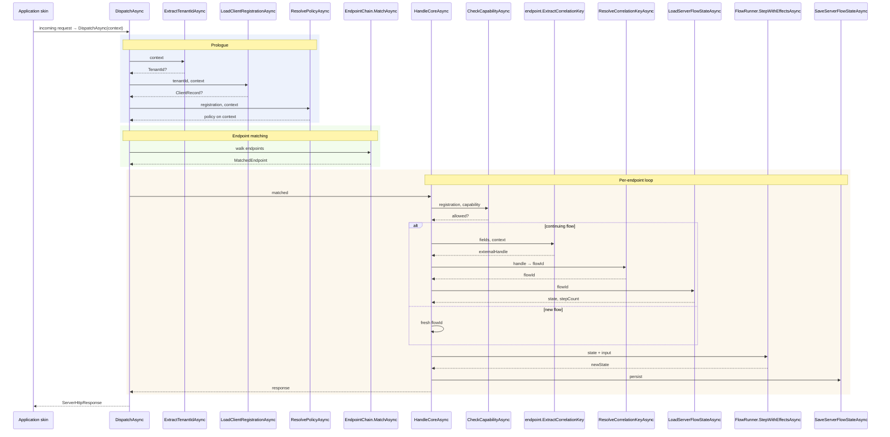
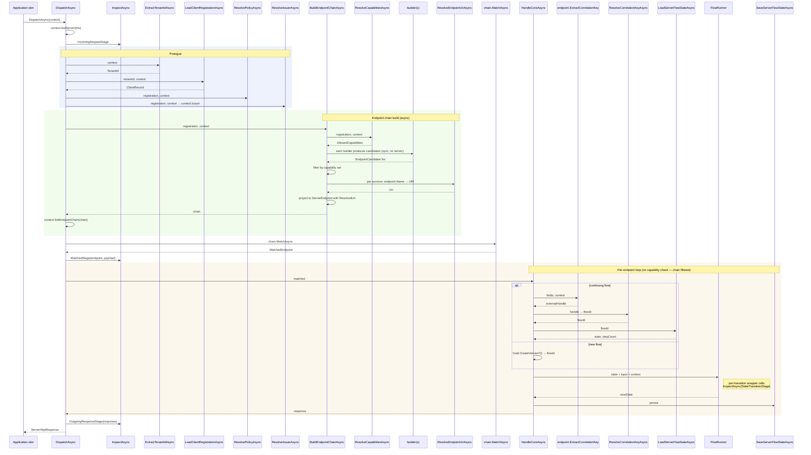

# Verifiable.OAuth — AuthorizationServer Design Notes

This is a living document. Decisions, scale assumptions, and open questions accumulate here as they surface in design discussion. Polish later. The goal is to keep architectural reasoning in one place so future work composes against a stable picture rather than re-deriving the picture each time.

For decisions that have settled into the codebase as committed architectural choices, see the `/documents/ADRs/` folder. This document is upstream of those — a working surface for thinking, not a record of finalised decisions.

---

## 1. Scale assumptions

The AS is designed for **agents-ready** throughput: millions of concurrent agents, including agents that may themselves run the AS. The deployment shape ranges from a single in-process AS for an embedded credential flow to a horizontally-scaled multi-region cluster handling autonomous-agent traffic.

The key consequence: **per-call certainty**, not statistical rarity. Every per-request operation must be deterministic-by-construction. "Rare" doesn't exist at scale. Two examples that illustrate the principle:

- A 64-bit random field with birthday collision at ~4 billion sounds safe in isolation. At millions of issuances per second it collides within an hour. Random fields used in any per-request artefact (nonces, jti values, opaque token bodies) need ≥128 bits when they're protecting freshness against an active attacker, or at least 96 bits when collision resistance is the only concern.
- A `kid` lookup taking 200 nanoseconds is fine alone. Multiplied across every request from millions of agents it's a bottleneck. Key resolvers must support in-process caching on the hot path; the library documents this expectation but cannot enforce it because the backend is the application's choice.

**Corollary on storage:** the per-request volume profile of some operations (DPoP JTI replay, RFC 9421 signature replay, attestation replay) is orders of magnitude higher than the per-flow volume of user-initiated handles (request_uri, code, device_code). Both go through the same storage abstraction; the application's backend choice (Redis cluster, Orleans grain, in-memory cache, signature-only stateless) absorbs the difference.

---

## 2. Pipeline overview

A request flows through three layers in order: **request prologue** (tenant, registration, policy), **endpoint chain** (matching), **per-endpoint loop** (state load → step → save). Every transition has a named typed delegate; the application wires the delegates, the library composes them.

The two diagrams below show the pre-9h current state and the post-9h future state. The 9h refactor's net effect: every per-call decision flows through a named typed delegate on `AuthorizationServerIntegration`; every per-call resolved value lives on `ExchangeContext`; every consumer reads from one source of truth. Inspection hooks at four well-defined points enable audit, telemetry, and security-event emission without library code changes.

#### Pre-9h current state

#### Post-9h future state

### 2.1 Prologue stage

| Delegate | Returns | Purpose |
|---|---|---|
| `ExtractTenantIdAsync` | `TenantId?` | Application reads tenant from whichever request signal identifies it (URL segment, subdomain, header, claim). Null → `400 invalid_request`. |
| `LoadClientRegistrationAsync` | `ClientRecord?` | Application loads the registration for the tenant. Null → `404`. Result stamped on `context.Registration`. |
| `ResolvePolicyAsync` | (writes to context) | Resolves per-request `PolicyProfile` and related policy state onto the context. Downstream code consults via typed `ExchangeContext` extensions. |

All three are required in every serving composition. Applications wire construction seams and request serving changes through the drained, candidate-validated operation in [Live configuration](#41-live-configuration).

### 2.2 Endpoint chain stage

`EndpointChain.MatchAsync` walks every registered endpoint's `MatchesRequest` until one returns a non-null `MatchPayload`. Endpoints are registered via `EndpointBuilders` (`AuthCodeEndpoints.Builder`, `Oid4VpEndpoints.Builder`, `MetadataEndpoints.Builder`, `RegistrationEndpoints.Builder`). Application chooses which builders to include.

`EndpointBuilders` is also the app-facing extension seam for *new* endpoints — including ones the library does not ship. `EndpointBuilderDelegate` and `EndpointCandidate` are public, and the library's own flows are nothing more than builders in this same set, so adding an endpoint is uniform regardless of author:

- **A new standard RFC endpoint** (e.g. RFC 7009 revocation, Global Token Revocation, RP-Initiated Logout) is shipped in the library as one builder-produced `EndpointCandidate` plus, where it needs an application decision, one named slot on `AuthorizationServerIntegration` (e.g. `RevokeTokenDelegate`). The chunk is small and shaped like every other endpoint; the library owns the wire and conformance-tests it.
- **A proprietary or experimental endpoint** an application needs can be authored entirely application-side: register a custom builder returning a custom `EndpointCandidate` with its own `MatchesRequest` / `BuildInputAsync` / `BuildResponse`. The candidate reaches application state through the `ExchangeContext` it is handed, not through a new integration slot (the sealed `AuthorizationServerIntegration` bundle is library-defined). No fork is required.

This is the same boundary that governs signals: the library owns the standard wire and the decision *seam*; the application owns the decision and any proprietary translation. A brand-new RFC that drops mid-cycle is therefore an additive chunk — a builder plus, optionally, a delegate slot — not a pipeline rewrite.

### 2.3 Per-endpoint loop stage

The capability filter (the registration allows this endpoint's capability and, when the composition declares its capabilities, the declaration names it) selects the candidate set
in `EndpointChain.BuildForRequestAsync`, at chain-build time, before matching, before
`Integration.MaterializeRegistrationAsync` runs, and before `HandleCoreAsync` is ever entered — a
capability-filtered candidate never reaches the loop below. `Integration.MaterializeRegistrationAsync`,
when wired, then updates `context`'s registration from the wire `client_id`, so every step below
sees the materialized record. `HandleCoreAsync` runs an 8-step state-machine loop:

1. The endpoint's own pre-correlation step (`endpoint.BeforeCorrelationAsync`), when set — the
   endpoint's own check needing only the request, the materialized registration, and the server,
   run before either a flow is created or any stored record is correlated or loaded. A stateless
   or new-flow endpoint runs it here, first; a continuing-flow endpoint runs it after its own
   handle-presence refusal (below) has found a handle present. Every check it makes is
   request-only, so it is identical for a caller naming a handle that does not correlate to
   anything and one naming a live handle whose own checks fail the same way — but the identical
   answer rests on what each check reads, not on a shared constant every step answers "by
   construction": the code-redemption and refresh-token steps answer identification, the
   `code_verifier`'s (or nothing's) absence, and a resolver fault or decline through
   `endpoint.HandleNotFoundError` / `endpoint.HandleNotFoundErrorDescription` (falling back to
   the grant's own constant when the endpoint sets neither); a malformed `code_verifier`
   answers its own distinct `invalid_grant` "PKCE verification failed." (the grammar, not the
   endpoint's identity, decides that body); declared client authentication answers its own `401
   invalid_client` untranslated; and the request-only half of DPoP validation answers its own
   nonce challenge or `invalid_dpop_proof`. The `request_uri` completion's step answers two
   literal bodies of its own ("Missing client_id."; the registration-identification comparison),
   never an endpoint constant. This step is the one place in the loop that runs for a handle that
   does not exist BY DESIGN, and it may therefore consume single-use authentication material — a
   client assertion's or a DPoP proof's `jti`, a nonce — before any stored record is ever reached;
   see the consumption sentence on `BeforeCorrelationDelegate`'s own remarks and §5's
   cryptography-before-storage ordering this step exists to serve.
2. Stateless short-circuit (no state to load/save).
3. Get current state — either generate fresh `flowId` for new flows, or extract external handle → resolve correlation key → load state.
4. Stamp verified-at on context.
5. `endpoint.BuildInputAsync` produces typed input or early-exit response.
6. `FlowRunner.StepWithEffectsAsync` advances the PDA.
7. `endpoint.BuildResponse` produces the response.
8. Persist via `SaveServerFlowStateAsync`.

Step 8 is where the application's `SaveServerFlowStateAsync` lambda pattern-matches on state type to update secondary indexes for the next step's correlation lookup. This is how `request_uri`, `code`, `device_code`, and `(issuer, jti)` all get their lookup paths — same delegate, application-side discrimination.

### 2.4 Replay determinism

The PDA's state-step transitions are deterministic given identical inputs.
The `Save/LoadServerFlowStateAsync` shape captures state snapshots, not the
input log; replay against the persisted state stream reconstructs "what
the state was at each step", but re-running an action (e.g. a DPoP-proof
JTI lookup) against external state that has since changed could produce a
different action-result and therefore a different next state.

For deployments that need strict deterministic replay — forensic
reconstruction, long-trace property-based testing — the per-step
`(before-state, input, action-results, after-state)` tuple is the right
artefact to capture. The `InspectAsync(StateTransitionStage)` hook
introduced in phase 9h is the natural emission point; the deployment's
inspector lambda records each tuple into whatever event store the
forensic trail uses. The library's storage abstraction does not bake
this in — replay determinism is a deployment concern, not a library
invariant.

---

## 3. Layered delegate model

Every integration point falls into one of three layers. Each layer composes the layer below it.

### Bottom layer: storage delegates

The universal storage contract. Backend-agnostic by design.

| Delegate | Shape |
|---|---|
| `LoadServerFlowStateDelegate` | `(tenantId, correlationKey, context, ct) → (OAuthFlowState?, stepCount)` |
| `SaveServerFlowStateDelegate` | `(tenantId, correlationKey, state, stepCount, context, ct) → void` |
| `ResolveCorrelationKeyDelegate` | `(tenantId, flowKind, externalHandle, context, ct) → flowId?` |
| `LoadClientRegistrationDelegate` | `(tenantId, context, ct) → ClientRecord?` |

The application's implementation chooses the backend: Redis, Orleans, in-memory, signature-only stateless, distributed K/V, hybrid layered cache + persistent store. The library's contract is intentionally agnostic — different SLO regimes (single-instance demo vs millions of agents) use radically different backends behind the same delegate signatures.

### Middle layer: cryptographic primitive delegates

Tagged primitives routed through `CryptographicKeyFactory` registry and dispatched via `CryptographicKeyEvents`. Backends (`Verifiable.Microsoft`, `Verifiable.BouncyCastle`, `Verifiable.Libsodium`, future `Verifiable.Tpm`) provide concrete implementations.

| Delegate | Purpose |
|---|---|
| `ComputeDigestDelegate` | Hash of arbitrary `ReadOnlySequence<byte>` input. |
| `ComputeHmacDelegate` | Keyed hash; symmetric MAC. |
| `VerifyHmacDelegate` | Recompute-and-compare MAC verification. |
| `SigningDelegate` | Asymmetric signature production. |
| `VerificationDelegate` | Asymmetric signature verification. |

Key resolution sits alongside the primitives and uses a unified slot model across signing and HMAC. Rotation policy lives in a `KeySet` (slots: `Incoming`, `Current`, `Retiring`, `Historical`) — `Incoming` is pre-published but not yet used for issuance; `Current` is active; `Retiring` is not used for issuance but still accepted for verification; `Historical` is archived (not verifiable, not published). The signing-side equivalent is the existing `SigningKeySet` per `ClientRecord.SigningKeys[usage]`; the HMAC-side `KeySet` (non-generic, lives at integration level) and its in-process default `InProcessKeySet` both store `KeyId` per slot. Material loading is decoupled from rotation.

Selection and byte-loading are separate delegates:

| Role | Signing | HMAC |
|---|---|---|
| Slot store | `SigningKeySet` (per `KeyUsageContext`) | `KeySet` (non-generic, stores `KeyId` per slot) |
| Selector | `SelectSigningKeyDelegate` → `KeyId` | `SelectHmacKeyDelegate` → `KeyId?` |
| Byte-loader (private) | `ServerSigningKeyResolverDelegate(KeyId, TenantId, …) → PrivateKeyMemory?` | `ResolveServerHmacKeyDelegate(KeyId, TenantId, …) → SymmetricKey?` |
| Byte-loader (public) | `ServerVerificationKeyResolverDelegate(KeyId, KeyUsageContext, TenantId, …) → PublicKeyMemory?` | (not applicable — symmetric) |
| Material type | `PrivateKeyMemory` / `PublicKeyMemory` | `SymmetricKey` |
| Publishable in JWKS | Always (`Incoming + Current + Retiring`) | Opt-in per keyset; renders as `kty=oct` per RFC 7518 §6.4 |

The signing side stores `KeyId` per slot and loads material lazily via the byte-loader — HSM/KMS-friendly by construction. The HMAC in-process default holds a `Dictionary<KeyId, SymmetricKey>` side store alongside the slot tracker (`InProcessKeySet`); an HSM-backed HMAC deployment would wire a different byte-loader and reuse the same slot model.

All byte-loaders take `(KeyId, TenantId, ExchangeContext, CancellationToken)`; the public-key loader also takes the `KeyUsageContext` the key is expected under, right after the `KeyId` (the slot of the token or artefact verified or published: `AccessTokenIssuance` for access tokens at UserInfo and at a resource server, `IdTokenIssuance` for an `id_token_hint` and at a relying party, `JarSigning` for a request object, `FederationEntitySignature` for the entity configuration's `jwks`, and the set a discovery algorithm list derives from), and answers `null` for a key it does not hold for that usage. Where the library holds the registration's key sets, its own slot admission runs first, so the usage narrows what a resolver verifies and never widens it. `TenantId` is threaded for application convenience — it lets the resolver shard by tenant first before looking up by kid within the tenant. Applications that don't need per-tenant isolation ignore the parameter. Selection happens upstream; byte-loaders perform no rotation logic, no selection logic, no slot-membership gating. Verifiability-by-slot is checked separately, before the byte-loader runs: the HMAC side checks `KeySet.IsKidValidForVerification(KeyId)`; the public-key side runs `IssuedKeyAdmission` over the registration's key set for the usage (`ClientRecord.SigningKeys[usage]`) where the library holds the sets and meets a presented `kid` (UserInfo, the OpenID for Verifiable Credential Issuance endpoints, end-session), and reads the key id from the registration's slot elsewhere (a request object, the entity configuration, discovery). At a resource server and at a relying party the library holds no key sets, the header key identifier goes straight to the application's resolver under the usage, and the resolver's answering nothing for a key it does not hold under that usage is the only key gate there.

`ServerDecryptionKeyResolverDelegate` continues to return `PrivateKeyMemory?` for OID4VP encrypted-payload decryption; it's a per-key lookup without the rotation surface (no current decryption kid selection beyond the registration-time-bound `ClientRecord.EncryptionKeyId`).

### Top layer: application integration delegates

Application-shaped integration points that compose the layers below.

| Delegate | Composes |
|---|---|
| `ExtractTenantIdAsync` | (no lower-layer composition; pure request inspection) |
| `ResolvePolicyAsync` | Reads from registration, writes to context |
| `ParseClientMetadataServerDelegate` | Application's JSON layer; inbound RFC 7591/7592 body parsing |
| `ValidateRegistrationAccessTokenDelegate` | Comparison against application's stored credential form |
| `IssueDpopNonceDelegate` (planned, DPoP) | Composes `ComputeHmacAsync` + `ResolveServerHmacKey` + random + time |
| `ValidateDpopNonceDelegate` (planned, DPoP) | Composes `ComputeHmacAsync` + `ResolveServerHmacKey` |
| `ValidateDpopProofDelegate` | Composes `VerificationDelegate` + `ComputeDigestAsync` + replay-check via `Load/SaveServerFlowState` |
| `ResolveSubjectTrustChainDelegate` | Composes the federation entity-statement fetch and `VerificationDelegate` chain validation the application's own resolver performs, answering a `FederationResolveOutcome` |
| `ResolveIssuerKeyDelegate` | Composes `JwtVcIssuerMetadataDocuments` (JWT VC Issuer Metadata) or `SdJwtX5cTrustResolver` (Inline X.509 Certificates), or the application's own trust framework entirely |

Top-layer delegates are where the library provides defaults that wire the lower layers together for the common case, and where applications override when their requirements differ from the defaults.

---

## 4. Storage abstraction philosophy

The library's storage contract is intentionally agnostic. `Load/SaveServerFlowStateDelegate` takes whatever parameters the protocol requires (`tenantId`, `correlationKey`, state, context) and the application decides how to fulfil them.

This means:

- **A single-instance development deployment** wires the delegate to an in-memory `ConcurrentDictionary`. Lookup is microseconds.
- **A horizontally-scaled cluster** wires it to Redis (with consistent-hashed sharding for the JTI volume), Orleans grains, DragonflyDB, ScyllaDB, or whatever the deployment's operational team chose.
- **A signature-stateless deployment** wires it to a custom impl that doesn't persist anything for some state types — for example, `ParRequestReceivedState` could be HMAC-encoded into the returned `request_uri` value rather than stored. The application's `LoadServerFlowStateDelegate` decodes the HMAC'd handle back into the state. The host may choose this storage representation while satisfying the same flow-state operations.

The **secondary index pattern** lives entirely inside the application's `SaveServerFlowStateDelegate` lambda. Application pattern-matches on the inbound state type and writes whatever index entries the next protocol step needs to find via `ResolveCorrelationKeyAsync`. The library never sees the index structure. Load, save, claim, delete and correlation lookup form one storage domain and are published together in one alteration candidate. A replacement requires host migration or forwarding for retained flows.

**The claim primitive.** `Load`/`SaveServerFlowStateDelegate` are read-then-write, not a concurrency control: two concurrent requests that load the same `(correlationKey, stepCount)` both pass verification and both save, the second silently clobbering the first — invisible in every single-writer test and real under load. `ClaimServerFlowStateDelegate` sits beside `Load`/`Save`/`DeleteServerFlowStateDelegate` as the fourth required storage primitive, called after verification and before an irreversible effect (minting a token, consuming a pushed-authorization `request_uri`): it returns `true` for exactly one caller per `(correlationKey, expectedStepCount)` and `false` for every other. An in-memory backend can use `ConcurrentDictionary<(string, int), byte>.TryAdd` for one winner, but must coordinate that claim with the loaded version, tenant domain, saves, deletion and retention. An isolated claim dictionary does not establish those relationships. A distributed backend implements it as a conditional write against the same version/step column `Load` reads and `Save` writes (a compare-and-swap, or `UPDATE ... WHERE step_count = @expectedStepCount`).

**Implication for high-volume per-request operations** (DPoP JTI replay being the first concrete case): the same delegate handles them. Volume is the application's concern. The library's contract supports any reasonable backend; it's the deployment's job to wire one that meets its SLO.

**Validation timing.** Admission requires explicit `Validate()` or a successful requested alteration, as described in [Live configuration](#41-live-configuration). Construction edits invalidate validation. A serving alteration drains requests, validates an independent candidate and publishes the complete wiring only on success. Load, save, claim, delete and correlation operations must share one storage/version domain per request; the host migrates or forwards retained flow records when that domain changes.

**Revocation seams and storage.** `RevokeTokenDelegate` handles client-driven RFC 7009 requests using the wire token. The optional `RevokeIssuedTokenDelegate` handles library-driven code replay and refresh reuse using persisted `jti` and token type. RFC 6749 §4.1.2 says "SHOULD revoke (when possible)"; without this optional seam audited access tokens remain valid until expiry, while the required delete seam invalidates the claimed live refresh record. Rotation retires its presented record in place and retains its index for the successor refresh lifetime. Hosts expire these records and index entries by `ExpiresAt`. Reuse loads the predecessor audit and walks retained successor records with a visited set, claims `(tenantId, flowId, loadedStepCount)` before deletion, and reloads once after a lost claim. A second lost claim stops without deleting unclaimed state. The walk has no hop cap; a corrupted cycle stops at its repeated flow id, keeping completed revocations. Code replay uses the same successor walk rooted at `RefreshFlowId`. Valid reuse persists `RevokedAt` through `ServerRefreshTokenReuseDetected`; its once-only effect is sequential.

### 4.1 Live configuration

`EndpointServer.RequestAlterationAsync(Action<AlterationCandidate>, CancellationToken)` queues an alteration and returns its completion task. Direct host calls, registration observers and signal handlers use this operation. Requests already admitted complete before the alteration callback runs. New arrivals wait while the server drains requests and processes queued candidates in alteration enqueue order. An observer queues the alteration and returns; publication follows request completion. Awaiting the alteration inside its emitting dispatch would wait for that dispatch's own lease, so observers retain the task for an external consumer.

Each callback receives independent editable wiring containers: the primary integration, protocol-family registry, nested cryptography and codecs, action-handler and authorization-detail registries, together with immutable declaration and configuration snapshots. `AlterationCandidate.Integration` exposes the primary copy; `Family<T>()` resolves its family copy. `Configuration`, `ActionExecutor` and `AddIntegration<T>()` let coupled changes form one candidate. Every candidate assignment of a wiring component copies the supplied containers and refuses components attached to another server. This includes components nested in verification records and fresh integrations containing externally owned children. Ownership checks and copying hold the component locks together; refusal is a named `InvalidOperationException`. Candidate `AddIntegration<T>()` replaces both primary and family references when registered under the primary's concrete type; a different key registers a secondary family subject to validation. Delegate targets and application resources are shared shallow references; their synchronization remains application-owned. The authorization integration's registration-event subject stays shared so subscriptions survive publication. Secondary family containers and their nested registries participate in copying and freezing as well. Custom integrations extend `WiringComponent.CloneCore` and `Children` for their own mutable containers and override `ValidateFamily` for secondary-family dependencies.

A candidate is validated before one reference assignment publishes the complete composition. Validation checks required host seams, including `DeleteFlowStateAsync` and `ResolveEndpointUriAsync`, the primary/family identity, declaration coherence and wired feature dependencies whatever the composition declares. The authorization family returned by `OAuth()` must be the primary integration, so dispatch and protocol handlers use the same validated host seams. Secondary families validate their own requirements without duplicating the primary host's storage seams. Structural checks cannot prove arbitrary delegate behavior, backend availability or the correctness of application data. Unless the declaration names signed request objects, a signed OID4VP request_uri request needing an unregistered signing action receives a neutral server error without an internal type name. Structural validation requires ClaimFlowStateAsync before publication. Construction-time validation enumerates the actions a request will need only for declared capabilities: a declaration naming signed request objects requires the registered `SignJarAction` handler, and a construction or candidate without it is refused with `CompositionDependencyException`. The unsigned redirect_uri request path does not require SignJarAction. An unexpected JAR response state receives a neutral server error without an internal type name. A JWKS request needing an unwired document builder receives a neutral server error without an internal member name. `ServerConfiguration.DeclaredCapabilities` names the capabilities a composition serves. Every `AuthorizationServerIntegration` supplies the `Cryptography`, `Codecs`, `MemoryPool`, `Timings`, `TokenProducers`, `ClientAuthenticationMethodsSupported` and `ClientAssertionSigningAlgorithmsSupported` containers. Without a declaration, every `AuthorizationServerIntegration` also supplies subject resolution, the grant-family loader, both key resolvers and every codec delegate. With a declaration, validation requires only the dependencies of the declared capabilities: the discovery endpoint needs nothing beyond the host seams, the JWKS endpoint needs `Cryptography.BuildJwksDocumentAsync`, and every other capability needs subject resolution, the grant-family loader, both key resolvers and every codec delegate; signed request objects need the registered `SignJarAction` handler besides. A missing dependency of a declared capability is refused with `CompositionDependencyException`, whose failures name each declared capability and the dependency it lacks. The failures are ordered by capability identifier and then by dependency path, ordinally, so the report is the same on every run. Dispatch builds the endpoint chain only from candidates whose capability the declaration names, so no request reaches a handler whose dependencies validation did not check. An empty declaration is refused unless `IsMaintenanceMode` is explicitly true, and then every request receives the ordinary unmatched-endpoint response. Presence does not establish delegate behavior: a resolver returning null satisfies its presence check.

An empty builder set is refused unless `ServerConfiguration.IsMaintenanceMode` is explicitly true. Maintenance requests receive the ordinary unmatched-endpoint response. `AdmissionWaitTimeout` bounds the total hold an arrival spends waiting for a window to close, defaults to five seconds, and must be positive and at most one minute. Expiry returns HTTP 503 with `ServerErrors.TemporarilyUnavailable` and `Retry-After: 1`, through `ServerHttpResponse` and the existing transport error path; the code is RFC 6749 §4.1.2.1's authorization-endpoint vocabulary reused as a transport-level refusal, not a §5.2 token-endpoint error response. DrainTimeout bounds the drain and abandonment reopens admission on unchanged wiring. AdmissionWaitTimeout and DrainTimeout reject nonpositive values and values above one minute in their init accessors with ArgumentOutOfRangeException. Both defaults are five seconds. An arrival is held only while the window closes within AdmissionWaitTimeout; a drain that runs to its bound refuses arrivals whose admission hold expires. Each queued request joins a specific window, whose membership is sealed by the drain wait's terminal outcome. Requests queued after the drain's terminal outcome belong to a fresh window and cannot inherit an abandoned window's fault. Each abandoned request is cancelled when its own token is cancelled; other requests receive the window's actual timeout or opening-request cancellation fault. The task outcome retains the actual cause without sampling a timer after continuation. Caller cancellation before a window opens cancels its request without touching admission. Once a window is open, cancellation is checked before its callback and after the callback returns. Cancellation after a callback edits its candidate discards and freezes that candidate before publication. RequestAlterationAsync throws synchronously for a null callback, a disposed serving owner or an invalid timeout policy, including calls from event observers. An exception escaping the worker faults every queued requester and reopens admission on the accepted wiring. The refusal body reuses RFC 6749 section 4.1.2.1 authorization-endpoint vocabulary as a transport-level refusal, not an RFC 6749 section 5.2 token-endpoint error response. The uniform OAuth-shaped body applies to every capability, including metadata and JWKS; HTTP 503 and Retry-After carry the refusal semantics.

An incoherent candidate is discarded and only its requester faults. The named `InvalidOperationException` identifies missing or incoherent wiring. Accepted live container references remain unchanged; subsequent requests use the accepted composition, and a later coherent alteration can succeed. A callback that throws discards its half-edited candidate, faults its requester with that exception and advances the queue. A null endpoint-builder member is rejected by ArgumentNullException before publication. Every accepted or discarded candidate and the original serving objects are frozen. Serving setters and registry registration require an alteration candidate. Setters on `ServerIntegration`, `AuthorizationServerIntegration`, nested groups, family registries and action executors throw a named fault; direct `ApplyConfiguration`, `AddIntegration` and action-bridge edits also throw. Construction setters remain available before first admission or successful requested publication. A construction edit invalidates validation, including edits to nested containers. A construction edit to a shared component invalidates every attached server. Component graphs are collected before their locks are acquired in ascending stable acquisition-key order, independent of composition order. A construction component shared between servers becomes frozen for every owner when any owner serves or publishes. Each owner can alter its own copied composition through its requested alteration afterwards. Disposing a server detaches its component ownership, including retained replaced or discarded views, without disposing application resources.

Admission requires explicit validation or a successful alteration. First admission freezes component setters and then rechecks validation before publishing or admitting a request. A lost construction race refuses admission with the named validation fault, and the host repairs the frozen wiring through a requested alteration. `Validate()` is available for fail-fast hosts; dispatch validates nothing itself. Validate refuses a call while an alteration window owns admission. Validation and construction mutation reject a disposed owner before attaching any component. `IsValidated` describes the current composition since its last edit and is false while alterations own admission. A rejected alteration resumes the accepted wiring's validation state. The ordinary dispatcher and global registration handler both acquire a ServerRequestLease through AcquireRequestAsync before reading any application seam. Every admitted request retains one complete wiring composition. `context.Server` identifies the serving owner; `context.RequestServer` is the fixed view used by builders, handlers, claim contributors and action callbacks. The lease lasts through outgoing inspection or global registration response construction. Disposing the exposed request view disposes its serving owner; disposing the lease only releases its request count. Direct helper callers outside a serving entry point can supply their own context server.

The drain quiesces requests, not flows; the host migrates or forwards retained state. Load, claim, delete, save and correlation operations in a request use one captured backend. Persisted flow records remain in the backend that received them and can span several requests. A storage alteration therefore includes the application's migration or forwarding step before publication. Once the alteration completes, the host can retire replaced wiring resources after accounting for any retained flows that still need them. The library does not dispose application-owned pools, providers, keys or stores. The host completes resource cleanup before reporting unconsumed request faults. A status-bearing presentation with no status resolver is refused and its captured fault names the missing resolver.

Policy is resolved once per request from its admitted wiring. Ordinary dispatch loads registration data unless the skin supplies a request snapshot, resolves capabilities once and retains the results on the request context. Applications publish immutable records and capability sets through synchronized stores, use fresh contexts and protect mutable delegate closures. `TimingPolicy` supplies deployment defaults; built-in profiles also define their own request lifetimes, and token producers apply registration overrides where specified. Captured timing records remain stable within a request. Token validators resolve their token shape through their own request paths.

Registration, capability and key data change under traffic through application operations, separately from wiring publication. Registration creation, conditional replacement and deletion commit through the required registration store before optional observers run. `AuthorizationServerIntegration.ClientRegistrationStore` supplies `IClientRegistrationStore.CreateAsync`, `TryUpdateAsync` and `DeleteAsync`; its operations and the registration loader share one synchronized storage domain for the record, routing indexes and protected management credential. Registration parsing or management-token validation requires ClientRegistrationStore in the validated composition. A required persistence exception propagates before notification and the operation emits no registration event. The client response and required create store receive the plaintext management credential; the application stores a hash or protected representation. Optional observer exceptions and exceptions from their inspection reports are isolated per subscription, preserving the committed response and delivery to later subscribers. `RegistrationObserverFailureStage` reports the immutable event and exception through `InspectAsync`, using an uncancelled diagnostic call after commitment. Applications protect diagnostic exception details; diagnostics are best effort and have no durable delivery guarantee.

Registration events carry immutable selected client data, event identifiers, tenant and client identifiers, occurrence times and per-registration revisions; they carry neither the request context nor the management credential. Event identifiers are allocated atomically within the instance-scoped stream, without application I/O after commitment. `ClientRegistrationProjection` selects client name and URI, immutable redirect URI, scope and capability sets, and copied default signing-key identifiers by usage. `ClientRegistrationEvent.Projection` replaces request-context delivery, `ClientRegistered` contains no credential or live record, and `ClientUpdated.Previous` carries the prior immutable projection while `Projection` carries the committed replacement. `ClientRecord.Revision` begins at one; the conditional store accepts only the loaded revision and a replacement exactly one greater. Concurrent updates that read one registration revision have exactly one successful conditional commit; a stale update returns HTTP 400 with invalid_client_metadata and emits nothing. This is the library's concurrency policy using the existing RFC 7592 §2.2 registration error path, not an additional wire revision field. Sequential requests may each succeed after loading successive revisions. The fixture's store commits both routing indexes under the same lock as its loader and management-token validation.

Each subscription owns a unique token; repeated concurrent disposal removes only that token, including when an observer subscribes more than once. Observer equality cannot substitute for subscription identity. Emission captures the subscription array, invokes each entry, and awaits any failure report before continuing. Concurrent emitters can invoke the same observer concurrently, with no global delivery order or replay; consumers use tenant, client and revision to discard stale cache updates. Disposal cannot cancel an already captured delivery. Capability grant and revoke signals require an application effect on synchronized registration and granted-capability state before endpoint reachability changes. Their projection identifies the source registration revision; the application advances its stored revision when applying a change. The fixture applies the signal to the registration revision and granted set atomically, and its resolver reads that granted set on each request. Grants add endpoint eligibility to the registration; revocation removes the active grant while retaining that eligibility, so the resolver enforces the refusal. Metadata-only replacement preserves revoked grants. Signals are best effort; an application needing durable capability effects must provide its own reliable effect mechanism.

A subscription made inside a candidate callback attaches to its shared stream immediately and survives that candidate's acceptance or rejection. A source component can be adopted by only one composition; a second adoption is refused with a named ownership fault. A candidate may adopt a component attached to its own composition by copying it; a component attached to another composition is refused. A fresh adopted authorization integration carries its event subject with its copy, so subscriptions made before adoption receive this server's registration events after publication. An adopted fresh stream supplies the observers for that replacement family; callers supply its required registration store as part of adoption. The async registration notification helpers require their caller to commit storage first; the registration endpoints and fixture operations do so explicitly. Notification helpers accept the caller context for API consistency and do not forward or retain it in optional diagnostics or events.

Observer failure reports receive a detached context containing no request, headers, body, live registration or management bearer. The stage contains only selected event data and the supplied exception. Outgoing inspection runs after the handler completes on every dispatch; its exceptions are recorded on the request Activity and the response returns as built. Incoming and matched inspection exceptions propagate before commitment.

Deletion retries a lost conditional race and emits a tombstone one revision beyond the atomically removed record, so delayed updates cannot repopulate a deleted cache entry. `DeleteAsync(record, expectedRevision, context, cancellationToken)` atomically returns the removed record or null without mutation. After a lost race the handler reloads the same identity; an absent or replaced identity receives HTTP 401 without another event. Consumers retain tombstone revisions after removing cached data. A delayed deletion cannot remove a different client's reused tenant index or grant state. For a persisted registration, an absent grant set or a different current client identity grants no capabilities to an overlapping request. A request-derived registration is resolved through the endpoint chain and materialized per request without being committed to ClientRegistrationStore. Capability effects apply only to their source identity and revision, so a delayed signal cannot overwrite a newer grant decision.

A management PUT requires the issued client_id; a missing or different identifier returns invalid_client_metadata without mutation or notification. The client update handler includes its issued client identifier in the complete replacement document. Management requests for absent clients or with invalid registration access tokens return HTTP 401. Registration responses carry an absolute configuration URI, the management bearer, the client identifier and every accepted metadata field. Read and update share the complete client-information response defined by RFC 7592 section 3. The validated presented bearer is echoed without requiring the store to recover its protected credential. The registered metadata retains copied immutable collections, and omitted replacement metadata is unset. The shared client/server metadata writer covers every supported field. `ClientRegistrationEvent.ClientId` and `TenantId` are computed get-only properties supplied through the required `Projection`; they have no independent init accessors or required-member obligations.

`LiveServerAlterationTests` holds the listener proofs for in-flight completion, held arrivals, bounded refusal, a bounded drain's abandonment and cancellation, the next request's seam and policy changes, configuration consistency under concurrent arrivals, named candidate rejection, a candidate's own copy of an adopted integration, serving setter guards, storage migration, global registration admission, observer and signal requests, ordered concurrent alterations, and capability-scoped validation and dispatch. Configuration observations exercise the combined drain and captured-view protections; either protection independently prevents a transition within one admitted request. A worker checkpoint registers the drain continuation before the held request is released. Race assertions concern invariants rather than which request wins. Notification-only cases retain their scope; endpoint observations use the listener.

### 4.2 Remote documents: the attempt is the library's, the cache is the application's

The storage rule above applies to every document the server fetches from elsewhere — a Client ID Metadata Document, the JWK Set a `jwks_uri` names, an authorization server's metadata. Decision record: [remote-documents-attempt-and-application-cache](ADRs/remote-documents-attempt-and-application-cache.md).

| | Library | Application |
|---|---|---|
| Reaching the wire | `OutboundFetch.FetchAsync` — the one chokepoint for every server-side fetch; SSRF policy from `ExchangeContext.OutboundFetchPolicy`, redirects, the size hint. The client-side flows (authorization code, refresh, revocation, the ID-JAG mint and redeem, the OID4VCI wallet's metadata, nonce, credential, deferred and notification calls, the OID4VP wallet's response and request-object posts) evaluate the same policy before invoking the application's transport delegate — from the call's context when it carries one, else from the client's deployment configuration (`OAuthClientInfrastructure.OutboundFetchPolicy`, `Oid4VciWalletConfiguration.OutboundFetchPolicy`, `Oid4VpWalletConfiguration.OutboundFetchPolicy`, default `SecureDefault`) — because the endpoints they dial are named by discovered metadata, which `OutboundRequest`'s remarks call as much an SSRF vector as a fetched URL. The OID4VCI wallet's OPTIONAL §4.1.3 by-reference Credential Offer GET (`Oid4VciWalletConfiguration.FetchCredentialOffer`) does not follow that evaluate-then-invoke shape: it dials through this same `OutboundFetch.FetchAsync` chokepoint rather than a single-hop transport delegate, so it carries the chokepoint's own redirect re-validation and per-hop policy evaluation, bounded by `MaximumCredentialOfferBytes` | `OutboundTransportDelegate` and the client-side transport delegates — the single-hop primitives; no `HttpClient` in the library; a browser host sends every request built for these seams with credentials omitted, since the Fetch Standard's default is `same-origin` and an issuer-named endpoint may share the application's origin |
| The attempt | `ClientIdMetadataDocuments.ResolveAsync`, `JwksUriResolver.ResolveAsync`, `AuthorizationServerMetadataDocuments.ResolveAsync` — fetch, validate, compute RFC 9111 §5.2 freshness from the headers, report result + `HttpCacheFreshness`; stateless. `JwtVcIssuerMetadataDocuments.ResolveAsync` / `SelectKeyAsync` do the same for a SD-JWT VC issuer's JWT VC Issuer Metadata document, answering a `JwtVcIssuerMetadataResolution` | the well-known suffix an issuer is resolved through (`WellKnownPaths.OAuthAuthorizationServer`, `OpenIdConfiguration`, or `WellKnownPaths.JwtVcIssuer`), which RFC 8414 §3 says the application MUST choose |
| The store | — | the implementation of `ResolveClientMetadataDelegate` / `ResolveJwksUriDelegate` / `ResolveAuthorizationServerMetadataDelegate` / `ResolveIssuerKeyDelegate`: a dictionary, a distributed cache, a grain, a database row |
| Lifetime bounds | `HttpCacheFreshness.Clamp`, a pure helper | which bounds, if any |
| After a failure | reports a non-storable freshness and a typed outcome | retry hold, backoff, drop; never stale on error without permission (RFC 9111 §4.2.4) |
| Key-set rotation | `ClientIdMetadataDocuments.RefreshJwksAsync` — replaces a document's key set from its `jwks_uri`; `ClientIdMetadataResolution.HasJwksUriKeySet` says when it applies | calls the helper on a document hit, so the key set follows its own lifetime, not the document's |
| Wiring | `ClientIdMetadataDocumentResolverOptions.ResolveJwksUri`; `PrivateKeyJwtClientAuthentication.BuildValidator(…, ResolveJwksUriDelegate?)` | one delegate instance into both; nothing wired means a `jwks_uri` is never dereferenced and the client fails closed for want of a key |
| Every other fetched document | the `did:web`, `did:webvh`, `did:webplus` resolvers and the `did:webvh` dereferencer report freshness on `DidResolutionMetadata` / `DidDereferencingMetadata` (the process metadata, since the result and document types are shared with methods that never touch the wire); the WebFinger JRD, the Status List Token, the federation entity statement and DIDComm attachment data report it on their own results; the DIDComm message POST is exempt, having no document to keep | stores each for its reported lifetime, or not at all |

The key-set delegate is asked on every resolution, including by a caller serving a cached document. An implementation that does not bound its own retries after a failure puts one outbound request on a host the client itself names for every authorization request that reaches it; that bound is the application's, like everything else in the right-hand column. The reference implementation the test suite runs as its application is `ClientMetadataResolutionCache` under `test/Verifiable.Tests/TestInfrastructure`.

### 4.3 The tenant key and the tenant handle

`TenantId` is the application's internal routing key: the value `ExtractTenantIdAsync` produces from the request, that the registration store, the flow-state store, the correlation keys and every key-set byte-loader are scoped by, and that the library passes raw into the application's own delegates (`ResolveOidcClaimsDelegate`, the key resolvers, `AuthorizeSsfRequestDelegate`). It never leaves the process through the library: it renders nothing of its value through `ToString()` or the debugger display, and no span tag, wire body, token claim or metadata document carries it.

`TenantHandle` is what the library shows. The application sets it on `ClientRecord` beside the key — a public slug, a pseudonymous identifier, whatever it is content to see on every exported span and in every delivered event — and the library never derives one. The dispatch span's `server.tenant.handle` tag carries the handle when the registration has one and nothing tenant-shaped when it does not; the registration projection carries both the key, which observers need to correlate an event with their own store, and the handle, which is what its debugger display and any diagnostic built from it render.

---

## 5. Operational ordering on validation

Per-request validation follows a strict cheap-first ordering:

1. **Structural parse** — is the input syntactically well-formed? Cheap, no backend calls.
2. **Format and policy checks** — required fields present, claim shapes correct, expiry windows in tolerance.
3. **Cryptographic verification** — signature, HMAC. Compute-bound, no backend calls.
4. **Storage-backed checks** — replay defense (JTI lookup), binding lookup (access-token thumbprint), revocation lookup.

RFC 9449 §4.3 itself permits any order for its twelve DPoP proof checks ("These checks may be performed in any order"), so this ordering is this library's own policy, not an RFC mandate — chosen because it is the right ordering for every per-request validation in the library. Three reasons:

- **DoS resistance.** An attacker hammering the AS with malformed proofs wastes only structural-parse cycles, not storage backend round-trips. Storage cost stays proportional to legitimate traffic, not attack volume.
- **Cost gradient.** The cheapest checks fail the largest fraction of bad inputs. Doing them first minimises total work.
- **Uniformity.** Applying the same cheap-first ordering to every per-request validation — DPoP proofs, client assertions, anything else the library or an application adds — keeps protocol behaviour predictable without needing a spec to require it case by case.

**Exception case worth noting:** an application may legitimately want to interpose an even cheaper check before cryptographic verification — for example, a Bloom filter of known-bad-jti values for a rapid-revocation feed. The library's design doesn't preclude this; the application's `ValidateDpopProofDelegate` (or equivalent) can compose whatever it wants. The library's defaults follow the standard ordering; the application's overrides can choose differently if the threat model demands.

**A DPoP proof's own nonce claim is checked AFTER its signature.** `DpopProofValidator.ValidateAsync`'s structural-parse-then-signature-then-claims ordering has its own nonce branch, but every token-endpoint caller builds its `DpopProofValidationRequest` with `NonceRequired = false` and no `ExpectedNonce`, so that branch never gates anything at the token endpoint — the validator returns success once signature and claim shape check out, carrying whatever `Nonce` claim (or none) the proof presented. The token endpoint's own single server nonce policy — every grant challenges a nonce-less proof alike, `use_dpop_nonce` — is decided AFTERWARD, by `Verifiable.OAuth.AuthCode.Server.DpopTokenEndpointValidation` (`ValidatePresentedProofAsync` for the two step endpoints — code redemption, refresh; `ValidateAsync` for the four grants without one) reading `proofResult.Claims.Nonce` on the validator's returned result. Because the validator's signature check runs before this outer nonce decision, a nonce-less or wrong-nonce proof still costs the server one full signature verification before it is ever challenged — never a free rejection ahead of it.

---

## 6. Per-call delegate guidance

Documented expectations for delegate implementations. None of these are enforced by the library (the application owns the backend); they're guidance the library's documentation should set.

- **Resolvers MUST cache in-process on the hot path.** `LoadClientRegistrationAsync`, `ResolveCorrelationKeyAsync`, `ResolveServerSigningKey`, `ResolveServerHmacKey` are called on every request. KMS / HSM / database round-trips on every call collapse throughput. The application's implementation must maintain an in-process cache (TTL-bounded, invalidated on rotation events) and only hit the cold backend on cache miss.
- **Backends MUST be async-capable.** The library's primitive delegates are all `ValueTask<T>`; software backends return synchronously-completed `ValueTask<T>` with state-machine elision (zero overhead), hardware backends genuinely await. Don't wrap a blocking backend in `Task.Run`; it defeats the purpose.
- **Failures MUST be deterministic.** The library doesn't retry on delegate failures — that's the application's HTTP handler chain's job. A delegate that throws gets its exception surfaced to the application; a delegate that returns null gets its semantic null-handling per the contract. No silent retries, no eventual-consistency tolerance inside the library.
- **`ExchangeContext` is the universal sidecar.** Every delegate takes it; applications can read prior decisions (`context.TenantId`, `context.Registration`, `context.Policy`) and write to it for downstream consumption. State that flows through the pipeline should travel via `ExchangeContext` extensions, not via the delegate parameters.

---

## 7. Open questions

Items genuinely undecided at the time of writing. Resolve in discussion; promote to settled section when decided.

### 7.1 Default DPoP nonce wire format

Stateless HMAC nonces using `ComputeHmacAsync`. The library will ship a default implementation; what fields does the default include?

- `kid` (key identifier for rotation) — required.
- `issuedAt` (Unix uint64 ms or sec) — required.
- `audienceHash` (first 16 bytes of SHA-256 of audience URI) — defense against cross-server replay.
- `random` (≥128 bits of CSPRNG) — collision resistance under high issuance volume.
- `hmacTag` (HMAC-SHA-256 over the preceding fields) — authentication.

Format encoding: binary packed for compactness (~80 bytes binary, ~110 bytes base64url) versus JWT-shaped (using the future JWS HS256 surface) for inspectability. Default proposal: binary packed. Rationale: nonces are opaque to clients (just echoed); compactness in HTTP header dominates; JWS HS256 isn't built yet (it's a listed-open consumer of the HMAC primitives). Override path: application replaces the default `IssueDpopNonceDelegate` / `ValidateDpopNonceDelegate` with their own implementation.

### 7.2 Server HMAC key lifecycle defaults — *settled, see §8*

The library ships `InProcessKeySet` (non-generic, slot-aware, `IDisposable`) as the in-process default for HMAC keys, with the same `Incoming`/`Current`/`Retiring`/`Historical` slot semantics used by the signing side. The byte-loader (`ResolveServerHmacKeyDelegate`) takes `(KeyId, TenantId, …)` and returns `SymmetricKey?`. Selection lives in `SelectHmacKeyDelegate`. Validation paths gate on slot membership (`KeySet.IsKidValidForVerification`) before invoking the byte-loader, so `Incoming` and `Historical` kids never validate inbound artefacts.

### 7.3 Forthcoming compositions

The library's nonce/proof/binding primitives will compose with two emerging protocols, expected to land as proper specs within the year:

- **DPoP-aware HTTP signing (RFC 9421 / draft-ietf-httpbis-message-signatures based)** — message signatures over the HTTP request itself, possibly binding the DPoP proof's key into the signature context.
- **HW-attested OAuth client authentication** via `draft-ietf-oauth-attestation-based-client-auth` — `urn:ietf:params:oauth:client-assertion-type:jwt-client-attestation` with EUDI Wallet WTE (Wallet Trust Evidence) / Apple App Attest / Google Play Integrity / TPM-backed attestation evidence flowing through.

The library's design must compose with both without changing the existing delegate signatures. The top-layer delegate model (application implements `IssueDpopNonceDelegate` / `ValidateDpopNonceDelegate` and can bake whatever extra fields it needs into the HMAC input) supports HTTP-signing composition naturally. Attestation-based client authentication composes through `ValidateClientAssertionDelegate` (currently shaped for `private_key_jwt` and will need extension for the attestation variant) — design TBD when the draft stabilises.

Reference links (to be verified against current versions before any phase that depends on them):

- `draft-ietf-oauth-attestation-based-client-auth`: <https://datatracker.ietf.org/doc/draft-ietf-oauth-attestation-based-client-auth/>
- EUDI ARF: <https://github.com/eu-digital-identity-wallet/architecture-and-reference-framework>
- HAIP: <https://openid.net/specs/openid4vc-high-assurance-interoperability-profile-1_0.html>
- OID4VCI §11.2 wallet attestation: <https://openid.net/specs/openid-4-verifiable-credential-issuance-1_0.html>
- RFC 9421 (HTTP Message Signatures): <https://www.rfc-editor.org/rfc/rfc9421>
- Android Keystore attestation: <https://source.android.com/docs/security/features/keystore/attestation>
- Apple App Attest: <https://developer.apple.com/documentation/devicecheck/>
- TPM-based attestation: TCG Credential Profile EK 2.0; `TPM2_Quote` for platform state; `TPM2_Certify` for key attestation.

### 7.4 JTI replay storage at agent-ready volume

The `(issuer, jti)` replay store is the single shared defense (`JtiReplayGuard` over `FlowKind.JtiReplay`) consulted by every `jti`-presenting path — the JAR request object (RFC 9101), the DPoP proof at the token endpoint (RFC 9449), the OID4VCI credential endpoint and SIOP nonce checks, and the JWT Bearer / ID-JAG assertion redemption (RFC 7523 §3 rule 7). All hit `Load/SaveServerFlowStateAsync` through the same correlation path the diagrams above show; the composite `(issuer, jti)` key isolates issuers. DPoP is the highest-volume consumer: at millions of requests per second the per-key write rate is order-of-magnitude above per-flow handles. The library's contract supports this — the delegate signature carries no inherent throughput limit — but real deployments will need carefully-chosen backends (Redis cluster with sharded keyspace, DragonflyDB, or similar) plus careful TTL management.

The library should document this clearly in the `Load/SaveServerFlowStateAsync` XML doc comments — what kinds of state types exist, their volume profiles, and the implications for backend selection. Currently the docs describe the contract but don't quantify the volume gap; that's a documentation improvement worth doing alongside any phase that adds per-request state types.

### 7.5 Self-hosted AS — agent-as-AS deployment shape

The scale assumption notes that agents may run the AS themselves. This implies a deployment shape where the library's AS code is part of an agent's runtime, handling its own outbound credential flows and possibly inbound calls from other agents. The implications for resource consumption, key isolation, and trust boundaries aren't fully worked through yet. Worth a dedicated section when the shape becomes concrete enough to design against.

---

## 8. Settled architectural decisions (promote when ready)

- **Registration persistence and notification.** The registration plane changes data under traffic. RFC 7591 create and RFC 7592 update/delete commit through `IClientRegistrationStore` before emitting immutable projections. Required storage exceptions propagate. Each optional observer exception is inspected independently, and observer or diagnostic exceptions cannot abort a committed operation or stop later deliveries. Unique subscription tokens make duplicate subscriptions and concurrent disposal independent. Record revisions and conditional replacement provide one winner for requests sharing a loaded revision, with HTTP 400 `invalid_client_metadata` for stale updates. Capability grant/revoke signals require an application state effect; the fixture updates its registration and resolver's granted set, and listener tests prove before/grant/revoke reachability. `LiveServerAlterationTests` also proves projection retention without credentials, persistence failure, commit ordering, observer isolation, subscription identity and coherent concurrent updates.

- **Post-handler inspection and registration management.** Outgoing inspection failures are recorded on the request Activity and preserve the built response; incoming and matched failures propagate. Observer diagnostics receive detached contexts. Conditional deletion returns the final removed record and publishes its next revision as a tombstone. Management authentication uses HTTP 401 for absent clients and invalid bearers, requires the issued identifier in PUT, and emits complete RFC 7592 section 3 responses with absolute configuration URIs. See [Live configuration](#41-live-configuration).

Decisions in this section are foundational enough that they need no re-discussion. Move items here from §7 when they're settled across the codebase and tests, or split into ADRs in `/documents/ADRs/` when they deserve their own decision record.

- **Live configuration.** Serving wiring changes through requested, ordered alterations. Admission captures one validated composition; the server drains requests, validates candidate copies, and publishes them atomically. Registration and policy data retain their application-owned consistency boundaries. See [Live configuration](#41-live-configuration).

- **The authorize evaluation sees the parsed authorization details.** `AuthorizationRequestEvaluation.RequestedAuthorizationDetailObjects` carries the same request's `RequestedAuthorizationDetails` string, parsed through the wired `ParseAuthorizationDetailListDelegate` into the neutral `AuthorizationDetail` model — the same parse the token endpoint's `ResolveCredentialAuthorizationDelegate` seam consumes — so an application correlating `issuer_state` to the requested `credential_configuration_id` reads the parsed value instead of re-parsing the string itself; a request carrying no `authorization_details` observes `null` for both. Proven by `RequestedAuthorizationDetailsReachTheDecisionSeamParsed` and `RequestWithoutAuthorizationDetailsObservesNullParsedList`.

- **Paired seams are refused at `Validate()`.** `AuthorizationServerIntegration.ValidateFeatureDependencies` refuses `ResolveCredentialAuthorizationAsync` wired without `ParseAuthorizationDetailsAsync`, and refuses the parser wired for the built-in `openid_credential` type alone without the resolver — the two shapes [RFC 9396 §5](https://www.rfc-editor.org/rfc/rfc9396) can never validly reach, since a half-wired pair would otherwise answer `invalid_authorization_details` at the wire with no composition-time signal until a Wallet's first request. Coupled seams wire in one alteration (`AlterationCandidate` — see `RequestAlterationAsync`'s own documentation). Proven by `ResolveCredentialAuthorizationWiredWithoutParserIsRefused`, `ParserAloneForTheBuiltInTypeOnlyIsRefused`, and `BothAuthorizationDetailsSeamsWiredValidates`.

- **Unified key-rotation primitive.** Both signing and HMAC use the same slot model (`Incoming` / `Current` / `Retiring` / `Historical`) — signing via the existing `SigningKeySet` per `ClientRecord.SigningKeys[usage]`, HMAC via the non-generic `KeySet` (with `InProcessKeySet` as the in-process default). Selection (`SelectSigningKeyDelegate` / `SelectHmacKeyDelegate`) is separated from byte-loading (`ServerSigningKeyResolverDelegate` / `ServerVerificationKeyResolverDelegate` / `ResolveServerHmacKeyDelegate`). All byte-loaders take typed `(KeyId, TenantId, ExchangeContext, CancellationToken)`, the public-key loader with the expected `KeyUsageContext` after the `KeyId`. See §3 for the full layered model.
- **Token revocation (RFC 7009), server side.** The revocation endpoint is stateless (the same `StartsNewFlow` + `FlowKind.Stateless` shape as `client_credentials`, not the stateful correlation-key path). The library owns the wire — client authentication via `ValidateClientCredentialsDelegate`, the §2.2 empty-200 that never reveals token validity, and a fail-closed candidate gate (the endpoint materializes only when both `RevokeTokenDelegate` and `ValidateClientCredentialsDelegate` are wired). The application owns the token store behind `RevokeTokenDelegate`: it scopes revocation to the authenticated client's tokens and cascades refresh → access (§2.1). That store is the same state the per-call decision seams (`EvaluateAccessDelegate`, `LoadClientRegistrationDelegate`) read, so a client-driven RFC 7009 revocation, an admin action, and an inbound SSF/CAEP `session-revoked` signal all converge on one piece of state — continuous access evaluation is then an emergent property of the existing per-call seams, not a separate mechanism. First slice of the global-logout arc. Convergence requires the application to commit these triggers to the same coherent state read by request resolvers.
- **Global Token Revocation (draft-parecki-oauth-global-token-revocation), server side.** A stateless JSON-body command endpoint (`global_token_revocation_endpoint`) that revokes all of a subject's tokens by RFC 9493 Subject Identifier. The `sub_id` reuses `Verifiable.Core.SecurityEvents.SubjectIdentifier` (the same type the Shared Signals subsystem uses); the body crosses the serialization firewall through `ParseGlobalTokenRevocationRequestDelegate` (default JSON ships in `Verifiable.Json`, see below); the command drops out to `RevokeSubjectTokensDelegate`, whose returned outcome maps to the §3 status codes (204/403/404/422), with 400 (malformed/invalid `sub_id`) and 401 (auth) handled by the endpoint. Fail-closed gate: capability + parse seam + revoke seam + client auth all required. **There is deliberately no library "orchestrator" object** — the revoke-subject seam *is* the global-logout fan-out: the application revokes the subject's grants against its store and, when it runs a Shared Signals Transmitter, MAY emit a CAEP `session-revoked` event. This is the "command" end of the signal/command spectrum (CAEP being the best-effort "signal" end). Shipped as its own `GlobalTokenRevocationEndpoints.Builder` in `Verifiable.OAuth.Logout`, demonstrating the §2.2 new-endpoint extension shape. The default JSON `sub_id` parser ships in `Verifiable.Json` (`GlobalTokenRevocationJsonParsing` + `UseDefaultGlobalTokenRevocationJsonParsing`, reusing `SsfJsonReadHelpers.ReadSubject`); the endpoint is folded into the all-capabilities discovery-coherence test, and the happy-path flow test exercises the production parser end-to-end.
- **Per-session `sid` + RP-Initiated Logout, server side.** The ID Token carries a `sid` established at authorize (the app stamps `ExchangeContext.SetSessionId`, mirroring `SetAuthTime`/`SetSubjectId`; threaded authorize→`ServerCodeIssuedState`→`IssuanceContext`→`SidClaimContributor`) — per-authentication-session, not per-subject. The `end_session_endpoint` (`EndSessionEndpoints` in `Verifiable.OAuth.Logout`) verifies the `id_token_hint` as an AS-issued JWS via **`Jws.VerifyAndDecodeAsync`** (the payload comes from the VERIFIED result; signature + `iss` only, **`exp` deliberately not enforced** per RP-Initiated §3 — so it does not reuse `JwsAccessTokenValidator`), extracts `sub`/`sid`, validates `post_logout_redirect_uri` against the new `ClientRecord.AllowedPostLogoutRedirectUris`, drops out to `TerminateSessionDelegate`, and redirects 302 with `state` echoed (else 200). Fail-closed gate: capability + `TerminateSessionAsync` + `VerificationKeyResolver`. Federated/cross-server logout *propagation* is deferred to the Back-Channel (Slice 5) and CAEP-emit (Slice 7) slices. **Non-legacy logout params:** §3 `logout_hint` is supported as a *sessionless* path through a sibling seam `TerminateSessionByHintDelegate` (`Integration.TerminateSessionByHintAsync`) — when `id_token_hint` is absent but `logout_hint` is present and that seam is wired, the library passes the opaque hint verbatim (it does not interpret it; the app resolves it to a session) and runs the same redirect-URI validation + 302/200; with the seam unwired, `id_token_hint` remains required (fail-closed). A sibling seam, not an overload of `TerminateSessionDelegate`, because the verified-`sub`/`sid` path and the opaque-hint path are distinct non-nullable contracts. §3 `ui_locales` has no library action (the library renders no UI), so the only supported surface is the **`ui_locales_supported`** discovery advertisement, app-contributed via `ContributeDiscoveryFieldsAsync`; `end_session_endpoint` itself is library-emitted. `frontchannel_logout_supported`/`_session_supported` are correctly omitted (Front-Channel is legacy/skipped); `backchannel_logout_supported`/`_session_supported` arrive with Slice 5.
- **Back-Channel Logout, server side.** The Logout Token is a dedicated OAuth-layer primitive pair (`BackChannelLogout.BuildLogoutTokenAsync` / `VerifyLogoutTokenAsync` in `Verifiable.OAuth.Logout`), NOT a generic RFC 8417 SET: its `sub`/`sid` are top-level JWT claims (not an RFC 9493 `sub_id`) and its explicit `typ` is `logout+jwt` (`WellKnownMediaTypes.Jwt.LogoutJwt`), so it composes the JCose signing/verification path directly rather than reusing `SecurityEventTokenIssuance`/`Verification` (whose `typ` is `secevent+jwt`) — same crypto, different envelope. The verifier enforces the §2.6 rules (signature first, then `iss`/`aud`/`iat`, a `sub` and/or `sid`, the back-channel logout member in `events`, and **no `nonce`**) and returns a typed `BackChannelLogoutVerificationResult`. **There is no library orchestrator and no new OP endpoint** (the OP is the sender; the RP owns the `backchannel_logout_uri`): the fan-out IS the `DeliverBackChannelLogoutDelegate` seam (`Integration.DeliverBackChannelLogoutAsync`) the end-session endpoint drops out to *after* `TerminateSessionDelegate`, passing the verified `sub`/`sid`; the app enumerates its own session→RP store, builds a Logout Token per RP with the primitive, and delivers it. Behaviour and advertisement share one gate — capability `OidcBackChannelLogout` allowed **and** the deliver seam wired — so `backchannel_logout_supported`/`backchannel_logout_session_supported` are advertised iff the OP will actually fan out (the OP carries the per-session `sid`, hence session-supported too). `ClientRecord.BackchannelLogoutUri`/`BackchannelLogoutSessionRequired` mirror the registration. Cross-server *propagation* is proven by the firewalled multi-RP HTTP e2e `FederatedBackChannelLogoutHttpTests.FederatedLogoutPropagatesLogoutTokenToEveryRegisteredRpOverHttp` (Slice 5d): one OP `sid` is shared across two registered RPs (SSO), the OP signs a Logout Token per RP and POSTs it to each `ClientRecord.BackchannelLogoutUri` over a real Kestrel socket, and each RP reconstructs from the wire bytes plus the OP's published public key alone, verifies §2.6, and drops the session keyed by `sid`. The deliberate scope choice — a multi-RP firewalled HTTP propagation e2e rather than the full Federation trust-ring — is sound because Back-Channel Logout is OP→RP (OIDC), not a federation-trust-chain feature; the ring would add multi-host realism, not a dependency. The OP-side session setup and `end_session` trigger run in-process (already covered by `EndSessionLogoutTests.EndSessionFansOutBackChannelLogoutAfterTerminate`); the security-critical OP→RP `logout_token` delivery is what crosses the wire.
- **CAEP `session-revoked` emit, application-composed (Slice 7).** A revoked/terminated session MAY be signalled to Receivers as a best-effort CAEP `session-revoked` SET (CAEP 1.0 §3.1) — the "signal" end of the signal/command spectrum, distinct from the directed Back-Channel Logout fan-out. **There is deliberately no library issuance helper and no emit orchestrator:** the SET is composed from the primitives the application already holds — the typed `CaepSessionRevokedEvent.ToSecurityEvent()` carried by `SecurityEventTokenIssuance.IssueAsync`, with the revoked subject as the SET `sub_id` — inside the application's own seam (`RevokeSubjectTokensDelegate` for Global Token Revocation, or `TerminateSessionDelegate` for RP-Initiated Logout). A dedicated `CaepSessionRevokedSetIssuance` wrapper was considered and **rejected as thin sugar** over that one-line composition (which `CaepInteropEventTests` already exercises inline) — adding public surface without earning it. Every underlying piece was already covered on its own (the typed event + projection, SET issuance/reception, interop-profile conformance, the HTTP SET round-trip in `SsfHttpFlowTests`, and the documented app-driven hook in the GTR §8 decision); Slice 7 is the *flow-level* proof that ties them to the real revocation endpoint. `GlobalLogoutCaepEmitHttpTests.GlobalTokenRevocationEmitsConformantSessionRevokedSetToReceiverOverHttp`: a real `global_token_revocation_endpoint` request (returning §3 204) drops to the revoke-subject seam, which emits a CAEP-Interop-conformant (non-empty `reason_admin`) session-revoked SET about the revoked iss_sub subject and pushes it firewalled over Kestrel to a Receiver, which reconstructs from the wire bytes plus the OP's published public key alone and confirms the event type and `sub_id` through the full reception pipeline.
- **RFC 8252 §7.3 loopback redirect exception, server side.** `RedirectUriMatching.IsRegisteredLoopback` is the narrow native-app companion to the exact-match matcher (`IsRegisteredExact`, which every call site tries first): a canonical-form gate first — `string.Equals(uri.OriginalString, uri.AbsoluteUri, Ordinal)` on both the requested URI and every registered candidate — refuses by construction the entire class of alternate-form bypasses (leading whitespace, non-canonical or default-re-stated ports, uppercase host casing, IPv4 shorthand/octal/decimal/hex encodings, longhand IPv6, and the bracketed-IPv6-plus-suffix trick where `Uri` folds a suffix into the path); only a candidate that survives it is compared on `Uri.Host` (against `127.0.0.1`, `[::1]`, and — only under the deployment opt-in `PolicyExchangeContextExtensions.IsLocalhostNameAcceptedForLoopbackRedirects`, default `false` per RFC 8252 §8.3's NOT RECOMMENDED — `localhost`), `Uri.IsLoopback`, `Uri.AbsolutePath`, and `Uri.Query`; the port is the one free variable RFC 8252 §7.3 grants, ignored on both the request and a ported registration alike. `AuthCodeEndpoints.IsAcceptableRedirectUri` gates the fallback to a public client (no declared `token_endpoint_auth_method`) presenting PKCE `S256` — the sole accepted PKCE method — at all three authorization-time sites (PAR, direct Authorize, JAR). The authorize redirect's `Location` is built from `Uri.OriginalString`, never `Uri.ToString()`, so the AS hands the client back exactly the string the token endpoint's RFC 6749 §4.1.3 check later demands: present → ordinal-equal to the code's persisted redirect URI or `invalid_grant`; absent → accepted, since this library's unconditional PKCE requirement means the OAuth 2.1 draft-16 §4.1.2.1 "MUST reject requests without a code_challenge from public clients" branch never applies here (§10.2 supplies only the "MUST allow"/"MUST enforce" redirect_uri-in-token-request rule, not the code_challenge MUST) — removing the unconditional redirect_uri check trades away a defence-in-depth layer RFC 9700 never credited to it: §4.4.2.1's actual AS-mix-up control is the RFC 9207 `iss` authorization-response parameter (or an ID Token `iss`), not PKCE and not an access token's `iss` claim. Proven by `RedirectUriMatchingTests`: Part C's canonical-form vector table (including the bracketed-IPv6 bypass vectors, the ":80"/uppercase-host canonical refusals, a ported-registration's own port being ignored, and a registered-candidate fragment being refused) drives the matcher directly; Part D drives the wired fallback in-process end to end; Part E drives every clause — any port (including a genuinely bound `[::1]`), the https/localhost/non-loopback refusals, the localhost opt-in, the direct-Authorize and JAR gates, and the RFC 6749 §4.1.3 / OAuth 2.1 §10.2 token-endpoint rule — over TestHostShell's real Kestrel-bound HTTPS loopback socket. RFC 6749 §3.1.2's "MUST be an absolute URI" / "MUST NOT include a fragment component" is enforced identically on both tiers: `IsRegisteredExact` and `IsRegisteredLoopback`'s canonical-form gate each refuse a relative or fragment-bearing candidate on either side (the requested value or a registered entry) as a permanent non-match, checking `IsAbsoluteUri` before any other `Uri` member is read so a relative candidate never throws.
- **RFC 9470 step-up authentication, server side (Slice 6).** Step-up enforcement converges on one authorize-decision seam: `Integration.EvaluateAuthorizationRequestAsync` (`EvaluateAuthorizationRequestDelegate`) is handed an `AuthorizationRequestEvaluation` (the requested `acr_values`/`max_age` and the session's `EstablishedAcr`/`auth_time`) and returns an `AuthorizationRequestDecision` — `Permit`, or `Deny(reason)` carrying an `AuthorizationDenialReason`. The library maps the reason to the OAuth error and error-redirect (`MapDenialReasonToError` in `AuthCodeEndpoints`: `UnmetAuthenticationRequirements` → `unmet_authentication_requirements` per OIDCUAR, `AccessDenied` → `access_denied`; a null/unmapped reason defaults to `access_denied`). The division of labour is **semantic decisions to the application, temporal to the library**: the app compares `acr` against its own authentication context (the library cannot know what an acr value *means*), while the library enforces `max_age` (OIDC Core §3.1.2.1) itself by whole-second comparison with **no clock skew** — `auth_time` and now share the AS clock, and any skew tolerance would defeat `max_age=0`. Every authorize path — direct, PAR, JAR — runs the same seam, so step-up cannot be bypassed by choice of request channel. The issued JWT access token carries `acr` + `auth_time` (RFC 9068 §2.2.1) and both survive refresh; `acr_values_supported` is advertised in discovery. Two front-channel hardenings rode the same slice: `state` is echoed on authorize **error** redirects (RFC 6749 §4.1.2.1), and PAR/JAR keep the pushed / `request_uri`-referenced value authoritative over a tampered front-channel duplicate (RFC 9126 + RFC 9101 §6.3), emitting an OTel span event when a tampering attempt is detected and ignored. Proven by `StepUpAccessTokenClaimsTests`, `UnmetAuthenticationRequirementsTests`, `AuthorizeStateEchoTests`, and `ParRequestIntegrityTests`.

- **The granted scope narrows at the authorize decision seam.** `AuthorizationRequestDecision.Permit(string? grantedScope)` optionally narrows the request's scope per [RFC 6749 §3.3](https://www.rfc-editor.org/rfc/rfc6749#section-3.3): "The authorization server MAY fully or partially ignore the scope requested by the client." `AuthCodeEndpoints.EvaluateGrantedScope` validates the narrowed value is a non-empty subset of the requested tokens and canonicalizes it to the requested tokens' own order, deduplicated; a value outside the request or an empty grant is the application's own defect, answered `server_error` with `OAuthEventNames.SeamGrantedScopeExceedsRequest` recorded on the dispatch span rather than issued as a silent widening or an empty grant — an application that wants to grant nothing denies instead with `AuthorizationDenialReason.InvalidScope`. The redeemed token response's `scope` reflects the canonical value whenever it is set. Proven by `BarePermitGrantsTheRequestedScopeUnchanged`, `SeamPermitsWithNarrowerScopeRedeemsToATokenCarryingTheNarrowedScope`, `SeamPermittingAScopeOutsideTheRequestIsAServerErrorNotASilentWidening`, `SeamPermittingAnEmptyScopeIsAServerError`, `SeamGrantedScopeIsCanonicalizedToTheRequestOrderWithoutDuplicates`, and `DenyWithInvalidScopeReasonMapsToInvalidScopeErrorWithStateEchoed`.

- **Token-endpoint error taxonomy, server side.** `EndpointCandidate`/`ServerEndpoint` carry an optional `HandleNotFoundError`/`HandleNotFoundErrorDescription` pair an endpoint uses to name its own refusal when its correlation handle resolves to no live flow — unknown, expired, or already consumed — read by `EndpointServer.HandleCoreAsync` at every "handle not found" site; `null` falls back to the host-generic `invalid_request` vocabulary, correct for an endpoint whose handle carries no protocol-specific error semantics. The Authorization Code token endpoint sets the pair to `invalid_grant` (RFC 6749 §5.2: "the provided authorization grant ... is invalid, expired, revoked"). A token request missing `code` is still MATCHED by the endpoint — rather than falling through to the host's bodiless 404 no endpoint recognizing it would otherwise produce — so the correlation-key-resolution failure inside `HandleCoreAsync` answers with the OAuth-shaped `invalid_request` body §5.2 requires ("The request is missing a required parameter"). Proven by `AuthCodeParPkceRealWireFlowTests` (an unknown code, an expired code via the injected `FakeTimeProvider`, and a missing `code` parameter). A refusal reachable only after a caller has already proven possession of the grant's own secrets — the matching `code_verifier` digest at code redemption (RFC 7636 §4.6), or the bound client's identity at refresh (RFC 6749 §6) — keeps its own body instead of this constant, because it tells such a caller nothing about existence it did not already know: the `ResolveEffectiveResource` granted-set subset refusal (`invalid_target`, RFC 8707 §2.2), the `ResolveGrantedAuthorizationDetailsAsync` narrowing-beyond-grant refusal (`invalid_authorization_details`, RFC 9396 §6), and the application's own `ResolveCredentialAuthorizationAsync` denial all answer this way.
- **Authorization-code lifecycle: hash at rest, claims, replay and reuse.** Authorization redirects carry the raw code; `ServerCodeIssuedState` persists its SHA-256 base64url `CodeHash`. Token correlation hashes the presented code, so the stored hash is not accepted as the wire code. `BeforeCodeRedemptionCorrelationAsync`, the endpoint's pre-correlation step, runs identification, issuer resolution, the `code_verifier`'s presence and grammar, declared client authentication, the request-only `client_id` rule, the request-only `resource` and `authorization_details` decisions, and DPoP — all before the presented code is ever looked up. `VerifyCodeGrantPresentation` then runs the checks that need the loaded code state — the PKCE digest, the grant-binding comparison, and the `redirect_uri` comparison — before claiming the loaded flow step and minting. PAR authorization claims its request URI in the same way. A valid code replay re-verifies through `VerifyCodeGrantPresentation`, revokes the original issuance audit, then walks the refresh family rooted at `ServerTokenIssuedState.RefreshFlowId` through retired links to the live token. It records `RevokedAt` through the pure `ServerAuthorizationCodeReplayDetected` transition only after that work; sequential repeats skip revocation. Invalid code presentations revoke nothing (OAuth 2.1 draft-16 §7.5.3: "The authorization server SHOULD NOT revoke any issued tokens when receiving a replayed authorization code that contains invalid parameters"). The Pre-Authorized Code grant's own stepless `authorization_details` resolution no longer runs the OID4VCI `locations` decision (and with it issuer resolution and Credential Issuer metadata contribution) when the grant carries `authorization_details` but the token request does not — that decision was already unread on this path; no wire answer changes.

- **Refresh rotation and reuse.** `BeforeRefreshCorrelationAsync`, the endpoint's pre-correlation step, carries identification, issuer resolution, declared client authentication, and the request-only `client_id` rule — OAuth 2.1 draft-16 §4.3.1's stored-grant binding rule ("if client authentication is included in the request, ensure that the refresh token was issued to the authenticated client, OR if a client_id is included in the request, ensure the refresh token was issued to the matching client") read fail-closed on neither identity (`invalid_request`). `VerifyRefreshClient` then keeps only the record-dependent half, once the record is loaded: the bound-client comparison. Validated credentials identify the registration; without credentials the form must identify the client. Confidential clients must authenticate. Both the live and reuse paths call `DpopTokenEndpointValidation.BindValidatedProofAsync`, reading the outcome the step's own `ValidatePresentedProofAsync` call already carried, and require a matching proof for a bound token. Rotation claims the loaded step before minting, side-saves a fresh refresh state, and retires the presented record with `SuccessorRefreshFlowId`. Its `ExpiresAt` is the maximum of issued-token expiry and successor refresh expiry. `PredecessorFlowId` on each live refresh state names the flow that audited its paired access token: the code flow initially, the presented refresh flow at rotation. The retirement transition preserves that backlink.

- **Every token-issuing grant applies the registration profile's DPoP mandate.** The authorization-code and refresh grants no longer call `DpopTokenEndpointValidation.ValidateAsync` at all: each instead runs the request-only half of DPoP in its own pre-correlation step (`ValidatePresentedProofAsync`, with `proofRequiredByRegistration = ClientPolicyProfiles.RequiresDpop(registration.Profile)` — the refresh grant's request-only half derives from the REGISTRATION's profile here, exactly like every other grant, so a DPoP-mandating profile presenting any refresh record without a proof is challenged), and the record's own `cnf.jkt` binding is applied afterwards, in the handler, by `BindValidatedProofAsync`. `ValidateAsync` itself runs with `dpopRequired = ClientPolicyProfiles.RequiresDpop(registration.Profile)` at its four remaining callers — the stepless grants without a pre-correlation step: Pre-Authorized Code, `client_credentials`, token exchange, and JWT Bearer. `RequiresDpop` returns `true` under `PolicyProfile.Fapi20` — [FAPI 2.0 Security Profile §5.3.2.1](https://openid.net/specs/fapi-security-profile-2_0-final.html#section-5.3.2.1): the authorization server "shall only issue sender-constrained access tokens" — and under `PolicyProfile.Haip10`, whose [§4](https://openid.net/specs/openid4vc-high-assurance-interoperability-profile-1_0-final.html#section-4) requires DPoP support of Wallets and Credential Issuers and which the library treats as the same mandate. Under either, a request presenting no proof is answered with a `use_dpop_nonce` challenge carrying a `DPoP-Nonce` header, and a proof without the server's nonce is challenged once. Every grant runs the validation before its first step that can consume a single-use artifact — the authorization code's and the refresh token's claim, the pre-authorized code seam, the JWT Bearer assertion seam and the assertion's `jti` record, the token exchange's subject-token, actor-token and authorization seams — because the retry [RFC 9449 §8](https://www.rfc-editor.org/rfc/rfc9449#section-8) prescribes presents the same request: a challenge or a rejected proof must not burn the artifact (`RedeemCompletesAfterOneNonceRetryOverRealWireUnderMandatingRegistration`, `RedeemWithInvalidDpopProofDoesNotConsumeTheAssertion`, `RegistrationRequiringDpopChallengeDoesNotConsultTheSubjectSeamBeforeTheRetry`; the replay defense after a complete redemption stays pinned by `RedeemRejectsReplayedJti`). A presented proof binds the token (`IssuanceContext.Confirmation`, `cnf.jkt`, `token_type=DPoP` per [RFC 9449 §5](https://www.rfc-editor.org/rfc/rfc9449#section-5)). On the token exchange and JWT Bearer grants, `IdJagDpopDecision.Evaluate` runs its proof-of-possession matrix where its inputs exist, after the seams, reading the outcome of the validation that ran before them and combining the presented proof's key thumbprint with the grant's own bound thumbprint and the Resource Server's sender-constraint requirement. Proven by `TokenExchangeGrantTests.RegistrationRequiringDpopWithoutAProofIsRefused`, `JwtBearerGrantTests.RegistrationRequiringDpopWithoutAProofIsRefused`, `ClientCredentialsGrantTests.RegistrationRequiringDpopWithoutAProofIsRefused`, `Oid4VciPreAuthorizedCodeGrantTests.RegistrationRequiringDpopWithoutAProofIsRejectedWithoutConsultingTheSeam`, `DpopEndToEndTests.TokenIssuanceAndResourceCallValidateUnderDpopProtocol`, and the refresh grant's own `DpopBoundRefreshTests.DpopSenderConstrainedRefreshTokenRefreshesThroughRealClientAsync` / `NonDpopClientStillRefreshesThroughRealClientAsync` / `DpopMandatingProfileChallengesAnUnboundRefreshRecordObtainedBeforeTheProfileMandatedItAsync` (a registration-profile alteration to a DPoP-mandating profile, after a Bearer refresh record already exists, is challenged on the record's own profile, not its stored binding).

- **DPoP delegate wiring is all-or-nothing, checked wherever a DPoP decision can be reached.** `DpopTokenEndpointValidation`'s three entry points — `ValidateAsync`, `ValidatePresentedProofAsync`, and `BindValidatedProofAsync`'s bound-record/no-proof branch — each check the SAME five delegates (`ValidateDpopProofAsync`, `IssueDpopNonceAsync`, `ValidateDpopNonceAsync`, `ResolveServerHmacKeyAsync`, `GetHmacKeySetAsync`) before issuing a nonce challenge or accepting a proof, answering `server_error` when any one is missing rather than issuing a nonce the server could never validate a retried proof against, or silently skipping a check a partial wiring left out. Proven by `DpopBoundRefreshTests.BoundRefreshWithoutAProofAndPartiallyWiredDpopFailsClosedAsync`.

- **The Pre-Authorized Code grant validates DPoP before the code seam.** `AuthCodeEndpoints.BuildPreAuthorizedCodeToken` runs `DpopTokenEndpointValidation.ValidateAsync` before `AuthorizationServerIntegration.ValidatePreAuthorizedCodeAsync`, because the pre-authorized code is single-use and the seam may consume it: a `use_dpop_nonce` challenge or a rejected proof must not consume it, so the Wallet retries the same code once it satisfies the challenge. A presented proof's confirmation rides the DPoP outcome's `Confirmation` into `IssuanceContext.Confirmation`, and the response `token_type` follows it. Proven by `NonceChallengeRunsBeforeTheSeamAndTheRetryWithTheSameCodeSucceeds`, `PresentedProofBindsTheAccessTokenAndAnswersDpopTokenType`, `LongLivedAccessTokenIsIssuedWithAProofAndRefusedWithoutOne`, `ProofWithWrongHtuIsRejectedWithoutConsultingTheSeam`, `ProofWithWrongHtmIsRejectedWithoutConsultingTheSeam`, and `ReplayedJtiIsRejectedWithoutConsultingTheSeamASecondTime`. Under a profile requiring an access-token audience this grant has no [RFC 8707 §2](https://www.rfc-editor.org/rfc/rfc8707#section-2) `resource` parameter and no scope-derived `ScopeToAudience` entry of its own; an application that mandates an audience under this grant wires `AuthorizationServerIntegration.ResolveAccessTokenAudienceAsync` itself.

- **A Credential Request is served under an authorization detail that names its configuration.** `Oid4VciEndpoints.ValidateScopeConfigurationBinding` enforces [OID4VCI 1.0 §8.2](https://openid.net/specs/openid-4-verifiable-credential-issuance-1_0.html#section-8.2): "The corresponding object in the `credential_configurations_supported` map MUST contain one of the value(s) used in the `scope` parameter"; `IsConfigurationGrantedByAuthorizationDetails` exempts a request whose Access Token's `authorization_details` claim names the exact `credential_configuration_id` — that grant is itself the authorization, and the scope rule does not apply. Proven by `Oid4VciConfigurationConstraintsTests.ScopeMatchingConfigurationIssues`, `ScopeNotMatchingConfigurationIsRefused`, `TokenWithUnrelatedScopeAndAGrantingDetailIsServed`, and `DetailGrantingConfigurationAIsStillRefusedForConfigurationBWhenScopeMissing`.

- **Key-attestation assurance constraints.** `KeyAttestationVerifier.CheckAssuranceConstraints` checks the attested `key_storage` and `user_authentication` arrays against the issuer's accepted-value sets as OID4VCI 1.0 Appendix D.1/D.2 define them: a MEMBERSHIP SET, satisfied when at least one attested value is a member of the accepted set by ordinal string equality, never an ordering between values; an absent or empty constraint constrains nothing, and an attested array that does not read as a JSON array of strings answers `KeyAttestationVerificationFailureReason.AssuranceConstraintValuesMalformed` rather than a silent unsatisfied result. Proven by `KeyAttestationVerifierTests.SatisfiedConstraintsValidate`, `KeyStorageConstraintUnsatisfiedWhenNoAttestedValueIsAccepted`, `UserAuthenticationConstraintUnsatisfiedWhenNoAttestedValueIsAccepted`, `MalformedAttestedArrayAnswersAssuranceConstraintValuesMalformed`, `AbsentConstraintIsSatisfiedByAnyAttestation`, and `EcosystemDefinedUrlValueMatchesByOrdinalEquality`.

- **Trace facts.** A request that matches no endpoint is categorized by a fixed precedence (`NoMatchCategories`): `NoRegistrationForTenant` when the tenant has no registration; otherwise `MatcherDeclined` when any candidate reached its matcher, else `CapabilityFiltered`, else `EndpointNameUnresolved` when `EndpointChain.UnresolvedUriCandidateNames` lists an endpoint name the application's URI resolver did not map, else `NoCandidateForPathAndMethod`. The unresolved names ride the `NoMatch` event under `ServerEventNames.NoMatchEndpointNameUnresolvedTagName`, and an unmapped name never stops a mapped endpoint from dispatching. `OAuthTagNames` tags the dispatch span from `IssueTokensAsync` — the one function every token-issuing grant calls — with `GrantType`, `ClientId`, `GrantedScope`, and the issued access token's `AccessTokenJti`; the code grant additionally tags `PkceMethod` from its own redeemed `codeState`, since PKCE is specific to that one grant. `ServerHttpResponse.ErrorCode` and `ServerTagNames.ErrorCode` carry the same wire error code onto the response and the span. No tag carries a token, a code, or a subject. Proven by `OAuthDiagnosticsTests.MappedEndpointStillDispatchesWhileAnotherNameIsUnresolved`, `CodeGrantTokenActivityCarriesTheOAuthWireFacts`, `ClientCredentialsTokenActivityCarriesItsOwnGrantType`, `RefusedTokenRequestActivityAndResponseCarryTheSameErrorCode`, and `NoActivityTagCarriesTheAccessTokenAuthorizationCodeOrSubject`.

- **Family revocation and persistence.** Valid reuse first reads its predecessor's audit, then revokes its own audit and walks `SuccessorRefreshFlowId` through retained records. Each audited token reaches the optional `RevokeIssuedTokenAsync`; the live refresh record is claimed with its loaded step before the required `DeleteFlowStateAsync` deletes it. A lost claim reloads that same flow once and follows the retired successor. A second failed live claim stops without deleting unclaimed state. Missing or unexpected records stop traversal. There is no arbitrary hop cap: retention by `ExpiresAt` supplies the natural bound, and a visited set stops corruption-induced cycles while keeping completed revocations. After the walk, `ServerRefreshTokenReuseDetected` sets `RevokedAt` through a pure record-copy transition and the runner saves it. Sequential presentations skip the walk; concurrent reuses may repeat idempotent audit calls. Code replay uses the same successor walk. Every reuse refusal, including issuer-resolution failure, has the constant `invalid_grant` body; only response bytes are constant, not work or timing. A legitimate client's concurrent refresh can lose its grant when one request loads the retired record after another rotates it: OAuth 2.1 §4.3.1 states "The authorization server cannot determine which party submitted the invalid refresh token, but it will revoke the active refresh token as well as the access authorization grant associated with it."

- **PKCE policy.** Plain is refused everywhere, including `PolicyProfile.Rfc6749WithPkce`. [OAuth 2.1 draft-16 §4.1.1](https://datatracker.ietf.org/doc/html/draft-ietf-oauth-v2-1-16#section-4.1.1) prohibits the plain transformation; [§7.5.2](https://datatracker.ietf.org/doc/html/draft-ietf-oauth-v2-1-16#section-7.5.2) states "The plain code challenge method, defined in [RFC7636], is explicitly forbidden in OAuth 2.1." [RFC 9700 §2.1.1](https://www.rfc-editor.org/rfc/rfc9700#section-2.1.1) calls for a method that does not expose the verifier; S256 is the only such method. PAR, direct authorize, and both JAR entry points refuse unsupported methods with `invalid_request` per [RFC 7636 §4.4.1](https://www.rfc-editor.org/rfc/rfc7636#section-4.4.1). The RFC 6749 profile retains its other relaxations. [RFC 8414 §2](https://www.rfc-editor.org/rfc/rfc8414#section-2) discovery advertises `["S256"]` under every profile. `WellKnownCodeChallengeMethods.Plain` and `IsPlain` identify the refused wire name and values in remote client metadata; they do not enable server acceptance. The persisted `ServerCodeIssuedState.CodeChallengeMethod` travels from authorization to token verification: only S256 hashes and compares, and every other persisted value fails `invalid_grant`. [RFC 7636 §4.1](https://www.rfc-editor.org/rfc/rfc7636#section-4.1) verifier grammar is checked before [§4.6](https://www.rfc-editor.org/rfc/rfc7636#section-4.6) digest verification. Absent methods request plain under [RFC 7636 §4.3](https://www.rfc-editor.org/rfc/rfc7636#section-4.3) and receive the same refusal. Both JAR paths check the method immediately after signature verification, before projection and loopback redirect matching; parameter failures use the direct JSON response specified by [RFC 9101 §6.3](https://www.rfc-editor.org/rfc/rfc9101#section-6.3). Direct authorization validates the client and redirect URI first, then redirects `invalid_request` with the exact request state under [RFC 6749 §4.1.2.1](https://www.rfc-editor.org/rfc/rfc6749#section-4.1.2.1). Invalid destinations receive a direct refusal. PAR retains its JSON 400 under [RFC 9126 §2.3](https://www.rfc-editor.org/rfc/rfc9126#section-2.3).
  - `AbsentPkceMethodRefusedAtParUnderRfc6749WithPkce` and `AbsentPkceMethodRefusedAtDirectAuthorizeUnderRfc6749WithPkce` prove the absent-method refusal.
  - `JarAuthorizeByValueTests` and `JarParTests` each prove plain and absent methods with an exact registered redirect and with a native loopback redirect on an ephemeral port.
  - `LoopbackFallbackRefusesPlainPkceIndependently` directly proves the fallback's independent S256 condition; `PlainPkceWithInvalidRedirectUriDoesNotRedirect` proves destination validation precedes the redirect error.
  - `AuthCodeParPkceRealWireFlowTests.PlainPkceRefusedAtParUnderS256OnlyDefault`, `PlainPkceRefusedAtParUnderRfc6749WithPkce`, and `PlainPkceRefusedAtDirectAuthorizeUnderRfc6749WithPkce` prove the authorization refusals over the listener.
  - `JarAuthorizeByValueTests.RejectsJarWithCodeChallengeMethodPlain` and `JarParTests.RejectsJarWithCodeChallengeMethodPlain` prove signed-request refusals under the RFC 6749 profile over the listener.
  - `DiscoveryEndpointTests.DiscoveryEmitsCodeChallengeMethodsAsS256OnlyUnderFapi20` and `DiscoveryEmitsCodeChallengeMethodsAsS256OnlyUnderRfc6749WithPkce` prove the listener advertisement.
  - `AuthCodeParPkceRealWireFlowTests.TooShortCodeVerifierAtTokenExchangeIsInvalidGrant` and `CodeVerifierWithDisallowedCharacterAtTokenExchangeIsInvalidGrant` use matching S256 digests to isolate the grammar rules.
  - `PersistedPlainPkceMethodAtTokenExchangeIsInvalidGrant` and `PersistedUnknownPkceMethodAtTokenExchangeIsInvalidGrant` corrupt the host's stored method and prove refusal; `S256IssuedCodeVerifiedAgainstPersistedMethodNotRequest` proves the persisted S256 transformation, and `FullJourneyReachesTokenRefreshAndRevocation` proves successful S256 issuance.

- **CAEP `credential-change` emit + credential status lists (the credential-side signal).** The signal/command spectrum extends from the *session* to the *credential*: where `session-revoked` (Slice 7) signals a revoked session, a CAEP `credential-change` SET (CAEP 1.0 §3.3, `change_type: revoke`, `credential_type: verifiable-credential`) signals a revoked credential — the same best-effort "signal" end, the same `SecurityEventTokenIssuance` / reception subsystem, the same **no library orchestrator** rule. The status runtime itself lives *outside* the AS, in `Verifiable.Core/StatusLists`: one shared bit core (`StatusList` — packed N-bit entries over a pooled buffer, parameterized by a **required** `BitOrder`: least-significant-first for the IETF Token Status List, most-significant-first for the W3C Bitstring Status List) carrying two presentations — `StatusListToken` (IETF: ZLIB + base64url token) and `BitstringStatusListCodec` / `BitstringStatusListEntry` / `BitstringStatusListValidation` (W3C: GZIP + Multibase + the `BitstringStatusListCredential`, issued/verified over the existing JWS or Data Integrity surface). Revocation is the `UpdateCredentialStatusesDelegate` seam — the credential-side counterpart of `RevokeSubjectTokensDelegate`: the application flips the bit(s) and republishes each affected list once (the pull channel a verifier polls) and emits the `credential-change` SET to its Shared Signals receivers (the push channel). The seam is **batch-shaped** because a single credential may carry several entries across one or more lists (W3C §A.3/§A.4), grouped so a batch re-encodes each affected list exactly once with no half-applied intermediate. Proven by `BitstringStatusListRevocationDualChannelHttpTests` (one trigger → republished list + pushed SET, each verified firewalled) and `BitstringStatusListBatchRevocationTests`. Wire shapes verified against the verbatim specifications: Token Status List `draft-ietf-oauth-status-list-20` §4.1, CAEP 1.0 §3.3, RFC 8417 (SET), RFC 9493 (`sub_id`), and RFC 8935 (push delivery).

- **The federation resolve endpoint names its error.** `AuthorizationServerIntegration.ResolveSubjectTrustChainAsync` (`ResolveSubjectTrustChainDelegate`) answers a `FederationResolveOutcome` — `FederationResolveOutcome.Resolved(contribution)` or `FederationResolveOutcome.Failed(error)` naming a `FederationResolveError`, or `null` — which `FederationEndpoints.BuildFederationResolveErrorResponse` maps to the [Federation §8.9](https://openid.net/specs/openid-federation-1_0.html#section-8.9) error vocabulary the specification assigns each reason (`invalid_trust_anchor` 404, `invalid_trust_chain` 400, `invalid_metadata` 400, `not_found` 404, and `invalid_subject` 404 for `null` or an unnamed error). `FederationEffectiveMetadataResolver.ReadDeclaredEntityTypes` enumerates every Entity Type the resolved subject declares, in ordinal order, for the request's optional `entity_type` filter. Proven by `FederationResolveEndpointTests` (`ResolveEndpointServesSignedResolveResponse`, `ResolveEndpointReturns404WhenSubjectUnresolvable`, `ResolveEndpointReturns400WithInvalidTrustChainWhenResolverNamesIt`, `ResolveEndpointReturns400WithInvalidMetadataWhenResolverNamesIt`, `ResolveEndpointReturns404WithInvalidTrustAnchorWhenResolverNamesIt`, `ResolveEndpointReturns404WithNotFoundWhenResolverNamesIt`) and `FederationEffectiveMetadataResolverTests.ReadDeclaredEntityTypesReturnsEveryDeclaredTypeInOrdinalOrder` / `ReadDeclaredEntityTypesReturnsEmptyWhenSubjectDeclaresNone`.

- **Remote documents: the library performs the attempt, the application owns the cache.** Caching is an application-layer concern. `ClientIdMetadataDocuments.ResolveAsync` and `JwksUriResolver.ResolveAsync` are stateless: the policed fetch through `OutboundFetch.FetchAsync`, the document's validation, and the RFC 9111 §5.2 freshness the headers imply, reported on the result as `HttpCacheFreshness`. The application's implementations of `ResolveClientMetadataDelegate` and `ResolveJwksUriDelegate` are the cache — the store, the lifetime bounds, what follows a failure, and RFC 9111 §4.2.4's rule against serving stale without permission are theirs — and one key-set delegate instance is wired into both `ClientIdMetadataDocumentResolverOptions.ResolveJwksUri` and `PrivateKeyJwtClientAuthentication.BuildValidator`, so a document and a registration share one cache. A cached document whose `HasJwksUriKeySet` is set is refreshed on a hit through `ClientIdMetadataDocuments.RefreshJwksAsync`, so a rotated key set follows its own lifetime and not the document's. The library ships no in-process dictionary, no lifetime options and no retry floor; `ClientMetadataResolutionCache` in `test/Verifiable.Tests/TestInfrastructure` is the reference an application starts from. See [§4.2](#42-remote-documents-the-attempt-is-the-librarys-the-cache-is-the-applications) and `documents/ADRs/remote-documents-attempt-and-application-cache.md`.

- **The SD-JWT VC issuer key is resolved through one delegate.** `ResolveIssuerKeyDelegate` (`issuerId`, `keyId`, `x5c`, `ExchangeContext`) is the application's single seam for both of [SD-JWT VC draft-19 §2.5](https://datatracker.ietf.org/doc/html/draft-ietf-oauth-sd-jwt-vc-19#section-2.5)'s key-discovery mechanisms — JWT VC Issuer Metadata (`JwtVcIssuerMetadataDocuments.ResolveAsync` / `SelectKeyAsync`, `JwtVcIssuerMetadataResolution` and its outcome enum, `JwtVcIssuerMetadataDocumentResolverOptions`, `WellKnownPaths.JwtVcIssuer`) or Inline X.509 Certificates (`SdJwtX5cTrustResolver.ResolveAsync`, evaluated per call against a caller-supplied instant, never a captured `TimeProvider`) — or an application's own trust framework entirely; `SdJwtVpTokenVerification.VerifyAsync` requires the calling context so the delegate can police its own outbound request. The CBOR mdoc sibling, `MdocCborIacaTrustResolver.Create`, takes a `TimeProvider` instead because its returned delegate is built once and reused across many resolutions. Proven by `SdJwtVpTokenVerificationIssuerKeySeamTests` (`VerifyAsyncPassesTheHeaderKidToTheDelegateAndNullX5cWhenAbsent`, `VerifyAsyncPassesTheHeaderX5cToTheDelegate`, `VerifyAsyncVerifiesCredentialSignatureThroughX5cTrustResolverWithConfiguredAnchor`, `VerifyAsyncReportsCredentialSignatureUnverifiedWithNoMatchingAnchor`, `VerifyAsyncPassesTheCallersContextToTheDelegate`) and `JwtVcIssuerMetadataDocumentsResolvingTests` (`SelectKeyAsyncSelectsByKeyIdFromInlineJwks`, `SelectKeyAsyncSelectsThroughJwksUriResolver`, `SelectKeyAsyncRefusesADuplicateKeyId`, `SelectKeyAsyncSelectsTheSoleKeyWhenNoKeyIdIsPresented`, `SelectKeyAsyncRefusesWhenNoKeyIdIsPresentedAndTwoKeysExist`); the real-wire round trip is `Oid4VpFlowIntegrationTests.IssuerKeyResolvesFromJwtVcIssuerMetadataOverRealWireThenViaJwksUri`.

- **Every client-side dial is evaluated against the outbound policy first.** The endpoints the client flows dial — PAR, token, refresh, revocation, the ID-JAG mint and redeem, the OID4VCI wallet's metadata, nonce, credential, deferred and notification calls, the OID4VP wallet's response and request-object posts — are named by discovered metadata or by an offer, and `OutboundRequest`'s remarks say a POST to such an endpoint is as much an SSRF vector as a fetched URL. Each flow evaluates `OutboundFetchPolicy` before invoking the application's transport, from the call's `ExchangeContext` when it carries one and otherwise from the client's deployment configuration (`OAuthClientInfrastructure.OutboundFetchPolicy`, `Oid4VciWalletConfiguration.OutboundFetchPolicy`, `Oid4VpWalletConfiguration.OutboundFetchPolicy`, default `SecureDefault`), and a denied target answers with the flow's own typed failure without the transport ever being called. The three OID4VCI transport delegates carry the `ExchangeContext` for the same reason `SendFormPostDelegate` does. The browser cookie concern is the application's transport factory's to close (`credentials: omit` on every request built for these seams); the seam docs say so. The OID4VCI wallet's OPTIONAL §4.1.3 by-reference Credential Offer GET (`Oid4VciWalletConfiguration.FetchCredentialOffer`) is the one client dial that does not follow this evaluate-then-invoke shape: it runs through the library's own `OutboundFetch.FetchAsync` chokepoint — the same one server-side document resolution uses — rather than a single-hop transport delegate, so it carries that chokepoint's own redirect re-validation and per-hop policy evaluation, bounded by `MaximumCredentialOfferBytes`. See [§4.2](#42-remote-documents-the-attempt-is-the-librarys-the-cache-is-the-applications).

- **The client starts an authorization request directly, and asks for a token as itself.** `AuthCodeClient.StartAsync` composes the [RFC 6749 §4.1.1](https://www.rfc-editor.org/rfc/rfc6749#section-4.1.1) authorization redirect with PKCE `S256` ([RFC 7636 §4.3](https://www.rfc-editor.org/rfc/rfc7636#section-4.3)) and persists the same flow state the pushed road (`StartParAsync`) persists, so the callback and token legs serve both roads. It is refused before any state, PKCE material or redirect is built when the authorization server's metadata sets `require_pushed_authorization_requests` ([RFC 9126 §5](https://www.rfc-editor.org/rfc/rfc9126#section-5)), and a caller field named after a flow-owned parameter never overrides the flow's value. `ClientCredentialsClient.RequestTokenAsync`, behind the `ClientCredentials` extension property on `OAuthClient`, composes the [RFC 6749 §4.4.2](https://www.rfc-editor.org/rfc/rfc6749#section-4.4.2) request, authenticates by `ClientRegistration.AuthenticationMethod`, and sends through the DPoP-retrying token request the authorization-code and refresh legs use (`TokenEndpointClientOperations`), so a wired infrastructure presents the proof and answers the one `use_dpop_nonce` challenge. The ID-JAG mint and redeem roads (`IdJagFlowHandlers.MintAsync`, `RedeemAsync`) send through the same request while keeping their own `OAuthOutboundFetchPolicyDenied` answer. Client authentication is attached per attempt, so a `private_key_jwt` retry presents a fresh assertion (a new `jti` and `iat`) and an authorization server that enforces client-assertion replay (`CheckClientAssertionJtiReplayDelegate`) serves it (`RequestCompletesAfterOneNonceRetryWithFreshClientAssertionUnderReplayCheckedRegistration`, `RedeemCompletesAfterOneNonceRetryWithFreshClientAssertionUnderReplayCheckedRegistration`, `MintCompletesAfterOneNonceRetryOverRealWireUnderMandatingRegistration`). Proven by `AuthCodeParPkceRealWireFlowTests.PlainStartReachesTokenOverRealWire`, `StartAsyncRefusedBeforeAnyDialWhenMetadataRequiresPar`, `AdditionalFieldsCannotOverrideStateOrCodeChallengeAtPlainStart`, and `ClientCredentialsGrantTests.ClientComposedRequestIssuesTokenUnderClientSecretBasicOverRealWire`, `ClientComposedRequestIssuesTokenUnderPrivateKeyJwtOverRealWire`, `WrongSecretAnswersTypedInvalidClientFailureNeverAnException`, `TokenEndpointDeniedByOutboundPolicyIsNeverDialed`, and `ClientRequestCompletesAfterOneNonceRetryOverRealWire`.

- **The OID4VCI wallet's transports carry headers, and its requests carry DPoP.** `Oid4VciFormPostDelegate` and `Oid4VciJsonPostDelegate` take an `OutgoingHeaders` parameter and answer an `HttpResponseData`, so the client — not the transport — composes the `DPoP` proof header; `Oid4VciWalletConfiguration.ConstructDpopProofAsync`, `DpopKey`, and `GenerateIdentifierAsync` are wired together or not at all (`Oid4VciWalletClient`'s constructor refuses a partial set), and when wired the §6 Pre-Authorized Code Token Request carries a proof and every subsequent §7/§8/§9/§11 request does too once the Token Response returns `token_type=DPoP`. `LookupDpopNonce` / `StoreDpopNonce` cache the server-issued nonce per authority; `DpopNonceRetry.SendWithNonceRetryAsync` sends once and retries exactly one further time with a fresh proof on a `use_dpop_nonce` challenge ([RFC 9449 §8](https://www.rfc-editor.org/rfc/rfc9449#section-8), §9), never a second time. `CredentialIssuanceResult.ExpiresAt` is the Token Request instant plus `expires_in`, or `null` when the response carried none. Proven by `ConstructWithDpopProofConstructorButNoDpopKeyThrows`, `ConstructWithDpopKeyButNoProofConstructorThrows`, `ConstructWithDpopKeyAndProofConstructorButNoGeneratorThrows`, `TokenRequestCarriesDpopHeaderWhenKeyConfiguredAndNoneWhenAbsent`, `TokenRequestRetriesOnceOnUseDpopNonceChallengeAndUsesTheSecondAnswer`, `TokenRequestFailsOnSecondUseDpopNonceChallengeRatherThanRetryingAgain`, `CredentialRequestRetriesOnceOnUseDpopNonceChallengeAndUsesTheSecondAnswer`, `CredentialRequestFailsOnSecondUseDpopNonceChallengeRatherThanRetryingAgain`, and `ExpiresAtEqualsRequestedAtPlusExpiresInWhenPresentAndIsNullWhenAbsent`.

- **The OID4VCI wallet answers remote failures as values.** `Oid4VciRequestFailure` (`Kind`, `Endpoint`, nullable `StatusCode`, `ErrorCode`, `ErrorDescription`) and `Oid4VciRequestFailureKind` (`ErrorResponse`, `MalformedResponse`, `OutboundPolicyDenied`) carry every `Oid4VciWalletClient` request's failure on input the Wallet does not control; every such request answers `Result<T, Oid4VciRequestFailure>` and `SendCredentialNotificationAsync` answers a nullable `Oid4VciRequestFailure?` — `null` on the §11.2 2xx acknowledgment. What the remote party sent never throws (`CredentialOfferSerializer.TryParse` is the non-throwing parse `FromJson` shares); composition errors, caller errors, and an application delegate's own exception stay exceptions. Proven by `TokenRequestRefusedAnswersErrorResponseWithStatusAndCode`, `TokenResponseRepeatingAccessTokenAnswersMalformedResponse`, `NonceRequestRefusedAnswersErrorResponseWithStatusAndCode`, `NonceResponseWithoutCNonceAnswersMalformedResponse`, `CredentialRequestRefusedAnswersErrorResponseWithStatusAndCode`, `CredentialResponseWithEmptyCredentialsArrayAnswersMalformedResponse`, and `NotificationRefusedAnswersErrorResponseWithStatusAndCode`.

- **Capability catalogs enumerate themselves.** `WellKnownCapabilityIdentifiers.All`, `WellKnownFederationCapabilityIdentifiers.All`, `WellKnownVcalmCapabilities.All`, and `WellKnownWebFingerCapabilityIdentifiers.All` are hand-kept lists, one per catalog file, that name every `CapabilityIdentifier` property the same file declares — an operator-typed capability URN is then checked against a complete set rather than one that drifts. `SourceHygieneTests.CapabilityIdentifierCatalogsEnumerateEveryDeclaredIdentifier` scans all four files and fails naming the file and line of any property a catalog's list omits, or any list entry no property declares.

- **The tenant key never leaves the process; the tenant handle is what the library shows.** `TenantId` scopes storage, correlation and the application's own delegates, renders nothing of its value, and reaches no span, body, claim or document. `TenantHandle`, set by the application on `ClientRecord`, is the only tenant-shaped value the library emits: the dispatch span's `server.tenant.handle` tag, fail closed when no handle is set, and the display half of the registration projection, whose key half stays for observer correlation. The library derives no handle. See [§4.3](#43-the-tenant-key-and-the-tenant-handle).

- **The client assertion names the issuer as its audience, its type is a per-registration choice, and the server's audience rule is a policy.** [rfc7523bis-11 §4](https://datatracker.ietf.org/doc/html/draft-ietf-oauth-rfc7523bis-11#section-4) item b replaces RFC 7523 §3 item 3 for client authentication: "the aud (audience) claim value MUST use the issuer identifier [RFC8414] of the authorization server as its sole value. The authorization server MUST have an issuer identifier to be used with this specification. The aud claim value MUST indicate only the issuer identifier of the intended authorization server as the audience of the JWT; this includes that the token endpoint URL of the authorization server MUST NOT be used as an audience value. The authorization server MUST reject any JWT that does not contain its issuer identifier as its sole audience value." "In the absence of an application profile specifying otherwise, applications MUST compare the audience values using the Simple String Comparison method defined in Section 6.2.1 of RFC 3986 [RFC3986]." [§5](https://datatracker.ietf.org/doc/html/draft-ietf-oauth-rfc7523bis-11#section-5) replaces the last paragraph of [RFC 9126 §2](https://www.rfc-editor.org/rfc/rfc9126#section-2) for a pushed authorization request: "the issuer identifier URL of the authorization server according to [RFC8414] MUST be used as the sole value of the audience. The authorization server MUST reject any such JWT that does not contain its own issuer identifier as the sole audience value." Both sections add: "Client authentication JWTs SHOULD be explicitly typed by using the typ header parameter value client-authentication+jwt or another more specific explicit type value defined by a specification profiling this specification", and "it is NOT RECOMMENDED for servers to reject JWTs that do not have explicit types." [RFC 9126 §2.1](https://www.rfc-editor.org/rfc/rfc9126#section-2.1) has the authorization server "Authenticate the client in the same way as at the token endpoint (Section 2.3 of [RFC6749])." Of the client authentication parameters a pushed request carries, the same section says "they are relied upon only for client authentication and are not germane to the authorization request itself", so the pushed request the server stores holds neither the `client_assertion` nor the `client_assertion_type` value. [OpenID Connect Core §9](https://openid.net/specs/openid-connect-core-1_0.html#ClientAuthentication) says of the `jti`: "These tokens MUST only be used once, unless conditions for reuse were negotiated between the parties; any such negotiation is beyond the scope of this specification." and of the claim set: "Any Claims used that are not understood MUST be ignored." On the client, `ClientRegistration.ClientAssertionAudience` names the `aud` value at every endpoint the registration authenticates at: `ClientAssertionAudience.IssuerIdentifier` by default, `ClientAssertionAudience.TokenEndpoint` on offer. `ClientRegistration.IsClientAssertionExplicitlyTyped` (default `true`) selects the `typ` header parameter, `JWT` or `client-authentication+jwt`, through the `type` parameter of `ClientAssertionSigning.SignAsync`, and `ClientTokenEndpointAuthentication.AttachClientAssertionAsync` applies both choices to the assertion it attaches, so the code exchange, the refresh, the client credentials grant and a raw push present one shape. On the server, `PrivateKeyJwtClientAuthentication.BuildValidator` takes a `ClientAssertionAudiencePolicy`: the default `AuthorizationServerIdentities` accepts the issuer identifier and the request's token and pushed-authorization endpoint URLs, and `IssuerIdentifierOnly` is the opt-in that accepts the issuer identifier as the sole `aud` value, compared ordinally; combining `additionalAcceptedAudiences` with `IssuerIdentifierOnly` throws an `ArgumentException` when the validator is built. The validator reads no `typ`, so both `JWT` and `client-authentication+jwt` authenticate, reads the named claims only and ignores any other, and fails closed when the issuer identifier cannot be resolved. The application's turn: the registration's audience choice; the server's policy choice; the issuer identifier and the endpoint URLs the server accepts as the audience, which the application pins to configuration because a value derived from an unvalidated `Host` or forwarded header lets an assertion made for another authorization server match; `checkJtiReplayAsync` as the single-use mechanism, since a validator built without it leaves the single-use MUST to the application's own mechanism; and a `client_secret_jwt` validator, which the library does not ship, so the application applies the audience rule there itself. The library's own pushed-request sender attaches no client authentication; a confidential client's pushed request is authenticated by the application's push built on `ClientTokenEndpointAuthentication.AttachClientAssertionAsync`. Three deviations are named: the default audience policy, and two per-registration opt-ins. `ClientAssertionAudience.TokenEndpoint` is a deviation from §4 item b's MUST NOT, offered only for an authorization server that refuses its issuer identifier as the audience. The default `ClientAssertionAudiencePolicy.AuthorizationServerIdentities` is a deviation from §4 item b and §5's MUST reject a JWT without the issuer identifier as its sole audience value, taken because the text is an Internet-Draft and because of the asymmetry its §6 describes: "the resulting compatibility is not entirely symmetric", so a server enforcing the narrower rule refuses a client that follows RFC 7523 §3 item 3 or OpenID Connect Core §9. The default of `IsClientAssertionExplicitlyTyped` follows the §4 and §5 SHOULD, typing the assertion `client-authentication+jwt`; setting it to `false` writes the generic `JWT`, a deviation from that SHOULD, offered only for an authorization server that rejects `typ` values it does not know. Proven by `AuthCodeClientAuthenticationTests.CodeExchangeAssertionFollowsTheRegistrationsAudienceAndTypeAsync`, `AuthCodeClientAuthenticationTests.IssuerOnlyPolicyAcceptsOnlyTheIssuerAsSoleAudienceAsync`, `AuthCodeClientAuthenticationTests.PushedRequestAcceptsEachOfTheThreeRfc9126AudiencesWithoutExplicitWiring`, `ClientCredentialsGrantTests.ClientCredentialsAssertionNamesTheIssuerByDefaultAsync`, `ClientCredentialsGrantTests.IssuerOnlyPolicyHoldsAtTheTokenEndpointAsync`, `ClientAssertionSigningTests.TypeHeaderIsTheValueTheCallerNames`, `PrivateKeyJwtClientAuthenticationTests.IssuerOnlyPolicyWithAdditionalAudiencesIsRefusedAtBuild`, `PrivateKeyJwtClientAuthenticationTests.AssertionIsRefusedWhenIssuerResolutionFails`, `PrivateKeyJwtClientAuthenticationTests.IssuerOnlyPolicyCountsAnAudienceSequenceHeldAsAnIterator`, `ClientAssertionSigningTests.UnsetAssertionAudienceIsRefusedAsAnArgumentAndAddsNothingToTheForm`, `AuthCodeClientAuthenticationTests.ClaimSetsTheSpecificationsAllowAreAcceptedAtThePushedRequestAsync`, `AuthCodeClientAuthenticationTests.ClaimRuleViolationsAreRefusedAtThePushedRequestAsync`, `AuthCodeClientAuthenticationTests.FutureNotBeforeIsRefusedAtThePushedRequestAsync`, `AuthCodeClientAuthenticationTests.PushedRequestStoresNoClientAuthenticationParametersAsync`, and `RefreshConfidentialClientAuthenticationTests.RefreshAssertionNamesTheIssuerByDefaultAsync`.

- **Resource indicators: the grammar, the fold and the comparison key.** [RFC 8707 §2](https://www.rfc-editor.org/rfc/rfc8707#section-2) says a `resource` value "MUST be an absolute URI, as specified by Section 4.3 of [RFC3986]. The URI MUST NOT include a fragment component.", registers `invalid_target` for a resource that is "invalid, missing, unknown, or malformed", and [§2.1](https://www.rfc-editor.org/rfc/rfc8707#section-2.1) directs that when the server "fails to parse the provided value(s) or does not consider the resource(s) acceptable, it should reject the request with an error response using the error code "invalid_target"". `ResourceIndicatorSyntax.Check` reads a value's original spelling against [RFC 3986 Appendix A](https://www.rfc-editor.org/rfc/rfc3986#appendix-A)'s `absolute-URI` and names the first part that fails as a `ResourceIndicatorFault`: every code point is US-ASCII ([RFC 3986 §2](https://www.rfc-editor.org/rfc/rfc3986#section-2): "The ABNF notation defines its terminal values to be non-negative integers (codepoints) based on the US-ASCII coded character set"), every `%` begins a two-digit triplet, a `#` is refused, and a value without a scheme is refused ([RFC 3986 §3.1](https://www.rfc-editor.org/rfc/rfc3986#section-3.1): "Scheme names consist of a sequence of characters beginning with a letter and followed by any combination of letters, digits, plus ("+"), period ("."), or hyphen ("-")."), so `:foo` and `://api.example.com/`, whose scheme is empty, are refused. For an `http` or `https` value `Check` adds [RFC 9110 §4.2.1](https://www.rfc-editor.org/rfc/rfc9110#section-4.2.1) and [§4.2.2](https://www.rfc-editor.org/rfc/rfc9110#section-4.2.2)'s "A recipient that processes such a URI reference MUST reject it as invalid." for an empty host (`HttpHost`) and the `"://" authority` production for a value without one (`HttpAuthority`), and [RFC 9110 §4.2.4](https://www.rfc-editor.org/rfc/rfc9110#section-4.2.4)'s "a recipient SHOULD parse for userinfo and treat its presence as an error; it is likely being used to obscure the authority for the sake of phishing attacks." for a `userinfo` (`HttpUserInfo`), so `https://api.example.com@other.example/` is refused instead of reading as one host while naming another. For every other scheme the generic syntax's `userinfo` is accepted, stored and minted into `aud` as sent, the deprecated `user:password` form included; the deviation is named below. [RFC 6749 §3.1](https://www.rfc-editor.org/rfc/rfc6749#section-3.1) is followed as written: "Parameters sent without a value MUST be treated as if they were omitted from the request." `ReadResourceOccurrences` drops an empty occurrence at every form ingress, the token exchange's included, so a request whose occurrences are all empty names no resource, while a whitespace-only occurrence is a value with no indicator in it and is malformed; a blank string inside a request object's `resource` claim is not a parameter sent without a value and is refused as malformed by the claim reader.
  - **The fold and the comparison key.** [RFC 8707 §2](https://www.rfc-editor.org/rfc/rfc8707#section-2): "The authorization server may use the exact "resource" value as the audience or it may map from that value to a more general URI or abstract identifier for the given resource." The library maps by folding: `ResourceIndicatorSyntax.Fold` lowers the ASCII letters of an accepted value's scheme and, when it has an authority, of its host outside percent triplets, following [RFC 3986 §6.2.2.1](https://www.rfc-editor.org/rfc/rfc3986#section-6.2.2.1) ("the scheme and host are case-insensitive and therefore should be normalized to lowercase") and the [MCP authorization](https://modelcontextprotocol.io/specification/2026-07-28/basic/authorization#canonical-server-uri) sentence "implementations SHOULD accept uppercase scheme and host components for robustness and interoperability." The fold is culture-independent ASCII lowering; userinfo, port, path and query keep their spelling ("The other generic syntax components are assumed to be case-sensitive unless specifically defined otherwise by the scheme"). A value `Check` refuses comes back from `Fold` unchanged. `ResourceIndicatorSyntax.ComparisonKey` is the fold of an accepted value and the value itself otherwise, which is [RFC 3986 §6.2.1](https://www.rfc-editor.org/rfc/rfc3986#section-6.2.1)'s simple string comparison: "If two URIs, when considered as character strings, are identical, then it is safe to conclude that they are equivalent." `ResolveEffectiveResource` matches a token request's `resource` values against the granted set by `ComparisonKey` ([RFC 8707 §2.2](https://www.rfc-editor.org/rfc/rfc8707#section-2.2): "the authorization server will issue an access token based on that subset of requested resources, whereas any refresh token that is returned is bound to the full original grant."): a requested value matches the granted entry of its identical spelling first and otherwise the first granted entry with its comparison key, and the issued `aud` carries each matched granted entry once, in the requested order and in the granted spelling. The granted set and the requested set are each deduplicated by exact spelling. Because the path is compared as sent, a multi-tenant resource that names its tenant in a path component keeps it ([RFC 8707 §3](https://www.rfc-editor.org/rfc/rfc8707#section-3): "it is important to use a specific resource URI including any portion of the URI that identifies the tenant, such as a path component.").
  - **The gates.** A `resource` value enters from the wire at three sites and each folds at its own site: `ReadResource` for the form field (the pushed request, the direct authorize request, and the token endpoint of the authorization-code, refresh and `client_credentials` grants), `AuthCodeRequestObjectExtensions.ReadResourceClaim` for the request object's claim (a JSON string or an array of strings, [RFC 8707 §2.1](https://www.rfc-editor.org/rfc/rfc8707#section-2.1): "a single "resource" parameter value is represented as a JSON string while multiple values are represented as an array of strings"), and the token exchange grant at its own site, which reads `ReadResourceOccurrences`. `ValidateResourceOccurrences` checks every occurrence as received at the five form ingresses (the pushed request, the direct authorization request, the code and refresh redemptions in each step endpoint's pre-correlation step, so the answer is byte-identical for a grant that does not exist and one that does, and the `client_credentials` grant); `ValidateResourceIndicatorsShape` checks the request object's claim at the pushed and the by-value request object; the token exchange checks its own occurrences in its own request parsing. The refusal is `invalid_target` with one fixed `error_description`, "The resource parameter must be an absolute URI (RFC 3986 section 4.3) without a fragment.", never the value, and the request's trace carries the event `oauth.resource.malformed` with the tag `oauth.resource.fault`, never the value: at every form ingress the tag names the first failing part of the value, and a request object's `resource` claim that is not a JSON string or an array of strings, or holds a blank, non-string or whitespace-bearing element, is recorded as `Fragment`, the fault of the placeholder the claim reader hands the gate in its place (any other refused element is recorded by its own first failing part). A token request naming a resource outside the granted set is refused `invalid_target` with one fixed `error_description`, "The resource parameter must be a subset of the resource(s) originally granted." (or "The resource parameter must be a subset of the resource(s) originally granted; none were granted." when the grant carries none), and the refresh grant's `invalid_scope` refusal of a scope token that was not granted answers one fixed `error_description` the same way, "The scope parameter must be a subset of the scope originally granted."; neither names a requested value. The token exchange's `audience` is read occurrence by occurrence and never folded: an empty occurrence is dropped ([RFC 6749 §3.1](https://www.rfc-editor.org/rfc/rfc6749#section-3.1)) and a whitespace-only one is refused `invalid_request` ([RFC 8693 §2.2.2](https://www.rfc-editor.org/rfc/rfc8693#section-2.2.2): "The value of the "error" parameter MUST be the "invalid_request" error code."). The description sits inside [RFC 6749 §5.2](https://www.rfc-editor.org/rfc/rfc6749#section-5.2)'s set ("Values for the "error_description" parameter MUST NOT include characters outside the set %x20-21 / %x23-5B / %x5D-7E."), and the authorize error redirect, in both its plain and its JARM branch, reduces every description it carries, an application's denial description included, to that set ([§4.1.2.1](https://www.rfc-editor.org/rfc/rfc6749#section-4.1.2.1) states the same rule).
  - **The carry of an exchange's audience.** A refresh token the token exchange issues stores the `audience` values the authorization seam authorized as its granted set, in the slot a resource indicator is stored in, under the carry rule of `IsCarriedAudienceEntry` and not the grammar of an incoming `resource`: every entry holds no white space and parses as an absolute URI with no fragment component, so an entry the grammar refuses (a `userinfo` in an `https` value, a host that is not ASCII) is carried, as the seam spelled it and never folded; when any entry fails the rule nothing is carried and the refresh token holds no granted set. [RFC 8693 §2.1](https://www.rfc-editor.org/rfc/rfc8693#section-2.1) defines `audience` as "The logical name of the target service where the client intends to use the requested security token", so the granted set is deduplicated by exact spelling and not by comparison key: a resource indicator is folded before it is stored, so its exact spelling and its comparison key agree, while two carried audiences that differ only in the case of the scheme or the host are two names, both issued by a refresh that names no `resource`; a request's `resource` is folded at its ingress (`ReadResource`), so a refresh naming either spelling arrives as the folded one and is answered with the carried audience stored in the folded spelling when there is one and otherwise with the first carried audience with its comparison key, and the carried audience stored in the other spelling is issued only by a refresh that names no `resource`.
  - **The application's turn.** The library owns the syntax, the fold and the key; the policy is the application's. [RFC 8707 §2.1](https://www.rfc-editor.org/rfc/rfc8707#section-2.1): "the authorization server MAY process the request with no specific resource or by using a predefined default resource value. Alternatively, the authorization server MAY require clients to specify the resource(s) they intend to access and MAY fail requests that omit the parameter with an "invalid_target" error." [§2.2](https://www.rfc-editor.org/rfc/rfc8707#section-2.2): "To the extent possible, when issuing access tokens, the authorization server should downscope the scope value associated with an access token to the value the respective resource is able to process and needs to know." [§3](https://www.rfc-editor.org/rfc/rfc8707#section-3): "an authorization server may be unwilling or unable to fulfill a token request with multiple resources." [RFC 8693 §2.1](https://www.rfc-editor.org/rfc/rfc8693#section-2.1): "audience" values "must be unique within that server to ensure that they are properly interpreted as the intended type of value." [RFC 9110 §4.2.3](https://www.rfc-editor.org/rfc/rfc9110#section-4.2.3): "distinct resources SHOULD NOT be identified by HTTP URIs that are equivalent after normalization (using any method defined in Section 6.2 of [URI])." A default or required resource, the downscoping, the refusal of several resources, the uniqueness of audience values and any identity between two indicators beyond the fold are decisions of the application's seams: `EvaluateAuthorizationRequestDelegate` receives the folded values as `AuthorizationRequestEvaluation.RequestedResource` and answers `AuthorizationDenialReason.InvalidTarget`, which the library maps to `invalid_target`; `AuthorizeTokenExchangeAsync` receives the folded `resource` values (an `audience` value is a logical name and reaches it as sent) and a denial naming an audience answers `invalid_target`.
  - **The client's turn.** The library's request builders carry the application's `resource` value to the wire without folding it: `TokenExchangeRequestBuilder` refuses an entry that the shared resource-indicator grammar refuses and sends every other entry as its own occurrence, unfolded, and the request-object start options refuse an entry holding white space, and nothing else is checked. The client-side clauses are the application's: the [MCP authorization](https://modelcontextprotocol.io/specification/2026-07-28/basic/authorization#resource-parameter-implementation) `resource` parameter "MUST be included in both authorization requests and token requests", "MUST identify the MCP server that the client intends to use the token with" and "MUST use the canonical URI of the MCP server"; [RFC 8707 §2](https://www.rfc-editor.org/rfc/rfc8707#section-2) "The client SHOULD provide the most specific URI that it can for the complete API or set of resources it intends to access." and "The client SHOULD use the base URI of the API as the "resource" parameter value unless specific knowledge of the resource dictates otherwise."; [RFC 8707 §3](https://www.rfc-editor.org/rfc/rfc8707#section-3) "Whenever feasible, the "resource" parameter should correspond to the network-addressable location of the protected resource." and, for an abstract identifier, "it is the client's responsibility to validate out of band that any network endpoint to which tokens are sent are the intended audience for that identifier."; [RFC 9110 §4.2.4](https://www.rfc-editor.org/rfc/rfc9110#section-4.2.4) "A sender MUST NOT generate the userinfo subcomponent (and its "@" delimiter) when an "http" or "https" URI reference is generated within a message as a target URI or field value."; and the sender MUST NOTs of [§4.2.1](https://www.rfc-editor.org/rfc/rfc9110#section-4.2.1) and [§4.2.2](https://www.rfc-editor.org/rfc/rfc9110#section-4.2.2) against an empty host. The application owns the canonical form it sends.
  - **Deviations.** Each is named with its reason.
    - The token exchange answers a malformed `resource` with `invalid_target`, a deviation from [RFC 8693 §2.2.2](https://www.rfc-editor.org/rfc/rfc8693#section-2.2.2)'s "If the request itself is not valid" and "The value of the "error" parameter MUST be the "invalid_request" error code." The reason is [RFC 8707 §2.1](https://www.rfc-editor.org/rfc/rfc8707#section-2.1)'s own instruction for a value the server fails to parse and RFC 8693 §2.2.2's "the "invalid_target" error code SHOULD be used in the error response" for a target service the server is unable to issue for: the owner's ruling of 2026-09-28 14.31 is one error code per parameter at every endpoint, the token exchange included.
    - Repeated `resource` parameters are aggregated, a deviation from [RFC 6749 §3.1](https://www.rfc-editor.org/rfc/rfc6749#section-3.1)'s "Request and response parameters MUST NOT be included more than once." The reason is that [RFC 8707 §2](https://www.rfc-editor.org/rfc/rfc8707#section-2) is the rule for this parameter and supersedes the general one: "Multiple "resource" parameters MAY be used to indicate that the requested token is intended to be used at multiple resources."
    - A `resource` carrying a query component is accepted, a deviation from [RFC 8707 §2](https://www.rfc-editor.org/rfc/rfc8707#section-2)'s "It SHOULD NOT include a query component". The clause itself recognizes "that there are cases that make a query component a useful and necessary part of the resource parameter, such as when one or more query parameters are used to scope requests to an application", and the library accepts the value the client names.
    - Only the scheme and the host are normalized, a deviation from the further normalizations [RFC 3986 §6.2.2.1](https://www.rfc-editor.org/rfc/rfc3986#section-6.2.2.1) ("the hexadecimal digits within a percent-encoding triplet (e.g., "%3a" versus "%3A") are case-insensitive and therefore should be normalized to use uppercase letters for the digits A-F"), [§6.2.2.2](https://www.rfc-editor.org/rfc/rfc3986#section-6.2.2.2) ("These URIs should be normalized by decoding any percent-encoded octet that corresponds to an unreserved character"), [§6.2.2.3](https://www.rfc-editor.org/rfc/rfc3986#section-6.2.2.3) ("URI normalizers should remove dot-segments by applying the remove_dot_segments algorithm to the path") and [§6.2.3](https://www.rfc-editor.org/rfc/rfc3986#section-6.2.3) ("a URI that uses the generic syntax for authority with an empty path should be normalized to a path of "/"" and an explicit port "for which the port is empty or the default for the scheme" "should be removed") describe, that [RFC 9110 §4.2.3](https://www.rfc-editor.org/rfc/rfc9110#section-4.2.3) repeats for `http` and `https` (omit the default port, provide a path of "/", "Characters other than those in the "reserved" set are equivalent to their percent-encoded octets"), and that the [MCP authorization](https://modelcontextprotocol.io/specification/2026-07-28/basic/authorization#canonical-server-uri) note asks for ("implementations SHOULD consistently use the form without the trailing slash"). None is applied and every other spelling is compared exactly and refused when it differs, so `https://x` and `https://x/`, `%2f` and `%2F`, `:443` and no port, and `/a/../b` and `/b` are different indicators, and a token request naming one spelling of a granted pair is refused `invalid_target` as not granted (`NarrowingRefusesAnEquivalentSpellingTheLibraryDoesNotNormalizeAsync`). The reason is fail closed: an equivalent spelling is refused, never widened into a grant or an audience the resource owner did not name, and [RFC 3986 §6.2.1](https://www.rfc-editor.org/rfc/rfc3986#section-6.2.1) states that identical strings are equivalent.
    - For every scheme other than `http` and `https`, the `userinfo` the generic syntax admits is accepted, stored and minted into `aud` as sent, the deprecated `user:password` form included: a deviation from [RFC 3986 §3.2.1](https://www.rfc-editor.org/rfc/rfc3986#section-3.2.1)'s "should reject the storage of such data in unencrypted form". The reason is that the generic grammar admits it and no rule of RFC 8707 forbids it. [§7.6](https://www.rfc-editor.org/rfc/rfc3986#section-7.6) names the look-alike hazard, a `userinfo` "appearing to identify one (trusted) naming authority while actually identifying a different authority hidden behind the noise", which the library refuses where [RFC 9110 §4.2.4](https://www.rfc-editor.org/rfc/rfc9110#section-4.2.4) says to (`http` and `https`) and leaves to the application's seams for every other scheme.
    - The choice [RFC 8707 §2](https://www.rfc-editor.org/rfc/rfc8707#section-2) leaves ("may use the exact "resource" value as the audience or it may map from that value") is taken as a mapping: the fold is applied before storage, so a stored grant holds the folded spelling. This is a permitted choice and not a departure.
    - A stored grant value the grammar refuses (an IRI, or any other value outside the ASCII grammar, such as a carried audience the grammar refuses) is compared as itself by `ComparisonKey` and applies only to a token request that names no resource, so it can never share a comparison key with a value the request supplies.
    - The ID-JAG assertion's `resource` claim is read as sent, neither checked against the grammar nor folded, a deviation from draft-ietf-oauth-identity-assertion-authz-grant-04 §4.4.1's "If the resource claim is present, the Resource Authorization Server MUST process it according to Section 2 of [RFC8707]." The claim's check and fold are deferred to the ID-JAG grant's own change.
  - Proven by `Rfc8707ResourceIndicatorTests`: the grammar and its refusals at the pushed request, `PushedAuthorizationRequestRejectsNonAbsoluteResourceWithInvalidTarget`, `PushedAuthorizationRequestRejectsResourceWithFragmentWithInvalidTarget`, `PushedAuthorizationRequestRejectsRelativeResourceWithInvalidTarget`, `ANonAsciiResourceIndicatorIsRefusedAtThePushedRequestAsync`, `AResourceIndicatorOutsideTheRfc3986GrammarIsRefusedAtThePushedRequestAsync`, `AnHttpIndicatorWithoutAHostIsRefusedAsync`, `AResourceIndicatorWithAnEmptySchemeIsRefusedAtThePushedRequestAndTheClientCredentialsGrantAsync` and `AnHttpIndicatorWithUserInformationIsRefusedAsync`; the other receipts, `DirectAuthorizeRejectsMalformedResourceWithInvalidTargetRedirect`, `JarParRejectsMalformedResourceClaimWithInvalidTarget`, `JarByValueRejectsMalformedResourceClaimWithInvalidTargetRedirect`, `ARequestObjectResourceArrayWithAMalformedElementIsRefusedAsync`, `ClientCredentialsRejectsMalformedResourceWithInvalidTarget`, `ANonAsciiResourceIndicatorIsRefusedAtEveryOtherReceiptAsync`, `ANonAsciiResourceAtRefreshIsRefusedBeforeCorrelationAsync`, `DirectAuthorizeOverTheWireDoesNotRedirectToAnUnregisteredRedirectUriWithANonAsciiResourceAsync` and `AWhitespaceBearingResourceIsRefusedWithItsFailingPartAsync`; the trace event, `AMalformedResourceIsRecordedOnTheRequestTraceByItsFailingPartAsync`; the redirect's description, `AnApplicationDenialDescriptionReachesTheRedirectInsideTheRfc6749CharsetAsync` (the plain branch) and `AnApplicationDenialDescriptionInASignedResponseIsInsideTheRfc6749CharsetAsync` (the JARM branch); the query component accepted, `PushedAuthorizationRequestAcceptsResourceWithQueryComponent`; empty as omitted, `EmptyResourceValueAtPushedAuthorizationRequestIsOmitted`, `AnEmptyResourceValueIsOmittedAtEveryAuthorizationFormReceiptAsync`, `EmptyResourceValueAtCodeRedemptionIsOmitted`, `EmptyResourceValueIsOmittedAtCodeRedemptionOverRealWireAsync`, `EmptyResourceValueAtRefreshIsOmitted`, `EmptyResourceValueIsOmittedAtRefreshOverRealWireAsync`, `ClientCredentialsTreatsAnEmptyResourceValueAsOmitted` and `ClientCredentialsTreatsAnEmptyResourceValueAsOmittedOverTheWireAsync`; an empty occurrence beside a valid one dropped, `PushedAuthorizationRequestDropsAnEmptyResourceOccurrenceMixedWithValidOne`, `AnEmptyResourceOccurrenceMixedWithValidOneIsDroppedAtEveryAuthorizationFormReceiptAsync`, `EmptyResourceOccurrenceMixedWithValidOneNarrowsAtCodeRedemptionOverRealWireAsync`, `EmptyResourceOccurrenceMixedWithValidOneNarrowsAtRefreshOverRealWireAsync`, `ClientCredentialsDropsAnEmptyResourceOccurrenceMixedWithValidOne` and `ClientCredentialsDropsAnEmptyResourceOccurrenceMixedWithValidOneOverTheWireAsync`; and a whitespace-only occurrence malformed, `WhitespaceResourceValueIsMalformedAtCodeRedemption`, `WhitespaceResourceValueIsMalformedAtCodeRedemptionOverRealWireAsync`, `WhitespaceResourceValueIsMalformedAtRefresh` and `WhitespaceResourceValueIsMalformedAtRefreshOverRealWireAsync`; repetition, `RepeatedResourceParametersAggregateAtDirectAuthorize`, `RepeatedResourceParametersNarrowAtCodeRedemption` and `ClientCredentialsWithRepeatedResourceProducesArrayAudience`; the fold and the comparison key, `AnUppercaseSchemeAndHostResourceIsGrantedTheCanonicalAudienceAsync`, `NarrowingMatchesAGrantedResourceByItsKeyAsync`, `NarrowingRefusesAResourceThatDiffersOnlyInTheCaseOfAKeyedPartAsync`, `NarrowingRefusesAnEquivalentSpellingTheLibraryDoesNotNormalizeAsync`, `PathQueryAndPercentEncodingKeepTheirSpellingAsync`, `OnlyTheSchemeAndHostOfAnAuthorityAreFoldedAsync`, `TheSchemeOfAnIndicatorWithoutAnAuthorityIsFoldedAsync` and `AnIdnHostInItsALabelFormIsAcceptedAndFoldedAsync`; the subset rule, `CodeRedemptionWithSubsetRequestResourceNarrowsAud`, `CodeRedemptionWithResourceNotInGrantedSetIsRefusedInvalidTarget`, `RefreshWithSubsetResourceNarrowsAud` and `RefreshTokenStaysBoundToFullGrantAcrossANarrowedRefresh`; the application's denial, `ApplicationDenialWithInvalidTargetReasonProducesInvalidTargetError`. `ResourceIndicatorSyntaxTests`: `FoldLowersOnlyTheAsciiLettersOfTheSchemeAndHost` (a hexadecimal IP-literal host lowered; a `userinfo` in the `user:password` form, a port and a percent-encoded octet kept as sent), `CheckRefusesEveryCodePointOutsideAscii`, `CheckNamesTheFirstPartThatFails` (the empty scheme refused; the `userinfo` of `ftp://user@host/` accepted), `CheckReadsEveryIpLiteralForm`, `ComparisonKeyFoldsAnAcceptedIndicatorAndKeepsAnyOtherValue` and `FoldReturnsAValueTheCheckRefusesUnchanged`. `TokenExchangeGrantTests`: `MalformedResourceIsRejectedFailClosed` (the `invalid_target` deviation), `TokenExchangeResourceIsFoldedAtIngressAsync`, `ANonAsciiResourceIsRefusedAtTheTokenExchangeAsync`, `AWhitespaceBearingResourceIsRefusedAtTheTokenExchangeAsync`, `RepeatedResourceCarriesEveryTargetIntoTheAuthorizationSeam`, `TokenExchangeTreatsAnEmptyResourceValueAsOmitted`, `TokenExchangeDropsAnEmptyResourceOccurrenceMixedWithValidOne`, and for the `audience`, `AnAudienceParameterReachesTheAuthorizationSeamAndTheIssuedTokenUnfoldedAsync`, `AnExchangeAuthorizedAudienceKeepsItsSpellingThroughRefreshAndRotationAsync`, `TwoAuthorizedAudiencesThatShareAComparisonKeyStayTwoThroughRefreshAsync`, `TokenExchangeTreatsAnEmptyAudienceValueAsOmitted`, `TokenExchangeDropsAnEmptyAudienceOccurrenceMixedWithValidOne`, `TokenExchangeRefusesAWhitespaceAudienceOccurrenceAsInvalidRequest` and `PolicyDenialWithNamedAudienceIsInvalidTarget`. `VcalmConformanceBridgeTests`, the resource server's exact audience comparison: `CaseVariantResourceIndicatorIsIssuedThisInstancesAudience`, `AudienceTrailingSlashIsInvalidToken` and `AudienceDefaultPortIsInvalidToken`. `RefreshGrantTests`, the scope refusal's fixed description: `RefreshWithAnUngrantedScopeValueIsRefusedInvalidScopeWithoutConsumingTheTokenOverHttpWire`.

- **The ID-JAG `sub_id` is any RFC 9493 Subject Identifier at the mint and is judged under a rule at the redeem.** [draft-ietf-oauth-identity-assertion-authz-grant-04 §3.1](https://datatracker.ietf.org/doc/html/draft-ietf-oauth-identity-assertion-authz-grant-04#section-3.1) (draft-04 below) defines "sub_id: OPTIONAL - Subject Identifier as defined in [RFC9493]." and states "When both sub and sub_id are present, they MUST identify the same End-User." The mint writes the claim only from the identifier the authorization seam chooses, and the redeem compares it with the grant's validated `iss`, `tenant` and `sub` when its rule asks for a comparison. [draft-04 §3.2.2](https://datatracker.ietf.org/doc/html/draft-ietf-oauth-identity-assertion-authz-grant-04#section-3.2.2): "If the Resource Authorization Server requires a SAML NameID Subject Identifier for subject resolution, it MUST reject the token request with an invalid_grant error as defined in Section 5.2 of [RFC6749] if any of the following is true", "the ID-JAG does not contain a sub_id claim using the SAML NameID Subject Identifier Format", "the sub_id claim is malformed or uses a Subject Identifier Format that the Resource Authorization Server does not support", and "the sub_id claim is not authorized by local policy for the validated ID-JAG issuer." A rule whose presence is `IdJagSubjectIdentifierPresence.Required` makes the three refusals, each answered `invalid_grant`. [draft-04 §9.5](https://datatracker.ietf.org/doc/html/draft-ietf-oauth-identity-assertion-authz-grant-04#section-9.5): "When the ID-JAG includes a sub_id claim, the Resource Authorization Server MUST NOT use the sub_id.issuer value to establish trust in the ID-JAG issuer." The library reads the claim after every other claim rule, on a grant whose signature and issuer the application's redeem seam has verified, and derives no trust from it. [draft-04 §9.6](https://datatracker.ietf.org/doc/html/draft-ietf-oauth-identity-assertion-authz-grant-04#section-9.6): "The IdP Authorization Server SHOULD include sub_id only when needed by the target Resource Authorization Server for subject resolution." The grant carries no `sub_id` unless the seam returns one. [RFC 9493 §3](https://www.rfc-editor.org/rfc/rfc9493#section-3): "A Subject Identifier MUST NOT contain any members prohibited or not described by its Identifier Format and MUST contain all members required by its Identifier Format." The one check the mint and the redeem read holds every format the catalog knows to exactly the members that format describes.
  - **The identifier.** Core's `SubjectIdentifier` carries a `Format` and its `Members`; `SubjectIdentifier.FromWireObject` reads a JSON object whose `format` member is a non-empty string and answers `null` for any other object. `SubjectIdentifierFormats.IsKnown` names the thirteen formats the catalog holds, compared ordinally: the eight of [RFC 9493 §3.2](https://www.rfc-editor.org/rfc/rfc9493#section-3.2) (`account`, `email`, `iss_sub`, `opaque`, `phone_number`, `did`, `uri`, `aliases`), the four of [OpenID Shared Signals Framework 1.0 §3.3](https://openid.net/specs/openid-sharedsignals-framework-1_0.html#section-3.3) and [§3.5](https://openid.net/specs/openid-sharedsignals-framework-1_0.html#section-3.5) (`jwt_id`, `saml_assertion_id`, `ip-addresses`, `complex`), and `saml-nameid` of [draft-04 §3.2.1](https://datatracker.ietf.org/doc/html/draft-ietf-oauth-identity-assertion-authz-grant-04#section-3.2.1). `SubjectIdentifier.IsValidForKnownFormat` answers `true` only for a format the catalog knows whose member rules hold. An identifier of a format of RFC 9493 Section 3.2 other than `aliases`, of `saml-nameid`, of `jwt_id` or of `saml_assertion_id` carries exactly the members its format describes, each required member a non-empty JSON string and each optional member of `saml-nameid` a JSON string. An `ip-addresses` identifier carries its one member as a JSON array of one or more non-empty strings, and a JSON string in its place is refused. An `aliases` identifier carries its one `identifiers` member as a JSON array of one or more Subject Identifiers, none of them `aliases` or `complex`. A `complex` subject carries one or more members, each a simple subject or an `aliases` identifier, none of them `complex`. An `aliases` element or a `complex` member of a format the catalog knows satisfies that format, and one of a format the catalog does not know is admitted. No identifier carries a `Members` entry named `format`, and a blank `Format` names no format at any depth. `SubjectIdentifier.IsWellFormed` reads the same rules and differs in one answer: an identifier of a format the catalog does not know is well formed and carried opaque, since [RFC 9493 §3](https://www.rfc-editor.org/rfc/rfc9493#section-3) reads "Every Identifier Format MUST have a unique name registered in the IANA "Security Event Identifier Formats" registry established in Section 8.1 or a Collision-Resistant Name as defined in [RFC7519]." The mint and the redeem read `IsWellFormed`. The Global Token Revocation endpoint reads `IsValidForKnownFormat` and answers any other `sub_id` 400 `invalid_request` before its revoke seam is called, and `SamlNameIdSubjectIdentifier.TryFrom` reads `IsValidForKnownFormat` for the `saml-nameid` projection.
  - **The mint.** `TokenExchangeAuthorization.SubjectIdentifier` is the authorization seam's choice of identifier for the End-User the grant's `sub` names; `null`, the default, omits the claim. `AuthCodeEndpoints.BuildIdJagMintResponseAsync` checks the chosen identifier after the capability gate, the audience and the resource client identifier and before it generates the grant's `jti` and resolves the signing material: an identifier that is not well formed, or a `TokenExchangeAuthorization.Tenant`, `AudienceTenant` or `AudienceSubject` of white space only, is answered `server_error` with `WellKnownOAuthErrorDescriptions.ServerNotReady` and nothing is minted; a tenant relationship value that is null or empty omits its claim. A well-formed identifier is written as `SubjectIdentifier.ToWireObject` renders it, one of a format the catalog does not know included. A SAML NameID identifier comes from `SamlNameIdSubjectIdentifier.ToSubjectIdentifier`, which writes each optional member exactly when it is present. `sub_id` is one of the claim names the mint reserves, so a `sub_id` among `TokenExchangeAuthorization.AdditionalClaims` never reaches the grant.
  - **The redeem.** `IdJagSubjectIdentifierRule` carries `Presence` (`Optional` by default, or `Required`), `AcceptedFormats` (empty by default, which accepts every format; the init accessor keeps an ordinal snapshot of the set it is given), `Relation` (`null` by default, which asks for no comparison under `Optional`) and `Association`, the application's `CompareDelegate<SubjectIdentifier, IdJagSubjectContext>`. `IdJagAssertionValidation.ValidateAsync` applies the rule it is given; `IdJagAssertionValidation.Validate` applies `IdJagSubjectIdentifierRule.Default`. The steps run in this order: the [draft-04 §4.4.1](https://datatracker.ietf.org/doc/html/draft-ietf-oauth-identity-assertion-authz-grant-04#section-4.4.1) and [§9.3](https://datatracker.ietf.org/doc/html/draft-ietf-oauth-identity-assertion-authz-grant-04#section-9.3) rules (the `typ` header, `iss`, the trust-domain rule, `aud`, `client_id`, `sub`, the time claims) and the reads of `cnf`, `act` and `may_act`; then the tenant relationship claims, each of `tenant`, `aud_tenant` and `aud_sub` refused when it is present and is not a JSON string with at least one character that is not white space (`MalformedTenant`, `MalformedAudienceTenant`, `MalformedAudienceSubject`); then the `sub_id` claim. An absent claim under `Required` is `SubjectIdentifierRequired`. A present claim that is not a well-formed Subject Identifier is `MalformedSubjectIdentifier` when the rule requires the claim or names a `Relation`, and is surfaced as `null` otherwise. A claim of a format outside a non-empty `AcceptedFormats` under `Required` is `UnsupportedSubjectIdentifierFormat`. When the rule requires the claim or names a `Relation`, the claim is then compared: a `Deny` is `SubjectIdentifierMismatch`, and any other decision than `Permit` is `SubjectIdentifierUndetermined`. The application's `ValidateJwtBearerAssertionDelegate` is to return no grant for a failed result, and the token endpoint answers every reason with one body, `invalid_grant` with the description `The JWT assertion is not valid.`. A successful result surfaces `IdJagAssertionValidationResult.SubjectIdentifier` (the well-formed claim, one of a format the catalog does not know carried opaque), `IdJagAssertionValidationResult.SamlNameIdSubjectIdentifier` (its projection through `SamlNameIdSubjectIdentifier.TryFrom` when its format is `saml-nameid`) and `IdJagAssertionValidationResult.SubjectIdentifierComparison`, the `ComparisonRecord` of the comparison, which also rides the two refusals the comparison decides; a `null` record means nothing judged the claim. The text of `IdJagAssertionValidationResult`, `IdJagSubjectContext` and `SamlNameIdSubjectIdentifier` renders no subject, tenant or NameID value.
  - **The comparison.** `IdJagSubjectIdentifierComparison.CompareAsync` compares under the rule's `Relation`, or `ComparisonRelation.Equal` when the rule names none, and answers in this order. A candidate of a format outside a non-empty `AcceptedFormats` is `Indeterminate`, basis `None`, and the association is not asked. A relation other than `Equal` is `Indeterminate`, basis `None`, and the association is not asked. Under `Optional`, an `iss_sub` candidate whose `iss` is the grant's validated issuer, in a grant that carries no `tenant`, `Holds`, basis `ProfileRule`, when its `sub` is ordinally the grant's `sub`, and with another `sub` it `Fails`, basis `ProfileRule`, when no association is wired. Every candidate the steps above leave, which under `Required` is every candidate compared under `Equal`, the one identical to the grant's subject included, takes the association's outcome, basis `ApplicationRule`, and is `Indeterminate`, basis `None`, when no association is wired. The association is called at most once, and an exception it throws reaches the caller. The decision follows from the outcome in one place: `Holds` is `Permit`, `Fails` is `Deny`, `Indeterminate` is `IndeterminateDeny` under `Required` and `Permit` under `Optional`, and an outcome outside the enumeration is `IndeterminateDeny`. A deny and an indeterminate-deny answer the wire with the same body, byte for byte; the record's `Outcome`, `Basis` and `Decision` tell them apart. The vocabulary of `Verifiable.Core.Relations` (`ComparisonRelation`, `ComparisonOutcome`, `ComparisonBasis`, `ComparisonDecision`, `ComparisonRecord`, `CompareDelegate`) is taken from the PIC Protocol drafts [PIC Prover and Verifier (pic-prover-verifier-02) §4.2](https://github.com/pic-protocol/pic-spec/blob/35b1d904aebf9438b0f25d7465d1d0b965d6656b/draft/0.2/rfc/pic-prover-verifier-spec.txt) and [PIC Sandboxed Execution (pic-sandboxed-execution-02) §2.4](https://github.com/pic-protocol/pic-spec/blob/35b1d904aebf9438b0f25d7465d1d0b965d6656b/draft/0.2/rfc/pic-lineage-guardrail-spec.txt), each of which states "It is not an RFC, an Internet Standard, or an official work item of any working group or standards body."; the library adopts their words and claims no conformance to the PIC Protocol.
  - **The application's turn.** For a candidate the association decides, the outcome it returns is the comparison's outcome whatever the candidate's members hold, so the obligations the texts place on the party that resolves a subject by the claim are the association's (`IdJagSubjectIdentifierRule.Association`). For a `saml-nameid` candidate, [draft-04 §3.2.2](https://datatracker.ietf.org/doc/html/draft-ietf-oauth-identity-assertion-authz-grant-04#section-3.2.2): "The Resource Authorization Server MUST compare every member of the SAML NameID Subject Identifier that is part of the set of identifier fields it uses for subject resolution for that SAML issuer. The Resource Authorization Server MUST NOT resolve the subject using only the nameid value unless local policy explicitly defines nameid alone as the subject identifier for that SAML issuer.", and the same paragraph makes the `sp_name_qualifier` value part of the subject namespace of a NameID scoped to a Service Provider; [draft-04 §9.5](https://datatracker.ietf.org/doc/html/draft-ietf-oauth-identity-assertion-authz-grant-04#section-9.5): "The Resource Authorization Server MUST use a SAML NameID sub_id only when the validated ID-JAG issuer is explicitly associated with the SAML issuer identified by sub_id.issuer through local configuration or trusted federation metadata." For an `email` candidate, [RFC 9493 §3.2.2.1](https://www.rfc-editor.org/rfc/rfc9493#section-3.2.2.1): "Therefore, the recipient SHOULD apply its own canonicalization algorithm to incoming events in order to reproduce the translation done by the local email system." For an `aliases` candidate, [RFC 9493 §3.2.8](https://www.rfc-editor.org/rfc/rfc9493#section-3.2.8): "Each Subject Identifier in the array MUST identify the same entity." For a `complex` candidate, [OpenID Shared Signals Framework 1.0 §3.3.1](https://openid.net/specs/openid-sharedsignals-framework-1_0.html#section-3.3.1): "All members within a Complex Subject MUST represent attributes of the same Subject Principal." An application that validates under `IdJagSubjectIdentifierRule.Default` and resolves a subject by the surfaced claim takes on [draft-04 §3.1](https://datatracker.ietf.org/doc/html/draft-ietf-oauth-identity-assertion-authz-grant-04#section-3.1), [§3.2.2](https://datatracker.ietf.org/doc/html/draft-ietf-oauth-identity-assertion-authz-grant-04#section-3.2.2) and [§9.5](https://datatracker.ietf.org/doc/html/draft-ietf-oauth-identity-assertion-authz-grant-04#section-9.5) itself, and [RFC 9493 §4.1](https://www.rfc-editor.org/rfc/rfc9493#section-4.1): "When processing a JWT with both JWT "sub" and "sub_id" Claims, implementations MUST NOT rely on both claims to determine the JWT Subject." At the mint the library writes the identifier the seam returns and chooses nothing in it, so the obligations of the party that chooses the identifier are the seam's (`TokenExchangeAuthorization.SubjectIdentifier`): [draft-04 §3.2.2](https://datatracker.ietf.org/doc/html/draft-ietf-oauth-identity-assertion-authz-grant-04#section-3.2.2) has the IdP derive the members of a SAML NameID identifier from the NameID it would use for SSO to the target Resource Authorization Server, or from an equivalent configured mapping, and include each optional field exactly when the corresponding attribute is present; [draft-04 §9.6](https://datatracker.ietf.org/doc/html/draft-ietf-oauth-identity-assertion-authz-grant-04#section-9.6): "The IdP Authorization Server SHOULD minimize the subject identifiers included in the ID-JAG to those required by the Resource Authorization Server."; [RFC 9493 §6.1](https://www.rfc-editor.org/rfc/rfc9493#section-6.1): "When transmitting Subject Identifiers, the transmitter SHOULD take care that they are only transmitting multiple identifiers together when it is known that the recipient already knows that the identifiers are related" or "when correlation is essential to the use case."; and [RFC 9493 §3.2](https://www.rfc-editor.org/rfc/rfc9493#section-3.2): "Since the Subject Identifier Format conveys semantic information, applications SHOULD choose the most specific possible format for the identifier in question." The grant's signature and the trust in its issuer are the application's too, established by its redeem seam before the validator runs, and so are the value rules named below.
  - **Deviations.** Each is named with its reason.
    - The three refusals of [draft-04 §3.2.2](https://datatracker.ietf.org/doc/html/draft-ietf-oauth-identity-assertion-authz-grant-04#section-3.2.2) are made for every format the rule accepts, where the clause names "a SAML NameID Subject Identifier" (`IdJagSubjectIdentifierPresence.Required`). The reason is that the same section lets the server resolve subjects by any format it supports ("The Resource Authorization Server MAY use sub_id for subject resolution when it supports the indicated Subject Identifier Format."), so the rule, not the format, says whether the server requires the claim: `AcceptedFormats` names the formats the server resolves subjects by, and the three cases read the same for each of them.
    - Under `Required` the association decides every claim, the one identical to the grant's subject included, and with no association wired the grant is refused as undecided (`SubjectIdentifierUndetermined`). The reason, stated in the remarks of `IdJagSubjectIdentifierComparison.CompareAsync`: whether the claim is authorized by local policy is the application's.
    - Under `Optional` an undecided comparison permits, and the record keeps `Indeterminate`, basis `None`, beside the decision `Permit`: a departure from [PIC Sandboxed Execution (pic-sandboxed-execution-02) §2.6](https://github.com/pic-protocol/pic-spec/blob/35b1d904aebf9438b0f25d7465d1d0b965d6656b/draft/0.2/rfc/pic-lineage-guardrail-spec.txt)'s "Failure, unavailable policy, indeterminate result, inconsistent semantic mapping, or missing committed inputs produce deny." The reason is that the claim is OPTIONAL in [draft-04 §3.1](https://datatracker.ietf.org/doc/html/draft-ietf-oauth-identity-assertion-authz-grant-04#section-3.1); the library follows that sentence where the claim is required and not where it is optional (`IdJagSubjectIdentifierRule.Presence`).
    - A rule that names a relation other than `ComparisonRelation.Equal` is accepted as given, and its comparison is recorded `Indeterminate`, basis `None`, without asking the association, so it permits under `Optional` and refuses under `Required`, where [PIC Prover and Verifier (pic-prover-verifier-02) §4.2](https://github.com/pic-protocol/pic-spec/blob/35b1d904aebf9438b0f25d7465d1d0b965d6656b/draft/0.2/rfc/pic-prover-verifier-spec.txt) reads "a Verifier MUST reject a PCA whose profile is unknown or does not define a deterministic comparison." The reason is that the `sub_id` profile defines equality only (`IdJagSubjectIdentifierRule.Relation`), so another relation is a comparison nothing decides, and its permit under `Optional` is the departure above.
    - `IdJagSubjectIdentifierRule.Default` judges nothing: a well-formed claim of any format is surfaced, one that is not well formed is surfaced as `null`, and no comparison is recorded. [draft-04 §3.2.2](https://datatracker.ietf.org/doc/html/draft-ietf-oauth-identity-assertion-authz-grant-04#section-3.2.2): "The Resource Authorization Server MAY use sub_id for subject resolution when it supports the indicated Subject Identifier Format." The claim is OPTIONAL and its use a MAY, so this is a permitted choice and not a departure; an application that resolves a subject by the surfaced claim carries the obligations of the application's turn above.
    - With no association wired, an `iss_sub` claim whose `iss` is the grant's own issuer, in a grant that carries no `tenant`, and whose `sub` names another subject is refused (`Fails`, basis `ProfileRule`, `SubjectIdentifierMismatch`). No clause states that refusal. It is this library's reading of [draft-04 §3.1](https://datatracker.ietf.org/doc/html/draft-ietf-oauth-identity-assertion-authz-grant-04#section-3.1)'s "When both sub and sub_id are present, they MUST identify the same End-User." with "A public subject identifier MUST be unique when scoped with issuer (iss+sub) for a single-tenant issuer", under which two subjects of one issuer are two End-Users unless the application says they are one. An application whose issuer hands out pairwise identifiers wires the association, which then decides, as [RFC 9493 §4.2](https://www.rfc-editor.org/rfc/rfc9493#section-4.2) allows: "Similarly, the JWT's "sub" Claim and the Subject Identifier's "sub" member MAY be different."
    - The mint answers an identifier that is not well formed, and a tenant relationship value of white space only (`TokenExchangeAuthorization.Tenant`, `AudienceTenant`, `AudienceSubject`), `server_error` with a fixed description, and not with an error of the request. The reason (`TokenExchangeAuthorization.SubjectIdentifier`, `Tenant`, `AudienceTenant`, `AudienceSubject`): each value is the authorization seam's, so a defective one is the server's own defect; the check runs before the grant's `jti` is generated, so no grant identifier is spent on it.
    - A `sub` of white space only is refused as `MissingSubject` before any `sub_id` rule runs. [RFC 7523 §3](https://www.rfc-editor.org/rfc/rfc7523#section-3) item 2: "The JWT MUST contain a "sub" (subject) claim identifying the principal that is the subject of the JWT." Reading a value of white space only as identifying no principal is this library's reading (`IdJagValidationFailureReason.MissingSubject`), the one its token factories hold when they refuse such a subject.
    - A `tenant`, `aud_tenant` or `aud_sub` claim that is present and is not a JSON string with at least one character that is not white space refuses the grant. The draft's part is the JSON string: [draft-04 §3.1](https://datatracker.ietf.org/doc/html/draft-ietf-oauth-identity-assertion-authz-grant-04#section-3.1) defines "tenant: OPTIONAL - JSON string that represents the tenant identifier for a multi-tenant issuer", "aud_tenant: OPTIONAL - A JSON string that represents a Resource Authorization Server tenant identifier" and "aud_sub: OPTIONAL - The Resource Authorization Server's identifier for the End-User as defined in [OpenID.Enterprise]." and names no JSON type for `aud_sub`. This library's part is the refusal, of the empty string and of a string of white space only as of any other value that is no such string: a fail-closed reading that no sentence of [draft-04 §3.1](https://datatracker.ietf.org/doc/html/draft-ietf-oauth-identity-assertion-authz-grant-04#section-3.1), [§4.4.1](https://datatracker.ietf.org/doc/html/draft-ietf-oauth-identity-assertion-authz-grant-04#section-4.4.1) or [§6.3](https://datatracker.ietf.org/doc/html/draft-ietf-oauth-identity-assertion-authz-grant-04#section-6.3) states. The reason: the tenant decides which namespace the subject is unique in, and a grant read as carrying no tenant is one the library's own comparison rule may decide. Reading `aud_sub` as such a string, as the claims beside it are, is this library's reading too. The members that state it: `IdJagValidationFailureReason.MalformedTenant`, `IdJagValidationFailureReason.MalformedAudienceTenant` and `IdJagValidationFailureReason.MalformedAudienceSubject`.
    - The format check makes no rule on a member's value, a departure from [RFC 9493 §3](https://www.rfc-editor.org/rfc/rfc9493#section-3)'s "Every member within a Subject Identifier MUST match the rules specified for that member by this specification or by a Subject Identifier's Identifier Format." Not checked: the `acct` URI of [RFC 9493 §3.2.1](https://www.rfc-editor.org/rfc/rfc9493#section-3.2.1), the `addr-spec` and the deliverable mailbox of [§3.2.2](https://www.rfc-editor.org/rfc/rfc9493#section-3.2.2), the formats of `iss` and `sub` of [§3.2.3](https://www.rfc-editor.org/rfc/rfc9493#section-3.2.3), E.164 of [§3.2.5](https://www.rfc-editor.org/rfc/rfc9493#section-3.2.5), the DID URL of [§3.2.6](https://www.rfc-editor.org/rfc/rfc9493#section-3.2.6), the URI of [§3.2.7](https://www.rfc-editor.org/rfc/rfc9493#section-3.2.7), the values of `jwt_id` and `saml_assertion_id` of [OpenID Shared Signals Framework 1.0 §3.5.1](https://openid.net/specs/openid-sharedsignals-framework-1_0.html#section-3.5.1) and [§3.5.2](https://openid.net/specs/openid-sharedsignals-framework-1_0.html#section-3.5.2), and the RFC 4001 form of each address of [§3.5.3](https://openid.net/specs/openid-sharedsignals-framework-1_0.html#section-3.5.3). The reason, which the remarks of `SubjectIdentifier.IsValidForKnownFormat` state with each rule's clause: the check covers the members present, their JSON types, the members a format does not describe and the reserved `format` member, and the value rules are the caller's to enforce.
    - An `aliases` identifier that repeats an identifier is admitted, beside [RFC 9493 §3.2.8](https://www.rfc-editor.org/rfc/rfc9493#section-3.2.8)'s "SHOULD NOT contain exact duplicates". The reason, in the summary of the private `IsValidAliases` of `SubjectIdentifier`: the clause binds the party that writes the identifier, and a reader loses nothing by a repeated alias.
    - An `aliases` identifier that holds a `complex` subject is refused. [RFC 9493 §3.2.8](https://www.rfc-editor.org/rfc/rfc9493#section-3.2.8) makes the array's elements Subject Identifiers: "Subject Identifiers in this format MUST contain an "identifiers" member whose value is a JSON array containing one or more Subject Identifiers." [OpenID Shared Signals Framework 1.0 §3.1.4](https://openid.net/specs/openid-sharedsignals-framework-1_0.html#section-3.1.4) names the two kinds of value apart, "The value of a Subject Member MAY be a "simple subject" or a "complex subject".", and [§3.2](https://openid.net/specs/openid-sharedsignals-framework-1_0.html#section-3.2) gives a simple subject a value that is a Subject Identifier, so a complex subject is not a Subject Identifier an `aliases` array holds. No clause states the refusal; it is this library's reading, stated in the summary of the private `IsValidAliases` of `SubjectIdentifier`. With it the check ends: a complex subject's member is a simple subject or an `aliases` identifier, and an `aliases` element is neither `aliases` nor `complex`. The reading stops at the array: a `sub_id` whose own format is `complex` is the Shared Signals shape the catalog carries, held to its members by the private `IsValidComplex`, and the redeem hands it to the application's association as it hands every format other than `iss_sub`.
    - A REQUIRED member of the `saml-nameid` format is held non-empty, as are the REQUIRED members of `jwt_id` and `saml_assertion_id`. [draft-04 §3.2.1](https://datatracker.ietf.org/doc/html/draft-ietf-oauth-identity-assertion-authz-grant-04#section-3.2.1) describes `issuer` and `nameid` each as "A JSON string containing" its value; the non-empty rule is this library's reading (`SubjectIdentifier.IsValidForKnownFormat`, `SamlNameIdSubjectIdentifier.TryFrom`), after the pattern of the formats of [RFC 9493 §3.2](https://www.rfc-editor.org/rfc/rfc9493#section-3.2), whose required members are "REQUIRED and MUST NOT be null or empty".
  - Proven by `SubjectIdentifierFormatRulesTests`, the format rules: `AKnownFormatCarriesNoMemberItsFormatDoesNotDescribe`, `ARequiredMemberIsANonEmptyString`, `AnAliasesIdentifierHoldsOneOrMoreNonNestedIdentifiers`, `TheFormatMemberIsNotAMemberOfTheIdentifier`, `ASamlNameIdIdentifierCarriesItsRequiredAndOptionalMembers`, `ACatalogFormatNameIsKnownAndAnyOtherNameIsNot`, `AJwtIdOrSamlAssertionIdIdentifierCarriesExactlyItsTwoMembers`, `AnIpAddressesIdentifierCarriesAnArrayOfStrings`, `AComplexSubjectHoldsSubjectIdentifiersOfAnyFormatTheCatalogAdmits`, `AnAliasesIdentifierMayRepeatAnIdentifier` (the duplicates admitted), `AWellFormedIdentifierNamesAFormatAndKeepsItsRules` and `AMemberOfABlankFormatIsNoSubjectIdentifier`. `SamlNameIdSubjectIdentifierTests`, the projection: `ParsesRequiredMembersAndLeavesAbsentOptionalsNull`, `ParsesOptionalMembersExactlyWhenPresent`, `RejectsMissingNameId`, `RejectsMissingIssuer`, `RejectsEmptyNameId` (the non-empty reading), `RejectsUnsupportedFormat`, `TryParseRefusesAnIdentifierThatBreaksItsFormat`, `RejectsNonObjectOrAbsentValue`, `ProjectsToAnRfc9493SubjectIdentifier` and `TheIdentifierRendersItsIssuerAndNoNameId`. `IdJagGrantTests`, the mint: `MintEmitsSamlNameIdSubjectIdentifier`, `MintEmitsAnIssSubSubjectIdentifierTheSeamChoseAsync`, `MintWritesAnUnknownFormatAsGivenAsync`, `MintRefusesAKnownFormatIdentifierBreakingItsFormatAsync` (the `server_error`, no `jti` generated), `MintRefusesAWhiteSpaceTenantRelationshipValueFromTheSeamAsync` (the `server_error` for a tenant relationship value of white space only from the seam), `MintOmitsATenantRelationshipValueThatIsEmptyAsync` (an empty value omits its claim) and `MintIgnoresASubIdSmuggledThroughAdditionalClaimsAsync`; the redeem: `RedeemSurfacesSamlNameIdSubjectIdentifier`, `EqualityHoldsForAnIssSubRestatingTheValidatedSubjectAsync`, `EqualityFailsForAnIssSubNamingAnotherSubjectOfTheValidatedIssuerAsync` and `APairwiseSubjectIsDecidedByTheAssociationAsync` (the reading of Section 3.1), `AnotherNamespaceWithoutAnAssociationIsIndeterminateWhileOptionalAsync` (the permit of an OPTIONAL claim), `ARequiredIdentifierWithoutAnAssociationIsAnIndeterminateDenyAsync`, `ADenyAndAnIndeterminateDenyAnswerTheWireIdenticallyAsync`, `TheAssociationDecidesAnotherNamespaceByItsCompleteConfiguredIdentifierAsync`, `ARequiredSamlIdentifierUnderAnIssuerTheAssociationDoesNotAuthorizeIsRefusedAsync`, `ARequiredIdentifierTheAssociationAuthorizesIsRedeemedAsync` (the identical claim decided by the association), `ATenantQualifiedContextIsDecidedOnlyByTheAssociationAsync`, `AMalformedTenantRelationshipClaimIsRefusedAsync`, `AGrantWithAMalformedTenantIsNeverDecidedByTheLibrarysOwnRuleAsync`, `ARequiredIdentifierThatIsAbsentIsRefusedAsync`, `ARequiredIdentifierOfAFormatTheServerDoesNotAcceptIsRefusedAsync`, `AnIdentifierOfAFormatTheRuleDoesNotAcceptIsUndecidedWhileOptionalAsync`, `TheDefaultRuleSurfacesAnIdentifierOfAnyFormatUnjudgedAsync`, `AMalformedIdentifierIsRefusedWhenTheRuleJudgesItAsync`, `AMalformedIdentifierIsSurfacedAsAbsentUnderTheDefaultRuleAsync`, `AGrantTheServerCannotVerifyIsRefusedBeforeItsSubIdIsReadAsync`, `AWhiteSpaceSubjectIsRefusedAsAValueNotAFaultAsync`, `ARuleNamingAComparisonTheFormatDoesNotDefineDecidesNothingAsync` and `RedeemDoesNotEstablishTrustFromSubIdIssuer`. `IdJagAssertionValidationTests`, the validator's own rules: `TheSubjectContextRendersItsIssuerAndNeitherItsSubjectNorItsTenant`, `TheValidationResultRendersNoPersonalIdentifier`, `TheRuleKeepsItsOwnCopyOfTheAcceptedFormats`, `TheRuleComparesAcceptedFormatsByExactSpelling` (a rule built from a set that compares without regard to case accepts only the exact spelling), `APresenceOutsideTheEnumerationIsReadAsRequired`, `AnOutcomeOutsideTheEnumerationDecidesAsUndetermined`, `TheAssociationIsAskedOnceWhenItDecides` and `AnExceptionOfTheAssociationReachesTheCaller`. `GlobalTokenRevocationServerTests`, the Global Token Revocation endpoint: `GlobalTokenRevocationReturns400OnInvalidSubjectIdentifier`, `ASubjectIdentifierWithAMemberItsFormatDoesNotDescribeIsRefusedAsync`, `ASubjectIdentifierWhoseShapeBreaksItsFormatIsRefusedAsync` (an `ip-addresses` member that is a string, a `complex` whose member is `complex` and an `aliases` with a `complex` element answered 400, the revoke seam not called) and `AWellFormedIpAddressesOrAliasesIdentifierReachesTheRevokeSeamAsync` (a well-formed `ip-addresses` and a well-formed `aliases` identifier reach the revoke seam).

- **A blank subject is no subject, at every seam that supplies one.** [RFC 7523 §3](https://www.rfc-editor.org/rfc/rfc7523#section-3) item 2: "The JWT MUST contain a "sub" (subject) claim identifying the principal that is the subject of the JWT." [RFC 6749 §3.1](https://www.rfc-editor.org/rfc/rfc6749#section-3.1): "The authorization server MUST first verify the identity of the resource owner." A subject that is null, empty or white space only identifies no principal and no resource owner. The seams named below supply the subject a token is issued for, the actor its `act` claim names, or the `sub` of an ID Token, an access token or a UserInfo response. Before a token factory, a signature, a stored record or a sent response receives it, the tree refuses: a subject that is null, empty or white space only where a seam types it as a string (the JWT bearer grant's, both validated tokens of the token exchange, the authorization's, the pre-authorized decision's); a shaped actor's `sub` member that is present and is not a string with a character that is not white space; a resolver's `sub` that is a string which is empty or white space only, and for an ID Token, an access token or a UserInfo response a `sub` that is absent or is not a string; and an authenticated subject at the authorize step that is empty or white space only. The prior actors nested in an `act` chain are outside it (**Open**, below). The rule, in one sentence: a value that restates the client's request (the JWT bearer assertion, the subject token, the actor token) is answered with the error its clause gives for a request that is not valid; a value the application chose (the authorization and its shaped actor, the pre-authorized decision, the resolver's value, a claim contributor's value) is the server's own defect, `server_error`; the authorize step's absent End-User is `login_required`.
  - **The validators.** `Rfc7523AssertionValidation.Validate` and `IdJagAssertionValidation` refuse a `sub` of white space only as `MissingSubject` (`Rfc7523AssertionValidationFailureReason.MissingSubject`, `IdJagValidationFailureReason.MissingSubject`), the reading of item 2 above.
  - **The JWT bearer grant.** A `JwtBearerGrant` that the application's `ValidateJwtBearerAssertionAsync` returns with a `Subject` that is null, empty or white space only is answered 400 `invalid_grant` with the description `The JWT assertion is not valid.`, before the replay guard records the grant's `jti`. The delegate's grant restates the assertion's claims, and the library cannot tell an assertion whose `sub` is blank from a delegate that lost the subject, so it answers the case a clause governs, an assertion that is not valid: [RFC 7523 §3.1](https://www.rfc-editor.org/rfc/rfc7523#section-3.1), "The value of the "error" parameter MUST be the "invalid_grant" error code."
  - **The token exchange.** An authorization that the application's `AuthorizeTokenExchangeAsync` returns with a `TokenExchangeAuthorization.Subject` that is null, empty or white space only is answered 500 `server_error` with `WellKnownOAuthErrorDescriptions.ServerNotReady` right after the seam returns, before the issued token type is read: no access token, ID-JAG or refresh token is issued, no refresh token is stored, and no grant `jti` is generated. The authorization is the application's decision and names the subject of the issued token, so one that names no subject is the seam's own defect, as a `sub_id` that is not well formed is at the mint. A subject token whose validated subject is blank never reaches the seam (the next bullet), so a blank subject here is one the seam chose itself.
  - **The token exchange's subject token.** A validated subject token that the application's `ValidateTokenExchangeTokenAsync` returns with a `ValidatedSecurityToken.Subject` that is null, empty or white space only is answered as that seam's null result is: 400 `invalid_request`, or `invalid_grant` when the request asks for an ID-JAG, with the description `The subject_token is not valid.`, before the actor token is validated and before the authorization seam is called, so an authorization that copies the subject, as an impersonation policy does, never receives it; no token is issued and no `jti` is generated. The validated token restates the subject token's claims, and the library cannot tell a subject token whose `sub` is blank from a validation that lost it, so it answers the case a clause governs, a subject token that is not valid: [RFC 8693 §2.2.2](https://www.rfc-editor.org/rfc/rfc8693#section-2.2.2), "The value of the "error" parameter MUST be the "invalid_request" error code."
  - **The pre-authorized code grant.** A `PreAuthorizedCodeDecision` that the application's `ValidatePreAuthorizedCodeAsync` grants with a `Subject` that is null, empty or white space only is answered 500 `server_error` with `WellKnownOAuthErrorDescriptions.ServerNotReady`, the fixed description every defect of an application seam is answered with (`AuthCodeEndpoints.BuildPreAuthorizedCodeToken`), and nothing is issued. The subject is the application's choice, so a blank one is the server's own defect, as at the token exchange.
  - **The authorization endpoint.** An authenticated subject that is empty or white space only is no established subject: the `SubjectId` accessor of `ExchangeContextServerExtensions` reads such a value as `null` and `SetSubjectId` throws for one, so `AuthCodeEndpoints.EvaluateAuthenticationRequirementsAsync` answers it as no subject, with the `login_required` redirect of [OpenID Connect Core §3.1.2.6](https://openid.net/specs/openid-connect-core-1_0.html#AuthError) ("The Authorization Server requires End-User authentication.") and no authorization code. The value identifies no End-User, and the state before an End-User is authenticated is the one that redirect answers.
  - **The other grants.** The refresh grant and the client credentials grant take no subject from a seam at redemption: the refresh grant issues for the subject its stored record holds, and the client credentials grant for the registration's client identifier. The authorization code grant issues for the subject the authorize step stored, which the accessor above keeps from being blank.
  - **The token exchange's actor token.** A validated actor token that the application's `ValidateTokenExchangeTokenAsync` returns with a `ValidatedSecurityToken.Subject` that is null, empty or white space only is answered as that seam's null result is: 400 `invalid_request` with the description `The actor_token is not valid.`, before the `may_act` check and before the authorization seam is called, so no `act` claim names a blank actor. The validated token restates the actor token's claims, and the library cannot tell an actor token whose `sub` is blank from a validation that lost it, so it answers the case a clause governs, an actor token that is not valid: [RFC 8693 §2.2.2](https://www.rfc-editor.org/rfc/rfc8693#section-2.2.2), "The value of the "error" parameter MUST be the "invalid_request" error code."
  - **The authorization's actor.** A `TokenExchangeAuthorization.Actor` whose `sub` member is present and is not a string with a character that is not white space (null, a value that is not a string, the empty string, or white space only) is answered by the check that answers a blank `TokenExchangeAuthorization.Subject`, right after the seam returns: 500 `server_error` with `WellKnownOAuthErrorDescriptions.ServerNotReady`, before the issued token type is read, so nothing is issued. The check runs whatever the issued token type, so an access or refresh token exchange whose authorization shapes such an actor is refused too, though only the ID-JAG writes the actor. The shaped actor is the application's decision and names the acting party of the ID-JAG's `act` claim, so one that names no actor is the seam's own defect, as a blank subject from the same seam is. An `Actor` without a `sub` member is written into the `act` claim as the seam shaped it.
  - **The resolver's value at the token endpoint.** After the claim contributors are merged into a producer's payload and before that payload is signed, a `sub` that is a string which is empty or white space only ends the issuance walk (`AuthCodeEndpoints.IssueTokensAsync`), and for the ID Token's and the access token's payloads so does a `sub` that is absent or is not a string: the token endpoint answers 500 `server_error` with `WellKnownOAuthErrorDescriptions.ServerNotReady` and returns no token of the walk, an access token signed before the ID Token included. The contributed `sub` is the value `ResolveSubjectIdentifierAsync` returns (`SubjectIdentifierContributor`), which [OpenID Connect Core §2](https://openid.net/specs/openid-connect-core-1_0.html#IDToken) describes for an ID Token as "REQUIRED. Subject Identifier."; a blank one identifies no End-User and is the resolver's own defect. The ID Token and the access token are held to presence. The ID Token's producer composes no `sub` of its own, so a resolver that throws leaves a failed contribution the merge drops and the payload without a `sub`, and a resolver that returns null leaves a `sub` that is null. The access token's producer composes its `sub`, which [RFC 9068 §2.2](https://www.rfc-editor.org/rfc/rfc9068#section-2.2) lists as "sub REQUIRED - as defined in Section 4.1.2 of [RFC7519]."; the merge writes every successful contribution over the payload, so an application's claim contributor for the access token target can replace it with null or a value that is not a string, the contributor's own defect. The presence rule binds any producer whose `ResponseField` is `id_token` or `access_token`, an application-defined one included; a producer of another response field may carry no `sub`, and only its blank string is refused. The authorization code grant and the refresh grant claim the presented code or refresh token before the walk, so a walk that ends this way leaves it claimed, with no token issued and no refresh token stored, and a resolver fault, a transient one included, spends the presented code or refresh token.
  - **The resolver's value at the UserInfo endpoint.** A composed UserInfo response whose `sub` is absent (a claim issuer without the subject contribution, or a resolver that throws), is not a string (a resolver that returns null), or is a string that is empty or white space only, is not sent: the endpoint answers 500 `server_error` with `WellKnownOAuthErrorDescriptions.ServerNotReady` and no claim of the End-User. [OpenID Connect Core §5.3.2](https://openid.net/specs/openid-connect-core-1_0.html#UserInfoResponse): "The sub (subject) Claim MUST always be returned in the UserInfo Response." A blank value is the resolver's own defect, as at the token endpoint.
  - **The Logout Token builder.** `BackChannelLogout.BuildLogoutTokenAsync` takes its subject and its session identifier as the caller's arguments, not from a seam, and throws `ArgumentException` for a `subject` or a `sessionId` that is given and is empty or white space only, each for its own parameter, as it throws for its other arguments, so no Logout Token carries a blank `sub` or a blank `sid`. The session identifier's rule holds beside a subject too: a blank `sessionId` given with a `subject` throws for `sessionId`, and no token is built with the `sub` alone or with a blank `sid`. The rule is this library's.
  - **The end-session endpoint.** `EndSessionEndpoints` reads the verified `id_token_hint`'s `sub` and `sid` in `VerifyIdTokenHintAsync`. A `sub` that is empty or white space only identifies no End-User, so the hint is answered as one without a `sub`: 400 `invalid_request` with the description `id_token_hint is missing the sub claim.`, no redirect, no session terminated and nothing delivered to the back channel. A `sid` that is empty or white space only identifies no session and is read as absent, so the logout proceeds as for a hint without a `sid`, and neither `TerminateSessionAsync` nor `DeliverBackChannelLogoutAsync` receives it. [RP-Initiated Logout 1.0 §4](https://openid.net/specs/openid-connect-rpinitiated-1_0.html#ValidationAndErrorHandling): "If any of the validation procedures defined in this specification fail, any operations requiring the information that failed to correctly validate MUST be aborted and the information that failed to validate MUST NOT be used." The ID Token such a hint restates carries no blank `sid`: `SidClaimContributor.GenerateSidClaim` contributes none for an `IssuanceContext.SessionId` that is empty or white space only, the Claim [Back-Channel Logout 1.0 §2.1](https://openid.net/specs/openid-connect-backchannel-1_0.html#BCSupport) defines, and the authorize step's `SessionId` accessor reads such a value as none. Both readings are this library's.
  - **Deviations.** Each is named with its reason and the member whose docs state its rule. At the token endpoint, `server_error` with status 500 is outside the error codes of [RFC 6749 §5.2](https://www.rfc-editor.org/rfc/rfc6749#section-5.2), the error response the token endpoint's clauses point to; the code is taken from [RFC 6749 §4.1.2.1](https://www.rfc-editor.org/rfc/rfc6749#section-4.1.2.1), the authorization endpoint's error response, and using it at the token endpoint is this library's choice, so that the server's own defect is never reported as the client's error.
    - Reading a value that is empty or white space only as no principal, no resource owner and no End-User is this library's reading; no clause states it. The reason: such a value identifies nothing, and `JwtPayload.ForAccessToken` and `JwtPayload.ForIdJag` throw for such a subject, so a request that carried one to them would end in an exception the library does not answer. Stated in `Rfc7523AssertionValidationFailureReason.MissingSubject` and `IdJagValidationFailureReason.MissingSubject`.
    - The JWT bearer grant answers a blank subject from the delegate `invalid_grant`, though the delegate and not the assertion may be at fault. The reason: the library cannot tell the two apart, and the answer is the one a clause gives for the case it governs, so that a fault that depends on the request is never answered 500. The choice is this library's; stated in `JwtBearerGrant.Subject`.
    - The token exchange answers a blank subject from the authorization seam `server_error`, and not [RFC 8693 §2.2.2](https://www.rfc-editor.org/rfc/rfc8693#section-2.2.2)'s "If the request itself is not valid or if either the "subject_token" or "actor_token" are invalid for any reason, or are unacceptable based on policy, the authorization server MUST construct an error response, as specified in Section 5.2 of [RFC6749]. The value of the "error" parameter MUST be the "invalid_request" error code." The reason: the refused value is the authorization, which is the application's, and not the request or its tokens; a subject token whose validated subject is blank is answered before the seam is asked, with that clause's answer (the next deviation). The rule is this library's; stated in `TokenExchangeAuthorization.Subject`.
    - The token exchange answers a subject token whose validated subject is blank `invalid_request` (`invalid_grant` when the request asks for an ID-JAG), though the validation seam and not the subject token may be at fault. The reason: the library cannot tell the two apart, and the answer is the one this grant gives for a subject token that is not valid ([RFC 8693 §2.2.2](https://www.rfc-editor.org/rfc/rfc8693#section-2.2.2), and the mint's `invalid_grant` for an ID-JAG), so that a fault that depends on the request is never answered 500, even when the authorization seam copies the subject. The choice is this library's; stated in `ValidatedSecurityToken.Subject`.
    - The token exchange answers an actor token whose validated subject is blank `invalid_request`, though the validation seam and not the actor token may be at fault. The reason: the library cannot tell the two apart, and the answer is the one [RFC 8693 §2.2.2](https://www.rfc-editor.org/rfc/rfc8693#section-2.2.2) gives for an actor token that is not valid, so that a fault that depends on the request is never answered 500. The choice is this library's; stated in `ValidatedSecurityToken.Subject`.
    - The token exchange answers a shaped actor whose `sub` member is present and names no actor `server_error`, whatever the issued token type, as it answers a blank subject from the same seam, and not with the `invalid_request` of [RFC 8693 §2.2.2](https://www.rfc-editor.org/rfc/rfc8693#section-2.2.2). The reason: the refused value is the authorization's, which is the application's, and not the request or its tokens. The rule is this library's; stated in `TokenExchangeAuthorization.Actor`.
    - The pre-authorized code grant answers a granted decision without a subject `server_error` with the fixed description. The reason: the subject is the application's choice and not the request's, so a blank one is the server's own defect, and the fixed description tells the client nothing of the server's internals. The rule is this library's; stated in `PreAuthorizedCodeDecision.Subject`.
    - The token endpoint answers a blank value from `ResolveSubjectIdentifierAsync`, and for the ID Token and the access token a `sub` that is absent or is not a string, `server_error` and returns none of the walk's tokens; [OpenID Connect Core §2](https://openid.net/specs/openid-connect-core-1_0.html#IDToken) makes `sub` REQUIRED for the ID Token and [RFC 9068 §2.2](https://www.rfc-editor.org/rfc/rfc9068#section-2.2) for the access token, and neither names an answer for an issuer that cannot give one. The reason: the value is the resolver's or a claim contributor's and not the request's, so a missing or blank one is the server's own defect, and returning the tokens signed before it would answer the request with a token without one. The rule is this library's; stated in `ResolveSubjectIdentifierDelegate` (its returns) and in `AuthCodeEndpoints.IssueTokensAsync` (its returns).
    - The UserInfo endpoint answers a response it cannot give a `sub` `server_error`; [OpenID Connect Core §5.3.2](https://openid.net/specs/openid-connect-core-1_0.html#UserInfoResponse) requires the claim and names no answer for a response that lacks it. The reason is the token endpoint's above. The rule is this library's; stated in `ResolveSubjectIdentifierDelegate` (its returns) for the resolver's value, and for a response composed without a `sub` by the endpoint's own check in `UserInfoEndpoints.BuildUserInfo`.
    - The end-session endpoint reads an `id_token_hint` whose `sub` is blank as a hint without a `sub` and answers it `invalid_request`, and reads a blank `sid` as absent; [RP-Initiated Logout 1.0 §2](https://openid.net/specs/openid-connect-rpinitiated-1_0.html#RPLogout) states neither reading. The reason: such a value identifies no End-User and no session, and passed on it would end a session for no End-User, or reach the terminate seam and the back-channel delivery as a session identifier, where the Logout Token builder throws for it. The reading is this library's; stated beside the reads in `EndSessionEndpoints.VerifyIdTokenHintAsync`, and for the ID Token's `sid` in `SidClaimContributor.GenerateSidClaim` (its remarks).
  - Proven by `TokenExchangeGrantTests.AnAuthorizationThatNamesNoSubjectIssuesNothingAsync` (an exchange that issues an access token, and one whose requested token type is a refresh token: 500 with the fixed body, no refresh token stored), `IdJagGrantTests.MintRefusesAnAuthorizationThatNamesNoSubjectAsync` (500 with the fixed body, no grant `jti` generated), `UnmetAuthenticationRequirementsTests.ABlankSubjectFailsWithLoginRequiredOnPushedCompletion`, `ABlankSubjectFailsWithLoginRequiredOnDirectAuthorize` and `ABlankSubjectFailsWithLoginRequiredOnJarByReference` (an empty subject and a subject of one space: the `login_required` redirect, no code), `Rfc7523AssertionValidationTests.ASubjectOfWhiteSpaceOnlyIsNoSubject`, `JwtBearerGrantTests.AnAssertionWhoseSubjectIsWhiteSpaceIsRefusedAsNotValidAsync`, `JwtBearerGrantTests.AGrantWithABlankSubjectFromTheDelegateIsRefusedBeforeTheReplayDefenseAsync`, `TokenExchangeGrantTests.ASubjectTokenWhoseSubjectIsBlankIsNoValidSubjectTokenAsync` (a subject token whose validated subject is one space, copied by the authorization seam: 400 `invalid_request` for an access token, with or without an actor token presented, and `invalid_grant` for an ID-JAG, no token issued, no `jti` generated, and neither the actor token's validation nor the authorization seam called), `TokenExchangeGrantTests.AnActorTokenWhoseSubjectIsBlankIsNoValidActorTokenAsync` (an actor token whose validated subject is one space: 400 `invalid_request`, no token issued), `TokenExchangeGrantTests.AnAuthorizationWhoseActorNamesNoSubjectIssuesNothingAsync` (a shaped actor whose `sub` is one space, null, or the number 5 at an ID-JAG exchange, and one space at an exchange whose seam issues an access token: 500 with the fixed body, no token), `IdTokenIssuanceTests.AResolverThatReturnsABlankSubjectReturnsNoTokenAsync`, `AResolverThatThrowsReturnsNoTokenAsync` and `AResolverThatReturnsNullReturnsNoTokenAsync` (a resolver that returns one space, throws, or returns null for a code flow with `openid`: 500 with the fixed body, no `id_token` and no `access_token`), `IdTokenIssuanceTests.AContributorThatWritesANullSubjectForTheAccessTokenReturnsNoTokenAsync` (a claim contributor for the access token target that writes a null `sub`: 500 with the fixed body, no `access_token` and no `id_token`), `UserInfoEndpointTests.AResolverThatReturnsABlankSubjectSendsNoUserInfoResponseAsync`, `AResolverThatThrowsSendsNoUserInfoResponseAsync`, `AResolverThatReturnsNullSendsNoUserInfoResponseAsync` and `AResponseComposedWithoutASubjectIsNotSentAsync` (a resolver that returns one space, throws, or returns null, and a claim issuer without the subject identifier rule: 500 with the fixed body, no claim of the End-User), `Oid4VciPreAuthorizedCodeGrantTests.AGrantedCodeWithoutASubjectIssuesNothingAsync` (a grant with a subject of one space: 500 with the fixed body), `BackChannelLogoutTokenTests.BuildRejectsABlankSubject` and `BuildRejectsABlankSessionId` (the Logout Token builder throws `ArgumentException` for a `subject` given with a `sid`, and for a `sessionId` given without a subject or beside one, that is empty or one space, each for its own parameter), `EndSessionLogoutTests.AnIdTokenHintWhoseSubjectIsBlankIsRefusedAsync` (a hint signed by the host whose `sub` is one space, over the wire: 400 `invalid_request` with `id_token_hint is missing the sub claim.`, no redirect, nothing terminated, nothing delivered), `EndSessionLogoutTests.AnIdTokenHintWhoseSessionIdentifierIsBlankTerminatesWithoutASessionAsync` (a hint whose `sid` is one space, over the wire: the redirect with the `state`, the terminate seam and the delivery seam each called once with the subject and no session identifier), `RefreshedIdTokenParityTests.AnIdTokenIssuedForABlankSessionIdentifierCarriesNoSidAsync` (an authorize context whose session entry is one space, over the wire: the ID Token carries its `sub` and no `sid`) and `RefreshedIdTokenParityTests.TheSidContributorContributesNoSidForABlankSessionIdentifierAsync` (an ID Token target whose `IssuanceContext.SessionId` is one space: no `sid` contributed).
  - **Open.** The prior actors nested under the current actor in an `act` chain are carried as given, and a `sub` inside such a chain that is empty or white space only is written as given: the subject token's own `act` (`ValidatedSecurityToken.Act`), and the `act` member nested in a shaped `TokenExchangeAuthorization.Actor`.

- **The one-time step: claimed before the walk, released when the walk ends before the step's first store write.** [OAuth 2.1 draft-16 §4.1.3](https://datatracker.ietf.org/doc/html/draft-ietf-oauth-v2-1-16#section-4.1.3): "The authorization server MUST return an access token only once for a given authorization code." [RFC 6749 §4.1.2](https://www.rfc-editor.org/rfc/rfc6749#section-4.1.2): "The client MUST NOT use the authorization code more than once." and, for a code used more than once, "the authorization server MUST deny the request and SHOULD revoke (when possible)". [RFC 6749 §10.5](https://www.rfc-editor.org/rfc/rfc6749#section-10.5): "Authorization codes MUST be short lived and single-use." [OAuth 2.1 draft-16 §4.3.1](https://datatracker.ietf.org/doc/html/draft-ietf-oauth-v2-1-16#section-4.3.1): "Authorization servers MUST utilize one of these methods to detect refresh token replay by malicious actors for public clients:" [RFC 9700 §2.2.2](https://www.rfc-editor.org/rfc/rfc9700#section-2.2.2): "Refresh tokens for public clients MUST be sender-constrained or use refresh token rotation as described in Section 4.14."
  - **The ordering.** The token endpoint claims the presented grant's one-time step (`ServerIntegration.ClaimFlowStateAsync`) after every verification of the request has passed and before the issuance walk: the subject resolution, the claim contributors, the token producers and their signatures. Two reasons hold it there. Under concurrency the claim is what makes the exactly-once MUST hold: of two presentations of one code or one refresh token, one wins the claim and the other is refused `invalid_grant` before it mints anything. And a replayed grant is refused after the request's verification and before any token is signed, the subject resolved or a producer run, so a party holding an already-spent grant cannot make the server pay the walk's cost by presenting it again.
  - **The reading of a use.** This library reads a use of an authorization code as a redemption that issued tokens, after [OAuth 2.1 draft-16 §4.1.3](https://datatracker.ietf.org/doc/html/draft-ietf-oauth-v2-1-16#section-4.1.3): "If a second valid token request is made with the same authorization code as a previously successful token request, the authorization server MUST deny the request". RFC 6749 Section 4.1.2's "used more than once" and Section 10.5's "single-use" are read the same way: a redemption whose walk ended before the step's first store write issued nothing, so it is not a use and the code can be redeemed again. The refresh token's rotation is read the same way under RFC 9700 Section 2.2.2: a refresh that rotated nothing has not used the presented refresh token.
  - **The release and its window.** When the walk ends after a won claim and before the step's first store write made by the library, by a failure it returns (a subject resolver that throws, answers null or answers a blank value; a signing key the resolver does not return; no applicable producer), by an exception it throws (a producer that throws, or any other seam whose exception escapes the walk, such as the identifier seam) or by the request's cancellation, the endpoint releases the claim through `ServerIntegration.ReleaseFlowStateAsync`, so the same grant presented again can complete: a fault of the application's seams does not spend the client's grant. The window is bounded by the library's first store write. The application's seams the walk calls (the token producers, the claim contributors, the resolvers and the identifier seam) run again when a released grant is presented again, so they keep no effect that a repeated walk would duplicate, or the application reconciles such effects itself.
  - **A release that fails.** When the walk threw, the walk's exception stays the request's fault: should the release throw as well, the release's exception is recorded on the request's activity when one is being recorded, and an application that needs every release failure observes it inside its release delegate. When the walk returned a failure, the walk has no exception of its own, so an exception of the release propagates as the request's fault. The library does not retry a release, so a release that throws or times out leaves the store's outcome to the store: a store that fails without removing its mark leaves the step claimed, so the grant is spent and the server fails closed; a store whose release may remove the mark and then throw documents that for its host, since the grant can then be presented again.
  - **The release's token and its bound.** The release runs under a token that the request's cancellation does not cancel, since that cancellation may be what ended the walk; the token cannot be cancelled. The application bounds its release inside its delegate, for example by its store's own timeout: a release that does not complete holds the request and the drain of an alteration that waits for it. The library calls the release at most once per won claim, so a store need not track which caller holds a mark.
  - **Fail closed after persistence.** From the step's first store write on, a failure leaves the step claimed, whatever fails afterwards and the write itself included. This rule is this library's: the write may have taken effect, and a persisted record of the step, such as a refresh token born of the grant, may already be live. A walk that completes is not released either, since the state it returns is the step's effect, which the dispatcher persists.
  - **The application's part.** The release is a required seam beside the claim (`ReleaseServerFlowStateDelegate`), and structural validation names `ReleaseFlowStateAsync` when it is missing. The host wires it on the same store as the claim and publishes it together with the load, claim, delete, save and correlation operations: an in-memory store removes the claim mark, a distributed store deletes the conditional-write mark or reverts the compare-and-swap its claim made, and a store whose claim always succeeds releases as a no-op. Releasing a pair that is not claimed does nothing, and the release neither steps, saves nor deletes the flow record.
  - **The two steps.** The authorization code's redemption, whose window ends at the save of the issued refresh token's `ServerRefreshTokenIssuedState`, and the refresh token's rotation, whose window ends at the save of the successor's `ServerRefreshTokenIssuedState` (`AuthCodeEndpoints`, the code grant's and the refresh grant's token steps, which share `ReleaseClaimedStepAsync`; their claim sites state the reasoning above in their comments, and the remarks of `ClaimServerFlowStateDelegate` and `ReleaseServerFlowStateDelegate` state it for the store).
  - Proven by `IdTokenIssuanceTests.ACodeSurvivesAWalkThatFailsBeforePersistenceAsync` and `RefreshGrantTests.ARefreshTokenSurvivesAWalkThatFailsBeforePersistenceAsync` (a subject resolver that throws, a failure the claim issuer records so the walk returns it: 500, and the same grant presented again answers 200, the refresh rotated), `AuthCodeParPkceRealWireFlowTests.ACodeSurvivesAWalkThatThrowsBeforePersistenceAsync` and `RefreshGrantTests.ARefreshTokenSurvivesAWalkThatThrowsBeforePersistenceAsync` (the identifier seam throws at the draw of the refresh token's value: 500 with the fault captured, then 200), `AuthCodeParPkceRealWireFlowTests.ACodeSurvivesAWalkThatTheRequestsCancellationEndsAsync` and `RefreshGrantTests.ARefreshTokenSurvivesAWalkThatTheRequestsCancellationEndsAsync` (the request's cancellation ends the walk; the claim is released once under a token that cannot be cancelled, and the same grant presented again answers 200), `AuthCodeParPkceRealWireFlowTests.TheWalksExceptionStaysPrimaryWhenTheCodesReleaseThrowsAsync` and `RefreshGrantTests.TheWalksExceptionStaysPrimaryWhenTheRefreshReleaseThrowsAsync` (the walk's exception is the captured fault, the release's is an `exception` event of the request's trace, and the grant presented again answers 400 `invalid_grant`), `IdTokenIssuanceTests.AReleaseThatThrowsAfterAReturnedFailureFailsTheRedemptionAsync` and `RefreshGrantTests.AReleaseThatThrowsAfterAReturnedFailureFailsTheRefreshAsync` (the walk returns a failure and the release throws before it removes the mark: the release's exception is the captured fault, and the grant presented again answers 400 `invalid_grant`), `AuthCodeParPkceRealWireFlowTests.AFirstStoreWriteThatTakesEffectAndThrowsLeavesTheCodeSpentAsync` and `RefreshGrantTests.AFirstStoreWriteThatTakesEffectAndThrowsLeavesTheRefreshTokenSpentAsync` (the first store write takes effect and throws: the release is not called and the grant presented again answers 400 `invalid_grant`), `AuthCodeParPkceRealWireFlowTests.AFailureAfterPersistenceBeganLeavesTheCodeSpentAsync` (no release of a walk that completed: the dispatcher's save of the resulting state throws, and the same code presented again answers 400 `invalid_grant`), `AuthCodeParPkceRealWireFlowTests.ConcurrentTokenRedemptionOfSameCodeYieldsExactlyOneSuccess`, `AuthCodeParPkceRealWireFlowTests.ValidReplayOfRedeemedCodeIsInvalidGrantAndRevokesTheIssuedAccessToken` and `AuthorizationServerFeatureTests.IntegrationValidateThrowsWhenReleaseFlowStateAsyncIsMissing`.
  - **Open.** The replay defence the JWT bearer grant uses (`JtiReplayGuard`) records a presented assertion's `jti` as a saved record and then claims that record's first step, so the saved record itself is the replay signal, and a walk that fails after it leaves the assertion refused as a replay. Releasing that claim alone would not restore the assertion, since the record's presence refuses a later presentation before the claim is consulted. A restoration would have to delete the record as well, which has to be reconciled with the claim's own retention rule: a deletion must not let a stale caller claim a consumed step again.

---

## 9. Token producer selection & identity issuance

The token endpoint issues one JWT per applicable `TokenProducer` per request. Which producers run, and what identity claims they're allowed to carry, is decided across three independent layers rather than one central switch. See `documents/ADRs/token-producer-selection-and-openid-anchoring.md` for the decision record; this section describes the resulting shape.

### 9.1 Endpoint match gates the grant capability

Each of the six token-issuing grants — `authorization_code`, `refresh_token`, `client_credentials`, `token_exchange`, `jwt_bearer`, `pre_authorized_code` — is its own `EndpointCandidate` carrying a `Capability` (`WellKnownCapabilityIdentifiers.OAuthAuthorizationCode` / `OAuthClientCredentials` / `OAuthTokenExchange` / `OAuthJwtBearer` / `Oid4VciPreAuthorizedCodeGrant`). `EndpointChain.MatchAsync` (§2.2) only reaches a grant's `BuildInputAsync` when the registration's resolved capability set allows that capability, so by the time an `IssuanceContext` is constructed the request has already proven the tenant may run this grant at all — the coarsest gate in the pipeline runs once, before any producer is considered.

`IssuanceContext.GrantType` (the wire `grant_type`, from `WellKnownGrantTypes`) carries that grant identity forward into the producer walk. It is not a re-check of what the endpoint match already gated — it's an independent signal producers read for decisions the endpoint match cannot express, because the endpoint match only knows "this tenant may run this grant", not "this grant establishes an authenticated End-User" or any other per-producer semantic the grant identity implies.

### 9.2 Producer selection: optional feature gate + grant-aware `IsApplicable`

`TokenProducer.RequiredCapability` is `CapabilityIdentifier?` — a coarse tenant-*feature* gate, orthogonal to the grant capability the endpoint match already checked. `null` means "not feature-gated at all"; the producer's applicability then rests entirely on `IsApplicable`.

- `Rfc9068AccessTokenProducer` sets `RequiredCapability = null`. An RFC 9068 access token is the default response of every token-issuing grant, and the grant's own endpoint match already gated the request before the producer walk begins — there is nothing left for a second capability check to gate. Its `IsApplicable` is unconditionally `true`.
- `Oidc10IdTokenProducer` keeps `RequiredCapability = WellKnownCapabilityIdentifiers.OidcOpenIdConnect`. Whether a tenant offers ID Tokens at all is a genuine opt-in feature, independent of which grant capability the request matched — a tenant can be `client_credentials`-only and never have OIDC wired at all. Its `IsApplicable` (`IsApplicableAsync`) is `openid ∈ scope AND GrantType ∈ {authorization_code, refresh_token}` — grant-aware, and checked independently of the capability gate (see §9.4).

The walk itself — `IssueTokensAsync` in `AuthCodeEndpoints.cs` — applies both filters per producer, in order: skip when `RequiredCapability` is set and absent from `context.ResolvedCapabilities`; skip when `IsApplicable` returns `false`; otherwise resolve the signing key for the producer's `KeyUsage` via `SigningKeySelection.ResolveSigningKeyIdAsync`, call `BuildAsync`, merge claim-contributor output, and sign. A producer that needs a coarser tenant switch than its own `IsApplicable` logic can express reaches for `RequiredCapability`; a producer whose applicability depends on values already on `IssuanceContext` (scope, grant type, or anything else on the record) expresses it in `IsApplicable` instead. The two are deliberately different axes, not a fallback chain.

### 9.3 One shared issuer

`IssueTokensAsync` is the one producer-walk loop of the six token-issuing grant sites: it owns the `RequiredCapability`/`IsApplicable` filter, the signing material's resolution, the algorithm derivation (`CryptoFormatConversions.DefaultTagToJwaConverter` from the resolved material's `Tag`), `BuildAsync`, the claim-contributor merge, `UnsignedJwt.SignAsync` and the compact serialization, and it returns a `TokenIssuanceResult` (the compact JWS and an `IssuedTokenAudit` of `jti`, `keyid`, `iat` and `exp` per response field, plus the latest `exp` across every token issued in the walk) or a `server_error` `ServerHttpResponse`, either when a producer's signing material could not be resolved, or, with `WellKnownOAuthErrorDescriptions.ServerNotReady` and no token of the walk returned, when a payload's `sub` after the claim-contributor merge names no subject (a blank string for any producer, and for the ID Token and the access token a `sub` that is absent or is not a string; see the section 8 entry "A blank subject is no subject, at every seam that supplies one.").

Each grant site keeps only what is genuinely grant-specific: constructing its `IssuanceContext` before the call, and shaping the response after it. `authorization_code` and `refresh_token` fold the audit dict into PDA state for `BuildResponse`; `client_credentials`, `token_exchange`, `jwt_bearer`, and `pre_authorized_code` write a scalar `expires_in` (read from `IssuedAudits[WellKnownTokenTypes.AccessToken]` rather than tracked separately) plus inline JSON. There is exactly one signing path in the library; a producer added for a new token type is correct at all six sites the moment it is added to `AuthorizationServerIntegration.TokenProducers`.

### 9.4 The `openid` ⇒ end-user invariant

`openid` in a token's scope is supposed to mean "this token identifies an authenticated End-User" — every ID Token and every UserInfo response makes that promise. The library defines its **end-user-authenticating grants** as `{authorization_code, refresh_token}`: the two grants where the library itself established an End-User authentication (refresh continues a prior one). `client_credentials` authenticates a client, not a person — its `sub` is the `client_id`. `pre_authorized_code` establishes no session at all. `token_exchange` and `jwt_bearer` are neither — whether the exchanged or asserted subject is an End-User is a decision the app's own authorization seam makes, not something the library can infer from the grant shape alone.

The invariant is enforced at three independent layers so that a defect in any one of them cannot by itself mint an identity assertion for a non-End-User subject:

1. **Source — scope narrowing.** `DropIdentityScopesForNonEndUserGrant` (`AuthCodeEndpoints.cs`) strips `openid` and the OIDC Core §5.4 identity scopes (`profile`/`email`/`address`/`phone`) from the granted scope before it reaches `IssuanceContext.Scope`, per the RFC 6749 §3.3 narrowing allowance. It runs at exactly the two grant sites with no authenticated End-User by construction — `client_credentials` and `pre_authorized_code` — and emits `OAuthEventNames.IdentityScopesDroppedForNonEndUserGrant` (an `ActivityEvent` tagged with the dropped scopes) when narrowing actually occurs, so a deployment can observe the drop rather than have it happen silently. `token_exchange` and `jwt_bearer` do **not** call it: their authorization seams (`AuthorizationServerIntegration.AuthorizeTokenExchangeAsync`, `ValidateJwtBearerAssertionAsync`) own whether the exchanged/asserted subject is an End-User, and the app opts into identity claims by granting `openid` itself.
2. **Consumer — the ID Token producer.** `Oidc10IdTokenProducer.IsApplicableAsync`'s grant-type check (§9.2) is independent of the scope check — it reads `IssuanceContext.GrantType` directly. Even if a defect ever left `openid` on a `client_credentials` or `token_exchange` token's scope, this producer still declines to synthesize an ID Token unless the grant is one the library itself recognizes as end-user-authenticating.
3. **Consumer — UserInfo.** `UserInfoEndpoints` keeps its pre-existing `openid`-in-token-scope check (OIDC Core §5.3.1), and that check is correct *because* layer 1 guarantees `client_credentials` and `pre_authorized_code` tokens never carry `openid`. A `token_exchange` or `jwt_bearer` token that legitimately carries `openid` is correctly served — the app vouched for the subject by granting it. Absent the source-side guarantee, this check alone would be exactly the failure mode `WellKnownScopes` warns against in its own documentation: an access token issued without `openid` authorizes actions but does not identify a user, and its presence must never substitute for proof of identity.

No single layer is trusted alone. The source layer is the one that actually prevents the leak; the two consumer layers are defense-in-depth against a defect that reaches them anyway.
